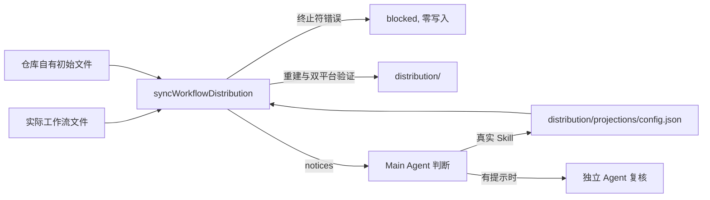

# 发布前同步改为单步命令

## Behavior

发布前同步把源码仓库实际工作流文件重建为 `distribution/`. Skill 在同步中逐字节复制, 引用写法只在安装时的平台投影中转换, 因此同步本身唯一与 Skill 引用相关的责任是: 确认投影能正确处理源码中的 `$name` 标记, 并把需要人判断的标记交给运行同步的 Main Agent. 原有的 `review`, `review --complete`, `prepare`, `apply --plan-digest` 四步协议为这一判断维护两份候选文件, 删除式校验, 两个哈希, `completed-review.json` 和 `planDigest`; 自首次提交以来两份候选列表一直为空. 用户 2026-10-31 决定改为一个命令.

### Command and phases

`node scripts/sync-workflow-distribution.mjs` 没有子命令; 带任何参数都是用法错误, 在 `stderr` 输出用法并退出 2, 不做任何 I/O. 合法调用在一个进程内依次执行:

1. 状态检查: `.agents/skills`, `AGENTS.md`, `docs/agents`, `docs/licenses/arw` 和 `distribution` 不得有未暂存, 未跟踪或被忽略的内容. 这样 Git 暂存区就是写入失败时的完整恢复基线. 不满足时 `blocked`, 零写入.
2. 读取与验证: 读取实际来源, `distribution/config.json`, `distribution/projections/config.json` (按原样读取, 同步不再写它) 和单独维护的仓库自有初始文件, 执行现有的受管理区域, Role, 许可证, 受保护路径冲突和初始文件检查. 阻断问题 `blocked`, 读取失败 `failed`, 都零写入.
3. 引用检查 (见下节): 有终止符错误时 `blocked`, 零写入; 未知身份只收集为提示.
4. 重建: 删除固定重建范围 (现有受保护路径不变, `distribution/projections/config.json` 仍受保护), 再从当前来源复制或转换全部生成内容.
5. 最终验证: 对重建后的 Workflow Distribution 分别执行 Codex 与 Claude Code 投影验证.

成功时 `stdout` 输出完成消息, 提示逐行写到 `stderr`, 退出 0. `blocked` 或 `failed` 时诊断写到 `stderr`, 退出 1. 第 4, 5 阶段的失败返回 `failed` 和准确 `stage`, 不做内部回滚; Main Agent 把 `distribution/` 恢复到暂存区字节, 删除本轮新增的未跟踪路径, 修正原因后重新运行命令. 第 1 至 3 阶段的失败只需修正输入后重跑.

### Reference check

引用检查只扫描分发 Skill 的 Markdown, 与现有分析范围相同. 已知身份是分发 Skill 身份与配置 `additionalSkillReferences` 的并集, 也就是安装投影会转换的身份集合.

- 已知身份后紧跟的字符不是封闭终止符 (ASCII 空格, 水平制表符, 换行或反引号), 例如 `$implement,`: 命令 `blocked`, 零写入, 一次列出全部此类位置的 `path:line:column` 和身份. Main Agent 修正源码文字 (通常补空格或反引号) 后重跑. 同步不再产生规范化候选. 这样投影不需要依赖逐位置配置补空格, 源码本身就是规范写法. 配置中现有 `skillReferenceNormalizations` 字段及其安装投影处理不变, 不升级配置版本 (与 `reviewEditor` 相同), 两者在下一次配置版本升级时一并退役; 同步不读取它作为放行依据, 字段非空时, 对应位置要么仍触发终止符错误, 要么因源码已修正而被投影验证报告为过期, 都在写入前 `blocked`.
- 身份既不是分发 Skill, 也不在 `additionalSkillReferences` 中的 `$name`, 不论后面是什么字符, 都作为提示输出, 不影响退出值. 分发内容保留原文 (Skill 逐字节复制, 安装投影对未知身份保持原文).

提示按路径, 行, 列排序, 每条一行: `notice skill-reference-unknown path=<path>:<line>:<column> identity=<identity>: <context>`, 其中 `path` 是仓库相对来源路径 (`.agents/skills/...`), `context` 是从标记起点开始的同一行前 80 个字符.

### Main Agent judgment

本节是提示处理程序的唯一权威, 长期文档中写在开发长期规格引用检查一节, 手册和 `upstream-sync` Skill 只引用它.

1. Main Agent 逐条判断提示. 是真实 Skill 引用时, 把身份加入 `distribution/projections/config.json` 的 `additionalSkillReferences` (保持排序, 去重), 暂存后重跑命令, 以确认该身份不再提示且没有新的终止符错误. 判断为不是 Skill 时不做任何持久记录.
2. 只有命令报告过至少一条提示时, Main Agent 在提交前按 `docs/agents/subagent-allocation.md` 另建一个独立 Agent 复核这些判断. 交给它的是提示原文, 每条的判断和理由, 以及配置差异; 复核意见按 `docs/agents/subagent-findings.md` 处理. 复核用的是平台原生的子 Agent 创建方式 (Codex 与 Claude Code 都由该分配文件覆盖), 不经过 `arw background-agent`, 因此两个平台行为一致. 判断已复核, 只因落实这些判断而重跑时不再复核; 重跑出现新的提示时, 新提示同样需要复核.
3. 没有提示时没有判断, 也没有复核步骤.

### Rationale

两份候选列表自首次提交起一直为空, 四步协议却要维护约 650 行非测试代码和每次同步四次调用. 合并为一个进程后, `prepare` 与 `apply` 之间的输入漂移不再存在, `planDigest` 的绑定失去对象. 终止符错误改为失败, 是因为修正源码只需一次, 而规范化候选需要每次重新判断并在配置中长期保存位置. 未知身份不阻断, 是因为阻断就要求保存 "不是 Skill" 的决定, 而现有规则明确不维护非 Skill 拒绝清单. 复核只在有提示时进行, 因为没有提示就没有需要复核的判断.

被拒绝的替代方案:

- 保留四步协议, 只删除编辑器之外的冗余: 主要成本 (候选文件, 删除式校验, 哈希交接, `planDigest`) 都服务于一个当前从不出现的判断.
- 保留规范化候选: 需要继续维护候选格式, 删除式校验和配置写入, 换来的只是不必改源码.
- 未知身份阻断直到判断: 需要持久化非 Skill 决定, 与现有规则冲突.
- 持久化非 Skill 决定以免重复提示: 多一份配置列表; 当前没有提示, 重复判断成本低.
- 每次同步都做独立复核: 没有提示时复核对象为空.
- 同步继续把引用决定写入 Projection 配置: 配置改为由 Main Agent 作为普通源码修改, 只有一个写入者.
- 在写入前重新核对输入摘要: 单一进程内读取到写入的间隔很短, 期间修改输入属于调用方失误, 且可由暂存区恢复.

接受的成本: 上游采用的 Skill 若含终止符错误, 需要本地改源码 (进入 Upstream Sync 的差异); 判断为非 Skill 的标记每次同步都会再次提示并触发复核; Main Agent 的误判进入普通 Git 提交, 由独立复核, 提交审核和用户复核 diff 发现, 恢复靠 Git.

## Module Design

### Modules

- Platform Adapter (`lib/arw-common/platform-adapter.mjs`): `analyzeSkillReferences` 的责任从 "产生两份审核候选" 改为 "按已知身份集合找出终止符错误与未知身份". 投影转换, `validateSkillReferenceProjection` 和 `skillReferenceNormalizations` 的安装处理不变.
- Workflow Distribution Sync Module (`lib/workflow-distribution/workflow-distribution-sync.mjs`): `prepareWorkflowDistributionReview`, `prepareWorkflowDistributionSync`, `applyWorkflowDistributionSync` 合并为一个 `syncWorkflowDistribution`. 删除审核结果消费, `planDigest`, `PLAN_BINDING`, 授权检查和 Projection 配置写入; 状态检查, 来源读取, 受保护路径, 重建和最终验证保持不变.
- 删除 `lib/workflow-distribution/skill-reference-review.mjs`.
- 入口 `scripts/sync-workflow-distribution.mjs`: 只拒绝参数, 调用 `syncWorkflowDistribution`, 渲染诊断与提示并映射退出值. 不再使用临时工作区或平台会话身份.

### Interfaces

- `analyzeSkillReferences({payload, projectionConfig})`: 载荷, 配置或 Skill 身份无效, Markdown 不是有效 UTF-8, 或存在已知身份的终止符错误时, 返回 `blocked` 与按路径, 行, 列排序的完整 `diagnostics`; 终止符错误的诊断码为 `skill-reference-terminator-invalid`, 携带 `path`, `line`, `column`, `identity`. 否则返回 `{status: 'succeeded', diagnostics: [], unknownReferences}`, 每项准确为 `{path, line, column, identity, context}`, `path` 为载荷路径 (`skills/...`), 同一身份的每次出现各占一项, 按路径, 行, 列排序.
- `syncWorkflowDistribution({repositoryRoot, buildDistribution?, createFilesystem?, stateAdapter?})`: 成功结果准确为 `{status: 'succeeded', diagnostics: [], notices}`, `notices` 是 `unknownReferences` 把路径改为仓库相对来源路径后的结果. 第 1 至 3 阶段的阻断返回 `blocked` 与完整 `diagnostics`, 读取失败返回 `failed`, `stage` 和 `diagnostics`, 都零写入. 引用检查通过后以原样配置调用 `validateSkillReferenceProjection`, 其阻断同样在写入前返回. 删除开始后的失败返回 `failed`, 准确 `stage` (`cleanup`, `source-read`, `source-transform`, `generated-write`, `final-validation`) 和 `diagnostics`. 原有 `projection-config-write` 阶段删除.
- CLI: 参数非空时退出 2 且不调用 `syncWorkflowDistribution`. 诊断每条一行 `<code> path=<path>[:<line>:<column>][ identity=<identity>]: <message>`, 提示格式见 Behavior. 退出值: `succeeded` 0, `blocked`/`failed` 1, 未预期异常 1.

### Seams and Adapters

不新增 Seam. 只读 Git 状态 Adapter (`createSourceCheckoutSyncStateAdapter`) 和公共文件系统不变. 运行同步的 Main Agent 不再是写入前的授权参与者, 只是提示的判断者; 运行时不消费任何外部审核结果或授权. 入口不再依赖临时工作区解析和平台会话身份.

### Dependencies and Data Flow

Projection 配置只有一个写入者 (Main Agent 的普通源码修改), 同步只读它. 依赖方向只减少: 入口不再依赖 `skill-reference-review.mjs`, 临时工作区和平台会话身份.

### Testing Decisions

测试通过生产 Interface 观察公开结果, 沿用现有临时仓库夹具.

- `analyzeSkillReferences`: 分发 Skill 与 `additionalSkillReferences` 身份后接非终止符时返回 `blocked`, 诊断列出每个位置; 四种终止符都通过; 未知身份 (后接终止符或非终止符) 成为带上下文的 `unknownReferences` 而不阻断. 防止已知身份的错误写法被静默放行, 或未知标记被误判为失败.
- `syncWorkflowDistribution`: 输入有未暂存或未跟踪内容时 `blocked` 且 `distribution/` 不变; 终止符错误时 `blocked` 且 `distribution/` 不变; 配置含过期 `skillReferenceNormalizations` 时写入前 `blocked`; 成功时生成范围被完整替换, 受保护路径保留, `distribution/projections/config.json` 字节不变; 有未知身份时仍成功重建并返回 `notices` (来源路径); 删除后写入失败与最终验证失败返回对应 `stage`. 防止零写入边界, 配置只读和提示路径的回归.
- CLI: 任何参数退出 2 且不调用同步; 成功退出 0 并在 `stderr` 输出提示行; `blocked` 退出 1 且诊断含 `path:line:column`. 防止旧子命令被继续接受和输出格式回归.
- 删除 `tests/workflow-distribution/skill-reference-review.test.mjs` 及其他只覆盖候选文件, 删除式校验, 哈希, `completed-review.json`, `planDigest` 与授权的用例.

### Module Design Rationale

引用分析留在 Platform Adapter, 因为终止符和已知身份集合与投影转换解释同一个格式. 三个同步函数合并, 因为拆分只为在步骤之间交接审核结果和用户授权, 这两者都已不存在; 合并后整个同步只有一个 Interface 和一个失败边界表. 保留写入前的 `validateSkillReferenceProjection`, 让仍然有效的配置字段在写入前而不是删除后被拒绝. 保留 `skillReferenceNormalizations` 字段而不立即删除, 是用户为避免配置版本变化所作的决定, 成本是一个暂时只用于安装投影的字段.

### ADR Evaluation

需要新 ADR (下一个编号 0036), 取代 [ADR-0034](../../docs/adr/0034-let-the-main-agent-complete-distribution-sync-review.md): 发布前同步不再有写入前的审核或授权步骤, 由一次命令在验证通过后直接写入; Main Agent 只判断未知身份提示, 且只在有提示时经独立 Agent 复核; 同步不再写 Projection 配置. ADR-0034 改为只说明被 0036 取代; [ADR-0026](../../docs/adr/0026-use-source-checkout-workflow-files-as-distribution-authority.md) Decision 中的指向改为 0036. 持久格式, 信任根和分发边界不变.
