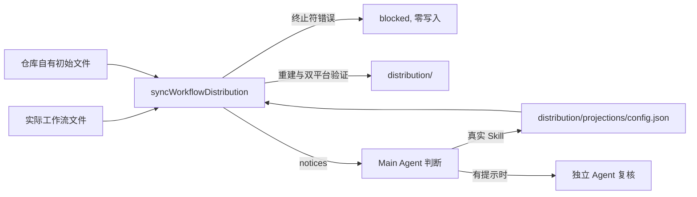

# 发布前同步改为单步命令

## Behavior

发布前同步把源码仓库实际工作流文件重建为 `distribution/`. Skill 在同步中逐字节复制, 引用写法只在安装时的平台投影中转换, 因此同步本身唯一与 Skill 引用相关的责任是: 确认投影能正确处理源码中的 `$name` 标记, 并把需要判断的标记交给运行同步的 Main Agent. 原有的 `review`, `review --complete`, `prepare`, `apply --plan-digest` 四步协议为这一判断维护两份候选文件, 删除式校验, 两个哈希, `completed-review.json` 和 `planDigest`; 自首次提交以来两份候选列表一直为空. 用户 2026-10-31 决定改为一个命令.

### Command and phases

`node scripts/sync-workflow-distribution.mjs` 没有子命令; 带任何参数都是用法错误, 在 `stderr` 输出用法并退出 2, 不做任何 I/O. 合法调用在一个进程内依次执行:

1. 状态检查: `.agents/skills`, `AGENTS.md`, `docs/agents`, `docs/licenses/arw` 和 `distribution` 不得有未暂存, 未跟踪或被忽略的内容. 这样 Git 暂存区就是写入失败时的完整恢复基线. 不满足时 `blocked`, 零写入.
2. 读取与验证: 读取实际来源的全部字节, `distribution/config.json`, `distribution/projections/config.json` (按原样读取, 同步不写它) 和单独维护的仓库自有初始文件, 执行现有的受管理区域, Role, 许可证, 受保护路径冲突和初始文件检查. 阻断问题 `blocked`, 零写入.
3. 引用检查 (见下节): 有终止符错误时 `blocked`, 零写入; 未知身份只收集为提示.
4. 重建: 删除固定重建范围 (现有受保护路径不变, `distribution/projections/config.json` 仍受保护), 再把第 2 阶段读到并转换好的字节写入生成目标. 不在删除后重新读取来源, 所以写入的正是已检查的字节.
5. 最终验证: 对重建后的 Workflow Distribution 分别执行 Codex 与 Claude Code 投影验证.

成功时 `stdout` 输出完成消息, 提示逐行写到 `stderr`, 退出 0. `blocked` 或 `failed` 时诊断写到 `stderr`, 退出 1.

失败边界:

| 失败位置 | 结果与状态 |
| --- | --- |
| 第 1 至 3 阶段的阻断问题 | `blocked`, 零写入; 修正输入后重跑. |
| 第 1, 2 阶段的读取失败 | `failed`, 零写入; `stage` 取封闭值: `root-observation`, `root-resolution` (仓库根观察与规范解析, 沿用 Filesystem Module 的取值), `git-state` (Git 状态读取), `source-enumeration` (列举来源), `source-read` (读取来源文件或配置), `distribution-enumeration` (列举现有生成范围), 不透传 Filesystem Module 的其他内部阶段; 排除原因后重跑. |
| 第 4 阶段删除失败 | `failed`, `stage: "cleanup"`. |
| 第 4 阶段写入失败 | `failed`, `stage: "generated-write"`. |
| 第 5 阶段验证失败 | `failed`, `stage: "final-validation"`. |

删除开始后的失败不做内部回滚; Main Agent 把 `distribution/` 恢复到暂存区字节, 删除本轮新增的未跟踪路径, 排除原因后重跑. 删除后不再重读和转换来源, 原有删除后的 `source-transform` 与 `projection-config-write` 阶段不再存在; `source-read` 只表示删除前的来源读取.

### Reference check

引用检查只扫描分发 Skill 的 Markdown, 与现有分析范围相同. 已知身份是分发 Skill 身份与配置 `additionalSkillReferences` 的并集, 也就是安装投影会转换的身份集合.

标记边界沿用现有身份语法 (身份只由小写 ASCII 字母组成的非空段和段间单个连字符构成): `$` 之后取最长的连续 `[a-z-]` 串作为候选身份. 候选不符合身份语法 (空串, 首尾连字符或连续连字符) 时, 该处不是引用, 不产生诊断也不产生提示; 否则由候选之后的第一个字符判断终止符. 例如 `$implement-` 与 `$implement--review` 不是引用; `$implement-x` 是身份 `implement-x`; `$implement2` 与 `$implement,` 是身份 `implement` 后接非终止符.

- 已知身份后紧跟的字符不是封闭终止符 (ASCII 空格, 水平制表符, 换行或反引号; 文件末尾不是终止符): 命令 `blocked`, 零写入, 一次列出全部此类位置的 `path:line:column` 和身份. Main Agent 修正源码文字 (通常补空格或反引号) 后重跑. 同步不再产生规范化候选, 源码本身就是规范写法.
- 身份既不是分发 Skill, 也不在 `additionalSkillReferences` 中的 `$name`, 不论后面是什么字符, 都作为提示输出, 不影响退出值. 分发内容保留原文 (Skill 逐字节复制, 安装投影对未知身份保持原文).

提示按路径, 行, 列排序, 每条一行: `notice skill-reference-unknown path=<path>:<line>:<column> identity=<identity>: <context>`, 其中 `path` 是仓库相对来源路径 (`.agents/skills/...`), `context` 是从标记起点开始的同一行前 80 个字符.

### Removal of skillReferenceNormalizations

`skillReferenceNormalizations` 字段及其安装投影处理在本 effort 中删除. 理由: 该字段位于 `distribution/projections/config.json`, 这份配置没有版本字段, 与读取它的代码在同一 Git 修订中一起发布和安装; 安装目录同时携带代码和 Workflow Distribution, 目标仓库不保存 Projection 配置副本, 因此不存在旧代码读取新配置或新代码读取旧配置的情形, 删除不需要兼容期. 同步不再产生该字段的内容后, 它没有写入者, 保留只会留下一条安装时补空格的分支和配置校验. 删除后 `skills` 只含 `root` 和 `additionalSkillReferences`; 投影对后接非终止符的已知身份保持原文 (同步已保证分发中不存在这种位置). 全局 Engine 配置的 `reviewEditor` 属于有版本的配置, 保持不变.

### Main Agent judgment

本节是提示处理程序的唯一权威, 长期文档中写在开发长期规格引用检查一节, 手册和 `upstream-sync` Skill 只引用它.

1. Main Agent 逐条判断提示. 是真实 Skill 引用时, 把身份加入 `distribution/projections/config.json` 的 `additionalSkillReferences` (保持排序, 去重), 暂存后重跑命令, 以确认该身份不再提示且没有新的终止符错误. 判断为不是 Skill 时不做任何持久记录.
2. 只有命令报告过至少一条提示时, Main Agent 在提交前按 `docs/agents/subagent-allocation.md` 另建一个独立 Agent 复核这些判断. 交给它的是提示原文, 每条的判断和理由, 以及配置差异; 复核意见按 `docs/agents/subagent-findings.md` 处理. 复核用平台原生的子 Agent 创建方式 (Codex 与 Claude Code 都由该分配文件覆盖), 不经过 `arw background-agent`, 因此两个平台行为一致. 只因落实已复核的判断而重跑时不再复核; 重跑出现新的提示时, 新提示同样需要复核.
3. 没有提示时没有判断, 也没有复核步骤.

### Rationale

两份候选列表自首次提交起一直为空, 四步协议却要维护约 650 行非测试代码和每次同步四次调用. 合并为一个进程后, `prepare` 与 `apply` 之间的输入漂移不再存在, `planDigest` 的绑定失去对象; 写入第 2 阶段已检查的字节, 也消除了删除后重读来源的变化窗口. 终止符错误改为失败, 是因为修正源码只需一次, 而规范化候选需要每次判断并在配置中长期保存位置. 未知身份不阻断, 是因为阻断就要求保存 "不是 Skill" 的决定, 而现有规则明确不维护非 Skill 拒绝清单. 复核只在有提示时进行, 因为没有提示就没有需要复核的判断.

被拒绝的替代方案:

- 保留四步协议, 只删除编辑器之外的冗余: 主要成本 (候选文件, 删除式校验, 哈希交接, `planDigest`) 都服务于一个当前从不出现的判断.
- 保留规范化候选或保留 `skillReferenceNormalizations` 字段: 前者要继续维护候选格式, 删除式校验和配置写入; 后者留下没有写入者的字段, 且该配置没有版本可以作为日后退役的时点.
- 未知身份阻断直到判断: 需要持久化非 Skill 决定, 与现有规则冲突.
- 持久化非 Skill 决定以免重复提示: 多一份配置列表; 当前没有提示, 重复判断成本低.
- 每次同步都做独立复核: 没有提示时复核对象为空.
- 同步继续写 Projection 配置: 配置改为由 Main Agent 作为普通源码修改, 只有一个写入者.
- 写入前重新核对输入摘要: 单一进程写入的是已检查的字节, 状态检查与写入之间修改 `distribution/` 属于调用方失误, 可由暂存区恢复.

接受的成本: 上游采用的 Skill 若含终止符错误, 需要本地改源码 (进入 Upstream Sync 的差异); 不符合身份语法的 `$` 串 (如 `$implement-`) 静默保持原文, 与现有分析相同; 判断为非 Skill 的标记每次同步都会再次提示并触发复核; Main Agent 的误判进入普通 Git 提交, 由独立复核, 提交审核和用户复核 diff 发现, 恢复靠 Git.

## Module Design

### Modules

- Platform Adapter (`lib/arw-common/platform-adapter.mjs`): `analyzeSkillReferences` 的责任从 "产生两份审核候选" 改为 "按已知身份集合找出终止符错误与未知身份". Projection 配置校验去掉 `skillReferenceNormalizations`; 投影转换去掉按配置补空格的分支和过期记录检查; 删除只服务于同步的 `validateSkillReferenceProjection` (字段删除后它只剩 `analyzeSkillReferences` 已覆盖的检查).
- Workflow Distribution Sync Module (`lib/workflow-distribution/workflow-distribution-sync.mjs`): `prepareWorkflowDistributionReview`, `prepareWorkflowDistributionSync`, `applyWorkflowDistributionSync` 合并为一个 `syncWorkflowDistribution`. 删除审核结果消费, `planDigest`, `PLAN_BINDING`, 授权检查, Projection 配置写入和删除后的来源重读; 状态检查, 来源读取与验证, 受保护路径, 重建和最终验证保持不变.
- 删除 `lib/workflow-distribution/skill-reference-review.mjs`.
- 入口 `scripts/sync-workflow-distribution.mjs`: 只拒绝参数, 调用 `syncWorkflowDistribution`, 渲染诊断与提示并映射退出值. 不再使用临时工作区或平台会话身份.

### Interfaces

- `analyzeSkillReferences({payload, projectionConfig})`: 载荷条目无效 (`projection-payload-invalid`), 配置无效 (`validateProjectionConfig` 的诊断), Skill 目录身份无效 (`skill-identity-invalid`), Markdown 不是有效 UTF-8 (`skill-markdown-invalid-utf8`), 或存在已知身份的终止符错误时, 返回 `blocked` 与稳定排序的完整 `diagnostics`; 终止符错误的诊断码为 `skill-reference-terminator-invalid`, 携带 `path`, `line`, `column`, `identity`. 否则返回 `{status: 'succeeded', diagnostics: [], unknownReferences}`, 每项准确为 `{path, line, column, identity, context}`, `path` 为载荷路径 (`skills/...`), 同一身份的每次出现各占一项, 按路径, 行, 列排序.
- `validateProjectionConfig`: `skills` 的准确键改为 `root` 与 `additionalSkillReferences`; 含 `skillReferenceNormalizations` 的配置以 `projection-skills-invalid` 阻断.
- `adapter.evaluate(intent)`: 签名和结果形状不变; 后接非终止符的已知身份保持原文, 不再产生 `skill-reference-normalization-stale` 或 `skill-reference-unresolved`.
- `syncWorkflowDistribution({repositoryRoot, buildDistribution?, createFilesystem?, stateAdapter?})`: 成功结果准确为 `{status: 'succeeded', diagnostics: [], notices}`, `notices` 是 `unknownReferences` 把路径改为仓库相对来源路径后的结果. 非成功结果与 `stage` 见 Behavior 的失败边界表.
- CLI: 参数非空时退出 2 且不调用 `syncWorkflowDistribution`. 诊断每条一行 `<code> path=<path>[:<line>:<column>][ identity=<identity>]: <message>`, 提示格式见 Behavior. 退出值: `succeeded` 0, `blocked`/`failed` 1, 未预期异常 1.

### Seams and Adapters

不新增 Seam. 只读 Git 状态 Adapter (`createSourceCheckoutSyncStateAdapter`) 和公共文件系统不变, 测试继续通过它们注入状态与 I/O 失败. 运行同步的 Main Agent 不再是写入前的授权参与者, 只是提示的判断者; 运行时不消费任何外部审核结果或授权. 入口不再依赖临时工作区解析和平台会话身份.

### Dependencies and Data Flow

Projection 配置只有一个写入者 (Main Agent 的普通源码修改), 同步只读它. 依赖方向只减少: 入口不再依赖 `skill-reference-review.mjs`, 临时工作区和平台会话身份.

### Testing Decisions

测试通过生产 Interface 观察公开结果, 沿用现有临时仓库夹具和注入的状态 Adapter 与文件系统.

- `analyzeSkillReferences`: 分发 Skill 与 `additionalSkillReferences` 身份后接非终止符 (含文件末尾) 时返回 `blocked`, 诊断列出每个位置; 四种终止符都通过; 未知身份 (后接终止符或非终止符) 成为带上下文的 `unknownReferences`; `$implement-`, `$implement--review` 既不阻断也不提示, `$implement2` 阻断. 无效载荷条目, 无效配置, 无效 Skill 目录身份和非 UTF-8 Markdown 各返回对应诊断码的 `blocked`. 防止已知身份的错误写法被静默放行, 未知标记被误判为失败, 以及边界解析不唯一.
- Projection 配置与投影: 含 `skillReferenceNormalizations` 的配置被拒绝; 后接非终止符的已知身份在投影中保持原文. 删除只覆盖规范化配置, 补空格和过期记录的用例.
- `syncWorkflowDistribution`: 输入有未暂存或未跟踪内容时 `blocked` 且 `distribution/` 不变; Git 状态读取失败返回 `stage: "git-state"`, 注入的根观察与根解析失败分别返回 `root-observation` 与 `root-resolution`, 注入的来源列举, 来源读取和生成范围列举失败分别返回 `source-enumeration`, `source-read`, `distribution-enumeration`, 两者 `distribution/` 都不变; 终止符错误时 `blocked` 且 `distribution/` 不变; 成功时生成范围被完整替换, 受保护路径保留, `distribution/projections/config.json` 字节不变; 有未知身份时仍成功重建并返回来源路径的 `notices`; 注入的删除失败返回 `cleanup`, 写入失败返回 `generated-write`, 最终验证失败返回 `final-validation`. 防止零写入边界, 配置只读, 提示路径和失败阶段的回归. 不再有删除后的来源读取与转换, 因此删除后的读取与 `source-transform` 阶段不需要测试.
- CLI: 任何参数退出 2 且不调用同步; 成功退出 0 并在 `stderr` 输出提示行; `blocked` 退出 1 且诊断含 `path:line:column`. 防止旧子命令被继续接受和输出格式回归.
- 删除 `tests/workflow-distribution/skill-reference-review.test.mjs` 及其他只覆盖候选文件, 删除式校验, 哈希, `completed-review.json`, `planDigest`, 授权和 Projection 配置写入的用例.

### Module Design Rationale

引用分析留在 Platform Adapter, 因为终止符, 身份语法和已知身份集合与投影转换解释同一个格式. 三个同步函数合并, 因为拆分只为在步骤之间交接审核结果和用户授权, 这两者都已不存在; 合并后整个同步只有一个 Interface 和一张失败边界表. 写入第 2 阶段读到的字节而不是删除后重读, 让写入内容与检查对象一致, 并去掉两个失败阶段. `skillReferenceNormalizations` 的删除理由见 Behavior; 接受的成本是本 effort 同时修改 Platform Adapter 的安装投影路径, 由投影测试覆盖.

### ADR Evaluation

需要新 ADR (下一个编号 0036), 取代 [ADR-0034](../../docs/adr/0034-let-the-main-agent-complete-distribution-sync-review.md). ADR 0036 的决定: 发布前同步由一次命令在双平台验证通过后直接写入 Workflow Distribution, 没有写入前的审核或授权步骤; 写入结果经普通 Git 提交审核和用户复核 diff; Main Agent 只判断未知身份提示, 且只在有提示时经独立 Agent 复核; 已知身份的终止符错误使同步失败, 不再有规范化位置; 同步不写 Projection 配置, `skillReferenceNormalizations` 删除. 持久格式只减少一个无版本配置字段, 信任根和分发边界不变.

- ADR-0034 改为只说明被 ADR 0036 完全取代并链接它.
- [ADR-0026](../../docs/adr/0026-use-source-checkout-workflow-files-as-distribution-authority.md) Decision 中 "这套完整安装载荷经审核并授权写入后" 的实质由 ADR 0036 取代: 改为载荷由发布前同步验证后写入, 经普通 Git 提交审核后才由发布消费, 括注指向 ADR 0036. ADR-0026 的其余决定 (实际文件权威, 派生, 精简配置) 不变.
- [ADR-0015](../../docs/adr/0015-use-versioned-skill-package-grammars.md) 中把职责归于引用审核的三处 (Decision 中 "经过解析和必要审核的 Markdown Skill 引用" 与 "无法确定的引用由用户审核", Rejected alternatives 中 "当前引用审核负责确定范围外的真实引用和需要规范化的位置") 由 ADR 0036 取代: 范围外的真实引用由 Main Agent 依据同步提示判断并写入 `additionalSkillReferences`, 规范化位置不再存在, 引用写法错误由同步拒绝后修正源码. 这三处改为陈述该结果并指向 ADR 0036; ADR-0015 的其他决定不变.
