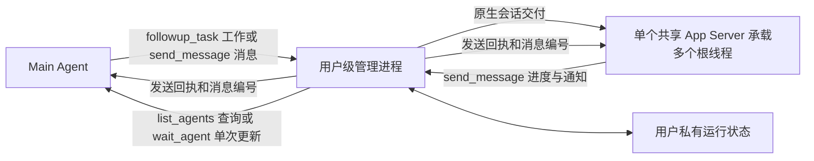

# 使用当前用户共享的后台 Agent 管理进程

状态: [ADR 0032](0032-run-claude-reviewers-through-headless-claude.md) 修订了本决定只管理 Codex App Server 的范围: 管理进程也通过 Claude 后端运行 Claude Reviewer. 共享 App Server, 模型目录和 Strata 的决定只适用于 Codex 后端.

多个仓库和与用户沟通的 Main Agent 可能同时启动后台 Agent. ARW 使用当前用户范围内单个不调用模型的常驻进程, 统一管理至多一个 ARW 专用共享 App Server 中的多个独立根线程, 不接管用户前台 Codex CLI 的 App Server. 管理进程首次需要后台服务时自动启动, 空闲与客户端断开后继续驻留, 正常运行至关机, 安装维护, 明确终止或故障另行处理. 最后一个根线程卸载且相关工具退出后, 共享 App Server 等待连续 60 秒无后台根线程或已接受待启动任务才关闭; 新任务取消关闭并复用, 维护可立即关闭. 它通过所有受支持系统上的本机回环 TCP 与机器入口连接, 并以当前用户私密凭据鉴权. 如果每个调用方自行管理进程, 容量, 会话恢复和安装维护责任就会分散, 跨调用方协调更复杂; 统一的本机回环 TCP 连接减少不同操作系统之间通信实现和维护的差异. 安装, 更新和卸载由操作进程先取得独立的固定本机回环维护端口, 再关闭管理进程; 正常管理进程启动也持有该端口直到启动完成. 操作进程持续持有该端口直到退出, 由操作系统释放互斥, 不留下需要人工清理的交接标记.

通用后台进程负责连接, 按已加载根线程计的容量, 恢复和共享 App Server 生命周期; Reviewer 专属规则继续负责四个审核角色, 单 Agent 审核及绑定报告. 管理进程崩溃后, 单靠已关闭的 `stdio` 连接或可能复用的 PID 不能证明旧共享进程已退出, 因此私有状态用独立于批量消息保存的 PID 与操作系统进程创建时间辨认原来那次启动; 身份仍活动或无法核对时拒绝启动第二个共享进程. 统一管理接受私有共享状态, 低资源占用要求和安装, 更新, 卸载时与活动任务协调的成本. 准确控制行为由 [产品后台 Agent 规则](../specs/agent-repository-workflow/spec.md#background-agent-control) 拥有, 配置, 私有状态与安装生命周期由 [安装管理规则](../specs/agent-repository-workflow-installation/spec.md#background-agent-management) 拥有.

共享 App Server 的模型管理器由进程启动配置建立, 各根线程不能独立替换模型目录. ARW 因此在启动前把 Codex 原生缓存与用户自定义模型记录合并为一份私有目录, 使 GPT 描述继续随原生缓存更新, 用户不必在自定义文件中手工维护副本. 进程存活期间目录保持不变, 实际退出后清理; 准确来源, 失败和安装归属由[安装共享模型目录规则](../specs/agent-repository-workflow-installation/spec.md#shared-model-catalog)拥有.

Strata 的独占 bearer key 跨同一提供方的多个根线程, 由用户级管理进程持有并在当前用户私有 SQLite 中保存未确认归还的 key 与控制器地址. 管理进程先确认共享 App Server 成功启动再领取新 key; 正常关闭时先确认相关根线程与工具卸载并归还持有 key, 再关闭共享进程. 单根线程或原生 Adapter 分别持有会使归还边界与共享进程关闭不一致, 复制到 Agent 恢复设置则扩大凭据分布. 意外退出保留进程身份和未确认归还事实, 下一次需启动时先核对旧进程再处理原 key, 避免仅凭进程退出抹去仍待归还的独占权. 此决定接受私有状态保存 bearer key 的暴露面, 以及领取回复和本地即时保存之间崩溃时无法自动找回 key 的限制. 准确生命周期由[产品提供方规则](../specs/agent-repository-workflow/spec.md#capacity-and-recovery)和[持久状态规则](../specs/agent-repository-workflow/spec.md#background-agent-state)拥有.

模型提供方的专用运行策略由程序消费通用原生事实和 Reviewer 调用层绑定的用途执行, 不交给 Agent 识别或转发, 不增加管理模型. 通用运行层保持准确线程与回合路由, 时间观察, 消息和占用保护, Reviewer 专属层继续判断公共角色状态及绑定报告交付; 提供方策略不拥有报告语义或评分. 当前任务恢复事实沿同一 Agent 状态和消息记录保存, 不增加消息队列或原始事件历史. 这种分工使 Main 断开后仍可推进原任务, 又不把 Reviewer 业务塞入通用管理层. Strata 分支的准确参数, 压缩, 工作策略与测量时限只由 [Strata 专用规则](../specs/agent-repository-workflow/strata.md)拥有, 实际使用该驱动时才读取; 公共 Reviewer 不加载这些程序规则, 避免其他模型的审核上下文承担无关细节.

审核任务保留原始墙钟与原任务起点, 需要模型运行预算或任务平均速度时共用 [模型工作计量](../specs/agent-repository-workflow/spec.md#model-work-time), 不让提供方时限和展示分别维护时钟. 同一计量记录保存恢复所需的停机与休眠的合并扣除值及必要观测, 边界不完整时使用明确标记并有依据的估算, 避免把控制端断开误认为模型停机, 或因一次失败调用没有结束时间就丢失整体计量. 工作耗时与原始墙钟分开, 正常工具执行和主动等待仍是工作开销, 重叠的不工作原因不重复扣除. 这一选择接受估算精度的限制, 仍要求原身份和任务连续性可靠, 不用计量估算掩盖不可恢复的运行.

模型阶段速度使用正常审核已有事件作配对估算, 不配置遥测接收或导出, 不增加采集初始化, 网络开销, 模型调用, token 或费用. 这一选择接受阶段计时的精度和覆盖限制, 以减少为了测速维护的机制. 同一模型配置统一汇总有效配对样本, 来源和精度只用于说明估算及覆盖. 无法可靠配对时保留未知及原因, 不影响合法审核. 准确计量与速度口径仅由 [模型阶段计量合同](../specs/agent-repository-workflow/spec.md#model-phase-measurement)拥有, 不把这些程序细节加入 Reviewer 提示或建立第二份任务时钟.

管理进程也是 Main Agent 与后台 Agent 之间唯一的自定义消息中介; 单个专用共享 App Server 以不同根线程承载后台 Agent 的原生会话, Reviewer 专用运行器不另存进度队列, 客户端也不维护第二份发件箱. 双方通过同一 ARW 命令的 `send_message` 主动发送消息, 管理进程先在内存登记并回送它创建的稳定 `messageId`, 再异步分发正文. 统一的发送方式使后台 Agent 也能从自己的原生工具结果取得回执, 无需把普通聊天输出转换成另一套消息来源. 管理进程使用 Node.js 内置 SQLite 的同一数据库分别保存 Agent 和消息, 把内存变更按配置间隔批量写入, 避免第三方运行时依赖和每条原生事件重写完整状态. 消息是否成功分发与发送方是否收到回执分别表示; 首次成功分发后的正文短期保留供查询, 不把模型消费或普通原生会话文件读取作为通信前提. 保存失败时已接受工作继续, 新任务和消息暂停准入至待存记录成功提交, 恢复不完整明确报告, 实际容量和归属仍须核对. 准确交付, 查询, 保留期限和表关系由 [产品后台 Agent 通信规则](../specs/agent-repository-workflow/spec.md#background-agent-communication) 与 [持久状态规则](../specs/agent-repository-workflow/spec.md#background-agent-state) 拥有.

用户级共享管理不意味着多个 Main 可以接管同一任务. 每个后台 Agent 固定绑定一个启动方 Main 会话, 管理进程集中核对其操作权, 其他会话只能查询. 这个边界避免不同会话把指示交付给不属于自己的工作; 断线和环境恢复保持原归属, 实际关闭继续由管理进程负责. 列表提供全用户运行概览, 不扩展任务控制权.
