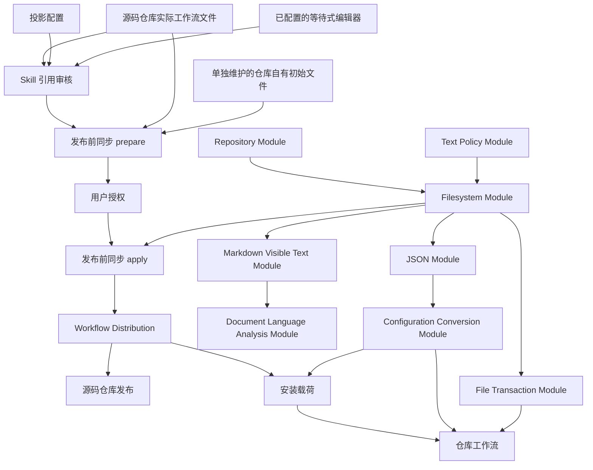

# Agent Repository Workflow 开发长期规格

## Terms introduced in this document

- **Markdown Visible Text Module**: 把 Markdown 解析为带来源位置和标题或正文分类的可见自然语言文本流的公共能力.
- **Document Language Analysis Module**: 对已经解析的 Markdown 正文文本流进行确定性 Unicode 字符分类, 加权和舍入的公共能力.

## Scope

本文定义 ARW 源码仓库的开发布局, 共享工作流内容的唯一编写来源, Workflow Distribution 与平台投影, Skill 引用审核, 发布前同步, 以及这些行为共同使用的公共 Module. 用户在目标仓库中使用 ARW 的行为由 [Agent Repository Workflow 长期规格](../agent-repository-workflow/spec.md) 拥有. ARW 安装目录由 [安装长期规格](../agent-repository-workflow-installation/spec.md) 拥有. Upstream Sync 是维护者显式调用的源码仓库专用 [`upstream-sync` Skill](../../../.agents/skills/upstream-sync/SKILL.md). 发布候选, 归档, VM, 标签, 外部写入授权和发布恢复由 [源码仓库发布长期规格](../agent-repository-workflow-release/spec.md) 拥有.

本文不要求日常开发中的 `distribution/` 与实际工作流文件实时一致. 源码仓库发布只消费已经完成发布前同步并经过审核的候选, 不重新决定共享工作流内容.

ARW 源码仓库不作为自身 Workflow Distribution 的目标仓库. Repository Workflow 面向采用已安装载荷的其他目标仓库, 不初始化, 更新, 验证或移除源码仓库的实际编写来源, 也不为这些来源保存目标仓库的 Managed Content 状态.

## Source Checkout layout

用户从克隆的源码仓库直接运行的 `arw.mjs`, `arw`, `arw.cmd`, `install.mjs` 和 `uninstall.mjs` 位于仓库根目录. 源码仓库维护入口和可单独下载的引导安装脚本作为 `scripts/` 的直接子项保持扁平布局. 薄入口只解析参数, 连接输入输出并映射退出值, 不因加载实现文件而执行命令.

不直接执行的运行时实现和只服务源码仓库的实现位于 `lib/`. 与 ARW 无关的通用公共能力位于 `lib/common/`. 依赖 ARW 语义且由多个具体业务范围复用的公共能力位于 `lib/arw-common/`. 具体业务实现位于以其长期责任命名的 `lib/<responsibility>/` 子目录. `lib/` 第一层只保留连接多个业务范围的顶层实现. 具体业务实现可以依赖 `lib/arw-common/` 和 `lib/common/`; `lib/arw-common/` 可以依赖 `lib/common/`, 但不依赖具体业务实现; `lib/common/` 不依赖 ARW 语义或其他 `lib/` 实现. 目录不自动增加另一层 Module Interface, 转发文件或 `index.mjs` 聚合入口.

`tests/` 按生产实现的长期责任对应 `lib/` 分组, 测试专用辅助程序和测试夹具独立保存. 根级测试只覆盖根级连接实现和跨责任不变量. 测试文件名表达当前长期责任或行为, 不使用 issue 身份, 日期, 临时状态或已经结束的一次性迁移含义; 可执行测试文件使用 `.test.mjs`.

通用后台 Agent 运行与跨调用方 App Server 管理是独立的正式 `lib/` 责任子目录, 只保留一份运行源码, 对应测试放在 `tests/` 的同责任目录. 该责任目录使用 Node.js 内置 SQLite 保存后台消息状态, 不让客户端或 Reviewer 专属运行层维护第二份消息存储. Reviewer 专属的角色选择, 单 Agent 审核, 绑定报告和结果消费可以保留在独立的 `lib/reviewer-runtime/` 责任目录, 经通用后台 Agent Interface 使用原生会话, 不使通用运行模块硬编码 Reviewer 的角色或报告规则. 通用控制行为由 [产品后台 Agent 规则](../agent-repository-workflow/spec.md#background-agent-control) 拥有, 安装配置与共享状态由 [安装管理规则](../agent-repository-workflow-installation/spec.md#background-agent-management) 拥有; 本文只规定源码责任与测试对应关系.

项目使用原生 JavaScript, ES Modules, Node.js 内置 Module 和 `node:test`, 不使用 `src/` 或 `.ts` 源码. `.mjs` 是唯一项目源码权威. 产品没有第三方运行时依赖. 源码仓库使用 pnpm 11 管理 TypeScript 和 Node.js 24 类型声明这两项开发依赖, 并通过 `allowJs`, `checkJs`, `noEmit` 和完整 `strict` 检查全部受 Git 管理的 `.mjs`. Node.js 24 是最低运行版本.

源码仓库的产品版本只来自根 `package.json.version`. 与当前代码和配置由同一 Git 修订版本绑定的数据不重复保存自己的结构版本, 语法配置版本或 Workflow Distribution 版本, 除非它确实承担读取旧格式或跨版本升级的兼容责任.

## Authoring authority

源码仓库实际使用的以下内容是共享工作流字节的唯一编写来源:

- `.agents/skills/`;
- 根 `AGENTS.md` 的 ARW 受管理区域;
- `docs/agents/*.md` 的 ARW 受管理区域;
- `docs/agents/roles/<role-name>.md`, 以及由该规范 Role 拥有并按需引用的 `docs/agents/roles/<role-name>/<document-name>.md`;
- 与每个上游来源身份准确对应的 `docs/licenses/arw/LICENSE.<source-id>`.

普通开发直接修改这些位置. `distribution/` 是发布前同步派生并由用户审核的安装载荷, 不是日常编写来源. `docs/licenses/arw/` 中不匹配 `LICENSE.<source-id>` 的其他直接文件不是 Workflow Distribution 的实际许可证来源, 也不因位于该目录而自动进入载荷. Upstream Sync 只更新 `.agents/skills/`, 映射的许可证目标和自己的来源配置与采用记录. 安装, 仓库工作流和源码仓库发布都不反向修改实际来源.

仅供 Source Checkout 使用的 `$reviewer-capability` Skill 不属于共享工作流载荷, 发布前同步不把它写入 Workflow Distribution, 安装和平台投射不把它带入目标仓库. 它的操作规则由该 Skill 单独拥有, 本文只拥有源码限定的分发边界, 不复制能力测试流程.

Code Map 是否适用于目标仓库由 Repository Profile 决定, 不通过是否分发 `code-maps` Skill 来表达.

`.arwignore` 是仓库自有初始文件, 不从源码仓库当前实际配置复制. 维护者需要改变该初始文件时, 必须直接修改 Workflow Distribution 中对应的来源.

## Workflow Distribution

### Layout

Workflow Distribution 使用以下固定布局:

- `distribution/baseline/` 直接保存目标仓库相对树, 不使用 `universal/` 或 `conditional/` 分类;
- `distribution/skills/<skill-name>/` 直接保存扁平 Skill Package, 不使用人工类别层;
- `distribution/baseline/docs/agents/roles/<role-name>.md` 保存规范 Role, 可选同名子目录保存该 Role 按需引用的 Markdown 文档;
- `distribution/projections/codex/config.toml` 保存单独维护的 Codex 仓库配置默认内容;
- `distribution/config.json` 保存 Workflow Distribution 特有的少量可调整规则;
- `distribution/projections/config.json` 保存统一格式到支持平台的投影配置.

Workflow Distribution 不使用 `distribution/manifest.json`, 平台专用投影 JSON, 带版本号的语法配置, `distribution/checks/`, `distribution/legal/` 或 `distribution/provenance/`. 它也不保存逐文件清单, 文件 Role, 类别, 处置方式, 调用元数据, 来源证据 URL, 检查日期, 摘要证据, 来源信息清单或由目录结构和代码已经确定的事实.

Workflow Distribution Module 递归枚举固定安全树. 每个安全普通文件自动成为载荷. 符号链接, 目录联接, 非常规文件, 不安全相对路径, 大小写冲突, 越界解析和无法完整枚举的树关闭式失败. 枚举顺序必须稳定, 但文件进入载荷不依赖额外登记.

### Workflow Distribution configuration

`distribution/config.json` 使用以下封闭结构:

```json
{
  "repositoryOwnedSeeds": [
    ".arwignore"
  ]
}
```

`repositoryOwnedSeeds` 只接受精确文件或目标目录根, 不接受 `glob`. 目录只约束 ARW 投影的目标, 不取得目录中其他文件的归属.

规范 Role 文件保留扁平身份布局, 同名子目录只保存该 Role 按需引用的安全普通 Markdown 文档, 不建立另一份 Role 身份. Claude Code 的静态 Skill 与 `CLAUDE.md` 投射继续按安装和更新生命周期处理, 原生 Reviewer 执行暂停. 运行支持范围与共享入口的实际上下文核对由[产品 Reviewer 工作流](../agent-repository-workflow/spec.md#reviewer-workflow)拥有, 不能用静态投射代替运行证据或豁免审核关卡.

### Projection configuration

`distribution/projections/config.json` 只负责把统一格式数据映射到多个平台. 顶层只使用 `source`, `skills` 和 `platforms`.

`source` 固定为 `codex`, 表示统一 Skill 来源使用 Codex 格式规则. `skills` 保存固定来源根目录, `additionalSkillReferences` 和 `skillReferenceNormalizations`. `platforms` 的键是 `codex` 和 `claude-code`. 每个平台只使用 `supportedVersionRange`, `format` 和 `targets`. `format` 保存 Skill 引用写法, `targets` 保存 Skill 的仓库相对目标根. Codex 的 `targets.configuration` 必须准确为 `.codex/config.toml`, 默认字节来自 `projections/codex/config.toml`; Claude Code 不声明该字段.

每个平台的 `supportedVersionRange` 是信息性的非空 SemVer 范围表达式. 当前范围值只保存在 `distribution/projections/config.json`. ARW 不解析这些范围, 不探测本机 Agent CLI 版本, 也不在发布前同步, 源码仓库发布, 安装或仓库工作流时检查它们.

投影模板使用 `${name}` 和 `/{name}`. `{name}` 只是身份占位符, 花括号不进入输出. 例如身份为 `security-review` 时, Codex 使用 `$security-review`, Claude Code 使用 `/security-review`. 统一规范标记始终是 `$name`.

安全普通 Skill 文件默认原样进入每个平台. Claude Code 精确排除每个 Skill 下的相对路径 `agents/openai.yaml`; Codex 不排除该文件. 实际 Skill 中的 `agents/openai.yaml` 是 Codex 调用数据的唯一内容权威. 发布前同步将它随 Skill 写入 Workflow Distribution, Codex 投影保留它, Claude Code 投影排除它. 投影不按 `frontmatter` 字段过滤 Skill, 也不扫描工作环境中的 Agent 或 Skill.

投影配置不保存平台扫描位置, 环境证据, 同名对象优先级, 内置身份, 保留身份, 发现范围, 读取规则, 冲突优先级, 内置对象或发布证据. 支持平台版本已经保证目标位置的项目 Skill 可以覆盖平台内部 Skill; ARW 不在每次投影时重复验证该环境事实.

JSON 对象键顺序和空白排版不参与语义比较或摘要. 用户可读写出默认保留调用方提供的字段顺序, 不全局按字母排序. 只有明确请求规范键排序的调用才排序键.

## Skill reference projection

### Analysis and conversion

Skill Package 中只有 `.md` 文件参与引用分析和语法投影, 包括 `SKILL.md` 与任意嵌套 Markdown 支持文档. 其他安全普通文件按准确字节复制.

统一来源采用 Codex 写法. 采用其他平台的上游内容时, Agent 在 Upstream Sync 审核中把采用的引用改写为 Codex 写法.

Skill 身份只使用小写 ASCII 字母组成的非空段, 相邻段之间使用单个连字符.

实际 Skill 或配置声明的身份不符合该范围时, 分析返回 `blocked` 与 `diagnostics`, 保证零业务写入, 并且不把该身份交给用户审核.

Skill 身份后必须立即出现一个封闭终止符: ASCII 空格, 水平制表符, 换行或反引号. 身份后出现其他字符时, 分析结果包含从引用起点开始的短上下文和准确的 `path`, `line`, `column`, `identity`, 供用户判断. 未被确认成 Skill 引用的位置保持原文, 不写入非 Skill 排除名单.

用户确认的位置写入 `skillReferenceNormalizations`. 投影先在身份后插入一个 ASCII 空格, 再执行平台引用写法转换. 每个位置对象按 `path`, `line`, `column`, `identity` 的顺序写出, 不应用全局字母排序.

能由当前 Skill 身份集合解析的标记直接形成规范引用. 无法由当前集合解析的潜在标记形成按身份排序且去重的一维候选集合. `additionalSkillReferences` 只保存用户确认确实是 Skill, 但不在当前分析范围内的身份. 投影转换当前 Skill 和 `additionalSkillReferences` 中的身份. 用户删除的其他候选按非 Skill 处理, 其标记保持原文. 配置不保存非 Skill 身份, 也不提供平台间名称映射.

分析可以递归发现候选, 但用户只审核一维身份列表. 选择一个身份不要求同时选择它引用的其他身份. 相同身份的有效标记使用同一决定: 保留身份时全部转换, 删除身份时全部保持原文. 审核不逐位置区分同一身份的不同用途.

### Human review

发布前同步使用 Skill 引用分析和以下完整审核流程, 候选覆盖全部实际 Skill.

1. 调用方把当前准确输入产生的两个完整且有序的候选集合交给引用审核 `prepare`. `additional-skill-references.txt` 每行保存一个额外 Skill 身份. `skill-reference-normalizations.jsonl` 每行保存一个需要确认的引用位置. `prepare` 在当前 `.tmp` 工作区处理这些临时文件, 并在本轮临时结果中保留原始完整候选集合.
2. 启动编辑器前, 调用 Agent 必须分别解释两个文件的内容, 保留或删除一行表示的决定, 以及该决定对平台投影的直接影响. 在第一份文件中保留一行, 表示确认该身份是当前范围外提供的真实 Skill, 并转换它的有效源码标记. 删除一行, 表示该身份不是 Skill, 它的标记保持原文. 在第二份文件中保留一行, 表示确认该位置是真实 Skill 引用. 投影会先补入一个终止空格, 再转换引用写法.
3. `prepare` 遵循[安装长期规格的全局 Engine 配置规则](../agent-repository-workflow-installation/spec.md#global-engine-configuration). 它使用当前入口配置的 `reviewEditor` 写入并打开第一份文件, 然后等待编辑器退出. 第一份文件通过删除式编辑验证后, 其中保留的身份就是已确认的额外 Skill. 第二份文件只包含当前范围内 Skill 和这些额外 Skill 的规范化候选. `prepare` 随后写入并打开第二份文件, 再次等待编辑器退出. 它与 `arw open <canonical-id>` 共享内部进程启动能力, 不调用或复用该命令本身.
4. 用户在两个文件中保留认可的行, 删除其余行. `prepare` 只接受删除式编辑, 并验证每个保留 JSONL 对象的语法和字段. 首次调用最后按文件顺序把两个审核结果各自的哈希写到 `stdout`.
5. 如果每个非空结果都发生了字节变化, 两个审核列表和两个哈希构成完成的审核结果. 两个列表是对应配置的完整期望值, 不与旧列表合并.
6. 如果任一非空结果没有发生字节变化, 首次调用尚未产生完成的审核结果. Agent 必须询问用户是否保留其中的全部候选. 用户不确认时返回 `blocked`. 用户确认后, Agent 立即使用 `--confirm` 再次调用审核命令, 并按固定顺序传入首次调用输出的两个哈希. 这些哈希只用于紧接着的确认, 不属于 `blocked` 结果, 也不能交给同步 `prepare`.
7. `--confirm` 不重新打开编辑器. 它读取同一工作区中的两个文件, 确认它们仍与哈希匹配, 并确认第二份文件只包含当前范围内 Skill 和第一份文件保留的额外 Skill. 成功时, 它返回与无须确认的首次调用相同的完成结果. 两个哈希只覆盖用户最终看到并保存的文件, 不合并成第三个哈希, 也不保存持久证据.
8. 只有完成的审核结果可以交给后续同步 `prepare`. 首次调用可以创建和修改本轮临时审核文件并启动编辑器. `--confirm` 只读取这些文件. 两次调用都不修改最终配置. 同步 `prepare` 使用审核结果生成同时包含配置和载荷变化的统一计划, `apply` 才执行持久写入.

审核开始时, 只要求本次实际读取的 Git 路径不存在未暂存或未跟踪内容. 已暂存内容可以作为输入, 仓库其他路径的修改不阻塞审核. 从审核结束到后续同步 `prepare` 之间保持输入不变是调用工作流程的责任. `.tmp` 中的输入和结果由当前短流程直接交接, 不增加快照或递归证据链.

## Pre-release synchronization

### Entry point and lifecycle

源码仓库维护入口使用以下封闭调用:

```text
node scripts/sync-workflow-distribution.mjs review
node scripts/sync-workflow-distribution.mjs review --confirm <additional-skill-references-hash> <skill-reference-normalizations-hash>
node scripts/sync-workflow-distribution.mjs prepare
node scripts/sync-workflow-distribution.mjs apply --plan-digest <plan-digest>
```

该入口只供源码仓库维护使用, 不安装到 ARW 安装目录, 也不是公开 `arw` 命令. 审核结果在当前 Platform Host 会话的同一固定 `.tmp` 工作区内交接, 调用方不传临时结果路径或运行身份.

引用审核, 计划与写入依次交接:

1. `review` 完成引用审核. 需要未变化确认时, `review --confirm` 只接受按上述顺序排列的两个审核结果哈希.
2. `prepare` 读取当前实际来源, 现有仓库自有初始文件, 两个配置和完成的审核结果. 它返回绑定这些输入与固定重建范围的 `planDigest`, 不写持久文件, 也不预先构造完整输出.
3. Main Agent 展示计划, 取得用户对同一 `planDigest` 的授权后, 才调用 `apply --plan-digest <plan-digest>`.
4. `apply` 以该参数作为外部授权, 重新验证计划输入未变化, 再直接重建发布前同步拥有的内容.

入口不读取 `stdin` 或自行向用户提问. 用法错误退出 2, `succeeded` 退出 0, `blocked` 或 `failed` 退出 1. 调用方结果写入 `stdout`, 诊断信息写入 `stderr`.

发布前同步只更新自己拥有的 Workflow Distribution 路径. 它从实际位置复制完整 Skill Package, 规范 Role 及其同名子目录中的按需读取文档, 每个 `LICENSE.<source-id>` 固定许可证和受管理区域, 并根据固定布局生成 `baseline` 与 `skills`. 它不枚举 `docs/licenses/arw/` 中的其他直接文件作为载荷, 也不从源码仓库当前 `.arwignore` 复制仓库自有初始文件. 该初始文件在 Workflow Distribution 中单独维护.

受管理区域提取必须精确, 唯一且边界完整. 目标基线文件由固定模板和提取内容构造. 发布前同步不把目标文件中旧的未受管字节反向合并到实际来源. `prepare` 在写入前关闭式处理无法完整枚举的来源, 缺失的必需实际文件, Skill 身份冲突以及无效配置, 审核结果或仓库自有初始文件. 受管理区域提取, 文件转换和复制由 `apply` 直接从当前来源执行, 不要求 `prepare` 预先保存完整目标字节.

`planDigest` 绑定当前实际来源, 两个配置, 仓库自有初始文件, 完成的审核结果和固定重建范围. 计划不保存完整 Workflow Distribution 字节, `payload` 或逐路径差异. `apply` 在复制前删除发布前同步拥有的生成范围中的全部现有文件与目录, 因而不把该范围中的旧布局或额外内容作为需要逐项验证的输入. 两个配置和独立维护的仓库自有初始文件不属于删除范围; 其中影响本次结果的内容仍由同一 `planDigest` 绑定. Projection 配置变化与完整重建只接受一次用户授权.

固定重建范围是 `distribution/` 根下除以下保留项及其必要祖先目录之外的全部子路径: `distribution/config.json`, `distribution/projections/config.json`, `distribution/projections/codex/config.toml`, 以及每个精确文件 `repositoryOwnedSeeds` 条目对应的 `distribution/baseline/<path>`. `distribution/projections/config.json` 在重建中替换, 但不在预先清理中删除. 未知的旧布局, 证据或投影路径只要不属于上述保留范围, 就随固定重建范围删除.

### State and recovery

发布前同步开始前, 它可能删除或写入的 Workflow Distribution 路径必须完全可由 Git 暂存区恢复, 不得包含未暂存, 未跟踪或被 Git 忽略的内容. 与 Git 暂存区相同的已暂存内容可以作为可恢复基线, 因而不要求相对 `HEAD` 完全干净. Git 不记录的空目录不保存文件数据, 可以随生成范围删除. 仓库其他路径不属于该前置条件.

`apply` 的写入顺序是删除生成范围, 直接从实际来源复制或转换当前内容, 更新 Projection 配置, 再验证完整 Workflow Distribution. 删除开始前后使用不同的失败边界:

| 失败位置 | 返回结果与留下的状态 |
| --- | --- |
| `prepare` 发现阻断问题 | `blocked`, 零写入. |
| 合法调用后读取或 I/O 失败 | `failed`, 附稳定诊断信息. |
| `apply` 删除前重验授权和全部计划绑定输入, 发现缺失, 不匹配或变化 | `blocked`, 零写入. |
| 删除开始后, 任一删除, 提取, 转换, 复制, 配置写入或最终验证失败 | `failed`, 附准确 `stage` 和稳定 `diagnostics`, 不执行内部回滚. |

运行时允许通过只读 Git 操作核对同步输入的工作树状态, 暂存状态和可恢复性, 并在写入前重验. 它不执行 Git 写入或恢复, 也不尝试利用混乱的中间状态. 实际分发内容仍从源码仓库当前文件读取, 不以暂存区字节替代编写来源. `apply` 失败后, 外部 Agent 按以下顺序恢复:

1. 把发布前同步拥有的 Workflow Distribution 路径恢复到 Git 暂存区字节.
2. 删除本轮准确新增的未跟踪路径.
3. 从 Skill 引用审核开始完整重跑发布前同步.

恢复和重跑属于 Agent 工作流程, 不进入 `Workflow Distribution Sync Module` 的 Interface.

源码仓库发布只接受已经同步, 验证并由 Git 候选提交固定的 Workflow Distribution. 发布前同步不创建 Git 提交, 标签, 归档或外部写入授权.

## Relationship to Repository projection

安装复制完整 Workflow Distribution, 不重新生成它. 仓库工作流只消费当前 ARW 安装目录中的 Workflow Distribution, 不读取源码仓库实际文件, 发布前同步状态或 Upstream Sync 状态.

仓库工作流把基线与所选平台投影组合为 Managed Content. `distribution/config.json` 声明的仓库自有初始文件只提供初始结构, 不成为持续受管字节. 目标采用, 冲突, `CLAUDE.md` 迁移, 锁文件和事务的完整行为只由总长期规格的仓库工作流章节拥有.

## Versioned JSON configuration conversion

只有确实承担跨发布版本兼容责任的 JSON 配置格式才使用版本化转换. 每种适用格式导出自己的规则对象实例, 并由拥有该配置生命周期的 Module 决定何时读取和持久化. 公共转换能力不维护生产环境注册表, 不打开文件, 不写文件, 也不取得 Installation 或 Repository Workflow 的事务责任.

规则对象的 `versions` 数组按受支持的已发布版本顺序排列. 每个 `version` 是唯一正整数, 数组按数值严格递增, 允许跳过未发布版本号. 每个版本对象包含准确 `version`, 有序 `fields`, 一个 `validate(value)` 和 `conversions`. `validate(value)` 返回按稳定顺序排列的诊断信息数组; 空数组表示接受, 非空数组表示拒绝. 每项诊断信息只包含稳定非空 `code`, `message` 和仅在适用时存在的以点分隔的 `path`. 某版本的 `conversions` 只定义数组中前一个受支持版本到该版本的转换, 第一个版本的 `conversions` 为空. 最后一个版本对象是唯一当前目标版本. 规则不重复保存 `sourceVersion` 或 `targetVersion`, 操作也不接受 `targetVersion`. 公共能力只沿数组向当前目标版本升级, 不支持降级, 分支转换或选择中间目标版本. 跨多个受支持版本升级时, 它依次在内存中执行每一步, 最后只产生一份完整结果字节.

`fields` 是扁平的有序数组. 每个条目包含以点分隔的 `path`, `required`, 以及可选 `defaultValue`. 每个路径段必须符合 `^[A-Za-z_][A-Za-z0-9_-]*$`. 某路径是否为父路径由后续后代条目推导. 父路径必须先于全部后代, 每个子树必须连续, 整个数组使用深度优先先序遍历, 并同时定义目标 JSON 中已知字段的顺序. 父路径不得声明 `defaultValue`. 非父路径的 `defaultValue` 如果存在, 必须是 JSON 值, 不得是显式 `undefined`.

先根据来源结构确定字段是否启用, 再取得本次转换使用的来源有效值:

| 来源条件 | 处理 |
| --- | --- |
| 某个可选祖先不存在 | 整个子树不活动, 后代字段的 `required` 不产生缺失错误. |
| 所有祖先都存在, 但 `required: true` 字段缺失 | 配置错误, 不能用旧版本默认值修复. |
| 已启用的可选叶字段缺失, 且旧版本有默认值 | 用该默认值作为本次转换的来源有效值. |
| 已启用的可选叶字段缺失, 且旧版本没有默认值 | 保持不存在. |

普通当前版本读取也可以在内存中使用可选叶字段默认值, 但不因此回写文件.

不受 `conversions` 覆盖的目标字段沿用普通字段流程, 新增目标字段也遵守同一规则:

| 来源与目标条件 | 目标结果 |
| --- | --- |
| 来源和目标都声明同一路径 | 保留来源有效值. |
| 来源缺失, 目标可选 | 保持缺失. |
| 来源缺失, 目标必需且有目标默认值 | 使用目标默认值. |
| 来源缺失, 目标必需但没有目标默认值 | 阻断转换. |

父路径决定子树能否启用. 可选父路径只在来源中已经存在或转换明确创建对应子树时启用, 不会仅因后代默认值而创建. 必需父路径按目标结构创建.

每条转换准确包含 `sourcePath`, `targetPath` 和同步 `convert(value)` 方法. 同一来源可以扇出到多个不同目标. 每个目标只能由一条转换产生, 多个转换目标也不得相同或形成祖先/后代重叠. 来源路径允许相同或互相重叠. 所有转换器都从本步骤开始时的不可变来源快照读取, 每次调用获得来源有效值的独立 JSON 副本, 不能观察另一条转换的输出.

转换器只接收自己的来源有效值, 不接收完整配置. 它必须确定, 同步且没有外部副作用, 并返回 JSON 值. `undefined` 或其他非 JSON 结果无效. 来源可选字段不存在且没有旧默认值时, 对应转换器不运行. 转换覆盖的来源和目标路径都不再参加普通保留, 新增或删除字段流程; 转换器没有运行时也不以普通流程补写目标. 如果目标因此缺少一个已启用的必需路径, 目标结构检查返回阻断诊断.

每个转换来源与目标在各自版本 `fields` 中的 `defaultValue` 是否存在必须一致: 两端都声明或两端都不声明. 只有一端声明时, 公共断言辅助程序使规则测试失败. 两端都声明时, 辅助程序把旧默认值的独立 JSON 副本传给转换器, 并要求结果与目标默认值 JSON 语义相等. 同一来源扇出时对每个目标分别检查. 目标默认值继续保留, 因为后续版本可以把它作为旧版本有效值继续转换.

公共转换能力只对路由必需事实执行运行时检查: 根值必须是对象, `configVersion` 必须存在且为正整数, 并准确匹配一个受支持版本对象. 其他字段类型, 取值和跨字段关系只由该版本的 `validate(value)` 负责, 不在公共实现中建立第二套结构. 来源结构的必需/路径诊断信息按来源 `fields` 顺序完整收集; 没有这些诊断后, 才把应用来源默认值后的完整有效 JSON 交给来源验证器一次. 转换形成目标有效 JSON 后再调用目标验证器一次.

如果标量或数组祖先阻止公共能力构造有效值, 公共能力把应用默认值前的 JSON 交给对应验证器. 验证器拒绝时返回普通配置阻断诊断. 验证器接受该结构表示规则对象与验证器自相矛盾, 属于实现缺陷. 验证器或转换器抛出的 `Error` 转成普通阻断诊断, 不保留 `cause`, 堆栈或原始错误对象. 抛出非 `Error` 值属于实现缺陷.

来源结构未声明的字段与子树默认保留. `unknownPaths` 只列出每个最高层未知子树根, 并保持来源中的稳定相对顺序. 如果旧版本中的未知路径在目标版本变成已知字段或转换目标, 或未知标量/数组祖先阻止创建目标已知后代, 转换关闭式阻断, 不自动采用或覆盖该值. 结构声明为叶字段的动态对象作为一个完整值处理, 其内部键不展开为未知路径.

目标 JSON 中的已知字段按目标 `fields` 顺序写入. 每一层保留的未知同级字段放在该层已知字段之后, 并保持原相对顺序. 只有结构明确声明为父路径的对象才递归重排; 作为叶字段保存的动态对象保持自身键顺序.

转换操作是纯转换. 成功结果准确使用以下顶层字段与顺序:

~~~javascript
{
  status: "succeeded",
  diagnostics: [],
  changed,
  sourceVersion,
  targetVersion,
  bytes,
  changes,
  unknownPaths
}
~~~

来源已经是当前版本时, `changed` 是 false, `sourceVersion` 与 `targetVersion` 相同, `bytes` 与完整输入来源字节逐字节相同, `changes` 是空数组, `unknownPaths` 仍反映当前来源中的实际最高层未知子树根. 内存默认值与验证不触发序列化或文件排版改写. 执行任一升级步骤的成功结果使用 `changed: true`, `sourceVersion` 是输入版本, `targetVersion` 是规则对象最后一个版本, `bytes` 是按目标字段顺序序列化后的完整替换字节.

`changes` 按实际执行的升级步骤分组. 准确结构例如:

~~~javascript
changes: [
  {
    sourceVersion: 1,
    targetVersion: 3,
    entries: [
      {kind: "converted", sourcePath: "configVersion", targetPath: "configVersion"},
      {kind: "added", path: "reviewEditor.command"}
    ]
  }
]
~~~

父容器不单独产生条目. `removed` 条目的准确形状是 `{kind: "removed", path}`. `removed` 条目按来源 `fields` 顺序排列. `converted` 与 `added` 条目共同按目标 `fields` 顺序排列. 同路径转换只有在 JSON 语义值变化时记录; 来源与目标路径不同时总是记录结构变化. 转换器没有运行时不记录变更.

阻断结果准确只包含 `status: "blocked"` 和稳定 `diagnostics`, 不返回 `changed`, 版本, 字节, 变更, `unknownPaths` 或部分候选. 每次调用只处理调用方已经确定的一份配置, 因而诊断信息不保存配置身份, 但保留适用的路径, 阶段和版本. `changes` 只存在于操作结果, 不持久化到配置文件. CLI 或生命周期报告比较原始与最终 JSON, 向用户显示净 `added`, `removed` 和 `updated` 路径, 不展示内部转换关系图.

规则对象的静态一致性只在拥有该对象的 Module 测试中通过公共断言辅助程序检查, 不在 Installation, Repository Workflow 或普通配置读取时重复运行. 测试覆盖全部字段, 转换来源和转换目标的路径语法, 字段顺序, 父级/默认值约束, 转换目标唯一且不重叠, 以及由旧默认值转换出的新默认值语义一致性.

## 设计理由

Skill 身份保持小写 ASCII 字母与单个连字符的统一范围, 优先让相同身份在支持平台之间直接转换. 扩大字符范围会引入平台名称映射与冲突处理; 当前选择接受不能表达这些额外字符的成本.

两个审核文件直接表达用户要删除的两个完整列表, 避免编辑包含无关字段的最终配置. 两个独立哈希对应两个审核结果, 不增加合并摘要或原始候选证据. 由 Git 管理的输入只需要检查相关范围的清洁状态, 当前 `.tmp` 短流程也已经提供足够边界, 不建立无限验证链.

引用审核, 计划和持久应用保持分离, 使用户选择引用时不写配置, 固定重建范围只接受绑定同一输入状态的授权. 当前选择接受输入变化后必须重新审核和准备的成本, 不为可由 Git 暂存区完整恢复的生成内容保存逐文件计划或第二套回滚状态.

## Module Design

### Modules

`Workflow Distribution Module` 只读构建和验证当前 Workflow Distribution. 它拥有固定布局, 安全枚举, `distribution/config.json` 解释和稳定载荷. 它不写源码仓库, 不投影目标仓库, 不执行安装.

`Workflow Distribution Sync Module` 拥有发布前同步的实际来源读取, 受管理区域提取, Skill 引用审核结果消费, 输入与重建范围绑定, 生成范围替换和 Projection 配置更新. 它通过只读状态 Adapter 核对同步所需的 Git 状态, 不执行 Git 写入或恢复, 也不取得源码仓库发布责任.

`Platform Adapter` 解释 `distribution/projections/config.json`, Skill 引用语法和来源到目标的转换. 它计算投影并提供独立的配置默认载荷, 不写目标仓库, 不扫描运行环境. `lib/arw-common/` 的 Codex 配置模块只处理字节与 TOML 语义; Repository Workflow 负责文件观察, 写入计划与事务. 同步保留单独维护的默认文件, 构建验证并携带该文件. 这些责任复用平台映射和事务, 避免另建分发入口或字段归属历史.

共享 Reviewer 原生运行控制属于产品业务责任, 正式实现与对应测试按运行控制职责进入内部责任目录, 不留旧位置的实现副本或转发入口. 它消费已准备输入和公共机械能力, 不进入 Platform Adapter 的纯投射计算或 Workflow Distribution Sync 的写入事务; 精确责任与 Interface 由[产品规格](../agent-repository-workflow/spec.md#module-design)拥有.

`Repository Module`, `Filesystem Module`, `Markdown Visible Text Module`, `Document Language Analysis Module`, `JSON Module`, `Configuration Conversion Module`, `File Transaction Module` 和只拥有编码与换行规则的 `Text Policy Module` 是与 ARW 无关的通用公共能力, 位于 `lib/common/`. 与 `.scratch`, `.arwignore`, ARW 身份, 全局配置或其他 ARW 语义相关且被多个具体业务范围复用的公共能力位于 `lib/arw-common/`. Module 的长期责任方不因物理目录或跨业务消费而改变.

`Repository Module` 发现最近的 Git 工作树根目录, 解析仓库相对路径并提供规范仓库身份. 它不提供业务文件读写, 不拥有 Git 暂存区恢复策略.

`Filesystem Module` 拥有限定范围的路径解析, 平台无关的规范相对路径拼接, 安全普通文件与目录操作, 根目录政策, 递归选择以及符号链接和目录联接拒绝. 它集中提供相对路径与绝对路径的范围判断, 不让业务 Module 重复实现. 它不解释业务路径清单或事务状态.

通用分配模块拥有方阵的最低总成本分配及最优解唯一性判断, 隐藏矩阵分配与歧义检测的复杂性. 它是 `lib/common/` 中的纯内存能力, 不解释成本的业务意义, 不读取报告或证据, 不决定评分策略.

Windows 命令行解析是 `lib/common/` 中的纯内存能力, 拥有引号与反斜杠的参数解码. 调用方拥有进程观察, 参数的业务含义及进程身份判断.

`JSON Module` 拥有 JSON 解析, 用户可读序列化, 语义比较, 稳定摘要, 独立 JSON 值复制, 以及仅沿对象字段进行的路径读取, 写入和删除. 它把文件安全与持久写入交给 Filesystem Module, 不解释配置版本, 默认值或业务结构, 也不为普通受信任对象增加额外重复键政策.

`Configuration Conversion Module` 使用 JSON Module 的值和路径 Interface 执行纯内存的逐版本转换. 它拥有前述公共规则语义, 有效值构造, 转换调度, 未知子树保留, 字段顺序, 变更和 `unknownPaths`. 每种配置格式拥有自己的规则对象, 验证器, 调用时机和持久事务; 公共 Module 不登记配置格式或取得文件 I/O 责任.

`File Transaction Module` 拥有完整有序操作的零写入检查, 顺序应用, 失败阶段, 已完成操作和普通文件回滚. 它不发现仓库, 不读写 Git 暂存区, 也不拥有用户授权或业务恢复策略.

`Text Policy Module` 拥有严格 UTF-8, 无 BOM 的 UTF-8 和 LF 规则. 它不自行发现仓库, 打开文件或取得业务文件范围.

`Markdown Visible Text Module` 把一份严格 UTF-8 Markdown 的可见自然语言解析为保持来源顺序和位置的文本流, 排除它已支持的隐藏结构, 并区分标题与正文文本流. 它只拥有 Markdown 结构边界和 `malformed-markdown` 诊断信息, 不判断术语, 文档预期语言或语言是否合格.

`Document Language Analysis Module` 只消费一份文档的规范仓库相对路径和正文文本流, 按 Unicode 字符类别计算 Chinese, English 与 Other 的确定性加权比例. 它不打开文件, 解析 Markdown, 发现文档范围, 判断预期语言, 应用阈值或保存批准.

总长期规格中的目标仓库 `Text Policy Module` 拥有 `.arwignore`, Git 可见文件枚举与 `arw text` 生命周期, 位于 `lib/arw-common/`. 它消费通用 Text Policy Module 的字节结果, 不复制编码和换行规则. 通用 Module 不解释仓库文本规则, 目标 Repository Module 也不建立第二套字节政策.

### Interfaces

除本节明确规定为直接值操作的纯内存 Interface 外, 本规格新增或改变的公开 Module 操作对合法调用使用封闭的 `status: "succeeded" | "blocked" | "failed"`. `diagnostics` 始终存在并使用稳定顺序. `succeeded` 携带该操作的完整成功载荷. `blocked` 保证没有业务持久写入, 不携带可继续 `apply` 的部分成功载荷. `failed` 表示外部依赖或执行阶段失败, 并携带 `stage` 及该操作明确规定的效果信息. 不增加 `partial` 或 `recovering` 状态. 调用参数形状无效时抛出 `TypeError`; 只有实现缺陷或不可能状态才抛出普通异常.

#### Repository discovery

Repository Module 的单一只读 Interface 接受起始目录. 成功返回规范仓库身份和与该身份绑定的仓库相对路径解析能力. 未找到最近 Git 工作树, 仓库相对路径越界或无法确认同一规范身份时返回 `blocked` 与 `diagnostics`. Git 或规范路径观察失败返回 `failed`, `stage` 和 `diagnostics`. 该 Interface 不写文件或 Git 暂存区.

#### Reference review and distribution sync

源码仓库引用审核 Interface 只实现前述完整审核流程. 发布前同步提供准确输入并消费完成审核结果.

引用审核成功结果准确包含 `status`, `additionalSkillReferences`, `skillReferenceNormalizations`, `additionalSkillReferencesHash`, `skillReferenceNormalizationsHash` 和空 `diagnostics`. 格式错误的 JSONL, 非删除式编辑, 重排, 未取得必需的无变化确认或审核输入已变化返回 `blocked` 与完整 `diagnostics`, 不返回哈希, 不修改持久配置. 编辑器启动失败, 非零或信号退出, 临时审核文件读取或写入失败返回 `failed`, `stage` 和 `diagnostics`. 失败可以留下用户已编辑的临时文件, 但不产生业务持久写入; 调用工作流程重新执行完整审核.

发布前同步的公开 Module Interface 提供只读 `prepare(...)` 和经授权的 `apply(...)`. `prepare` 接收已经完成的引用审核结果. 成功结果准确包含 `status`, `planDigest` 和空 `diagnostics`; 它不返回 Projection 配置字节, 完整 Workflow Distribution `payload` 或逐路径 `operations`. 输入阻断问题返回 `blocked` 与完整 `diagnostics`; 读取依赖失败返回 `failed`, `stage` 和 `diagnostics`. 这两种非成功结果都零业务写入且不返回可部分应用的结果.

`apply(...)` 接收绑定当前 `planDigest` 的用户授权, 重新读取并比较计划绑定的输入后执行固定范围重建. 授权缺失, 不匹配或计划绑定输入变化返回 `blocked` 与完整 `diagnostics`, 保证生成范围尚未删除. 成功结果准确包含 `status` 和空 `diagnostics`. 删除开始后的失败返回 `failed`, `stage` 和 `diagnostics`, 不返回逐路径 `completedOperations` 或 `rollback`; 调用工作流程始终恢复完整生成范围并重新执行审核. 引用审核与 `prepare` 之间不增加另一层摘要值或快照绑定.

#### File transactions

File Transaction Module Interface 接收一个限定范围的文件系统和完整的有序创建, 替换与删除操作集合. 每个操作包含 `kind`, 目标相对 `path`, `expected: {kind: "missing"} | {kind: "file", hash}`, 以及仅由创建和替换使用的期望的 `bytes`; `hash` 是调用方观察到的准确文件字节的 64 位小写 SHA-256 摘要值. 创建要求预期目标缺失, 替换与删除要求预期目标为文件. 同一路径最多出现一次. `preflight(...)` 按输入顺序完成全部观察且不写文件; 成功只返回 `status`, 不透明的已准备事务和空 `diagnostics`. 该已准备事务只能原样交回同一 Module 的 `apply(...)`, 不公开捕获的文件字节, 内容身份或内部准备条目. 观察阻断问题返回 `blocked` 与完整 `diagnostics`; 观察 I/O 失败返回 `failed`, `stage` 和 `diagnostics`.

`apply(...)` 在任何写入前按原顺序重新确认全部预期状态. 状态已经变化时返回零写入 `blocked`. 完整成功只返回 `status` 和空 `diagnostics`. 写入开始后的失败返回 `failed`, 准确 `stage`, 按原顺序列出已经成功写入的 `{kind, path}` 摘要, 按反向恢复顺序列出对应 `{path, status: "restored" | "failed"}` 普通文件回退结果, 以及 `diagnostics`. 写入开始前失败时不返回已完成操作或回退结果. 该 Module 不发现仓库, 不读写 Git 暂存区, 也不拥有业务恢复与重跑策略.

#### Distribution and platform projection

`buildWorkflowDistribution({distributionDirectory})` 是 Workflow Distribution 的最高层只读构建和验证入口. 成功结果准确包含 `status`, 已解析的 `distributionConfig`, 已解析的 `projectionConfig`, 按规范仓库相对路径稳定排序的 `payload` 条目, 以及空 `diagnostics`. 每个条目只包含 `path` 和 `bytes`; `path` 是规范仓库相对路径, `bytes` 是必须保持不变的准确字节序列. `payload` 是只供调用方在内存中按顺序消费的语义合同, 不规定 `Map`, Node.js `Buffer` 或 JSON 序列化. 下游投影与文件写入保持条目顺序并原样消费 `bytes`; 需要展示或持久化时由对应责任方定义另一种表示. 不安全目录, 配置或验证阻断问题返回 `blocked` 与完整 `diagnostics`, 不返回部分载荷. 文件读取失败返回 `failed`, `stage` 和 `diagnostics`. 该 Interface 不写文件, 不返回规范清单字节或清单声明清单.

`adapter.evaluate(intent)` 是配置驱动的 Platform Adapter 的单一只读行为入口. 意图只包含所选平台, 统一载荷, Projection 配置, Repository Profile 和当前初始文件目标字节. `succeeded` 结果准确包含 `status: "succeeded"`, 按目标路径稳定排序的 `managedTargets`, 按目标路径稳定排序的 `repositoryOwnedSeeds` 和空 `diagnostics`. 每个受管目标准确包含目标仓库相对 `path`, 原样目标 `bytes` 和规范来源 `source`. 每个仓库自有初始文件准确包含 `action: "create" | "compatible"`, 目标仓库相对 `path`, 规范来源 `source`, 原样预期 `bytes` 和 `strategy: "regular-file"`. 输入冲突或不可投影内容返回 `blocked` 与完整 `diagnostics`, 不返回两个部分数组; Adapter 依赖失败返回 `failed`, `stage` 和 `diagnostics`. 结果不包含运行时证据, 发现清单, 优先级证明或冲突授权字段.

#### Minimum cost assignment

`uniqueMinimumCostAssignment(costs)` 是无副作用的直接值操作, 不使用文件操作的状态结果. `costs` 是稠密方阵, 每项为非负安全整数; 参数形状或成本无效时抛出 `TypeError`. 一个有效分配为每行选择不同的列, 以所选成本之和最小为目标. 唯一最优解返回按行排列的列索引数组; 存在两个或更多同成本的最优解时返回 `undefined`, 不任意选择其中一个. 空方阵返回 `[]`. 输入保持不变, 成本和比较保持整数精确性, 不把浮点误差当作唯一性依据. 调用方拥有成本构造和索引到业务对象的映射; 该分离使通用优化算法的维护不影响业务优先级权威.

#### Windows command line parsing

`parseWindowsProcessCommandLine(command)` 是无副作用的直接值操作. `command` 必须是字符串, 非字符串抛出 `TypeError`. 成功返回保持原顺序的参数字符串数组, 显式空参数保留为空字符串, 例如输入 `""` 返回 `[""]`; 引号未闭合时返回 `null`, 不返回部分参数. 空字符串或只含空格与制表符的字符串返回 `[]`. 操作不读取进程或文件, 不改变输入.

引号外的空格和制表符分隔参数; 双引号划分引号内外的范围, 作为边界的双引号本身不进入参数. 未紧随反斜杠序列的双引号在引号内连续出现两次时产生一个字面双引号, 并保持引号内状态. 不在双引号前的反斜杠原样保留; 双引号前的连续反斜杠每两条产生一条字面反斜杠, 奇数时剩余一条将该双引号解码为字面字符, 偶数时该双引号切换引号内外的状态. 调用方依据完整原始观察和返回参数判断业务身份; 解析结果本身不证明进程存在或不存在.

#### Scoped filesystem operations

`createScopedFilesystem({createRoot?, root})` 的 `root` 必须是绝对路径, `createRoot` 必须是布尔值且默认是 `false`. 无效参数形状抛出 `TypeError`. 仓库相对根先由 Repository Module 解析. 根缺失且 `createRoot` 是 `false` 时返回 `blocked` 和唯一 `filesystem-root-missing` 诊断信息; 值是 `true` 时递归创建根后重新观察. 已有根是符号链接或不是目录时返回 `blocked` 和唯一 `filesystem-root-invalid` 诊断信息. 根观察, 创建或规范解析失败分别返回 `failed`, `stage: "root-observation" | "root-create" | "root-resolution"` 和唯一 `filesystem-io-failed` 诊断信息. 成功结果包含 `status: "succeeded"`, `scopedFilesystem` 和空 `diagnostics`. 返回的限定范围的文件系统在每次操作时重新验证输入路径没有逃离根.

限定范围的文件系统的 `root` 是已经解析且不经过符号链接的绝对目录. 它提供 `resolve({path})`, `inspect({path, rejectHardLinks?})`, `read({path, rejectHardLinks?})`, `readText({allowLossyDecoding, path, rejectHardLinks?})`, `list({path?, recursive?})`, `createDirectory({path, recursive?})`, `write({bytes, mode, path, fileMode?, beforeReplace?})`, `remove({path, recursive?})` 和 `setMode({mode, path})`. `path` 是范围相对路径, `rejectHardLinks` 与 `recursive` 默认是 `false`, `list` 的默认路径是 `.`. `write.mode` 只接受 `create | create-atomic | replace`. 无效参数形状抛出 `TypeError`.

`write` 的 `create` 与 `create-atomic` 要求目标缺失, 任意已有条目返回 `blocked` 与 `filesystem-create-collision` 诊断信息. `replace` 要求目标是已有普通文件, 否则返回 `blocked` 与 `filesystem-replace-target-invalid` 诊断信息. 三种模式成功后目标都包含准确输入字节. `create` 失败后目标可能缺失或含不完整字节; `create-atomic` 失败后目标只可能缺失或含完整输入字节; `replace` 失败保留原目标字节. 安全的缺失祖先目录可以在文件写入前创建, 后续写入失败不保证删除这些目录. 调用方在 `file-create | file-create-atomic` 失败后必须重新观察目标再决定是否重试.

`fileMode` 与 `beforeReplace` 只用于 `replace`. `fileMode` 是 `0` 到 `0o7777` 的整数, 指定替换文件的准确权限位; 临时普通文件从创建时采用该模式, 写完后在替换前再次设置准确权限, 不依赖调用环境的默认权限掩码. `beforeReplace` 是不带参数的只读检查函数, 可同步完成或返回 Promise, 成功时不返回载荷, 失败时抛出具体错误. 写入器在临时文件写完, 关闭并设置好权限后, 原子替换前调用并等待它一次. 调用方拥有原文件身份, 字节及业务前提的检查; Filesystem Module 不解释这些前提. 写入, 权限设置或该检查失败时, 返回 `failed`, `stage: "file-replace"` 及包含原始原因的诊断信息, 保留原目标字节并尝试清理已创建的临时文件. 省略两个选项时保留普通替换行为; 对其他写入模式提供这些选项或选项形状无效时, 在任何文件写入前抛出 `TypeError`. 这一交接让业务 Module 在全部替换准备完成后确认目标仍符合前提, 同时由公共写入器集中拥有临时文件, 权限, 原子替换与失败清理.

每个异步操作的 `blocked` 结果准确为 `{status: "blocked", diagnostics}`, `failed` 结果准确为 `{status: "failed", stage, diagnostics}`; 两者不返回部分成功载荷. `resolve` 不访问文件系统, 只返回 `succeeded | blocked`. 每个成功结果都包含 `status: "succeeded"` 和空 `diagnostics`: `resolve` 返回 `{absolutePath, relativePath}`, `inspect` 返回 `{entry: {kind, path, size?}}`, `read` 返回 `{bytes, path}`, `readText` 返回 `{path, text}`, `list` 返回稳定排序的 `{entries: [{kind, path}]}`, `createDirectory` 返回 `{created, path}`, `write` 与 `setMode` 返回 `{path}`, `remove` 返回 `{path, removed}`. `kind` 只接受 `directory | file | link | other | missing`, 其中 `missing` 只用于 `inspect`. 字节始终是准确 `Buffer` 副本. 操作在返回任何成功载荷前完成自己的全部观察或变更.

`resolveRelativePathWithinScope({scope, path})` 和 `resolveAbsolutePathWithinScope({scope, path})` 是 Filesystem Module 不访问文件系统的两个路径范围操作. 两者都要求 `scope` 是非空绝对路径. 前者要求 `path` 是非空相对路径并拒绝绝对输入; 后者要求 `path` 是非空绝对路径. 成功结果准确包含 `status: "succeeded"`, 解析后的 `absolutePath: string`, 由 `node:path.relative` 产生的 `relativePath: string` 和空 `diagnostics`; 范围本身的 `relativePath` 是空字符串. 解析结果越过范围时只返回 `status: "blocked"` 与非空 `diagnostics`, 不返回部分路径. 参数形状或要求的相对或绝对形式错误时抛出 `TypeError`. 两个操作都没有 `failed` 结果, 不证明路径存在, 常规文件类型或链接安全.

Repository Module 的仓库相对路径解析, 限定范围的文件系统的每次操作和业务 Module 必须提前验证的路径都复用这两个操作. 限定范围的文件系统在此基础上继续观察实际文件系统, 不跟随目标或任一现有祖先的符号链接与目录联接, 并按 I/O 结果返回 `blocked` 或 `failed`. 路径前缀缺失时, 创建只能发生在最近一个已经验证的真实祖先目录下; 后续每次操作仍重新验证当时存在的完整祖先链. 该合同不增加抵抗普通运行环境中恶意并发替换的文件句柄协议.

单纯的路径范围判断只采用当前主机的路径语义, 不预先保证名称能够在其他操作系统上创建. 业务合同明确要求的大小写冲突仍由对应业务 Module 检查, 不扩展成 Filesystem Module 的跨平台文件名语法.

Filesystem Module 的相对路径拼接操作接受逻辑路径部分, 使用 `/` 产生规范逻辑路径并规范化尾随或重复分隔符, 但不在范围未知时独立决定包含关系. 调用方在范围确定后把拼接结果交给相对路径范围操作. 业务 Module 不通过字符串加法或插值拼接这种逻辑路径. 实际主机文件系统路径继续直接使用 `node:path.join`; Filesystem Module 不为它增加无语义的转发层.

Filesystem Module 的原始读取只返回准确字节. 返回文本的读取还接受布尔值 `allowLossyDecoding`. `false` 表示编码解码器如果需要用替换字符处理无效字节就返回 `blocked`; `true` 才允许这种有损解码. 该参数不引入 BOM, 换行或其他 Text Policy 行为.

Filesystem Module 对参数结构相同的目录操作使用一个方法和 `recursive` 参数, 不仅因是否递归而复制两个 Interface. 每次合法操作的安全或当前状态阻断问题返回 `blocked`, I/O 失败返回 `failed` 与 `stage`, 成功时才返回完整读取值或变更结果. 只有当限定范围安全, 文本政策或事务模式增加了 Node.js 原生调用没有的行为时, 才提供复制或目录辅助程序; 与 `node:fs` 完全等价的直接转发不进入公共 Interface.

#### JSON values and configuration conversion

JSON Module 的解析 Interface 接受字符串, 完整 UTF-8 字节或限定范围内的文件. 字节和文件内容使用严格 UTF-8 解码, 不替换无效序列, 不规范化换行, 也不修改输入字节; CRLF 是有效 JSON 排版, BOM 由 JSON 语法拒绝. 成功返回 `status`, 完整 JSON `value` 和空 `diagnostics`; 无效 UTF-8, 无效 JSON 或非 JSON 数据返回 `blocked` 与 `diagnostics`; 限定范围内的文件读取失败返回 `failed`, `stage` 和 `diagnostics`. 用户可读序列化只公开一个方法, 由参数选择保留调用方字段顺序或递归排序键; 默认保留字段顺序. 成功返回 `status`, 无 BOM 的 UTF-8 且 LF 结尾的 `bytes` 和空 `diagnostics`; 不可序列化值返回 `blocked`. 文件写入消费成功序列化字节, 写入成功返回 `succeeded`, I/O 失败返回 `failed` 与 `stage`. 解析和序列化失败都不写文件.

JSON Module 的语义比较和摘要值只接受已经成功解析或由调用方提供的合法 JSON 值, 递归忽略对象键顺序与不影响值的排版, 但保持数组顺序. 两者是无副作用的直接值操作; 参数不是合法 JSON 值时抛出 `TypeError`.

`cloneJsonValue(value)` 接受合法 JSON 值并返回没有共享对象或数组身份的独立副本. `readJsonPath(value, segments)` 的成功结果包含 `status`, 空 `diagnostics`, `present`, 以及仅在存在时出现的独立 `value` 副本. 缺失路径是 `succeeded` 与 `present: false`. 标量或数组祖先使读取返回 `blocked` 与稳定诊断信息.

`writeJsonPath(value, segments, nextValue)` 不修改输入, 创建缺失的对象祖先, 替换准确叶字段, 并在成功结果的 `value` 中返回新的完整根. 写入的 `nextValue` 也取得独立 JSON 副本, 返回根不与输入根或调用方的 `nextValue` 共享对象或数组身份. `deleteJsonPath(value, segments)` 同样返回新的完整根; 路径不存在时幂等成功并使用 `removed: false`, 删除叶字段后不清理空父级. 两个操作遇到标量或数组祖先都返回 `blocked`, 不返回部分根. 非 JSON 值, 空路径段或非字符串路径段抛出 `TypeError`. 数组只能作为完整值读取, 替换或删除, 路径段不索引数组. Path Interface 不返回 `changed`; 调用方使用 JSON 语义比较判断值是否变化.

Configuration Conversion Module 的单一公开操作接受完整 UTF-8 来源字节和一种配置格式的规则对象. 它通过 JSON Module 解析来源字节, 按照 [版本化 JSON 配置转换](#versioned-json-configuration-conversion)形成完整有效目标值, 并只在升级时调用 JSON Module 保留字段顺序的序列化. 无效 JSON 文本返回 `blocked` 与稳定诊断信息, 不抛出 `TypeError`. 成功与阻断结果准确使用该章节定义的完整结果. 该纯操作没有 `failed` 结果. 参数形状无效时抛出 `TypeError`, 实现缺陷继续抛出普通异常.

#### Text and language analysis

Text Policy Module 的验证 Interface 接受字节或文本. 合规时返回 `status`, 规范 `bytes` 和空 `diagnostics`; BOM, 无效 UTF-8 或 CRLF 返回 `blocked` 与完整 `diagnostics`. Generate Interface 接受文本, 成功结果包含 `status`, 无 BOM 的 UTF-8 且 LF 结尾的规范 `bytes` 和空 `diagnostics`, 不打开或写入文件. 两个 Interface 都没有持久副作用; 参数形状无效时抛出 `TypeError`. 目标仓库 `Text Policy Module` 通过总长期规格定义的 `arw text check` 与 `arw text fix` Interface 选择适用文件并消费该通用结果.

Markdown Visible Text Module Interface 接受准确的非空 `path` 与 Buffer `bytes`, 使用严格 UTF-8 解码, 并返回有序 `flows` 和 `diagnostics`. 每个文本流标明自己是 `heading` 或 `body`, 并保留可见文字与每个 Unicode 码点的来源位置. 结构无法确定的隐藏边界产生稳定诊断信息, 但不删除在此之前或其他独立文本流中已经能够安全确定的可见文字. 参数形状或 UTF-8 无效时抛出 `TypeError`.

Document Language Analysis Module Interface 接受规范仓库相对 `path` 和 Markdown Visible Text Module Interface 返回的 `body` 文本流, 返回准确 `{path, chinese, english, other}`. 它按 Unicode 码点遍历: Han 与其他 Unicode 字母权重为 2, Unicode Latin 字母权重为 1, 非字母不计入分母. 三个比例分别舍入到一位小数. 没有可统计字符时三个比例共同为 `null`; 其他情况下它们都是数值. 参数形状无效时抛出 `TypeError`. 结果不包含原始计数, 诊断信息, 预期语言或阈值.

### Seams and Adapters

只读 Git 状态观察属于运行时的状态 Adapter, 用于检查同步输入满足可恢复基线并在写入前重验. 暂存操作, Git 恢复和完整重跑属于外部 Agent 工作流程, 不由运行时执行. 用户是外部授权参与者, 不是运行时 Adapter. 运行时消费已经完成的引用审核结果和绑定当前计划的授权, 并在写入前重新验证这些输入.

等待式审核与普通打开操作共用子进程启动 Seam. 该 Seam 接受已经选定的编辑器命令, 单个目标文件和是否等待进程退出, 并通过同一 Interface 返回成功或失败结果. 生产 Adapter 启动实际编辑器子进程; 确定性 Adapter 通过相同 Interface 返回可控结果而不启动真实编辑器. 普通打开使用 `editor` 并在进程成功启动后完成; 等待式审核使用 `reviewEditor` 并在子进程成功退出后完成. 生产环境的仓库, 文件系统, Markdown 可见文本, 文档语言, JSON 和文本 I/O 由公共 Module 提供; 确定性测试通过相同 Interface 注入隔离实现或失败结果. 业务 Module 不绕过已经适用的公共能力直接建立第二套 I/O 或语言计算策略.

Repository Module 的观察 Seam 只提供最近 Git 工作树根目录和规范路径事实. 生产 Adapter 从真实 Git 与操作系统路径取得这些事实; 确定性 Adapter 通过同一 Interface 返回隔离事实或失败. Repository Module 独自解释这些观察并产生规范仓库身份与仓库相对路径能力. Adapter 不决定仓库归属, 业务路径或失败政策, 调用方也不接触底层观察.

JSON 路径和配置转换都是没有 I/O 的确定性 Interface, 不增加生产 Adapter. JSON 路径测试直接传入 JSON 值, 配置转换测试直接传入完整来源字节, 规则对象, 验证器和转换器. 文件读取, 替换内容写入与事务失败继续通过消费转换结果的 Installation 或 Repository Workflow Seam 验证.

### Dependencies and Data Flow



本文的权威来源关系汇总如下:

| 权威来源或状态 | 责任方 | 转换和使用方 | 失败, 恢复和最终写入点 |
| --- | --- | --- | --- |
| 源码仓库实际工作流文件 | 普通源码仓库开发流程 | Skill 引用审核读取引用, Workflow Distribution Sync Module 在授权后直接复制或转换当前内容 | 来源无法完整枚举或必需文件缺失时在删除前阻断; 写入失败后外部 Agent 恢复已暂存基线并完整重跑; 普通 Git 提交保存实际文件 |
| `distribution/config.json`, `distribution/projections/config.json` 和单独维护的仓库自有初始文件 | Workflow Distribution Module 验证布局和配置, Platform Adapter 解释平台规则 | 发布前同步在删除前验证并绑定这些输入, 把审核结果写入 Projection 配置, 并在生成范围之外保留初始文件 | 配置或初始文件不完整时零写入; 修复来源后重新准备; 删除开始后的失败恢复整个 Git 暂存区基线 |
| [入口自然所属 Engine 目录中的 `config.json`](../agent-repository-workflow-installation/spec.md#global-engine-configuration) | 安装长期规格定义结构和安装目录配置生命周期, 用户拥有每个配置文件 | Skill 引用审核只读取 `reviewEditor` 并启动等待式编辑器 | 无效配置在编辑器启动前阻断; 审核不修改配置; 用户直接保存源码仓库配置, Installation 事务创建或升级安装目录配置 |
| 两个等待式审核文件的删除结果 | 用户审核, 引用审核 Interface 验证删除结果并计算两个独立哈希 | 发布前同步 `prepare` 只消费完整审核结果 | 编辑或确认失败时不产生持久配置; 重新执行完整审核; 只有授权后的同步事务把保留列表写入投影配置 |
| 发布前同步计划和用户授权 | Workflow Distribution Sync Module 绑定当前输入与固定重建范围, 用户提供本次授权 | `apply` 重新验证输入后直接重建生成范围 | 计划漂移或授权不匹配时零写入; 删除开始后的失败由外部 Agent 恢复 Git 状态并完整重跑; 计划自身不持久化 |
| 完整 Workflow Distribution 字节 | Workflow Distribution Sync Module 在授权后直接形成 | 源码仓库发布, Installation Payload Module 和目标仓库工作流只读消费 | 最终验证成功是内容写入完成点, 普通 Git 提交保存源码仓库候选; 失败时不从中间目录摘取状态, 恢复后完整重跑 |

实际工作流文件只有一个编写权威. 发布前同步是它到 Workflow Distribution 的唯一写入路径. Workflow Distribution 是发布, 安装和仓库工作流消费的同一完整载荷, 这些消费者不得重新构建或回写它.

源码仓库验证沿该单向路径检查实际来源, 发布前同步形成的完整载荷和平台投影. 面向目标仓库的 Repository Workflow 行为在隔离的真实仓库中验证, 不把源码仓库本身转换为其 Workflow Distribution 的消费方.

### Module Design Rationale

发布前同步独立于源码仓库发布, 因为前者决定和转换内容, 后者只验证并发布已经决定的候选. 把同步放进发布会让一次发布同时决定共享工作流语义. 把同步放进只读 Workflow Distribution Module 会让安装时构建边界取得源码仓库写入责任.

目录枚举替代完整清单, 因为可投影内容已经拥有固定安全树和少量例外. 配置只保留无法从树或代码推导, 且用户可能调整的数据. 目录布局成为公开合同, 换取删除重复清单, 证据和 Role 元数据.

Platform Adapter 同时拥有 Skill 引用分析和平台语法转换, 因为它们解释同一个平台格式差异. 发布前同步与仓库工作流调用同一转换, 避免各自复制规则. Adapter 不取得持久写入责任.

把静态平台投射和真实 Reviewer 运行分开, 可以保留双平台 Skill 与 Agent 文档安装而准确表达原生执行支持范围. 让投射验证负责实际模型, 会话或能力判断会使确定性安装依赖模型执行, 又复制产品运行权威; 当前选择保留静态格式与准确字节验证, 接受原生运行与能力另行核对的成本.

发布前同步生成范围在写入前已经要求完全可由 Git 暂存区恢复, 因而逐文件差异计划和内部回滚不会增加最终恢复能力. 固定范围删除后从当前来源直接重建, 让额外生成文件和目录自然消失. `apply` 失败后恢复 Git 暂存区并完整重跑比解释中间状态拥有更小的恢复合同. Git 恢复属于外部 Agent, 使业务 Module 不取得暂存权限.

Repository Module 独立拥有最近 Git 工作树发现和规范仓库相对路径, 优先让所有业务 Module 使用同一个仓库身份. 让每个调用方直接运行 Git 发现会复制嵌套仓库规则, 让 Filesystem Module 隐式发现仓库又会混合路径安全与仓库语义. 当前选择接受调用方必须先取得规范根, 仓库身份变化后必须重新创建后续范围的成本.

Filesystem Module 把纯路径范围判断, 限定根, 符号链接拒绝和每次操作的路径检查放在一个小 Interface 后面, 优先保证所有文件消费者使用相同安全语义. 相对输入与绝对输入使用两个操作, 使调用方要求保持明确, 同时共享内部包含关系判断. 让调用方直接组合 `node:fs` 和路径解析会把安全检查散落到业务 Module, 把业务路径清单或完整跨平台文件名语法放进 Filesystem Module 又会削弱通用性. 当前选择接受每次实际文件操作重新检查和调用方必须显式提供范围的成本.

Windows 命令行解析集中维护引号与反斜杠规则, 使进程观察等消费者复用同一参数解码. 它只计算参数或无法完整解析的结果, 因而使用直接值 Interface; 原始观察是否完整及参数是否属于某个业务进程仍由调用方决定.

JSON Module 集中解析, 用户可读序列化, 语义比较和摘要, 优先让配置读写与一致性判断共享一种 JSON 值语义. 各调用方直接组合 `JSON.parse`, `JSON.stringify` 和自有键排序会产生不同摘要与展示结果, 把文件安全也放入 JSON Module 则会复制 Filesystem Module. 当前选择接受文件输入必须经过限定范围的文件系统, 序列化调用必须明确字段顺序模式的成本.

Configuration Conversion Module 独立于 JSON Module 和配置生命周期, 因为版本字段, 默认值, 验证器, 转换与未知采用冲突是跨格式可复用的转换语义, 但文件位置, 写入时机和事务由各配置拥有者决定. 把转换算法复制到 Installation 与 Repository Workflow 会形成多个迁移权威, 把格式规则注册进公共 Module 又会让它依赖全部业务配置. 当前选择接受每种适用格式必须导出并测试一个完整规则对象的成本.

当前版本配置成功时保留准确来源字节, 因为配置由用户拥有, 内存中应用默认值只服务读取和验证. 在没有版本升级时重新序列化会无意义地改变用户排版或键顺序, 并把默认值解释成隐式持久写入授权.

File Transaction Module 与业务编排和 Filesystem Module 分离, 因为多个业务生命周期都需要相同的完整零写入检查, 写入前重验和普通文件回退, 而单次安全文件操作不能判断完整操作集是否仍可应用. 把事务流程留给每个业务 Module 会复制失败与回退语义, 放入 Filesystem Module 则会让单次 I/O Interface 取得有序计划和恢复政策. 当前选择接受调用方必须先形成完整操作集, 并在失败后解释公开效果摘要和决定业务恢复的成本; 已准备事务保持不透明, 不把捕获状态变成长期合同.

Text Policy Module 独立拥有规范仓库文本的编码与换行政策, 优先让需要规范字节的 Markdown, JSON 和其他文本共享同一保证. JSON 解析自身只要求严格 UTF-8 与有效 JSON, 因而可以接受用户配置中的 CRLF; 要求无 BOM 的 UTF-8 与 LF 的调用方显式组合 Text Policy Module. 把政策嵌入 Filesystem Module 会让普通二进制操作承担文本责任, 分散到各格式 Module 又会重复实现. 当前选择接受适用调用方在读写规范文本时显式组合一次验证或生成操作的成本.

Markdown Visible Text Module 与 Document Language Analysis Module 保持独立, 因为前者拥有可由术语和语言等消费者共同使用的 Markdown 结构边界, 后者只拥有与文档选择无关的字符计算. 如果语言分析重新解析 Markdown, Document Terms 与显式语言检查可能对同一文本选择不同正文; 如果解析器直接计算比例, 它会取得单一消费方的字符分类政策. 当前边界让每份文档只需解析一次并由调用方选择正文文本流, 同时接受文本流需要携带 `heading | body` 分类的成本.

### ADR Evaluation

[ADR-0026](../../adr/0026-use-source-checkout-workflow-files-as-distribution-authority.md) 记录实际文件权威, 发布前同步派生, 精简配置和 Upstream Sync 的 Ours 变化. [ADR-0002](../../adr/0002-use-repository-local-managed-distribution.md) 继续拥有目标仓库的 Managed Content 与仓库自有内容边界. [ADR-0009](../../adr/0009-use-canonical-distribution-lock-contract.md) 继续拥有锁文件. [ADR-0003](../../adr/0003-use-explicit-platform-adapters.md) 继续拥有单个配置驱动的 Platform Adapter 结构, [ADR-0014](../../adr/0014-use-operation-neutral-platform-adapters.md) 继续拥有它的操作中立与纯计算边界. [ADR-0022](../../adr/0022-place-source-checkout-scripts-under-scripts.md) 继续拥有根入口, 扁平 `scripts/` 维护入口和分层 `lib/` 实现布局.

[ADR-0010](../../adr/0010-use-role-fenced-managed-region-markers.md) 的受管理区域标记继续只标识内容责任, `arw-lock.json` 仍提供归属证明. [ADR-0013](../../adr/0013-use-main-agent-single-writer-orchestration.md) 拥有 Agent 写入分工: 与用户沟通的 Main Agent 负责 Git 恢复基线和 Git 写入, 允许分派的普通任务由所属 Main Agent 协调互不重叠的授权写入范围, 子 Agent 在分配范围内直接交付; 独立 Reviewer 不创建子 Agent, 独自完成审核并亲自写入绑定报告. Engine 写入继续服从适用的用户授权. [ADR-0017](../../adr/0017-use-operation-specific-recovery-baselines.md) 下, 发布前同步继续使用自身的 Git 暂存区恢复边界和完整重跑, 不建立跨生命周期的通用恢复协议.

两文件删除式 Skill 引用审核只是 ADR-0026 中用户审核派生内容的具体流程. 它不建立新的权威来源, 持久证据或权限主体, 因此不需要新的 ADR.

[ADR-0018](../../adr/0018-use-bounded-mechanical-trust-for-initial-arw-security.md) 的 Source Scope 可移植性, 来源符号链接排除和信任根决定保持不变. Filesystem Module 的路径范围与祖先链接拒绝把既有有界机械信任应用到通用文件操作, 但不验证来源身份, 不扩大 Source Scope, 不承诺跨平台文件名可移植性, 也不声称抵抗恶意信任根或并发替换. 这项公共 Interface 深化不建立新的授权主体, 持久格式, 信任根或恢复责任, 因而由本规格拥有准确合同, 不新增 ADR.

[ADR-0004](../../adr/0004-maintain-an-arw-skills-distribution-fork.md), [ADR-0007](../../adr/0007-compose-baseline-with-repository-overlays.md), [ADR-0015](../../adr/0015-use-versioned-skill-package-grammars.md), [ADR-0016](../../adr/0016-use-repository-owned-agent-projection-configs.md) 和 [ADR-0021](../../adr/0021-use-explicit-typed-distribution-manifest.md) 中仍有效的决定继续适用, 与 ADR-0026 冲突的部分以 ADR-0026 为当前权威. 按 [ADR 写作规则](../../../.agents/skills/rule-and-design-changes/SKILL.md#writing-durable-documents), 部分有效的记录仅在有助于理解当前选择时简要保留紧邻前一次决定, 完全被取代的记录只指向现行权威.

## Requirement ownership

本文是以下要求的唯一长期负责方:

- 源码仓库实际工作流文件作为唯一编写来源;
- 源码仓库不作为自身 Workflow Distribution 的目标仓库;
- Workflow Distribution 布局, 枚举, 配置和验证;
- 平台投影配置与 Skill 引用转换;
- 发布前同步审核, 输入绑定, 授权, 固定范围重建和外部恢复边界;
- 开发侧公共 `Repository Module`, `Filesystem Module`, `Markdown Visible Text Module`, `Document Language Analysis Module`, `JSON Module`, `Configuration Conversion Module`, `File Transaction Module` 和 `Text Policy Module` 合同;
- `package.json`, `pnpm-lock.yaml` 与根 `tsconfig.json` 共同拥有的 pnpm 11 开发工具链, 完整严格 JavaScript 检查和独立类型检查与测试命令;
- Workflow Distribution 到发布, 安装和仓库工作流的单向产物流.

现有要求标识符 `ARW-DIST-001` 到 `ARW-DIST-018`, 以及 `ARW-PROJECTION-001` 到 `ARW-PROJECTION-008`, 由本文上述行为, Module Design 和 Validation `strategy` 定义.

总长期规格只说明用户行为如何消费已安装 Workflow Distribution. 安装规格只说明如何复制载荷. Upstream Sync Skill 只说明如何更新实际 Skill, 许可证目标和来源自身状态. 发布规格只说明如何验证和发布已经同步的候选内容.

## Validation strategy

固定验证覆盖 Workflow Distribution 构建与配置, 规范 Role 与按需读取文档的布局和准确字节, 只选择固定 `LICENSE.<source-id>` 许可证来源, 仓库自有初始文件的准确目标, 两个平台的准确投影, Skill 引用分析与转换, 发布前同步直接重建, 以及公共 Module 的路径, Markdown 可见文字, 文档语言, JSON, 配置转换, 文本和文件事务边界. Workflow Distribution 测试夹具使用许可证文件而不是通用 NOTICE 文件证明实际来源选择和额外直接文件排除. 测试通过生产 Module Interface 观察行为, 并覆盖正常结果, 删除前输入或状态阻断, 删除开始后的稳定失败阶段, 完整生成范围替换, 独立初始文件保留, I/O 失败, 稳定排序和准确字节. Filesystem 测试分别覆盖相对与绝对范围操作的准确公开结果, 范围本身, 范围内外目标, 尚不存在的路径, 输入形式错误和零 I/O; 限定范围的操作另外覆盖目标链接, 嵌套现有祖先的符号链接或目录联接, 缺失前缀, 以及祖先状态变化后的下一次操作重新阻断. 这些测试断言公开路径, 状态与诊断信息, 不把内部祖先遍历步骤作为合同. Platform Adapter 测试直接断言 `managedTargets` 与 `repositoryOwnedSeeds` 的准确条目字段, `action`, `strategy` 和顺序. 平台投影不使用静态预期结果或第二份完整预期清单; 发布前同步不测试内部回滚, 失败后只保留外部 Git 恢复与完整重跑责任.

最终 Skill Package 与平台投射结果用于证明调用元数据保留, 源码限定 Skill 未进入分发, 普通 Reviewer 规则仍可分发及 Claude 静态支持保留. 这些观察不以文档句子断言替代实际载荷, 不证明原生 Reviewer 能力; 运行与能力测试沿产品共享入口和既有能力验证边界进行.

源码布局验证覆盖扁平 `scripts/` 入口, `lib/common/`, `lib/arw-common/`, 具体业务责任目录和上述单向依赖. 安装运行时清单, 生成物和测试使用最终路径, 不把旧位置的转发入口作为兼容方式.

JSON Module 测试覆盖字符串, 字节与限定范围内的文件解析, 严格 UTF-8, CRLF 接受, BOM 与无效 JSON 阻断, 独立复制, 路径缺失, 对象祖先创建, 标量或数组祖先阻断问题, 幂等删除, 不清理空父级, 输入不可变, `nextValue` 独立副本和无效参数. Configuration Conversion Module 测试覆盖版本唯一递增与跳号, 当前目标, 完整来源字节, 无效 JSON 阻断问题, 来源有效默认值, 可选祖先, 必需诊断信息顺序, 验证器的空或非空诊断信息合同与单一权威, 转换扇出, 重叠来源快照, 目标冲突, 转换器结果与错误, 默认值是否存在与转换后语义一致性, 未知根, 动态对象, 目标键顺序, 准确成功/阻断结果, 当前版本精确字节成功, 分组的变更条目形状/顺序和净空操作. 每个实际规则对象另外运行公共静态断言辅助程序, 并通过自己的验证器和生命周期测试证明准确版本字段与默认值. File Transaction Module 测试通过公开 Interface 证明完整写入前检查零写入, 已准备事务不公开捕获状态且只能由 `apply` 消费, 写入前重验, 成功效果, 失败阶段, 已完成操作顺序和普通文件反向回退结果; 测试不把内部准备条目作为通过条件.

源码仓库的完整验证命令与矩阵由[源码仓库验证规则](../../agents/source-checkout-validation.md)拥有, 不依赖彼此结果的必要检查可以并行. 准确输入相同的有效结果复用, 等价普通快照和最终主仓库授权检查遵循[产品验证合同](../agent-repository-workflow/spec.md#validation-strategy), 不省略必要完整检查. Document Terms 检查当前工作树的默认范围与当前 effort; `pnpm test` 保留确定性 Document Terms Module, CLI 和 Adapter 行为覆盖. `pnpm typecheck` 只读取根 `tsconfig.json` 覆盖的受 Git 管理 `.mjs`, 不生成代码, 声明或其他产物. 源码仓库发布的候选内容, 归档, VM 和标签验证由发布长期规格补充.

测试新增, 最少充分覆盖与用户主动清理使用同一[产品测试治理合同](../agent-repository-workflow/spec.md#validation-strategy), 不因源码仓库身份增加逐例批准. 本仓库单个测试回调耗时阈值只由根 `AGENTS.md` 的 Repository-owned 声明拥有 ([测试性能流程](../../../.agents/skills/test-performance-optimization/SKILL.md#threshold)), 不把它推广为全局固定值. [独立清理流程](../../../.agents/skills/test-value-cleanup/SKILL.md)协调低价值删除和剩余套件的性能优化, 不启动自动维护或改变普通运行的失败条件.

## Test presentation

`pnpm test` 使用 Node.js 原生结构化事件报告器隐藏成功用例与成功组, 保留标准输出, 标准错误, 警告, 失败, 断言差异, 调用栈, 取消和运行异常, 以及原生最终完整统计. `pnpm test:verbose` 对同一测试集合使用原生逐项报告器. 两者都保留测试日志, 不缓存或自动保存日志, 不增加第三方测试运行器. 日志默认可见遵循 Vitest 的默认模式, 同时保留本仓库的 Node.js 测试基础.
