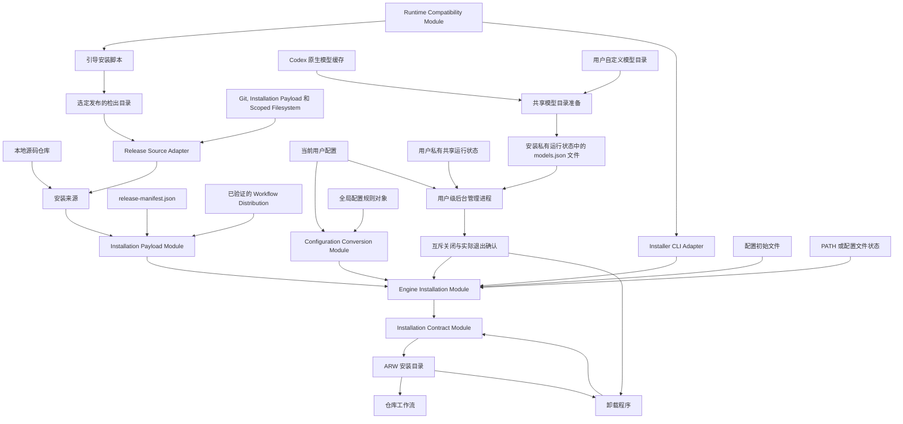

# Agent Repository Workflow 安装长期规格

## Scope

本文定义引导安装脚本, 安装载荷, ARW 安装目录, 更新, 卸载, 全局 Engine 配置升级, PATH 和命令解释器配置文件归属, 安装事务与恢复. ARW 的用户命令和目标仓库行为由 [Agent Repository Workflow 长期规格](../agent-repository-workflow/spec.md) 拥有. Workflow Distribution 的编写与发布前同步由 [开发长期规格](../agent-repository-workflow-development/spec.md) 拥有. 源码仓库发布的候选内容, 归档, VM, 标签和外部写入由 [发布长期规格](../agent-repository-workflow-release/spec.md) 拥有.

本文还拥有固定安装目录中的用户级后台运行配置与私有共享状态, 以及安装更新或卸载时同后台管理进程的交接. 通用 Agent 的执行和容量行为由[产品长期规格](../agent-repository-workflow/spec.md#background-agent-control)拥有, Reviewer 的专用限制不进入安装配置.

安装只复制已经由当前来源提供的运行时与 Workflow Distribution. 它不构建,修复或重新投影 Workflow Distribution, 也不执行 Upstream Sync.

## Public entry points

用户下载默认分支的单文件 `scripts/install-arw.mjs`, 检查后从本地运行. 不推荐把远程响应通过管道直接交给 Node.js. 非交互式默认最新版本安装示例是:

```text
node install-arw.mjs --non-interactive --register-path true
```

规范来源没有稳定 tag 时, 引导脚本明确失败, 不自动安装默认分支. 此时使用克隆 Source Checkout 后执行 `node install.mjs` 的本地安装路线和相应 `-pre` 身份.

引导安装脚本默认选择最高稳定 SemVer 标签. `--version MAJOR.MINOR.PATCH` 只接受远端存在的精确稳定标签, 并明确授权首次安装历史版本. ARW 不提供降级: 已安装版本高于目标版本时安装报错且零安装写入, 无论是否使用 `--version`; 需要旧版本时先卸载再安装. 单文件引导安装脚本生成时, 从根 `release-validation.json` 投影规范 HTTPS 远端. 生成物可以包含该派生值, 但不成为第二权威来源. 运行时不读取当前目录的 Git 配置, 也不提供远端覆盖选项. 它建立临时检出目录, 解析标签对应的提交, 验证检出目录 `HEAD`, 调用该版本根目录的 `install.mjs`, 再清理临时检出目录.

维护者也可以从源码仓库根直接运行:

```text
node install.mjs
```

没有任何发布身份参数时, 安装程序从当前工作树执行本地安装, 不读取 Git 元数据, 不访问远端, 也不要求干净工作树, Git 提交或标签. 本地身份从根 `package.json.version` 机械派生为固定 `<version>-pre`. 用户不能提供另一个本地版本或后缀.

任一 `--release-tag` 或 `--release-commit` 出现时都进入正式发布路径. 两项必须完整, 未重复且有效. 部分或无效的证据不退回本地安装.

Installer 不接受选择方式参数, 版本策略不区分默认最高版本与 `--version`. `--version` 只属于 Bootstrap, Installer 不接受它. `--release-tag` 必须是没有 `v` 前缀的规范稳定 `MAJOR.MINOR.PATCH`, `--release-commit` 必须是完整的 40 或 64 位小写十六进制 Git 对象 ID. Installer 验证标签与 `package.json.version` 一致, 标签解析结果, 检出副本 `HEAD` 和传入提交完全相同, 并验证载荷字节属于该提交.

源码仓库和 ARW 安装目录都提供 `arw.mjs`, `arw.cmd` 和无扩展名 `arw` 启动器. PowerShell, CMD, Git Bash 和 Linux Bash 使用同一个日常 CLI `arw`. Bootstrap 与 Installer 在加载 Installation Implementation 或开始 Git, 网络, 临时资源, 提示和安装写入前检查运行时. Node.js 低于 24 或无法解析时写入明确错误并以退出码 1 结束. 普通 `arw` 与 Uninstaller 不执行显式版本检查. 启动器每次从当前 PATH 解析 `node`, 不固定安装时的运行时绝对路径.

Installer 和 Uninstaller 把通知与成功摘要逐行写入标准输出, 把诊断和参数错误逐行写入标准错误, 不输出内部结果 JSON. 参数错误使用退出码 2; 不支持的运行时, 任一 `severity: "error"` 诊断, `partial`, `unknown`, 交互输入 `EOF` 或其他操作失败使用退出码 1; 没有错误诊断的 `installed`, `removed` 或幂等 `unchanged` 使用退出码 0. Installer 成功摘要使用 `Installed agent-repository-workflow to <absolute-path>.`, Uninstaller 成功摘要使用 `Uninstalled agent-repository-workflow from <absolute-path>.`. 交互询问只把 `y` 和 `yes` 视为同意, 把空输入, `n` 和 `no` 视为拒绝, 其他输入重新询问. Installer 的 PATH 拒绝等同 `registerPath: false` 并继续安装; Uninstaller 的删除拒绝返回无错误的 `unchanged`; `EOF` 不解释为拒绝, 而是在任何写入前返回稳定错误.

## Installation target and choices

目标目录固定为当前用户目录:

- Windows 使用 `%USERPROFILE%\.agent-repository-workflow`, 即使从 Git Bash 执行也不改用 `$HOME`;
- Linux 和实验性 macOS 使用 `$HOME/.agent-repository-workflow`.

安装不创建符号链接, 不复制 Node.js, 不依赖 npm 软件包. 默认采用交互式模式, 使用 `--non-interactive` 进入非交互式模式. 选择如下:

- `--version MAJOR.MINOR.PATCH` 由引导安装脚本选择精确稳定发布;
- `--reinitialize-config true|false` 决定是否用所选来源的配置初始文件重置现有配置;
- `--register-path true|false` 决定是否确保 PATH 或配置文件注册, 非交互式模式必须提供.

`--register-path false` 表示本次不改变 PATH 或配置文件, 不释放已有归属. `--reinitialize-config` 只控制明确的配置重置, 不改变运行时载荷或路径归属选择.

## Installation payload

`release-manifest.json` 是安装载荷清单的唯一配置. 它的顶层字段封闭为 `configSeed`, `distributionRoot`, `launchers` 和 `runtimeFiles`.

`configSeed`, `distributionRoot`, `launchers` 和 `runtimeFiles` 的准确值由源码仓库当前清单决定. `runtimeFiles` 必须包含已安装 `arw terms check` 所需的完整 Document Terms, Markdown 和 Document Repository 运行时依赖. 已安装命令只从安装载荷读取这些依赖, 不读取 Source Checkout 内部脚本, 测试路径或其他未登记来源. 清单不保存 `product`, `releaseManifestVersion`, `workflowDistributionManifest` 或产品版本. 安装载荷不在代码中重复硬编码运行时与启动器清单.

`configSeed` 和 `distributionRoot` 是非空来源相对路径. Filesystem Module 根据来源根解析它们并阻断越界结果, 不应用另一套跨平台文件名语法. `configSeed` 只定位安全普通来源文件; Installation Payload 成功结果只把它的完整内容作为 `configSeedBytes` 返回, Engine Installation Module 固定把这些字节用于安装根目录 `config.json`. `launchers` 是封闭对象, 只包含 `darwin`, `linux` 和 `win32`; 每个值是按字节序排序的非空来源相对路径数组. `runtimeFiles` 是采用相同规则的非空数组. 每个启动器或运行时路径同时是来源路径和安装目录中的目标相对路径, 不增加条目对象或第二份目标映射. 所选平台的启动器, `runtimeFiles` 和 `distributionRoot` 下完整验证载荷合并后, 使用 Filesystem Module 返回的范围相对目标检查精确或大小写等价重复, 并拒绝与安装根 `config.json` 或 `manifest.json` 大小写等价的目标. 这些冲突阻断整个载荷, 不静默排除条目. `configSeedBytes` 不进入普通载荷, 最终 `{path, bytes}` 载荷按路径字节序排序.

Installation Payload Module 验证清单的封闭结构, 平台启动器选择, 相对路径包含关系, 安全普通来源文件, 重复目标和大小写冲突. 它通过 Filesystem Module 的规范相对路径拼接 Interface 组合 `distributionRoot` 与每个 Workflow Distribution 条目, 因而输出不含重复分隔符的规范目标路径, 再通过同一 Module 的相对路径范围操作确认结果位于来源根内. 它从 `distributionRoot` 读取完整且验证通过的 Workflow Distribution. 本地与正式来源使用同一种载荷展开方式.

正式发布在任何安装写入前独立验证所选标签, 解析出的提交, 检出目录 `HEAD`, 软件包身份, 载荷字节和来源 Git 状态. `package.json` 留在 Git 树验证清单, 但不进入 ARW 安装目录. `release-manifest.json`, 引导安装脚本, 根安装程序, `config.install.json`, 测试, 源码仓库文档和维护脚本也不进入安装.

安装载荷同时包含根 `LICENSE.txt`, 与来源保持准确字节并沿用普通载荷的归属, 修复, 升级和卸载责任. 该文件通过既有 `runtimeFiles` 清单登记, 不增加独立许可状态或修改第三方许可.

安装根目录复制适用的 `arw.mjs`, `arw`, `arw.cmd` 和 `uninstall.mjs`. 内部运行时 Module 复制到 `lib/`. 完整 Workflow Distribution 按规范相对路径复制. 安装后的仓库工作流直接消费同一载荷; 安装程序不重新生成它.

已安装运行时从同一安装的完整有效归属清单读取 `arwVersion`. 源码仓库运行时只从根 `package.json.version` 读取. `package.json` 与安装清单同时存在或同时缺失都表示不一致布局, 关闭式失败, 不在两个权威来源之间回退.

## Global Engine configuration

每个入口读取其自然所属 Engine 目录中的 `config.json`. 不增加模式参数, 路径探测或第二套选择逻辑. 源码仓库入口的 Engine 目录没有 `config.json` 时, 普通读取使用同目录 `config.install.json` 的内容作为默认值, 不写配置.

当前已知结构使用 `configVersion: 3`:

```json
{
  "configVersion": 3,
  "agents": {},
  "editor": {
    "command": "code",
    "args": ["{file}"]
  },
  "reviewEditor": {
    "command": "code",
    "args": ["--new-window", "--wait", "{file}"]
  },
  "jira": {
    "listLimit": 50
  },
  "backgroundAgent": {
    "maxInstances": 16,
    "earlyExitNotificationThreshold": 10,
    "providers": {
      "openai": {"maxInstances": 4},
      "anthropic": {"maxInstances": 4}
    }
  }
}
```

`agents` 是可选对象, 缺失时等同于空对象. 每个属性名是精确 Agent 配置名称. 条目的 `command` 必须是非空 PATH 命令名或可执行文件的绝对路径, `args` 必须是只包含字符串的固定数组. 形似相对路径的命令会被拒绝. 任一格式错误的已知字段使配置关闭式失败.

`editor` 服务不要求现有打开操作等待进程退出. `reviewEditor` 服务需要在独立窗口中打开审核文件, 并在用户保存和关闭后立即验证文件, 因而所配置程序必须支持新窗口和等待模式. 默认 VS Code 参数是 `--new-window --wait {file}`. 两者都要求 `command` 是 PATH 命令或绝对路径, `args` 恰好包含一个 `{file}`. ARW 不拼接命令解释器命令字符串, 不读取 `ISSUE_EDITOR`.

`jira.listLimit` 是十进制正安全整数. 它只提供 JIRA 列表的一页默认显示数量, 当前默认值是 `50`. Application 与 JIRA 长期规格拥有该值的命令使用行为; Installation 只拥有全局字段, 默认值和升级.

### Background Agent configuration

`backgroundAgent` 使用[入口所属 Engine 配置](#global-engine-configuration), 除 `providers` 外字段均为正安全整数:

| 字段 | 默认值 | 读取与生效范围 |
| --- | --- | --- |
| `maxInstances` | `16` | 管理进程启动时从启动脚本自然所属 Engine 目录读取, 约束当前用户共享 App Server 加载的独立根线程数量; 原生子 Agent 不另算独立实例 |
| `messageTimeoutMs` | `5000` | 机器入口与 `arw list background-agents` 的客户端从自身 Engine 目录读取, 作为普通请求的总等待预算, 单位为毫秒 |
| `persistenceIntervalMs` | `1000` | 管理进程启动时从启动脚本自然所属 Engine 目录读取, 作为有脏数据时的批量保存间隔, 单位为毫秒 |
| `earlyExitNotificationThreshold` | `10` | 管理进程启动时从启动脚本自然所属 Engine 目录读取, 作为同一 Reviewer 任务首次主动早退通知及暂停的累计次数阈值; 后续行为由[Reviewer 运行合同](../agent-repository-workflow/spec.md#reviewer-runtime)拥有 |
| `providers` | 见[共享模型目录](#shared-model-catalog) | 管理进程启动时读取, 以 `modelProvider` ID 为键保存 ARW 自己的提供方容量与专用驱动设置; 默认 `openai` 与 `anthropic` 的 `maxInstances` 均为 `4`, 不含 Codex 用户目录内容 |

管理进程的容量, 保存间隔和主动早退通知阈值在其存活期间固定. 其他入口连接同一个管理进程, 或用户修改配置文件, 均不改变这三项运行设置; 后续重新启动管理进程时才读取启动脚本届时的配置. 客户端的等待预算只约束自己的请求, 各入口可以不同, 无需获取管理进程配置. 这样既让每个入口遵循相同配置来源规则, 又让同一共享进程保持一致的容量, 保存与通知行为. 全部字段都不接受仓库配置或单次请求覆盖. 普通请求与 `wait_agent` 的独立等待预算及任务时长边界由[后台 Agent 控制规格](../agent-repository-workflow/spec.md#machine-entry)拥有.

字段或对象缺失时, 普通读取在内存中使用相应默认值, 不写配置. 安装与安装更新在同一配置事务中补入缺失的默认结构, 保留用户已设置的有效值和无关字段, 不因这些字段增加配置版本. 格式错误 (包括 `providers` 不是对象或条目不是对象) 时在启动后台进程或修改安装前明确失败; `providers` 条目内部字段 (`driver`, `installationDirectory`, `maxInstances` 的取值) 的核对只在后台运行时进行, 但安装对数值 `maxInstances` 大于全局上限的条目另行警告, 见下段. 配置来源不改变[用户私有共享状态目录](#background-agent-management)的归属, 源码入口不因使用共享状态而隐式安装 ARW.

共享模型目录中每个已设置的提供方 `maxInstances` 必须是正安全整数. 安装读取有效配置中所有已设置数值 `maxInstances` 的提供方时, 若某个上限大于有效 `backgroundAgent.maxInstances`, 只警告并继续, 不改动该提供方或用户明确设置的全局上限; 警告包含提供方身份及两个限额. 后台运行时读取所有提供方配置, 若任一提供方上限大于本次读取到的有效全局上限, 明确报错且不启动共享 App Server; 全局字段缺失时按默认 `16` 核对. 用户只读列表不因此启动或恢复 App Server. 提供方名额的准入, 回收顺序和占用状态由[产品容量规则](../agent-repository-workflow/spec.md#capacity-and-recovery)拥有, 全局 `config.json` 不复制提供方限额.

### Reviewer configuration

Reviewer 的全局设置来自调用入口自然所属 Engine 目录中的 `config.json`, 遵循[统一配置来源规则](#global-engine-configuration), 不由共享管理进程的启动位置或 Reviewer 的受审目录决定. 全局 `reviewers` 是独立于 `agents` 外部 CLI 启动条目的对象. 它只接受 `code-standards-reviewer`, `requirements-reviewer` 和 `spec-readiness-reviewer` 三个角色键; 已退役的 `code-spec-reviewer` 和 `commit-audit-reviewer` 键被忽略. 每个角色只接受以下字段:

| 字段 | 值 | 全局默认值 |
| --- | --- | --- |
| `model` | 非空模型标识字符串 | `"gpt-6-luna"` |
| `modelProvider` | 非空 Codex 模型提供方标识字符串 | `"openai"` |
| `reasoningEffort` | 非空原生推理强度字符串 | `"xhigh"` |
| `serviceTier` | `"default"` 或 `"fast"` | `"default"` |
| `env` | 名称到字符串的对象, 只允许出现在全局配置中; Claude 后端每回合读取并注入 `claude -p` 进程, 不进入解析后的设置与持久状态 | 无 |

全局配置读取时按这份单一默认值补全缺少的对象, 角色及字段. 普通读取只在内存中补全. 安装或安装更新在同一配置事务中持久补入缺失的默认值, 包括已有 `configVersion: 3` 配置, 保留用户提供的角色字段与无关内容, 不用新默认值刷新已有设置. 完整新装配置为四个角色提供完整默认字段; 全局初始文件与规则默认值必须语义一致. 除 `env` 外不把模型凭据放入这些字段; 未选择专用驱动的提供方实际连接配置仍由 Codex 原生配置拥有, Strata 连接由[共享模型目录与专用驱动](#shared-model-catalog)取得. 不增加仅因本轮新成员而产生的配置版本. 按[机器入口的平台判定](../agent-repository-workflow/spec.md#machine-entry)由 Claude Code 中的 Main Agent 调用时, 合成结果的 `modelProvider` 不是 `anthropic` 的角色整体改用 Claude 默认设置 (`model` 为 `haiku`, `modelProvider` 为 `anthropic`, `reasoningEffort` 为 `high`, `serviceTier` 为 `default`); 合成结果已是 `anthropic` 时照常使用. 这是因为全局默认值与显式 Codex 设置无法区分, 而 Claude Code 中只有 Claude 后端可以不依赖 Codex 运行环境.

仓库根目录 `arw.config.json` 的同名 `reviewers` 对象使用相同角色键和字段格式, 但不接受 `env` (出现即以配置错误拒绝, 防止凭据进入仓库), 每个角色可以为空或只包含要覆盖的字段. 按字段由仓库值覆盖全局值, 未覆盖字段保留全局设置. 仓库默认写入四角色空对象, 不复制全局设置, 使后续全局调整仍能生效. 仓库文件创建与默认补入由 [Repository Workflow](../agent-repository-workflow/spec.md#repository-workflow) 拥有.

完整合成结果用于普通 Reviewer 审核, 调用方不能用本轮模型参数覆盖用户配置. 能力验证与基准的隔离实例可以在已明确选择的本轮设置中覆盖这些字段. 默认 Standard 必须明确向原生线程与回合传入 `serviceTier: "default"`, 不使用 `null` 表示 Standard, 不受面向用户的 Main Agent 服务档位影响. `"fast"` 是原生请求偏好, 不证明提供方实际服务权益. 字段格式无效时明确失败, 不静默忽略; 模型, 提供方及推理强度的实际支持由 Codex 判断, ARW 不自动替换组合.

### Configuration versions and lifecycle

全局配置只支持已经发布的 `v1` 和当前 `v3`. `v2` 只是开发期间的未发布设计, 不成为受支持来源版本. 从 `v1` 升级时直接执行 `v1 -> v3`; 后续版本如果存在, 则按照开发长期规格的版本顺序逐步在内存中转换, 最后只写一次.

全局配置规则对象按以下准确字段顺序定义版本. `-` 表示父路径没有 `defaultValue`:

| 版本 | 路径 | 必需 | 默认值 |
| --- | --- | --- | --- |
| v1 | `configVersion` | true | `1` |
| v1 | `agents` | false | `{}` |
| v1 | `editor` | true | - |
| v1 | `editor.command` | true | `"code"` |
| v1 | `editor.args` | true | `["{file}"]` |
| v3 | `configVersion` | true | `3` |
| v3 | `agents` | false | `{}` |
| v3 | `editor` | true | - |
| v3 | `editor.command` | true | `"code"` |
| v3 | `editor.args` | true | `["{file}"]` |
| v3 | `reviewEditor` | true | - |
| v3 | `reviewEditor.command` | true | `"code"` |
| v3 | `reviewEditor.args` | true | `["--new-window", "--wait", "{file}"]` |
| v3 | `jira` | true | - |
| v3 | `jira.listLimit` | true | `50` |
| v3 | `reviewers` | false | 四角色完整默认对象, 见上方字段表 |
| v3 | `backgroundAgent` | false | - |
| v3 | `backgroundAgent.maxInstances` | false | `16` |
| v3 | `backgroundAgent.messageTimeoutMs` | false | `5000` |
| v3 | `backgroundAgent.persistenceIntervalMs` | false | `1000` |
| v3 | `backgroundAgent.earlyExitNotificationThreshold` | false | `10` |
| v3 | `backgroundAgent.providers` | false | `{"openai":{"maxInstances":4},"anthropic":{"maxInstances":4}}` |

每个版本验证器是 `agents`, `editor`, `reviewEditor`, `jira`, `backgroundAgent` (含 `providers` 为对象且各条目为对象这一结构) 和 Reviewer 配置已知结构与取值的唯一校验权威; `providers` 条目内部字段由[共享模型目录](#shared-model-catalog)在后台运行时核对. `v1` 的 `conversions` 为空. `v3` 的唯一版本转换把 `configVersion` 从同路径的 `1` 转成 `3`. `agents` 和 `editor` 走普通保留流程; `reviewEditor` 和 `jira` 作为新必需父级创建, 并从 v3 叶字段默认值构造. `reviewers` 与 `backgroundAgent` 按上方配置合同补入缺失默认值, 已有的有效配置保留. 规则对象测试必须证明 `configVersion` 的旧默认值转换后与新默认值语义相等.

配置文件不存在时, 安装从当前 `configSeed` 创建完整 v3 配置, 包含上述四角色 Reviewer 默认值与四项后台 Agent 默认值; 初始文件不含 `backgroundAgent.providers`, 其默认值与遗留提供方迁移由同一配置事务按[共享模型目录](#shared-model-catalog)补入. `configSeed` 只负责首次创建和 `--reinitialize-config true`, 不参与现有配置的默认值, 字段顺序, 验证器或升级计算. 对现有配置执行安装或更新时, Installation 把当前完整 UTF-8 配置字节和全局规则对象交给 Configuration Conversion Module, 并只消费完整成功结果. 当前版本转换成功仍逐字节保留原输入; 缺失默认值的补入是明确的安装写入, 保留已有值及无关文本. 升级或默认补入后的完整配置字节统一进入安装事务, 没有缺失值或版本变化时不重写配置.

升级保留不冲突的未知子树, 并列出 `unknownPaths`. 未知字段占用新已知路径, 或它的标量或数组结构阻止创建新已知后代时, 自动升级在写入前停止. Installation 比较原始与最终 JSON, 在配置事务实际成功后向用户列出净新增, 删除和更新路径; 没有实际变化时不产生无意义变更. 配置事务成功前失败时不报告这些变更, 配置已经成功写入但后续安装步骤失败时仍报告已应用的变更. 已有配置转换的提示先按 `added`, `removed`, `updated` 类别排列, 每类路径按字节序排列, 再按 Configuration 转换结果的既有顺序列出 `unknownPaths`. 准确模板分别是 `Configuration added path: <path>.`, `Configuration removed path: <path>.`, `Configuration updated path: <path>.` 和 `Preserved unknown configuration path: <path>.`. 该连续提示分组位于其他 Installation 提示之前; 未改变配置时仍可报告实际保留的未知路径, 缺失配置创建和明确重新初始化只通过 `configurationResult` 报告, 不展开初始文件的全部路径. 配置升级不静默删除用户数据.

`--reinitialize-config true` 明确授权用当前初始文件覆盖配置且不创建备份. `false` 不阻止必要且受支持的结构升级. 无效, 不支持或无法安全升级的配置不写入. 转换成功字节与运行时, PATH 或配置文件登记一起进入同一 Installation 事务, 不提前单独持久化. `config.json` 始终由用户拥有, 不进入普通受管理文件清单.

## Background Agent management

用户级后台管理进程在固定安装目录下使用与安装载荷分开的用户私有运行状态目录, 保存本机连接凭据, 可重连状态及核对原生环境所需的最少事实. 当前用户的源码仓库入口与已安装入口共享这一个位置和同一进程; 源码入口缺少已安装运行时时不复制载荷或隐式执行安装. 用户私密凭据只用于本机控制连接, 不进入仓库配置, Workflow Distribution, 机器响应或 Reviewer 报告. 后台控制与安装维护各使用一个固定的本机 TCP 端口, 均只能显式绑定不可配置的 `127.0.0.1`; 管理进程必须先确认私密凭据及状态目录的当前用户访问边界, 不能确认时拒绝启动或接入. 运行状态不成为安装清单管理的运行文件, 也不替代各调用方准确绑定的恢复记录.

私有运行状态目录中的固定纯文本文件 `app-server-process` 只记录当前共享 App Server 的进程 PID 和操作系统报告的该进程创建时间, 内容恰为两个值以一个 ASCII 逗号连接, 不含字段名, JSON 或其他正文. 创建时间取自操作系统对目标进程的观察, 不能用文件创建或修改时间代替. 管理进程在共享 App Server 启动边界取得这两个值后立即创建文件, 在同一次进程存活期间不改写. 正常关闭先按[产品提供方规则](../agent-repository-workflow/spec.md#capacity-and-recovery)完成持有 key 的归还, 共享进程实际退出后立即删除该文件; 意外退出时保留文件, 下一次需要启动共享进程的恢复流程确认旧身份已退出并处理未确认归还事实后才删除, 不在退出回调或只读查询时删除. 文件创建与正常关闭后的删除不等待 Agent 与消息的 SQLite 批量保存. 文件只用于共享进程身份核对, 不充当 `agents` 表的运行身份或消息记录. 准确退出判断由[产品恢复规则](../agent-repository-workflow/spec.md#capacity-and-recovery)拥有.

Claude 后端的每个运行中回合进程以同样格式记录在 `claude-process-<threadId>` 文件中, `threadId` 是该 Agent 的 Claude 会话 id. 管理进程在回合进程启动后立即创建文件, 无法取得身份或写入文件时立即结束该进程并按启动失败处理, 确认进程退出后删除; 意外退出时保留文件, 由新管理进程在启动, 准入或该 Agent 接到新工作时核对旧进程是否已退出, 确认退出后删除并按已结束的运行恢复该 Agent, 未确认前该 Agent 保持未知状态并占用名额. 回合任务在文件写入成功后才写入标准输入; 管理进程在启动与写入之间退出时, 该进程尚未取得工作, 且标准输入随管理进程退出而关闭, 因此没有对应文件的 Claude Agent 视为没有运行中的回合进程, 冷启动与离线维护直接按已结束的运行恢复, 不依赖共享 App Server 身份. 离线维护在任一文件对应的进程未确认退出时拒绝执行.

同一安装目录中的私有运行状态目录使用 Node.js 内置的 `node:sqlite` 在同一个数据库中保存后台 Agent, 消息和 Strata 提供方当前事实, 不增加第三方运行时依赖. 数据库表及关联关系由[产品后台 Agent 持久状态规则](../agent-repository-workflow/spec.md#background-agent-state)拥有. 首次领取的 Strata key 立即保存, 确认归还后的删除同样立即提交; 提供方当前服务错误与 Agent 和消息变更按配置间隔合并批量保存, 准确字段及查询归[产品后台 Agent 持久状态规则](../agent-repository-workflow/spec.md#background-agent-state)拥有. 正常关闭时, 独占权须保持到相关根线程与工具卸载且没有待启动工作, 在关闭共享 App Server 前完成归还; 归还失败或结果未知时不关闭共享进程或删除其身份文件. 共享进程意外退出时, 归还留给下一次需启动共享进程的恢复流程. 数据库及其自身关联文件与 `config.json` 共用卸载时的保留或删除选择; 本机连接凭据, 调用方在安装目录外绑定的 Reviewer 恢复记录和未知内容不因此取得删除授权. Agent 与消息由管理进程先更新内存, 再按配置间隔批量保存; 保存失败时保留待存变更并暂停接受新任务和消息, 已接受工作继续, 待全部待存记录成功提交后恢复准入. 已保存且分发完成的消息正文与已退出 Agent 不在内存保留历史副本; 数据库按需提供最近消息. 未保存事实的恢复不完整, 不放宽 App Server 生命周期, 容量, 固定 Main 归属, 维护互斥或实际退出核对. 卸载先按授权完成进程关闭和删除前检查, 不因最终批量保存失败而撤销卸载授权或声称进程没有退出. 消息的保留期限, 状态含义, 可查询范围和交付时序由[产品后台 Agent 通信规则](../agent-repository-workflow/spec.md#background-agent-communication)拥有.

后台管理进程至多持有一个 ARW 专用共享 App Server 的进程句柄和状态, 各后台 Agent 以不同根线程运行; 客户端连接结束及全部根线程停止后的空闲状态都不要求管理进程退出. 最后一个根线程确认卸载且相关工具确认退出后, 共享 App Server 按[产品空闲关闭规则](../agent-repository-workflow/spec.md#capacity-and-recovery)等待连续 60 秒无后台根线程或已接受待启动任务才关闭; 新任务取消关闭并复用. 安装, 更新和卸载维护在安全核对通过后可立即关闭, 不等待该空闲期限. 管理进程故障后可能影响全部根线程, 新进程必须先证实旧 App Server 实际退出才能启动新的共享进程; 陈旧进程 ID 不授予释放名额或终止进程的权限. 具体容量, 自动回收和任务故障结果由[产品长期规格](../agent-repository-workflow/spec.md#capacity-and-recovery)拥有.

### Shared model catalog

ARW 自己的提供方设置保存在全局 `config.json` 的 `backgroundAgent.providers`, 不依赖 Codex 用户目录: 只使用 Claude 后端的机器无需 Codex, 安装也不创建, 读取或改写 `~/.codex` 或 `CODEX_HOME`. `providers` 是以原生 `modelProvider` ID 为键的对象, 条目字段见下表. 缺少时普通读取在内存中使用默认 `{"openai":{"maxInstances":4},"anthropic":{"maxInstances":4}}`, 安装补入缺失的默认提供方及其 `maxInstances`, 保留用户已设置的提供方, 字段与显式上限; 提供方条目内部字段的详细核对 (字段, Strata 安装目录, 上限不大于全局上限的报错) 只在后台运行时读取这些设置时进行 (安装仅对超过全局上限的数值上限另行警告), 其他命令及安装不因条目内部字段无效而失败, 只有 `providers` 或其条目不是对象的结构错误才在安装前失败.

Codex 自定义模型记录 `models.custom.json` 是 Codex 用户目录 (默认 `~/.codex`, 非空 `CODEX_HOME` 时为该准确目录) 中由用户拥有的可选文件, 只在启动 Codex App Server 时读取其 `models` 数组, 必须是 JSON 数组, 缺失视为空数组. ARW 不创建, 不补缺, 不改写它, 卸载时保留, 其中的 `providers` 不再被 ARW 读取.

安装已有 Codex 时代遗留的 `models.custom.json.providers` 时一次性迁移: 当要写入或已有的 `config.json` 尚无 `backgroundAgent.providers` 时, 安装读取该文件的 `providers` 并与默认值合并后写入同一配置事务, 以文件中的值为准, 保留全部提供方与字段, 并提示已迁移的提供方; `backgroundAgent.providers` 一旦存在即为唯一来源, 之后不再读取旧文件, 不覆盖用户在配置中的修改. 本字段不增加配置版本, 较早的 ARW 版本会以未知字段拒绝含 `backgroundAgent.providers` 的配置. 旧文件不存在, Codex 用户目录不存在或没有 `providers` 时视为无需迁移; 文件存在但无法解析或 `providers` 结构无效且需要迁移时, 在任何安装写入前报错, 不丢失其中的值.

默认全局上限 `16` 为不同提供方的独立根线程并行留出空间, 同时约束共享 App Server 加载的根线程总数; OpenAI 与 Anthropic 默认上限 `4` 分别收紧这两个提供方的并发预算, 使 Claude 后端的 Reviewer 也不会占满全局名额. 更多并行会增加本机内存和处理器占用及提供方请求负载; 名额耗尽且无法安全回收时, 新请求按容量规则被拒绝. 用户可依据机器资源和实际服务配额调整这些上限.

安装补入默认上限后, 其他未设置提供方仍不增加专用上限. 每个条目按以下字段读取:

| 字段 | 值与默认行为 |
| --- | --- |
| `driver` | 可省略; 当前专用驱动值为 `"strata"`, 省略时只使用配置的提供方上限 |
| `installationDirectory` | `driver: "strata"` 时必需, 本机可访问的绝对安装目录路径 |
| `maxInstances` | 可省略; 通用提供方省略时不增加提供方专用上限, Strata 省略时为 `1`; 设置时为正安全整数, 与有效全局上限的关系按[后台 Agent 配置规则](#background-agent-configuration)处理 |

Strata 配置示例 (`config.json` 片段):

```json
{
  "backgroundAgent": {
    "providers": {
      "qwen_strata": {
        "driver": "strata",
        "installationDirectory": "/mnt/c/Users/Pello/AppData/Local/Programs/qwen-3.8-flash-next",
        "maxInstances": 1
      }
    }
  }
}
```

`qwen_strata` 的三个变体使用同一提供方身份和限额. 配置读取按[后台 Agent 配置规则](#background-agent-configuration)核对提供方限额与有效全局上限. Strata 的安装目录是 Windows 服务从 WSL 访问时的实际目录, 不改变 ARW 对其他操作系统的支持范围. 只有可变的目录和配额在此设置, Strata 的入口, 控制请求与模型映射由[产品驱动规则](../agent-repository-workflow/spec.md#capacity-and-recovery)拥有; 独占 key 由管理进程持有, 不写回配置, 原生缓存或用户自定义来源文件.

管理进程每次准备创建共享 App Server 前, 从 Codex 用户目录读取原生 `models_cache.json` 和可选的用户 `models.custom.json` 的 `models` 数组 (后者缺失视为空数组), 按原生缓存记录在前, 用户自定义记录在后的顺序合并为 `{"models":[...]}`. 实际接入 Strata 驱动 (由 `backgroundAgent.providers` 判定) 时才读取 [专用运行参数](../agent-repository-workflow/strata.md#runtime-parameters), 对其模型条目应用生成目录调整; 其他模型条目原样合并. 提供方调整只属于生成目录, 不写回缓存或用户自定义来源, 也不从单个根线程切换共享目录. 该分支的原生压缩设置与私有任务绑定文件按 [专用压缩规则](../agent-repository-workflow/strata.md#compaction-support)准备, 其他分支不加载其参数或提示内容. 生成结果只写入实际 ARW 安装目录的用户私有运行状态 `<ARW 安装目录>/background-agent-state/models.json`, 路径随实际 ARW 安装目录解析 (与提供方条目的 `installationDirectory` 字段无关); 不复制原生缓存的身份, 刷新时间等其他字段或配置中的 `providers`, 不修改原生缓存, 也不把 GPT 描述写入用户自定义文件. App Server 启动时通过进程级 `model_catalog_json` 使用该生成文件; 不由单个根线程或单次请求选择目录. 原生缓存缺失, 任一来源文件无法解析, `models` 不是数组, 提供方设置无效, 或生成失败时明确报告并且不启动 App Server; 其中来源文件与生成失败只影响 Codex App Server, Claude 后端只读取 `backgroundAgent.providers`, 不访问 Codex 用户目录. 提供方设置无效或超过全局上限则拒绝新建或恢复任何运行, 包括 Claude 后端, 准入使用读取到的有效配置值, 不静默改用另一来源.

同一个共享 App Server 存活期间不重写生成文件; 来源文件的后续更改只在下一次 App Server 启动时生效. 确认共享进程实际退出后立即删除生成文件. 启动失败而进程退出无法确认, 或旧进程身份仍未知时保留文件且不重写; 确认旧进程已经结束后才可清理旧文件并重新生成. 该文件不进入 Agent 与消息的 SQLite 批量保存, 也不改变独立的进程身份核对.

## Installation ownership manifest

目标目录存在完整有效且受支持的安装清单时, 视为受管理安装. 当前写入方只生成 `manifestVersion: 2`. 读取方关闭式拒绝其他未支持版本. `manifestVersion` 保留, 因为该文件跨安装版本长期存在并承担兼容责任.

安装清单是封闭 JSON 对象, 顶层只包含 `manifestVersion`, `product`, `arwVersion`, `managedFiles` 和 `pathOwnership`. `manifestVersion` 固定为 `2`, `product` 固定为 `agent-repository-workflow`, `arwVersion` 是受支持的规范 ARW 版本, `managedFiles` 是按字节序排序的完整受管理路径数组. `pathOwnership` 为空或只包含当前平台的一条记录:

- Windows 记录准确包含 `kind: "windows-user-path"`, 安装目录绝对路径 `entry`, `valueKind: "String" | "ExpandString"` 和布尔值 `createdValue`.
- Linux 记录准确包含 `kind: "linux-profile"` 和绝对 `profile` 路径. 它不记录 `createdFile`; Uninstaller 删除自有标记块后可以保留空的 `~/.profile`.

安装清单不保存来源模式, 发布标签, Git 提交, 摘要值, 工作树清洁状态或 Agent CLI 运行时信息. `pathOwnership` 中的记录按 `kind` 与规范目标身份保持唯一. 实验性 macOS 不自动登记路径, 因而不产生归属记录.

`managedFiles` 是当前写入方从完整载荷保存的按字节序排序目标路径数组. 读取方把每个非空值作为 Filesystem Module 的相对路径范围操作输入, 并使用返回的范围相对目标执行后续检查和文件操作. 解析到安装根本身, 越过安装目录, 精确或大小写等价重复, 或与根 `config.json` 或 `manifest.json` 大小写等价的目标都使清单无效. Installation 不另外定义受限文件名字符, Windows 保留名, Unicode 规范化或其他跨平台文件名语法.

安装清单缺失或损坏时不能证明残留归属. 目录可以保留有效配置, 未知文件和安全真实父目录, 但所有计划中的受管理目标都必须缺失. 即使残留字节与载荷相同, 安装程序也不覆盖, 删除或自动清理. 不提供 `--take-over`, 接管提示或残留清理. 旧 `.local-tracker` 安装不自动迁移或接管.

版本策略不区分 Bootstrap 的选择方式: 没有已安装版本时允许首次安装 (显式 `--version` 可选择精确历史发布), 同版本修复和升级允许, 已安装版本高于目标版本时拒绝降级. 本地固定 `-pre` 可以覆盖核心版本较低的稳定版或固定 `-pre`, 以及相同的 `-pre`; 它不能覆盖相同核心版本的稳定版或任何更高版本. 相同核心版本的正式稳定版可以覆盖本地 `-pre`. 其他预发布标签和格式错误的版本关闭式失败.

替换在完整的写入前检查后移除当前受管理运行时, 再全新复制, 最后写安装清单. 它不维护旧运行时回滚. 未知文件和用户配置保留.

## PATH and shell configuration ownership

`--register-path true` 确保注册, `false` 不改变注册. 已存在且内容等价的条目如果没有实际写入, 不新增归属. 当前安装实际写入, 或由有效清单已经证明的条目才取得归属.

Windows 无论从 PowerShell, CMD 或 Git Bash 执行, 都只管理 `HKEY_CURRENT_USER\Environment` 键的 `Path` 值. Adapter 读取未展开的原始文本和实际值类型, 只接受并保留 `String` 或 `ExpandString`. 原值不存在时创建 `ExpandString`. 它不展开 `%USERPROFILE%` 等环境变量, 不把展开结果写回 Registry, 也不接受其他类型. 写入保留其他内容, 只追加缺失的绝对安装条目. 等价比较忽略大小写, 外围双引号和末尾路径分隔符, 但不把相对路径或含环境变量的条目当作等价.

每次实际 Windows 用户 `Path` 变化成功后, Adapter 通过 `SendMessageTimeoutW` 广播环境变化. 参数固定为 `HWND_BROADCAST = 0xffff`, `WM_SETTINGCHANGE = 0x001a`, `wParam = 0`, `lParam = "Environment"`, `SMTO_ABORTIFHUNG = 0x0002`, 每个顶级窗口的超时时间为 `1,000 ms`. 没有实际变化或 `--register-path false` 时不发送.

通知成功只表示已经请求 Windows 刷新环境, 当前命令解释器仍可能保留旧环境. 返回零, 超时或调用异常产生 `windows-environment-refresh-failed` 警告, 说明持久 PATH 已改变, 并建议注销再登录或手动刷新当前命令解释器. 通知失败不回滚 Registry, 不改变归属或最终成功状态.

Linux 只管理 `~/.profile` 中的固定标记块. 起止标记必须各自独占完整行, 各出现一次且顺序正确. 内嵌, 重复, 缺失一侧或顺序错误关闭式失败. 现有文件通过 Filesystem Module 以 `allowLossyDecoding: false` 读取; 任何需要编码解码器替换无效字节的内容都在写入前失败, 不因有损解码改变无关字节. ARW 不猜测其他命令解释器配置. 实验性 macOS 不自动注册命令解释器配置文件.

固定标记块使用以下准确 UTF-8 与 LF 字节, 并在写入时保留一个结尾 LF:

```text
# >>> agent-repository-workflow PATH >>>
export PATH="$HOME/.agent-repository-workflow:$PATH"
# <<< agent-repository-workflow PATH <<<
```

`~/.profile` 不存在时创建只包含该块的文件. 现有文件的其他字节保持不变; 原文件没有结尾换行时, Installer 可以增加一个 LF 作为块分隔符. Uninstaller 只删除准确自有块及它的结尾换行, 为分隔该块而增加的前置 LF 可以保留. 删除后文件为空时保留空文件.

`~/.profile` 中只有把 `$HOME/.agent-repository-workflow` 本身作为完整 PATH 条目的赋值才是等价登记. `$HOME/.agent-repository-workflow/bin` 或其他子路径不等价, Installer 仍写入准确标记块.

安装清单只累计安装实际取得的 PATH 和配置文件归属. Windows 保存准确绝对条目与必要的值归属, Linux 保存准确配置文件路径. 没有改写的等价条目和 `--register-path false` 都不创建新归属, 也不释放旧归属.

## Installation transaction and recovery

安装按以下顺序推进, 最后才用安装清单声明完整结果:

1. 收集并验证来源, 载荷, 版本策略, 目标状态, 配置升级, 路径登记和全部受管理目标. 控制进程先绑定固定的 `127.0.0.1` 维护端口取得用户级互斥, 再阻止所有入口启动新工作, 核实无执行中的主任务, 子 Agent, 工具调用和未决人工交互, 并确认全部已加载根线程及相关子 Agent 和工具, 单个共享 App Server 与管理进程实际退出; 维护交接可立即关闭共享 App Server, 不等待普通空闲期限. 任一状态不安全或退出无法确认时, 保证零安装写入, 也不停止忙碌任务.
2. 完整检查通过后, 在同一互斥交接保持期间替换运行时, 复制载荷, 修改 PATH 或配置文件, 并更新配置.
3. 全部必需步骤成功后才写安装清单. 它是最后提交点, 不能把部分内容声明为完整安装.

管理进程无法连接时, 控制进程在持有维护互斥期间通过操作系统可靠确认同一私有状态目录的管理进程不存在, 不把连接被拒当作退出证明. 旧共享 App Server 的准确 PID 与操作系统创建时间核对为已退出, 且数据库没有任何尚未确认归还的非空提供方独占凭据时, 离线维护可以按普通冷恢复的同一规则把尚未退出的 Agent 运行状态恢复为 `exited`, 保存的暂停任务保持 `working`, 其他任务使用 `unknown`. 原有运行身份, Main 归属, 原生线程, 恢复绑定, 时间和提供方任务事实保留, 状态版本遵循原有状态与消息序列规则, 不重放任务或启动模型. 恢复结果成功提交后才进入安装写入, 旧共享进程身份文件留给既有生命周期核对和清理.

管理进程存在或观察未知, 旧共享进程仍存活或身份未知, 以及旧身份缺失但数据库仍有尚未退出的 Codex 后端 Agent 时, 离线维护明确失败. 即使 Agent 已经全部退出, 数据库存在非空提供方独占凭据也必须阻断; 离线维护不联系提供方, 不删除凭据或旧进程身份来消除阻塞. 这使离线安装恢复只依赖本地退出事实, 避免新增对模型服务可达性及资源归还失败处理的依赖, 并接受有未归还独占使用权时须先经现有提供方恢复流程处理后再安装的可用性限制. 没有独占凭据的历史服务错误不构成此项阻断. 恢复保存失败时保留退出核对依据并报告失败, 不把内存中的状态更改当作提交成功; 重试重新核对全部前提. 原有在线维护的资源归还和退出核验保持不变.

后续实际请求自动启动已更新或仍可用版本的后台管理进程, 不要求用户执行另一个管理命令. 安装失败时只使用能够证明的当前运行时和清单状态判断后续请求, 不让旧管理进程在可能已替换的代码上继续接收工作. 上述交接同样适用于本地来源安装和正式来源安装, 不因它们共享容量而分别启动管理进程.

实际 I/O 失败立即停止并报告, 不承诺完整回滚. Engine Installation Module 返回操作, `unchanged | installed | partial | unknown` 状态, 阶段, 结构化诊断信息和规范归属摘要. 无法确认外部 Registry 或配置文件写入是否发生时使用 `unknown`. CLI 只把结果映射为输出与退出码, 不重新读取清单推断结果.

失败后能否直接重试, 取决于旧清单能否证明残留内容的归属:

| 失败后可证明的状态 | 恢复方式 |
| --- | --- |
| 有效旧清单能够证明全部剩余受管理目标和平台归属 | 幂等地向前重试, 直到新的完整事务最后替换旧清单. |
| 实际写入失败后, 留下旧清单无法证明的受管理目标或新平台登记 | 保留实际失败 `stage`, 使用 `partial` 或 `unknown` 报告失败, 并在 `notices` 中列出人工清理要求. 用户清理准确残留后, 才重新执行完整写入前检查. |

人工清理提示保留以下准确格式:

- 未证明归属的受管理目标, 按相对路径字节序列出: `Manual cleanup required before retry: remove unowned installation path <path>.`.
- 新 Windows 归属: `Manual cleanup required before retry: remove unowned windows-user-path registration <entry>.`.
- 新 Linux 归属: `Manual cleanup required before retry: remove the ARW marker from unowned linux-profile registration <profile>.`.

`config.json` 由用户拥有, 不进入人工清理列表. Installer 不自动采用, 覆盖或删除未证明归属的残留, 也不新增持久恢复记录. 调用方不得从部分写入的运行时猜测完成状态.

## Uninstallation

卸载程序保留在安装根目录:

```text
node uninstall.mjs [--non-interactive] [--remove-config true|false] [--stop-background-agents true|false]
```

交互模式询问是否删除安装; 同意删除后, 再用一次独立询问决定是否一并删除 `config.json` 和后台 Agent 与消息共用的 SQLite 数据库及其自身关联文件; 显式 `--remove-config true|false` 代替这一次询问. 非交互模式执行卸载命令本身即表示同意删除安装, 未指定 `--remove-config` 时默认保留两者. 不提供删除安装的另一个参数, 也不提供单独的数据库删除参数.

`--stop-background-agents true|false` 是独立的后台 Agent 关闭选择. 存在后台 Agent 时, 交互模式在未显式提供该参数的情况下展示当前运行概览并询问是否关闭; 显式参数值代替该项询问. 非交互模式只有明确提供 `true` 才授权关闭, `--non-interactive` 不代替这一选择. 非交互模式未提供该参数或为 `false`, 或交互模式拒绝关闭, 且仍有后台 Agent 时, 在关闭和卸载删除之前返回 `unchanged`, `stage: "preflight"`, 错误诊断和退出码 `1`. 没有后台 Agent 时可以省略该参数. 重复参数或非 `true|false` 值是用法错误, 在关闭或删除前返回退出码 `2`.

关闭授权针对当前用户全部 ARW 后台 Agent, 包含空闲和执行中的实例. CLI 的只读运行概览用于提示; 实际关闭与删除前, 管理进程在互斥交接内重新核对当前运行身份与状态. 没有关闭授权时若此时出现新的后台 Agent, 也必须阻断, 不使用早先的空列表推断可以继续. 有授权时由管理进程执行关闭, 不改变 Agent 的原 Main 会话归属. 尚未完成的任务与工具会话不承诺继续执行或自动重放.

卸载只删除有效清单证明由当前安装拥有的运行时文件, PATH 或配置文件改动, 以及同一次选择明确授权删除的 `config.json`, 后台 Agent 与消息共用数据库和数据库自身关联文件. 未知文件, 本机连接凭据和调用方在安装目录外绑定的恢复记录保留. 删除嵌套的受管理文件后, 只从深到浅删除由其相对路径产生且已经为空的受管理父目录. 未知嵌套内容使对应目录保留. 配置和数据库默认保留, 只有交互确认删除或 `--remove-config true` 才删除. 最终目录为空时尝试删除安装根目录, 否则保留. 该空根目录删除失败只产生手工清理提示, 不把已经完成的卸载改为失败.

Windows 只移除清单拥有的准确 ARW 条目. 如果清单证明 ARW 创建了原本不存在的 `Path` 值, 且移除 ARW 条目后没有其他内容, 则删除该值并恢复为不存在状态. 否则保留原类型和其他内容. Linux 只删除清单拥有的完整配置文件标记块. 已归属条目或标记块已经缺失时视为幂等成功.

卸载的删除顺序与恢复边界如下:

1. 读取安装清单与归属并取得删除安装, 配置与后台 Agent 数据库, 以及适用的后台 Agent 关闭选择. 清单缺失, 损坏, `product` 或版本不支持, 或无法证明归属时, 返回失败, 不猜测删除. 仍有后台 Agent 且用户未授权关闭时, 不关闭它们, 也不开始卸载删除.
2. 控制进程先绑定固定维护端口取得用户级互斥, 再阻止所有入口启动或继续交付工作. 存在后台 Agent 时只按明确关闭授权执行关闭, 确认全部受管根线程及相关子 Agent 和工具, 单个共享 App Server 与管理进程实际退出, 完成 PATH, 配置, 获准删除的数据库及自身关联文件和全部受管理删除目标的检查. 任一步失败或退出无法确认时, 立即结束卸载流程, 不删除 PATH 登记, 配置, 数据库, 运行时或安装清单; 已经关闭的 Agent 准确报告, 不声明它们仍在执行. 只有这些准备全部成功后才能开始删除, 并在整个删除期间保持互斥.
3. 删除清单拥有的 PATH 或配置文件登记.
4. 删除运行时和获准删除的配置, 后台 Agent 数据库及自身关联文件.
5. 最后删除清单. 此前的删除发生部分失败时保留清单, 只允许向前重试.

安装, 更新和卸载的互斥由执行操作的控制进程先绑定固定维护端口取得并持有, 覆盖管理进程停止, 最后的清单提交或删除, 直至控制进程实际退出后由操作系统释放. 后台管理进程正常启动时也持有该维护端口直至启动完成, 以免启动与维护写入交错. 取得互斥或接管管理进程退出期间发生竞争时, 未取得资源的操作在首次受管理写入前失败. 不使用持久交接标记, 监听端口释放不能代替管理进程实际退出的核对.

Module 返回 `unchanged | removed | partial | unknown`, 阶段, 诊断信息和归属摘要.

## Module Design

### Modules

`Runtime Compatibility Module` 位于 `lib/arw-common/`, 是只拥有 Node.js 版本字符串解析和 Node.js 24 最低版本判断的纯 Module. 它不执行 I/O, 不退出进程, 不接收生命周期模式或调用方身份. Bootstrap 与 Installer 消费它的结果; 普通 `arw` 与 Uninstaller 不依赖它.

`Bootstrap Module` 消费发布长期规格拥有的规范 HTTPS 远端, 并拥有稳定发布选择, 临时检出目录, 安装程序交接和清理. `Bootstrap Artifact Module` 只拥有单文件引导安装脚本的确定性生成, 写入和验证, 包括把当前配置值投影到生成物. 它不选择发布或执行安装.

`Installation Payload Module` 独占 `release-manifest.json` 验证, 平台启动器选择, 运行时清单, 完整 Workflow Distribution 组合, 安全来源验证和载荷字节读取. 它不写安装目录. Engine Installation Module 通过一个内部 Installation Payload Seam 消费该 Module 的完整结果, 使生产 Adapter 和确定性测试 Adapter 不改变 Engine 的载荷消费责任.

`Identity Module` 拥有产品身份, 稳定版与固定 `-pre` 的版本语法与解析, 软件包身份和当前 `arwVersion` 权威来源选择. 它不拥有载荷或事务.

`Engine Installation Module` 选择 Local Source Adapter 或 Release Source Adapter, 再让两种来源共用同一个安装生命周期. 它编排后台管理进程的互斥关闭, 载荷, 配置, PATH 或配置文件和运行时写入. Release Source Adapter 消费 Git, Installation Payload 和 Scoped Filesystem Interface, 但不让产品调用方选择这些依赖. 它在收集阶段拥有版本顺序 (数值核心版本, 同核心时固定 `-pre` 低于稳定版), 经 Identity 的 `parseArwVersion` 解析后比较已验证的目标 `arwVersion` 与 Installation Contract Module 验证的已安装清单版本, 执行版本策略, 违反时在任何安装写入前阻断.

`Uninstallation Module` 验证当前受管理安装, 确认后台管理进程, 所有受管根线程及单个共享 App Server 可以安全退出, 再按用户配置选择和有效清单证明编排平台登记, 受管理文件, 残留枚举与清单最后删除. 它不取得安装来源, 构建载荷或升级已有配置.

`Installation Contract Module` 拥有安装清单结构, 归属计划, 已安装版本验证和最后的清单提交. 安装程序与卸载程序共用 PATH 或配置文件归属操作. 用户私有后台状态不属于安装清单中的运行文件. 它不参与目标仓库工作流.

`Shared Model Catalog Module` 拥有 `backgroundAgent.providers` 的运行时核对, 旧 `models.custom.json.providers` 的读取以供迁移, 原生缓存与自定义模型记录的启动时合并, 按实际接入的提供方规则调整生成目录, 以及私有生成文件随共享 App Server 退出的清理. Installation 消费迁移读取结果及有效配置中的提供方限额, 后台管理进程消费进程级生成结果; 单个根线程不能改变该共享目录. 它不创建或维护原生缓存, 用户的自定义模型记录及 Codex 用户目录.

开发长期规格中的 `Repository Module`, `Filesystem Module`, `JSON Module`, `Configuration Conversion Module`, `File Transaction Module` 和 `Text Policy Module` 被这些 Module 复用. 全局配置规则对象属于 Installation, 安装策略不下沉到公共 Module. 后台进程自身的控制, 容量和任务状态由[产品规格](../agent-repository-workflow/spec.md#background-agent-control)拥有; Installation 只要求其提供可核实的互斥关闭结果, 不复制通用运行策略.

### Interfaces

`evaluateNodeRuntime(version)` 是 Runtime Compatibility Module 的唯一公开行为 Interface. 非字符串输入抛出 `TypeError`. 可解析版本的第一个以点分隔的部分必须是无前导零的非负十进制主版本号. 无法解析时返回 `{status: "unsupported", error: "ARW cannot determine the active Node.js major version: <version>."}`. 主版本号低于 24 时返回 `{status: "unsupported", error: "ARW requires Node.js 24 or newer. Current runtime: <version>."}`. 主版本号 24 或更高版本返回 `{status: "supported", recommendation: null}`. `<version>` 保留调用方提供的准确字符串. 结果不同时包含 `error` 和 `recommendation`.

Bootstrap Module Interface 接受 [Public entry points](#public-entry-points) 定义的 Bootstrap 参数. 参数有效时, 它选择发布, 验证完整提交与检出目录 `HEAD`, 再把准确发布参数和其余 Installer 参数交给该检出的 Installer, 并返回 Installer 退出码. 参数错误在任何临时资源或来源访问前失败. 创建临时目录后的每条路径都尝试清理它; 发布选择, Git, Installer 启动, 信号或清理失败使 Bootstrap 失败, 不返回部分成功. 该 Interface 不返回检出文件或安装结果对象.

`Bootstrap Artifact Module` Interface 接受源码仓库根目录和 `write | check` 模式. 它读取当前规范 Bootstrap 行为, Runtime Compatibility 行为和已验证的发布配置, 再确定性形成完整单文件生成物. `write` 只在完整构建成功后写入规范生成物; `check` 只读比较现有生成物且不写文件. 成功结果只包含 `status: "succeeded"`, `changed` 和空 `diagnostics`; `check` 成功固定使用 `changed: false`. 输入或配置无效, 规范行为无法唯一组成或 `check` 发现字节不一致时返回 `blocked` 与完整 `diagnostics`. 配置读取或生成物 I/O 失败返回 `failed`, `stage` 和 `diagnostics`. 非成功结果不返回部分生成物, Interface 也不公开组成过程. 生成物只投影规范远端和行为, 不成为其权威来源.

Identity Module Interface 根据当前运行目录的来源布局或完整有效安装清单返回唯一规范产品身份. 成功结果只包含 `status: "succeeded"`, 固定 `product: "agent-repository-workflow"`, 规范 `arwVersion` 和空 `diagnostics`. 源码布局只接受根 `package.json.version`; 安装布局只接受清单 `arwVersion`. 两种来源同时存在, 同时缺失, 身份无效或版本不规范时返回 `blocked` 与完整 `diagnostics`, 不回退到另一来源. 来源读取失败返回 `failed`, `stage` 和 `diagnostics`. 非成功结果不返回身份, 载荷, 安装计划或来源特有的额外记录. Identity 另导出 `parseArwVersion(value)`: 对稳定版或固定 `-pre` 字符串返回数值核心版本与预发布标记, 其他输入抛出 `Error`; 它不提供比较操作, 版本顺序由 Engine 拥有.

Installation Payload Module Interface 接受已经固定的来源根目录和目标平台, 自行读取并验证该来源的 `release-manifest.json` 与完整 Workflow Distribution. 无效调用形状同步抛出 `TypeError`. 成功结果只包含 `status: "succeeded"`, 空 `diagnostics`, 完整 `configSeedBytes`, 按目标路径字节序排序的完整 `{path, bytes}` `payload`, 以及按来源路径字节序排序且无重复的 `verificationPaths`. `verificationPaths` 包含清单, `configSeed` 来源路径和形成完整载荷所依赖的每个来源文件; 它不包含由正式来源 Adapter 单独验证的软件包身份. 输入, 清单, Workflow Distribution, 安全路径或载荷冲突返回 `blocked` 与完整 `diagnostics`; 来源读取失败返回 `failed`, `stage` 和 `diagnostics`. 两种非成功结果都不返回 `configSeedBytes`, 载荷, 验证路径或其他部分候选, 并且不写安装目录. Engine 的内部 Installation Payload Seam 使用相同输入和完整结果形状, 不向产品调用方增加可选择的 Adapter 或部分载荷 Interface.

Release Source Interface 接受准确的 `{evidence, platform, sourceDirectory}`. `evidence` 只包含完整提交对象 ID 和规范稳定 `tag`; `platform` 与 `sourceDirectory` 都是字符串. 输入对象缺失或包含额外字段时抛出 `TypeError`, 证据内容无效时返回 `blocked` 与唯一 `release-evidence-invalid` 诊断信息. 成功结果准确为 `{arwVersion, diagnostics: [], sourceDirectory, status: "succeeded"}`. 其他来源阻断问题返回 `{diagnostics, status: "blocked"}`, 观察失败返回 `{diagnostics, stage, status: "failed"}`; 非成功结果不返回部分来源.

Release Git Adapter 只包含 3 个异步操作. `readHead(directory)` 返回 `{status: "succeeded", commit}` 或 `{status: "failed", message}`. `resolveTagCommit(directory, tag)` 使用相同结果形状. 两者的 `commit` 必须是当前仓库对象格式的完整小写十六进制提交 ID. `assertFilesMatch(directory, commit, paths)` 接受稳定排序且无重复的安全仓库相对路径, 并返回 `{status: "succeeded"}`, `{status: "blocked", message}` 或 `{status: "failed", message}`. `blocked` 只表示树清单含不支持条目, 路径集合不匹配或检出副本字节与提交不同; Git 启动, 退出, 输出解析或其他观察错误使用 `failed`. 每个非成功结果只包含非空 `message`, 不返回提交, 匹配路径或部分观察. 无效调用形状抛出 `TypeError`.

Release Source Adapter 先验证调用形状与 Release 证据, 再取得完整 Installation Payload 结果. 只有载荷成功时才通过 Scoped Filesystem 依次观察和读取 `package.json`, 解析软件包身份, 比较标签与版本, 观察检出副本 `HEAD` 和标签提交, 最后验证 `package.json` 与全部载荷 `verificationPaths` 的准确 Git 树字节. `readHead` 或 `resolveTagCommit` 的 `failed` 映射为 `release-source-observation-failed` 与 `stage: "git-observation"`; 两个成功提交与证据不同映射为 `release-git-identity-mismatch` 阻断问题. `assertFilesMatch` 的 `blocked` 映射为 `release-checkout-mismatch` 阻断问题, `failed` 映射为相同 Git 观察失败. 载荷的 `blocked | failed`, 软件包缺失或不安全, 软件包解析和身份不匹配保持现有结果种类, 诊断信息与阶段优先顺序. 确定性 Adapter 必须返回相同完整结果, 不能提供部分载荷, 跳过软件包身份或缩小最终 Git 验证路径.

ARW 安装请求明确来源模式, 已选择的身份, `reinitializeConfig`, `registerPath` 和平台. Engine Installation Module 返回只包含 `diagnostics`, `notices`, `operation`, `stage`, `status` 和 `summary` 的对象. `operation` 固定为 `install`; `stage` 是 `preflight | remove | install | path | manifest | complete`; `status` 是 `unchanged | installed | partial | unknown`. `diagnostics` 的每项只包含稳定非空 `code`, `message` 和 `severity: "warning" | "error"`; `notices` 是字符串数组, 已有配置的路径净变更, `unknownPaths` 和实际写入失败后的人工清理要求准确使用本文定义的模板与顺序. 在来源身份或安装目录尚未验证时 `summary` 可以是 `null`, 否则只包含 `arwVersion`, `configurationResult: null | "initialized" | "preserved" | "reinitialized"`, `installationDirectory`, `managedFiles` 和 `pathOwnership`.

Installation 对用户级后台管理进程的内部交接只接受可核实的停止接收新工作, 无执行中或未决事项, 所有受管根线程及单个共享 App Server 已退出和管理进程已退出这一完整结果. 新工作不能在检查与安装写入之间插入. 结果不完整或失败时在 `preflight` 阶段阻断并保持零安装写入, 不把调用方提供的旧状态或进程 ID 当作退出证明. Uninstallation 在删除前也要求这些退出事实, 但可以先按用户的明确关闭授权停止正在执行的后台 Agent. 交接消费 Module 已取得的授权, 不自行推断用户同意, 不增加 Installer 参数或改变现有结果对象形状.

内部共享模型目录 Interface 在安装时只读取遗留 `providers` 供迁移, 在共享 App Server 启动前返回完整合并文件的准确路径, 或以抛出的错误失败, 错误消息为具体原因 (来源缺失或无法解析, 提供方设置无效, 私有生成失败, 已有生成文件的前一进程退出未确认), 在确认进程实际退出后清理生成文件. 遗留文件无法读取时安装不写入; 来源或生成失败不交给原生进程使用, 进程退出未知也不以删除文件表示清理成功. Interface 不接受单根线程提供的目录路径.

`installed` 只在安装清单最后提交后与 `stage: "complete"` 一起返回. 没有执行写入时返回 `unchanged`; 已知至少一项写入成功后发生失败时返回 `partial`; PATH 或配置文件 Adapter 无法确认外部写入是否发生时返回 `unknown`, 并优先于 `partial`. `partial` 或 `unknown` 不被 CLI 改写为完整成功.

`uninstallRelease({removeInstallation, removeConfig, stopBackgroundAgents})` 是 Uninstallation Module 的公开操作, 输入准确包含三个布尔值. CLI 把交互确认或非交互执行映射为 `removeInstallation`, 把配置与后台 Agent 数据库的共同选择 `--remove-config` 或对应交互回答映射为 `removeConfig`, 把后台 Agent 关闭确认或 `--stop-background-agents` 映射为 `stopBackgroundAgents`; 输入形状无效时抛出 `TypeError`. `removeInstallation: false` 在读取安装状态或执行写入前返回取消提示和 `unchanged`, `stage: "preflight"`, `summary: null`, CLI 退出码为 `0`. `true` 时 Module 通过 Installation Contract 从自然安装目录取得当前平台, 产品身份和完整有效清单; 调用方不能提供或覆盖这些事实. `removeConfig: true` 同时授权删除 `config.json`, 后台 Agent 与消息共用数据库及其自身关联文件, 不授权删除私密凭据, 调用方在安装目录外绑定的恢复记录或未知文件. `stopBackgroundAgents: true` 只授权关闭已核实属于当前用户 ARW 的后台 Agent, 不代替安装归属, 实际退出和删除目标检查; `false` 且实际存在后台 Agent 时在关闭或删除之前阻断.

Uninstallation Module 使用与 Installation 相同的顶层字段与诊断结构. `operation` 固定为 `uninstall`; `stage` 是 `preflight | remove-path | remove-files | manifest | complete`; `status` 是 `unchanged | removed | partial | unknown`. 在安装目录尚未检查时 `summary` 可以是 `null`, 否则只包含 `arwVersion: string | null`, `configurationResult: "absent" | "preserved" | "removed"`, `installationDirectory`, `managedFiles`, `pathOwnership` 和 `residualPaths: string[] | null`. `removed` 只在清单最后删除并完成残留枚举后返回; `unchanged`, `partial` 和 `unknown` 使用与 Installation 相同的写入与不确定性边界.

Installation Contract Module 的只读安装检查接受规范安装目录和平台. 成功只返回 `status: "succeeded"`, 空 `diagnostics` 和 `installation: null | {installationDirectory, pathKind, manifest}`; `pathKind` 固定按平台映射为 `win32 -> windows-user-path`, `linux -> linux-profile`, `darwin -> macos-experimental`, 即使 `manifest` 为 `null` 或 `pathOwnership` 为空也保留该值. Windows 或 Linux 有效清单中的非空 `pathOwnership` 记录必须匹配 `pathKind`; macOS 清单的 `pathOwnership` 必须为空. `manifest` 使用本文定义的完整安装清单, `null` 表示清单缺失. 清单缺失以外的损坏, 不支持版本, 不安全路径, 平台归属不匹配或无法证明归属返回 `blocked` 与完整 `diagnostics`; I/O 观察失败返回 `failed`, `stage` 和 `diagnostics`. 非成功结果不返回部分身份或归属.

`planPathRegistration({installation, registerPath})` 接受 Engine 从固定安装位置和成功检查结果组成的完整 Installation 状态, 以及布尔值 `registerPath`. 该状态准确包含 `directory`, `exists`, `managed`, `manifest` 和 `pathKind`. 安装目录缺失时仍保留固定解析得到的 `directory` 与 `pathKind`, 并使用 `exists: false`, `managed: false` 和 `manifest: null`; 它不是 `inspectInstallation(...)` 的可为空的 `installation` 字段原样值. 安装目录存在时, 其余字段来自成功检查结果. `planPathRemoval({installation})` 只接受包含完整有效清单的已检查安装状态. 两个 Interface 通过平台 Adapter 观察当前 Windows Registry 或 Linux 配置文件状态, 调用方不传入低层平台状态. 成功只返回 `status: "succeeded"`, 不透明 `preparedPathOwnership` 和空 `diagnostics`; 状态阻断问题返回 `blocked` 与完整 `diagnostics`, 观察失败返回 `failed`, `stage` 和 `diagnostics`. 两种非成功结果不返回部分计划且保证零写入.

`applyPathOwnershipPlan(preparedPathOwnership)` 只接受同一 Module 产生的不透明计划, 并在任何写入前重新观察计划依赖的当前状态. 状态变化返回零写入 `blocked`. 成功结果准确包含 `status: "succeeded"`, `changed`, 稳定的空或仅包含警告的 `diagnostics`, `notice: string | null` 和 `pathOwnership: [] | [<本文定义的平台归属记录>]`. `registerPath: false`, 已存在但未由清单拥有的等价登记, 已由清单拥有且无需改写的登记, 以及移除目标已经缺失时都是幂等成功且使用 `changed: false`; `registerPath: false` 保留已有归属, 未拥有的等价登记不取得归属. 实际平台写入失败返回 `status: "failed"`, `stage`, `effect: "none" | "changed" | "unknown"`, `pathOwnership: [] | [<本文定义的平台归属记录>]` 和 `diagnostics`. `effect: "none"` 证明没有平台状态变化, `changed` 证明状态已经变化, `unknown` 表示无法确认; 失败结果的 `pathOwnership` 只包含当时仍能证明的归属, 不把未知写入声明为已拥有. Registry 持久写入失败阻止清单提交; Windows 环境通知失败只追加警告诊断, 不改变已确认的写入, 归属或成功状态. Interface 不公开 Registry 命令, 配置文件偏移或低层写入步骤.

安装清单只有在全部运行时和平台归属步骤成功后才能最后提交; 卸载只有在全部已证明归属内容处理后才能最后删除清单. 任一实际写入阶段失败都不返回完整安装或卸载成功. 旧清单无法证明的新残留准确使用本文的人工清理提示, 不因字节相同取得归属, 也不建立未完成安装记录.

配置升级接受当前完整 UTF-8 字节与全局配置规则对象. Configuration Conversion Module 通过 JSON Module 解析这些字节, 并返回开发长期规格定义的完整成功或阻断结果. Installation 从成功消费 `changed`, `sourceVersion`, `targetVersion`, `bytes`, `changes`, `unknownPaths` 和空 `diagnostics`, 再计算路径净变更与适用的完整替换操作. 当前版本成功保留准确输入字节且不产生替换操作; 阻断结果不包含替换字节或部分候选. 初始文件不进入该 Interface. 写入由安装事务完成, 配置转换不直接打开文件.

Shared Model Catalog Module 的安装 Interface 只读: 成功时返回遗留 `models.custom.json` 的 `providers` 对象, 文件, 目录或该字段不存在时返回 `undefined` (无需迁移); 文件存在但无法读取, 解析或结构无效时以具体错误失败, 调用方以返回值区分结果: `undefined` 表示无需迁移, 对象表示待迁移的提供方, 抛出的错误表示失败, 错误消息即具体原因. Installation 把该错误作为写入前失败 (`stage: preflight`, `status: unchanged`, 错误消息进入 `diagnostics`, 不执行任何安装写入). Installation 以此与默认值合并并从有效配置计算提供方限额警告, 不替换配置中已有的显式值; Installation 不以提供方上限超过全局上限作为安装阻断条件. 后台启动 Interface 仍读取所有提供方配置并在创建共享 App Server 前执行上限校验. 两个 Interface 都不从其他程序目录补读全局配置.

### Seams and Adapters

引导安装脚本通过 Git, 临时资源和安装程序子进程 Seams 取得固定发布并完成交接. 生产环境 Adapter 使用真实 Git, 文件系统和子进程; 确定性测试使用具有相同操作形状的隔离或脚本化 Adapter. 任一 Adapter 失败通过拥有该生命周期的 Module 返回, 调用方不从部分输出推断成功.

Engine Installation Module 通过一个共同来源 Seam 取得固定安装来源. Local Source Adapter 验证当前源码布局与规范预发布身份, Release Source Adapter 验证完整发布参数, 标签, 提交, 检出 `HEAD`, Git 字节和规范稳定身份. 两者成功时都只返回 `status: "succeeded"`, 固定 `sourceDirectory`, 规范 `arwVersion` 和空 `diagnostics`; 来源特有证据在 Adapter 完成验证后不继续进入共同安装路径. 验证阻断问题返回 `blocked` 与完整 `diagnostics`, 来源或 Git 观察失败返回 `failed`, `stage` 和 `diagnostics`; 非成功结果不返回部分来源. Engine 只把成功结果交给同一个 Installation Payload, 配置, 平台归属和事务生命周期.

Engine Installation Module 的内部 Installation Payload Seam 接受与 Installation Payload Module Interface 相同的固定来源和平台输入, 并只返回该 Interface 定义的完整结果. 生产 Adapter 由 Installation Payload Module 承担, 继续执行真实清单, Workflow Distribution, 路径和来源字节验证. 确定性测试 Adapter 只在 Engine 测试中提供同形状的完整结果或失败, 不成为 CLI 输入, 用户配置, 持久状态或另一份载荷权威. Engine 对两个 Adapter 的结果使用同一载荷消费, 事务和失败路径.

Release Source Adapter 通过 Installation Payload, Scoped Filesystem 和 Release Git Interface 取得完整来源事实. 确定性 Adapter 仍执行 Release Source Adapter 的顺序, 映射与最终结果责任, 不重复构造与读取完整 Workflow Distribution. 保留的真实 Release 检出副本测试证明载荷验证路径, 软件包字节和 Git 树验证能够组合通过. 这些 Adapter 不改变 Engine Installation Module 的共同来源 Seam 或 Release Validation Module 的正式边界.

PATH 与配置文件归属通过平台 Adapter 隔离 Windows Registry 和 Linux 配置文件 I/O. ARW 安装目录通过开发规格中的公共 `Repository Module`, `Filesystem Module`, `JSON Module`, `Configuration Conversion Module`, `File Transaction Module` 和 `Text Policy Module` 执行普通能力. 配置转换是确定性的内存操作, 不增加文件 I/O Adapter. 用户选择和外部环境不成为可伪造的运行时 Adapter.

Installation 与 Uninstallation 通过后台管理进程的交接 Seam 先取得固定维护端口的互斥, 再取得停止接收新工作, 删除或替换前无活动运行以及管理进程实际退出的完整事实. 安装与更新遇忙碌工作时阻断; 卸载另消费 Module 已确定的后台 Agent 关闭授权, 由管理进程执行关闭. 生产 Adapter 与真实的单一用户级进程通信, 确定性测试 Adapter 提供相同成功或失败结果, 不替 Module 决定关闭授权或写入条件. 该 Seam 不允许调用方用旧 PID 或本次请求字段声明进程已经退出.

共享模型目录的文件系统 Seam 使用原生 Codex 用户目录来源和安装私有运行状态, 区分安装时仅读取的遗留文件与管理进程每次启动共享 App Server 前生成的临时文件. 生产 Adapter 读取真实来源并在已确认的进程退出边界清理生成文件; 确定性 Adapter 提供相同来源失败, 合并顺序和退出事实, 不以线程配置或进程启动参数替代来源读取.

### Dependencies and Data Flow



本文的权威来源关系汇总如下:

| 权威来源或状态 | 责任方 | 转换和使用方 | 失败, 恢复和最终写入点 |
| --- | --- | --- | --- |
| 根 `release-validation.json` 中的规范 HTTPS 远端 | 发布长期规格 | `Bootstrap Artifact Module` 投影到单文件生成物, Bootstrap Module 用它取得准确发布 | 配置无效时在网络访问前失败; 修复受 Git 管理的配置后重试; 普通 Git 提交是配置更新点, 生成物不是第二权威来源 |
| 本地源码树或稳定标签解析出的准确检出提交 | Local Source Adapter 或 Release Source Adapter, Identity Module 验证产品身份 | Installation Payload Module 从同一个固定来源读取清单, Workflow Distribution 和载荷字节 | 身份, Git 树或检出不匹配时在安装写入前阻断; 临时检出失败后清理并重新取得; 安装事务只消费验证成功的固定来源 |
| `release-manifest.json` 和已验证的 Workflow Distribution | Installation Payload Module | 完整结果通过 Installation Payload Seam 交给 Engine Installation Module, 再用于平台启动器选择和有序安装载荷 | 清单, 路径或字节无效时零安装写入; 修复来源后重新构建完整载荷; 载荷只在安装事务中写入 ARW 安装目录 |
| 当前 `config.json` 字节和全局配置规则对象 | Installation 拥有规则对象, Configuration Conversion Module 拥有公共转换语义 | Engine Installation Module 生成完整替换字节与用户可见净变更 | 解析, 版本, 验证器或结构冲突时阻断, 未知路径报告给用户; 失败后保留原字节并重新安装; File Transaction Module 是配置替换点 |
| [入口所属 Engine 配置中的 `backgroundAgent`](#background-agent-configuration) | Installation 拥有字段格式, 默认值和安装配置生命周期; 各入口读取自身配置 | 管理进程消费启动时的容量与保存间隔, 机器入口和用户列表客户端消费自身的请求预算 | 普通读取不写配置, 其他入口连接不改变管理进程设置; 无效格式明确失败 |
| [用户私有共享运行状态](#background-agent-management) | Installation 拥有状态目录归属, 后台管理进程拥有实际运行事实 | 控制客户端用私密凭据连接管理进程; Installation 和 Uninstallation 消费互斥退出结果 | 源码未安装不隐式安装; 权限, 凭据或原生退出无法确认时关闭式失败, 更新与卸载在写入前阻断 |
| `backgroundAgent.providers`, Codex 原生 `models_cache.json`, 用户 `models.custom.json` 与安装私有 `models.json` | ARW 配置拥有提供方设置, Codex 拥有原生缓存, 用户拥有自定义记录, Shared Model Catalog Module 拥有提供方核对, 启动时合并及生成文件生命周期 | Installer 补入默认提供方 (`openai` 与 `anthropic` 上限 `4`), 并把遗留 `models.custom.json.providers` 一次性迁移入尚无 `providers` 的配置, 不创建或改写 Codex 用户目录, 对高于有效全局上限的提供方只警告; 后台管理进程在启动共享 App Server 前校验所有提供方并生成进程级目录 | 需要迁移的遗留文件无法解析或结构无效时在任何安装写入前报错; 来源或生成失败不启动 App Server, 存活或退出未知时不重写, 实际退出后删除生成文件; 用户已设置的模型, 提供方及显式限额和原生缓存保留 |
| 当前 `config.install.json` 初始文件 | Installation 源码与 Installation Payload | Engine Installation Module 只在配置缺失或明确重新初始化时创建完整配置 | 初始文件无效时在安装写入前阻断; 普通升级不读取它; Installation 事务是创建或替换点 |
| 当前 Windows Registry `Path` 或 Linux 配置文件状态 | 平台归属 Adapter 和 Installation Contract Module | 归属计划计算变更, 通知和卸载所需证明 | 写入前观察失败时阻断; 部分写入准确返回影响和仍能证明的归属; 平台写入成功后才允许最后提交安装清单, 后续任一失败留下的未证明新登记按准确提示人工清理 |
| 目标 `arwVersion` 与已安装清单版本的比较 | Identity Module 拥有版本语法, Engine Installation Module 拥有版本顺序与策略 | Engine 在收集阶段比较来源成功结果与已验证清单 | 已安装版本高于目标时在任何安装写入前阻断; 需要旧版本时先卸载再安装 |
| ARW 安装目录中的安装清单 | Installation Contract Module | 已安装身份验证, 更新和卸载 | 清单最后写入表示本次安装归属完整; 旧清单证明全部残留时幂等向前重试, 否则人工清理未证明残留后完整重跑; 卸载最后删除清单 |

`release-manifest.json` 只拥有安装载荷清单. `distribution/config.json` 只拥有 Workflow Distribution 规则. 安装归属清单只拥有已经完成的安装身份与归属. 三者不重复彼此字段.

### Module Design Rationale

安装载荷与 ARW 安装目录分离, 使载荷清单和字节验证可以在任何写入前完成, 并让本地与正式来源共用同一结果. 把运行时清单再硬编码到安装程序会创建第二权威.

Installation Payload Seam 保持在 Engine Installation Module 内部, 因为生产与测试只需要替换取得完整载荷结果的方式, 不需要改变产品调用方必须理解的 Installation Interface. Installation Payload Module 直接承担生产 Adapter, 避免增加只做转发的浅 Module. 确定性测试 Adapter 让 Engine 的事务与失败行为不再为每个案例重复读取完整来源, 而保留的真实链路测试继续证明生产 Adapter 与 Engine 的组合行为.

Release Source Adapter 只消费已经存在的完整 Interface, 因为软件包失败, 载荷失败和 Git 失败需要分别验证来源编排, 但重复复制完整 Workflow Distribution 不能增加这些失败映射的证明. 让产品调用方选择 Adapter 会扩大安全边界, 让测试跳过 Release Source Adapter 又无法证明失败优先顺序和验证路径组合. 当前选择保留一个使用全部生产 Adapter 的真实发布检出验证, 并让其余来源矩阵使用同形状的确定性 Adapter 执行完整 Release Source 责任.

Installation Contract Module 独立拥有清单最后提交, 因为运行时与 PATH 或配置文件写入可以由 ARW 安装目录编排, 但只有一个边界能判断归属证明何时完整. 有效清单证明的部分失败保留幂等向前重试事实; 任一实际写入步骤失败后无法证明的残留要求用户准确清理再完整重跑, 不建立无法兑现的全量回滚或新的持久恢复记录.

Uninstallation Module 与 Engine Installation Module 分离, 因为卸载只消费现有清单证明和用户的配置删除选择, 不需要安装来源, 载荷或配置升级. 两者共用 Installation Contract Module 的平台归属和清单边界, 避免复制归属判断, 同时不让卸载取得安装准备责任.

全局配置保留 `configVersion`, 因为它由不同安装版本长期读取并升级. Workflow Distribution 和发布载荷配置与代码由同一 Git 修订版本绑定, 没有同样责任, 因而不从它们删除版本字段推导出全局配置也应无版本.

`reviewEditor` 与普通 `editor` 分离, 因为已有编辑器程序不保证等待模式. 共享内部子进程启动实现可以避免重复进程逻辑, 但两个公开行为的完成语义仍不同.

Bootstrap Module 与 `Bootstrap Artifact Module` 分离, 因为稳定发布选择, Git 取得, 安装交接和临时目录清理是一次外部执行生命周期, 单文件生成与验证则是只依赖当前源码和配置的确定性转换. 合并两者会让生成操作取得网络和安装责任, 只保留生成物又会复制发布选择规则. 当前选择接受两个 Module 共享规范远端投影, 配置变化时必须重新生成和验证单文件的成本.

Identity Module 集中产品身份, 版本语法和当前布局中的唯一版本来源, 优先让源码运行时, 已安装运行时和安装验证使用同一判断. 让每个入口直接读取 `package.json` 或安装清单会产生回退和歧义, 把身份放进载荷 Module 又会让没有载荷的运行时查询依赖安装计划. 当前选择接受调用方必须提供当前布局事实, 两种来源同时存在或同时缺失时关闭式失败的成本.

Engine Installation Module 在来源 Adapter 完成固定来源验证后统一编排安装生命周期, 优先让 Local Source 与 Release Source 共用载荷, 配置, 平台登记和事务语义. 为两种来源分别实现安装器会复制归属和失败恢复, 让 Adapter 执行安装又会把来源差异扩散到持久写入. 当前选择接受来源 Adapter 必须先归一为同一固定来源结果, 任一来源特有的部分结果都不能继续安装的成本.

用户配置和平台登记必须以写入前观察到的当前字节或 Registry 状态为来源, 因为安装计划不能覆盖用户在准备后完成的变化. 依赖早先缓存或只信任安装清单会丢失实时状态, 让调用方直接修改又会绕过归属计划. 当前选择接受应用前重新观察, 未知字段提示, 部分平台失败的准确影响报告, 以及后续任一失败无法证明新登记时要求人工清理的成本.

安装, 更新和卸载只在后台管理进程已阻止新工作, 所有受管运行环境与管理进程实际退出后修改受管运行时, 因为关闭客户端连接并不停止正在执行的后台任务. 安装与更新遇忙碌工作时无写入地失败. 卸载允许用户明确选择结束后台 Agent, 所以必须把关闭确认与删除安装分开, 并在关闭成功和全部检查通过后才开始删除. 只观察一次空闲状态会让并发新任务在检查和修改之间进入旧进程; 未取得关闭授权便终止执行中的任务也会丢失用户仍需要的工作. 互斥持续到控制进程退出, 避免已确认退出后再次进入新工作.

共享进程只接受一份启动时模型目录, 所以后台管理进程在它创建前合并原生缓存与用户自定义模型, 让 GPT 描述仍随 Codex 原生缓存更新, 用户文件只维护额外模型, 提供方设置则由 ARW 配置拥有, 使 Claude 后端不依赖 Codex 目录. 把 GPT 描述复制进自定义文件会让每次 Codex 更新都产生人工同步责任; 在根线程配置中尝试选择目录又不能改变已建立的进程级模型管理器. 当前选择接受来源失效时不能启动后台服务, 以及自定义目录改动需要等到下一次进程启动才生效.

提供方设置放在 ARW 全局配置而不是随 Codex 目录迁移, 因为只用 Claude 后端的机器没有 Codex 目录, 而提供方容量是 ARW 自己的准入合同. 放弃的替代方案是继续保留在 `models.custom.json` (使每台机器依赖 Codex 目录, 安装还需创建它) 和另建独立文件 (要另写读取, 补缺与卸载保留逻辑). 同一合同也让 Claude 回合与 Codex 根线程共用提供方与全局名额, 并在提供方设置无效或超限时一并拒绝: 只约束 Codex 或为 Claude 单独计数会让 Claude Reviewer 占满全局名额且出现第二套容量规则. 接受的成本是配置错误会暂时阻止包括 Claude 在内的新运行, 名额满时返回容量不足, 以及较早 ARW 版本不接受含 `backgroundAgent.providers` 的配置.

ARW 拒绝降级, 因为较新版本可能写入较早版本无法读取的配置或清单格式 (例如 `backgroundAgent.providers`), 而较早版本不能迁移回去, 所以不存在安全的原地降级路径; ARW 不保证旧版本能读取新版本留下的状态, 所以不把降级作为受支持操作; 需要旧版本的用户先卸载再安装, 并自行处理保留配置与旧版本的兼容性. 放弃的替代方案是保留显式 `--version` 的降级授权: 它让用户一个参数就能把不兼容的状态交给旧版本, 却无法由安装保证旧版本可用. 接受的成本是用户必须先卸载 (配置默认保留) 再安装旧版本. 版本策略由 Engine 执行而不是 Identity 或 Installation Contract: Identity 只拥有版本语法与解析, 不读取安装状态; Installation Contract 只验证清单, 不决定安装前置阻断; 接受 Engine 同时依赖两者的成本. 版本顺序同样留在 Engine: 它只有版本策略一个调用点, 让 Identity 导出比较操作会增加一个单调用方的公开 Interface; 放弃的替代方案是由 Identity 导出比较, 接受的成本是顺序规则与版本语法分处两个 Module.

全局配置规则对象而不是配置初始文件拥有版本字段, 默认值, 验证器和转换, 因为已有用户配置升级需要可测试的旧版本语义. 初始文件只表示新安装的完整当前值; 让它同时参与迁移会使用户调整过的初始文件位置和字段顺序成为第二升级权威. 当前选择接受规则对象与初始文件都要通过各自测试保持当前版本语义一致的成本.

Runtime Compatibility Module 与 Bootstrap 和 Installer 生命周期分离, 因为两个入口必须在任何副作用前使用同一最低版本和稳定消息, 而版本判断本身不需要 I/O 或安装状态. 分别在两个入口内联会复制解析与消息政策, 让 Module 执行退出或接收生命周期模式又会混合判断与进程控制. 当前选择接受两个入口必须消费同一纯结果的成本. 普通 `arw` 与 Uninstaller 不承担安装前来源或写入责任, 当前也没有必须提前拒绝其运行的实际要求, 因而不扩大显式检查范围.

### ADR Evaluation

拒绝降级收回了 `--version` 的降级授权, 这是调用方可见的结果变化, 已记录在公共入口条款; 它属于 ADR 0017 已拥有的完整写入前检查, 不改变信任根, 授权边界或持久状态责任, 因而不需要新 ADR.

提供方设置的持久权威从 Codex 用户目录移到全局 `config.json`, 经评估不需要新 ADR: 它只改变 ARW 自有设置的存放位置, 不改变 ADR 0030 的架构选择, 安全或授权边界. 一次性迁移保留全部旧值且不改动旧文件, 所以回退到旧位置是一次有限的代码改动而不丢数据; 代价是迁移后在 `config.json` 中对提供方所做的修改不会回到旧文件, 回退者需自行抄回, 该后果记录在此. 取舍已在 Module Design Rationale 中说明.

[ADR-0020](../../adr/0020-use-external-nodejs-source-delivery.md) 继续拥有外部 Node.js, 稳定发布检出目录和复制式安装. [ADR-0031](../../adr/0031-use-github-and-local-validation-sources.md) 拥有公开 HTTPS 来源的边界. 当前规范远端值由[发布长期规格](../agent-repository-workflow-release/spec.md#release-validation-configuration)和根 `release-validation.json` 拥有. [ADR-0022](../../adr/0022-place-source-checkout-scripts-under-scripts.md) 继续拥有引导安装脚本, 根目录安装程序和内部 Module 布局. [ADR-0005](../../adr/0005-use-arw-version-and-distribution-digest.md) 继续拥有 ARW 版本的产品身份责任. [ADR-0026](../../adr/0026-use-source-checkout-workflow-files-as-distribution-authority.md) 说明安装消费派生后的完整 Workflow Distribution, 不让安装取得编写责任.

[ADR-0017](../../adr/0017-use-operation-specific-recovery-baselines.md) 继续拥有 Engine Installation 的完整写入前检查, 移除当前受管运行时后全新安装, 不保留旧运行时回滚, 最后提交清单, 以及有效清单能够证明残留时的失败后向前重试. 本规格的 `partial | unknown`, 残留报告, 未证明残留的人工清理和清单最后处理把该恢复基线具体化, 不建立第二套恢复权威. [ADR-0018](../../adr/0018-use-bounded-mechanical-trust-for-initial-arw-security.md) 继续拥有固定来源的有界机械信任, 以及 Bootstrap 可以先选择稳定标签, 但必须解析完整提交, 验证检出 `HEAD` 和准确来源字节后才能交给 Installer 的有限例外. 当前来源验证不声称证明标签历史, 作者或托管身份.

[ADR-0030](../../adr/0030-use-user-wide-background-agent-management.md) 拥有单一用户级后台管理进程和本机控制通道的架构选择. 本规格拥有固定安装目录中的容量配置默认值, 私有状态位置, 共享模型目录来源与文件生命周期, 以及更新卸载的安全交接; 不复制后台 Agent 的任务控制, Reviewer 规则或原生恢复策略.

安装清单 `manifestVersion: 2` 和全局配置 `configVersion: 3` 延续已经存在的跨安装版本持久兼容责任, 当前长期规格拥有其准确格式与迁移, 不形成新的跨领域决策. Windows Registry 与 Linux 配置文件归属只是 ADR 0017 安装恢复基线在受支持平台上的准确归属证明, 生命周期结果公开表示同一条边界: 已证明残留可以向前重试, 未证明残留必须人工清理后完整重跑. 这些决定不改变既有安全, 授权, 信任根或其他领域的持久状态责任, 因而不需要新 ADR.

Installation 直接消费开发长期规格拥有的 `resolveRelativePathWithinScope(...)`, `resolveAbsolutePathWithinScope(...)` 和限定范围的文件系统安全合同, 不建立第二套路径授权或跨平台文件名规则. [ADR-0018](../../adr/0018-use-bounded-mechanical-trust-for-initial-arw-security.md) 的来源身份, Source Scope 与信任根边界不因 Installation 的目标路径检查而改变; 当前设计也不声称抵抗恶意信任根或并发替换. 因此 Installation 只验证并消费公共 Filesystem 结果, 不为同一共享边界新增 ADR.

内部 Installation Payload Seam 不改变 ADR 0017 的恢复基线或 ADR 0018 的生产信任根. 生产 Adapter 仍执行准确来源验证, 测试 Adapter 不进入产品调用, 配置, 持久状态或发布载荷. 该 Seam 只把已经存在的载荷取得依赖显式交给 Engine, 不改变公开行为, 安全边界或跨领域责任, 因而不需要新 ADR.

Release Source Adapter 的依赖 Seam 同样不改变 ADR 0018 的固定来源信任根. 生产 Adapter 仍执行真实 Installation Payload, Scoped Filesystem 和 Git 验证, 并保持软件包身份与完整树字节的关闭式检查. 确定性 Adapter 不增加外部来源选择或持久结构, 因而不需要新 ADR.

## Requirement ownership

本文是以下要求的唯一长期负责方:

- 引导安装脚本获取, 发布选择和安装程序交接;
- Node.js 24 最低版本及 Bootstrap 与 Installer 的前置检查;
- `release-manifest.json` 与安装载荷清单;
- 本地和正式来源的安装身份;
- Engine 配置创建, v1 到 v3 规则对象, 升级, 未知字段保留与提示;
- `backgroundAgent` 的上限, 普通回执超时和批量保存间隔的全局默认值与持久配置, 用户私有共享状态及安装或卸载前的后台进程交接;
- 遗留提供方设置的迁移, 原生缓存与自定义描述的合并, 共享 App Server 生成目录的保存和退出清理;
- 安装清单结构与归属;
- PATH 和配置文件登记, 通知与移除;
- 安装和卸载事务, 状态与向前恢复;
- 跨平台安装行为与验证.

现有要求标识符 `ARW-ENGINE-001` 到 `ARW-ENGINE-016` 由本文上述行为, Module Design 和 Validation strategy 定义.

总长期规格只说明用户需要先取得 ARW 安装目录. 开发规格只产生 Workflow Distribution. 发布规格只验证候选可发布. 任何文档都不复制本文的归属或恢复规则.

## Validation strategy

固定验证覆盖引导安装, 安装载荷, 安装, 更新, 卸载, 配置升级, 支持平台的 PATH 或配置文件归属, 事务和恢复. Installation Payload Module 的聚焦测试通过生产 Adapter 覆盖真实清单, Workflow Distribution, 路径, 来源字节和失败结果. Engine Installation Module 的多数测试通过确定性测试 Adapter 覆盖载荷消费, 事务和失败行为, 并保留少量完整真实链路测试证明生产 Adapter 与 Engine 组合后的准确来源字节和最终安装结果. Release Source Adapter 的确定性矩阵覆盖载荷, 软件包与 Git 失败的准确顺序和映射, 一个完整真实发布检出验证证明生产依赖组合, 软件包身份, 验证路径和 Git 树字节. 各类 Adapter 使用相同操作形状, 测试不通过绕过 Engine 或 Release Source 责任或削弱断言来减少来源 I/O.

测试通过公开 Module Interface 覆盖正常结果, 输入或状态阻断, I/O 与外部依赖失败, `configSeedBytes` 到安装根目录 `config.json` 的固定映射, `config.json` 与 `manifest.json` 保留目标冲突, 准确载荷字节和归属, 登记与移除幂等状态, 平台写入失败的 `none | changed | unknown` 影响, 零写入保证, 最后提交安装清单, 以及未知配置字段的保留与报告. Installation 的路径集成测试还覆盖范围根排除, 解析后重复与大小写冲突, 目标链接, 嵌套祖先的符号链接或目录联接, 缺失前缀和后续操作的祖先链重验, 并只断言公共 Filesystem 与 Installation 结果. 引导安装生成测试从发布验证配置读取远端并核对生成物一致性, 不断言当前远端字符串永远不变.

运行时兼容测试覆盖无法解析, 低于 Node.js 24 和 Node.js 24 或更高版本. 入口测试证明 Bootstrap 与 Installer 在所有取得和安装副作用前拒绝不支持版本, 普通 `arw` 与 Uninstaller 不执行替代检查, 并证明单文件 Bootstrap 从同一规范源码生成判断.

全局配置测试分别覆盖缺失配置从 v3 初始文件创建, 明确重新初始化, v1 直接转换到 v3, v2 不受支持, 当前 v3 空操作, `reviewEditor`, `jira.listLimit: 50` 和 `backgroundAgent.maxInstances: 16` 默认值, `agents` 与 `editor` 保留, 已有有效上限不被默认值覆盖, 验证器阻断, 未知根保留和冲突, 净路径与未知路径提示的准确模板和顺序, 转换零 I/O, 事务中的单次替换内容, 以及任一配置阻断时零安装写入. 规则对象测试使用开发长期规格的公共断言辅助程序; 初始文件测试只验证它与当前 v3 完整有效值一致, 不把初始文件传入升级 Interface.

后台管理交接测试从源码和已安装入口观察同一用户级上限, 两项消息与保存配置默认值及私有状态, 并验证源码尚未安装时只读默认值不产生安装. 安装与更新碰到执行中主任务, 子 Agent, 工具或未决人工交互时, 观察零安装写入且原任务继续; 全部安全空闲时, 观察控制进程先取得固定维护端口, 禁止新任务进入, 所有受管根线程及单个共享 App Server 与管理进程实际退出后才开始写入. 卸载分别观察交互关闭确认, 显式参数代替确认, 非交互缺失或拒绝关闭授权时不关闭也不删除, 以及没有后台 Agent 时可省略参数. 交互模式用一次询问决定配置与 Agent 和消息共用数据库共同保留或删除, 显式 `--remove-config` 代替询问, 非交互省略时共同保留; 获准删除的数据库自身关联文件在删除前全部检查, 失败时零卸载删除, 凭据, 安装目录外的调用方绑定恢复记录和未知内容保留. 授权关闭执行中的实例后, 只有全部受管根线程及相关工具, 单个共享 App Server 与管理进程实际退出且全部删除前检查成功才开始卸载; 部分关闭后准备失败时, 安装内容不变且关闭事实准确报告. 初次概览为空但交接时出现新 Agent, 未授权关闭仍须阻断. 非法或重复参数在关闭或删除前返回用法错误. 正常管理进程启动与维护争用同一端口时只有一方进入, 控制进程持有端口直至实际退出, 不留下持久交接标记; 未取得互斥时零受管理写入, 下一次请求使用当前有效版本. 私有进程身份文件测试验证内容只有操作系统 PID 与创建时间并以 ASCII 逗号分隔, 启动边界创建, 同一进程存活期间不改写, 正常关闭时确认实际退出后删除, 意外退出时保留到下一次启动恢复核对旧进程实际退出并处理未确认归还的 key, 且不等待 SQLite 批存; 文件时间不能替代操作系统创建时间. 状态或退出证据缺失时不得从陈旧 PID 推断成功.

共享模型目录测试观察: 没有 Codex 用户目录的机器上安装不创建它, 配置获得 `openai` 与 `anthropic` 默认上限 `4`, 且 Claude 后端读取提供方设置不访问 Codex 目录; 已有遗留 `models.custom.json.providers` 且配置尚无 `providers` 时一次性迁移全部提供方及字段 (文件值优先于默认值), 旧文件字节不变, 配置已有 `providers` 后不再读取旧文件或覆盖用户修改; 无法解析的遗留文件在任何写入前报错. 令任一提供方上限高于有效全局上限, 观察安装警告包含提供方身份和两个限额, 安装继续且两个配置值不变; 随后运行时读取所有提供方配置时明确报错, 不启动 App Server. 启动前分别提供有效原生缓存和自定义模型记录 (自定义文件可缺失), 验证生成的 `models.json` 只包含按缓存后自定义顺序排列的原始 `models` 数组, 不写回两份来源; 缓存缺失, 解析失败或非数组的任一来源以及私有生成失败都阻止 App Server 启动并给出原因. 保持共享进程存活时修改来源, 观察生成文件不变; 确认退出后文件删除, 下次启动采用新来源, 退出未知时不删除或覆盖旧文件.

Installation Contract Module 测试覆盖 3 个 `pathKind` 固定平台映射, 无 PATH 归属时保留映射, Windows 与 Linux 清单归属匹配和 macOS 空归属. Uninstallation Module 测试通过准确的三个布尔值输入覆盖取消, 保留配置, 删除配置和独立后台 Agent 关闭授权, 并证明身份与清单只由 Installation Contract 取得. 每个实际写入阶段的失败测试覆盖有效旧清单能够证明全部残留时的幂等重试, 无法证明的新文件或平台登记使用准确人工清理提示, 配置不进入清理列表, 相同字节不被采用, 保留实际失败 `stage`, 且不创建未完成安装记录.

源码仓库验证至少运行 `pnpm typecheck`, `pnpm test`, 受影响 JavaScript 的 `node --check`, `node scripts/generate-install-arw.mjs --check`, `node arw.mjs text check`, 把当前 effort 的实际仓库相对目录传给 `--include` 的 `node arw.mjs terms check`, 以及 `git diff --check`. 安装集成复用验证完整生产载荷, 配置和清单的一次真实文件系统安装, 不为 Document Terms 创建第二次完整安装或测试专用依赖清单. 它从具有结构有效且没有术语条目的根 `CONTEXT.md` 的临时 Git 仓库并行运行已安装 `arw terms check` 和 `arw terms check --strict`; 两次调用都必须正常通过, 从而证明命令路由与完整运行时依赖不读取 Source Checkout 内部路径. 术语语义由 Document Terms 聚焦测试承担, 安装集成不构造实际文档检查集合. 发布规格另外拥有真实发布候选与 VM 矩阵.
