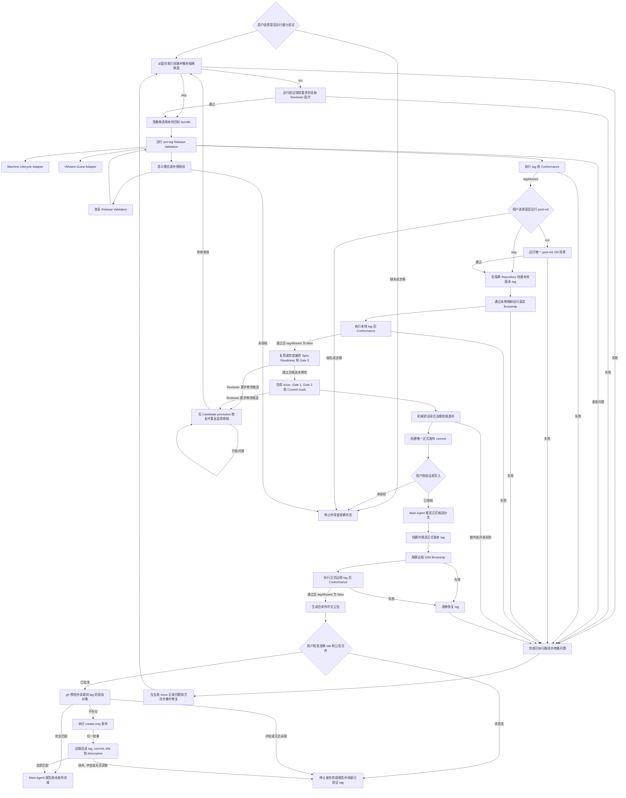

# Agent Repository Workflow Release 长期规格

## Scope

本文定义 ARW 源码仓库重复执行发布验证和创建 GitHub 托管发布对象时的长期规则. 它拥有发布候选内容, 标签前验证, Reviewer Capability Conformance, 跨平台安装验证, 真实目标 Git 仓库, 发布归档, HTTPS 引导安装链路, Release Conformance, 标签授权, 已批准公告交接, GitHub 托管发布对象核验, 发布完成和失败恢复. [Agent Repository Workflow 长期规格](../agent-repository-workflow/spec.md) 拥有产品和仓库工作流. [开发长期规格](../agent-repository-workflow-development/spec.md) 拥有 Workflow Distribution 与平台投影. [安装长期规格](../agent-repository-workflow-installation/spec.md) 拥有 Bootstrap, 安装来源与载荷, Identity, Installation Contract 和 ARW 安装目录. `.scratch` 中的工作规格只记录一次实现工作, 不是发布验证的运行时权威来源.

## Requirement ownership

- `ARW-DOC-006`: `Release Conformance Module` 在 `pre-tag` 中只要已取得可信的已提交候选树, 就用同一个 `repositoryRoot` 与当前候选树直接调用 `Document Terms Module`, 不以归档验证结果作为该检查的前置条件. 它不启动日常 CLI, 不创建另一个树, 不读取工作树, 不启动 Reviewer, 也不保存第二份审核证据. 任一顶层, map 或 context 术语诊断都按稳定规则转换为发布诊断并阻止 tag; 多 context 转换保留规范 context path, 使重叠位置不被发布诊断去重. 同一次完整检查结果保存在 Conformance 成功或失败结果的 `documentTerms`, CLI 共用精简呈现, 但比例不产生发布诊断, 不改变 `status`, `tagAllowed` 或退出码. 其他独立检查继续; 只有无法取得可信候选树时跳过该依赖检查并保留空语言结果. `post-tag` 不重复该检查并使用空语言结果.
- `ARW-TEST-008`: 每次发布验证先询问用户是否确认对根 `package.json.version` 的准确值进行发布验证, 验证受 Git 管理的发布配置, 再取得外部 VM JSON 并询问是否跳过 Reviewer 能力验证. 默认流程从当前已批准的暂存索引在隔离本地 Repository 中创建干净 commit, 先运行源码仓库检查以及 Release Validation Registry 登记的 `pre-tag` 跨平台安装和真实 Repository 场景. `pre-tag` Release Conformance 通过后, 用户必须为当前候选明确选择 `run` 或 `skip` 唯一的 `post-init` VM 场景; 通过的 `run` 或明确的 `skip` 才允许用只作用于验证子进程的 Git URL 映射和本地版本 tag 运行真实 Bootstrap 与 `post-tag`. 完整验证后的 Candidate promotion 先集中修复并重新审核所有 Reviewer 要求的候选修改, 审核收敛后才对最终修复候选重新运行一次完整发布验证; 审核对象和输入未变时复用已有通过结果. 精确机器, 场景, 步骤顺序, 身份, 判断, 归档类型和覆盖分配只由 Release Validation Registry Module 拥有; `release-validation.json` 只提供可独立调整的发布参数和初始化 issue 场景身份. 用户不跳过 Reviewer 能力验证时, 验证规则要求的 Reviewer 能力批次仍是门禁. Registry 必须登记一项可以由 `post-init` 的 `run` 选择执行的完整 Agent 初始化后交接和真实 issue 生命周期覆盖. VM 不安装开发依赖, 不运行 `pnpm typecheck` 或完整 `pnpm test`. macOS 仍是实验性平台.
- `ARW-TEST-013`: `Release Candidate Module` 只接受它所运行的 Repository 中没有已暂存, 未暂存或未跟踪变化的已提交 `HEAD`, 从候选可达的最高较低稳定 SemVer tag 选择基线, 没有较低 tag 时使用当前 Git 对象格式的空树, 并返回排序且唯一的基线到候选变更路径. 本地 `pre-tag` 要求隔离远程不存在当前版本 tag, 本地 `post-tag` 要求隔离 Repository 两端 tag 准确指向验证 commit; 正式远程 `post-tag` 要求 Source Checkout 与规范 `origin` 的 tag 都准确指向最终发布 commit. 提交, 树, 基线和变更路径只属于当前连续发布操作, 不进入持久证据.

## Release candidate and continuity

候选版本是安装长期规格定义的源码仓库 `arwVersion`. Release Candidate Module 原样消费该值. 可达的相同版本或更高稳定版本 tag 阻止发布. Tag 时间, 提交距离和调用方提供的基线不参与基线选择. Release Candidate Module 是候选, 基线和变更路径的唯一责任方.

Main Agent 从已批准的完整暂存索引创建隔离本地 commit 和本地裸 Repository. 该 commit 以当前 Source Checkout `HEAD` 为 parent, 但不移动 Source Checkout 分支或 `HEAD`. 验证子进程使用进程级 Git URL 映射把配置的规范远程字符串精确重定向到本地裸 Repository, 使候选中的真实 Git 调用仍消费同一远程字符串, 但不产生规范远程写入. 宿主机从该本地远程取得准确候选对象制作 bundle. 受验系统只从宿主机传入的 bundle 克隆或检出, 不访问远程 Git. 本地 `post-tag` 使用准确稳定版本 tag; 该 tag 只存在于隔离 Repository, 不进入 Source Checkout 或规范远程, 并随候选被替代或流程结束而删除.

当前发布操作由 Main Agent 在同一次活动流程中保留每一轮完整候选结果. 每个新暂存 tree 形成新验证 commit, 并重新运行完整 `pre-tag` VM, `pre-tag` Conformance, 当前候选的 `post-init` 选择和本地 `post-tag` 验证; 被替代轮次不提供通过证据. 版本确认, VM JSON 路径和 Reviewer Capability 选择在同一连续操作中复用, 已经准备且核对过身份的本地目标 bundle 可以复用. `post-init` 选择只绑定一个候选 commit, 新候选必须在自己的 `pre-tag` Conformance 通过后重新取得选择. 这些值不写入 Repository 文档, 发布归档或 Release Conformance 输入.

最终本地候选通过后, Main Agent 进入 Candidate promotion, 完成最终 Spec Readiness 和 Gate 3. 任一 Reviewer 要求修改候选时, Main Agent 留在该阶段修复并重复适用审核; 治理 Input 或 issue subject 变化时先刷新 Spec Readiness, 每次候选变化都重新执行受影响的必要验证和 Gate 3. 全部审核收敛后, 只对最终修复候选重复一次完整本地验证. 重新验证期间候选, 审核对象, 输入和适用规则未变时, 复用已有通过结果, 然后完成 issue 记录和适用 Commit Audit. Commit Audit 仍只在 issue 进入终态且完整本地验证通过后运行; 它要求修改候选时使当前审计失效, 并进入相同的审核收敛和后续完整验证流程.

最终发布 commit 可以与本地验证 commit 不同, 但差异只能是当前发布准备 issue 的准确完成记录和 Commit Audit Engine 映射的正式 Gate 1 与 Gate 2 记录. Main Agent 机械证明其他路径, 模式和字节不变, 并验证全部收尾记录. 该闭合差异不重复 VM, Bootstrap 或完整源码测试. 任一其他差异, 进程中断, 首次候选结果丢失或连续比较无法完成时, 旧结果不提供恢复权威, 必须以新暂存 tree 重复完整本地验证.

## Release validation configuration

根 `release-validation.json` 是需要独立于 Registry 代码调整的受 Git 管理发布验证配置的唯一权威来源. 它保持小型且便于人工审核, 不保存版本字段, 因为配置与读取代码由同一 Git 提交绑定, 不承担旧格式升级责任.

配置只保存规范 ARW Repository HTTPS 远端地址, `prepare-bundles` 宿主命令超时值, VMware `hard-power-off` 兼容性的准确匹配值, 每台受支持机器的 `soft-power-off` 超时值, 以及一个明确的初始化 issue 场景身份. 当前源码仓库候选提交和用户对 `post-init` 的 `run | skip` 决定不进入配置. 候选在每轮发布验证中从准确暂存 tree 创建的隔离 commit 解析, `post-init` 决定在该候选的 `pre-tag` Conformance 通过后单独取得.

`release-validation.json` 的 `vmware.softPowerOffTimeoutMs` 准确使用 `Windows 11`, `Ubuntu`, `Alpine` 三个键, 但配置没有顶层 `machines`, 也不保存任何场景或步骤定义. Release Validation Registry Module 在代码中拥有相同的完整机器键集合, 以及完整场景, 目标类型, 步骤分组, 顺序, 依赖, 前提, 阶段, 审核位置, 选择, 命令与判断分类, 有限操作, 机械约定, 参数和归档类型. Module 验证配置指定的是一个已登记且适用的 `post-init` 场景身份, 并把初始化 issue 操作绑定到 Registry 拥有的固定位置; 配置值不表示用户决定运行该场景. Module 不根据机器名, 场景名或步骤名猜测身份, 配置也不提供通用 Registry 覆盖.

该配置不保存宿主机路径, VM 位置, 快照, 凭据, SSH 身份文件, 主机密钥或其他每台机器的秘密和位置. 这些事实继续只存在于用户为本次发布提供的外部 VM JSON. 外部 VM JSON 保留自己的持久数据格式版本, 并在顶层 `machines` 中使用 Release Validation Registry Module 拥有的相同 3 个机器键. Release Validation Module 分别验证 `vmware.softPowerOffTimeoutMs` 与外部 `machines` 的键集合都和 Registry 相同, 不增加映射字段. `release-manifest.json` 继续只拥有 Installation 清单. `package.json` 继续只拥有软件包身份, 不保存 Repository 远端地址.

Release Validation Module 在任何网络访问或虚拟机状态变化前封闭验证两个配置, `vmware.softPowerOffTimeoutMs`, 外部 `machines` 与 Release Validation Registry Module 产生的完整 Registry 之间的机器键连接. 缺失, 未知字段, 错误类型, 不安全 URL, 无效超时值, 无效兼容性匹配值, 无效初始化 issue 场景身份, 无效 Registry 或键集合不一致都关闭式失败. 调用方不提供这些配置值, 场景身份或 Registry 覆盖值. Bootstrap Module 从该配置投影规范远端地址到单文件生成物; 生成物中的字面值是派生输出, 不是第二权威来源.

## Local validation sources

两个验证目标的源码由仓库外的独立 JSON 提供, 顶层封闭为 `agentAssisted` 和 `plain`, 各自只含绝对 `directory`. 配置文件和目录必须可读取并位于源码仓库之外, 不放入根发布配置或 VM JSON, 不要求原远端或固定原提交. 来源配置的命令交接由[VM 命令](../../agents/cross-platform-vm-commands.md)拥有.

准备时复制目录的当前完整可表示文件, 包含隐藏文件和被忽略的实际文件, 排除原 `.git` 元数据. 原目录只读. 工具在当前会话工作区建立临时 Git 基线和 bundle, 不让忽略规则或换行转换改变提交字节. 临时提交只绑定本次材料, 不代表原项目版本或来源信任权威. 当次目标提交随准备结果交给 bundle 检查和场景计划, 不接受操作者另行覆盖.

同次运行和恢复使用同一组已准备 bundle, 不因原目录改变而重建活动输入. 目录变化只影响下次在新工作区进行的准备. 配置, 复制或打包失败不返回可运行的部分成功, 缺失或损坏的活动 bundle 按失败和清理合同处理. 真实路径, 来源配置和源码不进入版本管理, issue 或发布归档; bundle 继续只作为临时传输输入.

没有较早可达稳定 tag 时, 候选解析可以使用空树基线, 但现有完整发布验证仍要求真实旧版输入. 在这项前提解决前停止正式发布, 不伪造旧版, 跳过旧版矩阵或以源码迁移冒充发布成功.

## Release procedure

每次从开始发布验证到发布验证通过算一次完整发布验证. Main Agent 的第一个操作是读取根 `package.json.version`, 并询问 `是否确认对 <package.json.version> 版本进行发布验证?`. 用户的无歧义肯定回答只允许开始本次发布验证, 不授权发布或外部写入. 缺失, 拒绝或含糊回答不进入下一步. 用户指出软件包版本值与要进行发布验证的版本不一致时, 当前发布验证终止; Main Agent 只报告需要在发布验证之外另开 issue 修改软件包版本并形成新候选, 不自动创建 issue, 修改受 Git 管理的文件或继续任何验证步骤.

版本确认后, Main Agent 先验证当前候选中的 `release-validation.json`, 再向用户索取一次本次使用的外部 VM JSON 绝对路径, 并在任何 Reviewer 能力准备或 Reviewer 线程启动前询问是否对本次发布验证完全跳过 Reviewer 能力验证. 用户的回答必须无歧义地归一为当前发布验证的 `skip` 或 `run`: `skip` 不运行 Reviewer 能力批次, `run` 执行验证规则要求的批次. 缺失, 拒绝或含糊回答使流程在任何 Reviewer 能力操作前暂停. 版本确认, 外部 VM JSON 路径和 Reviewer 选择都只适用于当前发布验证, 不能沿用另一次流程的回答, 路径, 授权或跳过选择. 外部 VM JSON 同时供 Main Agent 和验证工具读取, 可以包含 VM 生命周期, 远程访问, 受验系统凭据和运行时路径等必要环境事实. 它的路径, 内容和凭据不得写入 Repository 文档, issue, 归档或其他发布证据. 准确数据格式和宿主机验证规则由[跨平台 VM 验证规则](../../agents/cross-platform-vm-validation.md#release-vm-configuration-handoff)拥有.

Release Validation Module 按 VM JSON 和冻结的 Scenario Plan 编排虚拟机生命周期. 不同虚拟机最多按已经验证的并发上限有界并发, 同一虚拟机内的场景和生命周期严格串行, 最终结果仍按 Registry 顺序. 每个场景在任何受验项目状态变化前独立完成按需强制关机, 恢复准确快照, 关机状态和当前快照身份检查, 后台启动, 受验系统地址发现, 严格主机密钥就绪检查以及唯一工作目录和主目录创建, 然后运行该场景. 取回全部可用结果字节后执行最终强制关机, 准确恢复快照并重复相同检查; 清理通过后才运行同一虚拟机的下一个场景或完成归档. 发布验证不读取, 保存或比较虚拟磁盘链. 只有场景本身要求优雅重启或关机时才使用受验系统软操作. VM 清理事实不进入发布归档. Main Agent 不逐步编排这些机械生命周期操作, 但继续分析任何失败并决定是否采用临时补偿.

发布准备和后续外部发布按以下顺序执行:

1. Main Agent 读取根 `package.json.version`, 并询问 `是否确认对 <package.json.version> 版本进行发布验证?`. 只有无歧义肯定回答才继续. 版本不一致时当前发布验证终止.
2. Main Agent 封闭验证 `release-validation.json`, 再取得本次发布验证的 VM JSON 绝对路径. 在任何 Reviewer 能力 `prepare` 或线程启动前, 取得当前发布的 `skip | run` 决定. 同一连续流程的修复轮次复用版本回答, 路径和选择, 但每次运行仍重新验证配置.
3. Main Agent 从当前 issue 已批准并暂存的完整索引创建隔离 commit 和本地裸 Repository, 冻结版本, commit, tree, 基线和变更路径. Source Checkout `HEAD` 不移动. 验证进程只在子进程环境中把配置的规范远程 URL 映射到该本地 Repository.
4. `run` 时对变更路径影响的 Codex Reviewer 能力执行发布规则要求的批次. `skip` 不运行该批次, 且只豁免这项能力证据.
5. `prepare-bundles` 从隔离 Repository 取得候选 commit, 从单独提供的仓库外来源 JSON 定位两个本地源码目录, 复制其当前内容并建立临时 Git 基线, 制作 Registry 要求的 bundle. 同次运行使用同一组已经准备的目标 bundle; 再次准备使用新工作区并重新读取当前目录, 不覆盖活动输入.
6. Release Validation Runner 按 Registry 执行全部 `pre-tag` 平台, 生命周期和真实 Repository 场景. 它继续所有不依赖失败结果的路径, 使用路径交接语义判断和补偿, 并在每个可归档场景清理通过后创建规范 tar. `post-init` 场景不进入这份 Scenario Plan.
7. 完整结果没有 `diagnostic`, `unresolved`, 正式失败, 待处理交接或清理失败时, 在隔离 Repository 运行一次 `pre-tag` Release Conformance. 成功结果必须包含 `tagAllowed: true`.
8. Main Agent 为当前候选创建一次 `post-init` 选择交接, 并向用户询问是否运行 Registry 中唯一的 `post-init` VM 场景. 只接受明确的 `run` 或 `skip`, 不设默认值. `run` 执行该场景的完整生命周期, Agent 交接, 后续机械验证, 清理和归档; 任一失败都阻止当前候选, 且不能改用 `skip`. `skip` 不构造 Scenario Plan, 不启动 VM, 也不创建该场景归档. 只有通过的 `run` 或明确的 `skip` 返回 `tagAllowed: true`.
9. 只在隔离本地 Repository 创建准确版本 tag, 使用同一进程级 URL 映射运行候选中的真实 Bootstrap, 创建 Registry 登记的 `post-tag` 归档, 再运行本地 `post-tag` Release Conformance. 成功结果必须包含 `tagAllowed: false`. 这些步骤不访问或修改规范远程.
10. 任一候选失败时, 先完成全部可执行路径和补偿调查, 再把实际问题和修复方法记录到当前发布准备 issue, 直接修复并暂存. 每项修复不单独运行 Spec Reviewer, Code Review 或 Commit Audit Reviewer. 新暂存 tree 形成新隔离 commit, 并从本节第 4 步重新运行适用 Reviewer Capability, 完整 `pre-tag` VM, `pre-tag` Conformance, 新候选的 `post-init` 选择和本地 `post-tag` 验证.
11. 完整本地验证成功后, 对同一个暂存候选进入 Candidate promotion, 完成最终 Spec Readiness, 必要验证和 Gate 3. 任一 Reviewer 要求修改候选时, 在该阶段直接修复并重复适用审核. 治理 Input 或 issue subject 变化时先刷新 Spec Readiness; 每次候选变化都重新执行受影响的必要验证和 Gate 3. 没有未解决问题后, 如果候选发生过修改, 用新的完整暂存 tree 创建新隔离 commit, 并从本节第 4 步只对最终修复候选重复一次完整本地发布验证.
12. 完整本地验证重新通过, 且审核对象, 输入和适用规则未变时, 复用已有的 Spec Readiness 和 Gate 3 通过结果. Gate 3 通过后, 把当前发布准备 issue 更新为 `completed`, 只增加允许的完成标记和实际证据. 终态转换按通用提交工作流运行 Gate 1, Gate 2, Commit Audit 和 `commit-audit verify`. Commit Audit Reviewer 要求修改候选时, 当前审计失效, 带着该候选修改返回本节第 11 步; 审核收敛并按本节第 11 步重新完成完整本地验证后, 才重新执行 Commit Audit.
13. Main Agent 机械确认本地验证 commit 与最终索引之间只增加本节第 12 步的 issue 完成记录和 Engine 映射的正式 Gate 1 与 Gate 2 记录, 并验证这些治理收尾. 任一其他差异使本地发布验证失效; Main Agent 在当前 issue 中记录问题和方法, 修复后用新的完整暂存 tree 创建新隔离 commit, 并从本节第 4 步重新验证. 闭合的收尾差异不重复 VM, Bootstrap 或完整源码测试.
14. 全部提交关卡通过后创建唯一正式发布 commit. 当前发布准备 issue 的职责在此结束. 后续外部发布操作由发布规则直接授权, 不需要另一个 issue.
15. 在当前用户的外部写入授权下, 把正式候选分支推送到规范 `origin`, 确认远程分支和当前版本 tag 状态, 再把准确 commit 取得到已准备的候选裸 Repository. 创建并推送准确版本 tag 后, 不使用本地 URL 映射运行真实远程 Bootstrap 和正式 `post-tag` Conformance.
16. 正式远程 `post-tag` 成功后生成仓库外公告文件, 取得用户对完整 title 和正文的一次批准, 再预检并调用外部 `gh`. 完全匹配的既有对象直接满足该阶段, 冲突对象关闭式停止, 缺失时才执行 create-only 创建. 创建后或结果不明确时只读回远端对象. 只有 tag, commit, title 和 description 全部匹配才报告版本发布完成.

### Failure handoff and diagnostic continuation

验证发现任何问题时, 当前候选先完成仍能安全推进的工作, 再交接需要判断的失败:

1. Runner 保存该生命周期或步骤原本定义的不可变正式失败结果, 继续全部不依赖待处理用户响应的可运行路径, 并立即执行适用的机器安全操作.
2. 没有更多记录可以推进时, Runner 才统一返回 `paused` 和当前会话的待处理清单路径. 清单按 Scenario Plan 配对每个原结果路径和最小 `responseTemplatePath`, 不解释错误或修复.
3. Main Agent 读取原结果, 使用非机械化手段检查 VM, 判断临时补偿是否安全且必要, 设计并在 Runner 外执行补偿. Runner 不描述, 选择或执行补偿.
4. Main Agent 编辑清单指定的准确模板文件本身, 把同一路径传给 `resume --input`. Runner 拒绝另存副本.

Runner 在收到已应用补偿的响应后不重放原变更操作. 继续执行前, 仍须通过失败步骤已有的预期状态检查:

| 失败类型 | 补偿后的检查与继续条件 | 再次不通过 |
| --- | --- | --- |
| 机械检查失败 | 执行已有的只读预期状态检查, 通过后从下一依赖步骤继续. | 保存该检查原本定义的结果, 创建新的单次授权并再次暂停. |
| 语义判断失败 | 重新收集完整事实, 创建新的 `semantic-judgment` 移交项, Main Agent 判断通过后才继续. | 保存判断结果并创建新的单次授权. |

补偿解锁的下游记录只标为诊断. 原失败, 诊断结果和未解决记录都不进入正式归档, 不被 Release Conformance 当作通过证据, 也不改变候选已失败或不能发布的结论. 所有源码仓库修复只在本次可执行验证结束后集中处理. Main Agent 把问题和方法记录到当前发布准备 issue, 不为单个验证问题另建 issue, 不修改 effort spec, 也不在每项修复前后启动 Reviewer. 修复形成新隔离候选后, 重复完整 `pre-tag` VM, `pre-tag` Conformance, 新候选的 `post-init` 选择和本地 `post-tag` 验证.

Release Candidate, Reviewer Capability Conformance, Archive, Release Conformance 和 Tag-after Module 都不执行提交, 分支推送, tag 创建, tag 推送或 tag 删除. 这些外部 Git 写入由 Main Agent 逐次核对准确目标, 候选, 前置授权标志和远端身份后执行.

## GitHub release publication

GitHub 托管发布对象只在同一次连续流程的 `post-tag` Release Conformance 成功后创建或确认. 公告的结构, 内容选择和安装方法遵循 [Source Checkout 发布和恢复](../../agents/source-checkout-release-publication.md#publish-the-github-announcement). 本规范只拥有公告在发布顺序中的位置, 已批准 title 与 description 的交接, 以及 GitHub 托管发布对象的创建, 核验和恢复, 不复制公告内容合同.

公告保存在 Repository 之外. Main Agent 向用户展示准确 title 和完整 description, 并取得一次覆盖这两个值的明确批准. 批准绑定准确文件字节; Main Agent 只把同一文件作为 `gh` 的正文输入, 不在批准后重新组成或改写正文. 任何字节变化都使批准失效.

Main Agent 在写入前证明本地与规范远端的准确版本 tag 都指向同一已验证候选, 核对准确 GitHub 项目, title 与公告文件, 并确认外部 `gh` 已通过认证预检. 它先读取同 tag 的 GitHub Release. 只有 tag, 经 Git 解析的 commit, title 和正文全部匹配, 且对象为正式已发布 Release 时才视为幂等成功; `targetCommitish` 不能单独证明 tag 提交. 冲突或读取失败时停止. 只有明确不存在时才使用显式项目, title, 公告文件和 `--verify-tag` 创建, 不提供 `--target`, 发布资产或自动公告.

创建调用成功后仍必须读回远端对象. 调用超时, 连接中断或结果不明确时也只执行相同只读核验, 不盲目重复创建. 只有读回的 tag, commit, title 和 description 全部与已批准输入匹配时, GitHub 托管发布阶段才成功. 缺失, 冲突或无法读取时保留已经验证的 tag, 不报告版本发布完成, 不自动更新或删除远端对象, 并从准确远端状态等待新的用户决定.

创建 GitHub 托管发布对象是 Main Agent 使用外部维护者工具完成的操作, 不是新的 ARW runtime Module, GitHub HTTP Module, 认证配置或持久状态. ARW 代码不读取 `gh` 凭据, 不管理它的安装和更新, 也不因这项外部发布操作取得 GitHub API 或私有源码传输责任.

## Reviewer capability gate

Reviewer Capability Conformance 只运行变更路径命中的固定 Codex Reviewer. Claude Code 只承担原生格式, 准确初始文件字节, Workflow Distribution, 平台投影和变更检测的确定性验证. 实时能力门禁不属于每次提交的 Commit Audit 或 Gate 3.

每个受影响 Reviewer 的一个批次包含 3 次具有独立身份的完整重复. Code Standards, Code Spec 和 Commit Audit 的每次重复各运行其唯一场景的一个全新实例, 因而每个角色一批有 3 个实例. Spec Readiness 的每次重复运行两个场景各一个全新实例, 只按相同重复序号配对, 因而一批有 6 个实例. 每个实例具有独立 `instanceId`, 只属于一次重复, 并使用全新线程和隔离场景工作区. 平台容量不足时可以按准备顺序分批执行, 但完整重复与实例集合, 同序配对, 同批输入和答案隔离保持不变. 场景名称和交接顺序固定且中性, 不泄露隐藏预期; 调用方把返回的 `instanceId` 作为当前 `prepare` 的不透明绑定值, 不从中推导隐藏预期或能力优先级. 这些实例只用于定向和发布能力验证, 不改变普通真实审核的实例数量.

每个实例由 Reviewer 执行一次独立审核. 原始报告中的所有可评分内容使用同一逐用例评分规则, 表示格式妨碍解析时由 Main Agent 在独立副本中修正, 保留原件及全部判断和证据. Code Standards, Code Spec 和 Commit Audit 的一次重复汇总其唯一实例的全部用例; Spec Readiness 先合并同序两个场景实例的全部问题用例和干净用例, 再计算该重复的 F2, 不先计算场景分数再等权平均. `repetitionScores` 保留 3 个折减前 F2 分数, 其算术平均值是折减前分数 `scoreBeforePenalty`. 任一实例存在表示格式错误, 错误的来源或证据引用, 缺失要求, 重复或拆分要求记录, 或违反适用检查停止规则时, 只把其所属重复的 F2 乘一次 `0.9`; 同一重复内多项或多类错误不累计折减, 没有这些错误时保留原分数. 普通漏报, 误报及证据覆盖不足按逐用例规则失分, 不仅因判断错误额外折减. `finalRepetitionScores` 保留 3 个已调整分数, 其算术平均值 `score` 是唯一权威分数. 能力通过只要求 `score >= 0.75`, 单次重复没有独立门槛.

能力验证和 benchmark 只在同一审核任务最终交付后按既有评分合同计分. 自动接续及提供方内部错误恢复仍属于运行程序内部, 尚未作为调用方的失败结果交付, 因而这些过程及其中已经恢复的工具错误不触发分数折减; 中间回合状态或恢复次数不改变实例的能力结果. 最终绑定报告中的真实错误仍按上述用例及折减规则处理, 实际来源违规继续按会话检查合同处理.

定向与发布能力验证沿同一评分路径计算权威结果, 同时消费共享 Reviewer 运行计量, 并列展示逐实例工作耗时, 各类原生 token 消耗及任务平均和模型阶段两类输入输出速度. 计量遵循[产品运行计量合同](../agent-repository-workflow/spec.md#isolation-and-measurement)与[工作时间合同](../agent-repository-workflow/spec.md#model-work-time), 保留观察来源及适用的估算标记和依据, 不另定义速度公式或计时机制. 评分与计量按当前准备记录中的 Reviewer 身份和 `instanceId` 关联, 使审核质量与运行效率对应同一实例, 不用其他实例的数据补足结果. benchmark 的已有统计合同由其操作权威拥有, 本文不重复声明.

因模型自身行为完全没有可评分内容的实例, 在 Main Agent 核对原生会话与冻结场景并确认原因后, 全部用例记 0 分. 已有可评分内容继续计分, 缺失判断的用例记 0 分; Spec Readiness 配对中的另一个实例仍正常评分, 两个场景的全部用例保留在分母中. 准备, 运行, 传输或测量错误及未知原因使结果无法可信评分时, 不产生分数, 先修复后按实际影响范围恢复. 输入身份, 当前准备绑定, 原生会话和来源隔离条件独立于分数核对; 有效性条件失败不能被高分掩盖. 精确逐用例规则, 错误记录与计分输入由[评分规则](../../agents/reviewer-capability-scoring.md)拥有.

Code Review finding 使用[共同证据规则](../../agents/reviewer.md#code-review-evidence)形成可独立复核的最小完整证据. 同一真实问题可以从多个等价代码位置获得证明. 隐藏用例允许同一 `check` 声明多个完整证据位置, 使正确指向分配点或查询点的 finding 不会仅因未采用写入点锚点而被误判. 验证器在单个实例内按[问题关联规则](../../agents/reviewer-capability-scenarios.md#problem-association)逐位置完整匹配, 按[问题评分规则](../../agents/reviewer-capability-scoring.md#problem-cases)选择最高分位置且只形成一次关联, 然后才计算重复分数. 证据不能跨位置拼接, 既有评分公式和重复 finding 的原子性惩罚保持不变.

当前有效候选的 3 次完整重复形成一个 Reviewer 批次. 最终分数达到 `score >= 0.75`, 且全部强制门禁与全部实例会话检查通过时, 即满足发布能力收敛. 模型报告中的格式, 引用, 覆盖和检查停止错误按上述规则失分及折减, 不独立使批次失败. 结果只在同一 Reviewer 的当前有效重复集合内汇总, 不跨 Reviewer 求平均. 每个场景的每次重复只消费一份当前有效的完整实例结果; 重跑结果替代对应受影响结果, 未受影响的场景与重复保留其有效结果. Spec Readiness 按同序号配对当前有效的两个场景结果计算重复分数.

发生错误时, Main Agent 先评估错误对整个场景和各次重复结果的实际影响. 所有情况均先修复错误, 再按确认的影响范围恢复: 如果错误影响当前场景全部重复, 重新准备该场景全部 3 次重复并使用全新 Reviewer 会话; 如果只影响当前重复, 只重跑该重复, 重新执行的实例使用全新 Reviewer 会话; 如果不影响当前重复的结果, 无需重跑审核, 保留已有结果. 未受影响的场景和重复保留有效准备, 原始报告, 会话证据与评分输入. 表示格式问题按上述独立副本规则处理. 候选, Role, 场景或评分合同变化也按实际影响确定哪些结果失效, 在受影响范围内修正并重新建立有效绑定. 错误修复保留 Reviewer 原始报告的判断和证据, 不改变既有评分公式或绕过强制门禁; 最终验证仍要求完整的 3 次重复和全部适用场景.

能力验证按实际调用用途采用[产品运行合同路由的提供方程序时限](../agent-repository-workflow/spec.md#capacity-and-recovery), 时限消费同一[模型工作时间](../agent-repository-workflow/spec.md#model-work-time). 暂时没有最终输出或草稿仍未完成不构成失败; 未达到适用停止条件时, Main Agent 读取完整会话记录并观察实际进展, 不以单次等待超时终止或替换 Reviewer. 达到适用程序截止, 用户明确结束, 或记录证明任务确实无法继续时, 按准确运行事实处理结束. 普通审核的用户等待沟通仍只由[Reviewer 指引](../../agents/reviewer.md#machine-operations)拥有.

Codex Platform Host 拥有每个全新 Reviewer 实例线程的正式输出和完整会话记录. Main Agent 按[会话检查规则](../../agents/reviewer-capability-session-inspection.md#inspection-boundary)检查重复与 `instanceId`, 输出身份, 候选与场景绑定, 完整性, 会话中的禁止来源读取和实际进展. 固定生成的交接在接收方记录中只有密文时, 该规则使用已知准备内容, 实例绑定和平台现有的发送方与接收方事实完成匹配, 不要求解密或直接比较明文; 实际观察和初始交接后的全部消息仍属于检查范围. 文件不可用, 不可解析, 身份不匹配, 无法匹配的交接, 来源不明的附加消息, 禁止来源读取或不可恢复失败使当前批次关闭式失败. 自动 `verify` 取得最终正式成功后, Main Agent 另行在准确 `preparedPath` 的父目录原子写入 `release-validation-report.md`; 评分运行时代码不生成该报告. 报告中的批次结果先写最终分数和折减前分数, 紧接着用说明文字按稳定顺序写 3 个折减前重复分数, 3 个已调整重复分数和原始错误记录, 并记录各实例的错误及适用的表示修正情况. 其他诊断计数不与权威结果混排. 报告再逐个实例记录 Reviewer 身份, 重复身份, `instanceId`, 场景, 正式结果, 会话 ID, 平台原生路径, 检查范围, 解析结果, 启动上下文结果, 检查结果和准确发现项; 没有发现项时写 `None.`. 会话不可用或检查失败时, 只要该批次目录仍可写, 报告就保存全部已知字段和准确失败. 已完整计算的分数可以保留为诊断, 但不能改变批次失败结论. 报告缺失或写入失败使该批次失败. 该报告, 正式输出与完整会话只属于当前 `.tmp` 工作区, 不复制进归档, 受 Git 管理的 Repository 或跨进程恢复状态, 也不自动清理平台原生会话记录.

定向优化在每个完整实时轮次后按[轮次间用户审核](../../agents/reviewer-capability-session-inspection.md#human-review-between-targeted-rounds)取得下一轮具体方案批准. 批准后的夹具修改完成[独立质量审核](../../agents/reviewer-capability-scenarios.md#fixture-authority)即可直接进入该轮适用验证, 规模较大的场景重建则必须在修改前列入批准方案. Agent 指令, 长期规范和其他受保护文档仍独立遵循[准确差异批准](../../agents/rule-and-design-changes.md#human-review). 批准批次使普通就绪失效时, 修改与定向检查之间的例外, 以及优化结束后关闭 issue 前必须重新完成普通 Spec Readiness 的要求, 均遵循 [Spec Readiness 定向例外](../../agents/spec-readiness.md#source-checkout-targeted-reviewer-optimization-exception).

### Targeted Reviewer error analysis

场景质量的独立盲审具有单独的启动授权边界. 每次开始新的盲审前, Main Agent 说明范围和预计耗时, 取得用户对该次盲审的明确同意; 夹具修复或验证授权不自动包含盲审. 同一未变更可见场景的两阶段审核和必要质疑不重复请求授权, 只修改隐藏预期时复用原审核线程. 该边界保留独立质量要求, 让用户在承担审核耗时前决定启动时机. 具体流程遵循[场景质量规则](../../agents/reviewer-capability-scenarios.md#fixture-authority).

四个 Reviewer 的能力评分复用多套完整证据位置表达最小证明及合理直接佐证组合, 不跨位置或 finding 拼接. 评分按冻结来源排除可确定的空白行, 保留无关正文的精确率惩罚; 空白不能提供必要证据, 无效定位不能以此豁免. 该处理不改变正式证据归一化或 JSONL 文件格式, 具体计分遵循[评分规则](../../agents/reviewer-capability-scoring.md).

Code Standards, Code Spec, Spec Readiness 和 Commit Audit 的每个定向优化轮次, 都由 Main Agent 根据场景和适用规则独立核查全部实例的完整最终 finding, 再对照隐藏预期. 语义确认接受或拒绝的候选, 以及没有形成候选的问题都属于核查范围, 隐藏预期和机械得分不能证明问题成立.

每轮报告展示按数量降序排列的错误分组表或列表, 包含各组数量, 具体表现, 支持判断的证据和可能原因. 明确统计单位, 完整核查数量和总数, 同一 finding 是否允许多组计数, 以及跨实例重复出现的计数方式. 漏报单独根据已核实的问题清单判断, 不把未满分用例数量作为漏报数量. 原因分析区分已观察事实与待验证假设, 不把调用次数或分数变化直接解释为原因.

Reviewer 错误, 场景缺陷, 隐藏预期遗漏或错误, 评分器问题和未决规则解释分别记录. 同一问题跨轮追踪其首次发现, 当前判断, 修正范围和验证证据, 区分已修复, 未修复, 修复不完整和仍有争议; 未决事项在取得决定前保持未决, 不在后续报告中默认为已确认结论. 已发现的真实问题仍须逐句核对, 不能连带接受错误附加断言. 当前未决工作由持续更新的优化清单组织, 其固定中文章节, 单项归类, 状态更新及简洁性要求遵循[清单维护规则](../../agents/reviewer-capability-session-inspection.md#session-optimization-tracking). 清单保存当前状态, 跨轮处理历史留在对应报告中.

每轮先展示本批次的最终分数和折减前分数, 紧接着用说明文字展示 3 个折减前重复分数, 3 个已调整重复分数和原始错误记录, 再展示同一角色前两轮的最终权威分数. 每次向用户展示评分和耗时时, Reviewer 耗时以逐实例明细为主要展示项, 本轮总墙钟和实例工作耗时合计作为补充; 按[定向轮次展示规则](../../agents/reviewer-capability-session-inspection.md#human-review-between-targeted-rounds)标明角色, 场景, 重复, 实例及并行重叠, 并说明场景或计分口径差异. 具体轮次记录留在验证证据中, 长期规范只保存上述持续要求. 完整核查, 会话检查, 原始结果保留和下一轮授权遵循[定向轮次检查规则](../../agents/reviewer-capability-session-inspection.md#complete-finding-checks-in-targeted-rounds); 修复场景或预期不追溯使旧轮次通过.

## Step validation

每个场景从准确快照和相互隔离的受验位置开始, Scenario Plan 在任何场景变化前冻结前提与当前步骤选择. 每个产品命令或有限操作完成后, Release Validation Module 捕获完整实际结果和 Registry 判断所需的全部可观察变化, 再执行机械判断或创建准确的 Main Agent 语义移交项. 已接受结果成为下一步的比较基线. 捕获或判断失败使当前步骤失败, 只阻断依赖该结果的正式后续步骤; 其他独立场景和临时补偿发现继续. 准确的受验系统准备, Git 基线, Repository 变化捕获和移交步骤由[跨平台 VM 验证规则](../../agents/cross-platform-vm-lifecycle.md#routine-lifecycle)拥有.

每一步只审核预期发生变化的位置. 安装和卸载审核一次性 Installation 用户状态. 初始化, 初始化 issue, 更新, 验证, 移除和重新初始化审核目标 Repository. 不额外扩大到另一位置的副作用.

机械步骤由有限机械约定直接形成完整判断. 命令步骤自动填写 `exitCode`, `path`, `changeType`, `summary`, `matchesExpected` 和其他机械事实; 非命令有限操作不包含 `exitCode`. Runner 在形成最终 `validation.json` 前验证路径集合准确, 完整实际事实没有丢失, 增加或改写. 它不从 `exitCode` 单独推断 `matchesExpected`. 语义步骤模板只把步骤与逐文件 `summary` 和 `matchesExpected` 留空; Main Agent 只填写这些判断字段, 不重新抄写机械事实.

每个步骤目录包含 `validation.json`. 命令步骤字段准确为 `exitCode`, `files`, `matchesExpected`, `summary`; 非命令有限操作或语义步骤字段准确为 `files`, `matchesExpected`, `summary`. `exitCode` 只属于实际执行命令的步骤, 并忠实保存命令子进程返回的整数值. 不执行命令的步骤没有 `exitCode`. 非零值可以在预期拒绝场景中与 `matchesExpected: true` 同时出现. `summary` 是非空自然语言. `files` 按 Repository 相对路径排序且唯一.

每个 `files` 条目的字段准确为 `changeType`, `matchesExpected`, `path`, `summary`. `changeType` 只接受 `added`, `modified`, `deleted`, `type-changed`. 重命名和复制分别记录为删除与新增. 任一文件判断为 `false` 时, 步骤必须为 `false`. 不保存完整差异, 不变文件清单或文件摘要.

命令步骤只在对应流实际可用时保存 `stdout.txt` 或 `stderr.txt`; 一个流可用但为 0 字节时保存准确空文件, 不可用时保持文件不存在. 非命令步骤没有命令输出, 所以这两个文件必须不存在. 输出文件是否存在不替代 `exitCode` 或 `matchesExpected`.

## Archive contract

长期验证文件只使用规范未压缩 POSIX ustar `.tar`. Tar 只接受安全相对路径的普通文件, 拒绝目录项, 链接, 特殊项, PAX 扩展和 GNU 扩展. 文件头使用用户 ID 0, 组 ID 0, 修改时间 0, 空责任方名称, 规范八进制字段, 两个终止零块且没有尾随字节. 归档不包含 `manifest.json`, Bootstrap 辅助程序, 完整差异, 候选来源, Git 身份, 受验系统事实, VM 清理事实, 归档摘要或独立证据 JSON. 归档创建方和 Main Agent 不扫描, 脱敏或拒绝标准输出或标准错误中的凭据.

每个归档根目录只有 `summary.json` 和 `steps/`. 根摘要字段准确为 `matchesExpected`, `steps`, `summary`. `steps` 是准确有序的步骤目录名数组. 只有全部步骤都是 `true` 时, 根结果才是 `true`. 创建方先验证来源, 再以排他创建方式写入目标. 写入失败时删除不完整目标并保留原始错误; 清理失败作为附加错误保留. Conformance 根据归档路径选择准确清单, 直接核对 tar 文件集合, 规范头部和验证对象.

Release Validation Registry 独占 `pre-tag`, `post-init` 和 `post-tag` 的准确归档类型, 输出路径, 顺序和每个归档的步骤清单. `pre-tag` 要求全部已登记 `pre-tag` 归档有效, 且 `post-init` 与 `post-tag` 归档不存在. `post-init` 的 `run` 只接受唯一登记归档及其完整步骤清单, `skip` 不创建归档. `post-tag` 只验证已登记的 `post-tag` 归档. 不保存可选观察归档, 失败归档, 发布联合归档或第二份证据 JSON.

## Platform Installation matrix

长期覆盖要求每个受支持平台在推荐 Node.js 运行时上使用候选可达的最近较低稳定 Release 和当前候选, 完成旧版安装, 同版本 repair, 候选升级, 默认降级拒绝, 明确授权降级到旧版, 再次升级恢复候选, 已安装命令, 来源不可用, 未知配置保留, 保留配置卸载, 重新安装, 删除配置卸载, 测试残留清理和最终状态验证. 不通过改写候选版本号或构造中间版本代替真实 Release. 每个 Release 使用自己的 Installer 和载荷验证器验证来源, 安装后再把已安装 manifest, 命令版本和该 manifest 声明的全部 managed file 字节与同一 Release checkout 比较. Candidate 不导入或解释其他 Release 的内部 payload Module, 也不重建另一份跨版本载荷集合. Windows 另外覆盖受支持的命令行环境以及重启后的当前用户 PATH; POSIX 平台通过新的登录命令行环境重新读取配置文件. Release Validation Registry 独占准确步骤顺序, 身份, 有限操作和归档类型.

测试夹具构造, 受验系统临时 Repository 和各平台最终状态比较的执行细节由[跨操作系统 VM 验证规则](../../agents/cross-platform-vm-lifecycle.md#routine-lifecycle)拥有.

Node.js 24 最低版本覆盖 Registry 登记的实际 ESM 入口, 候选安装, 启动入口, 卸载, 最终状态及完整操作系统行为. 每个登记入口必须有唯一完整的语法检查结果. 同一运行时矩阵不重复执行版本转换或 Repository 场景. VM 不安装 pnpm 或开发依赖, 也不运行 `pnpm typecheck` 或完整 `pnpm test`; 这些步骤只属于宿主机 tag 前检查.

任何 Installation 或 Repository 场景都不下载, 安装, 探测或检查 Codex, Claude Code 或其他 Agent CLI. `workflow init` 投影哪些平台内容来自场景中明确提供的用户选择, 不是来自受验系统上是否存在可执行文件. VM 只需要 Git, 配置的 Node.js 可执行文件, ARW 输入和场景自身所需的操作系统工具.

## Real Repository matrix

真实目标 Repository 的来源与当次临时提交遵循[本地验证来源](#local-validation-sources). 受验系统只从已经准备并检查的 bundle 克隆或检出, 不访问原项目远端, 不自行读取宿主机源码目录或重建输入. 来源位置, 当次提交与 bundle 身份是临时验证输入事实, 不进入发布归档.

长期覆盖同时包括没有既有 Agent 配置的目标, 以及已经由最近较低稳定 Release 注入 ARW Workflow Distribution 的目标. 前者证明全新初始化, 后者先用同一旧版安装验证当前状态, 再证明候选升级和工作流更新. 具体平台, Profile, Code Map 根目录, `include`, `exclusion` 和其他初始化选择只由 Release Validation Registry 登记. 除明确属于 Agent 文档转换或 ARW Managed Content 的变化外, 现有 README 和仓库自有 Agent 内容保持原有字节.

Scenario Plan 在任何虚拟机状态变化前锁定每个操作的适用选择. Release Validation Registry 登记每个场景的首次初始化, 更新, 移除和重新初始化选择, 包括适用的文档转换, 孤立 Code Map README 和移除类别选择. 登记选择只覆盖发布验证需要证明的产品行为, 不限制用户在普通 Repository 中选择其他合法值. 不适用的选择在计划中表示为 `null`, 并在子进程参数中完全省略, 不能序列化为 `false`, `retain` 或空值. Runner 不在步骤前复核或重新选择这些值; 前提不匹配由该步骤的实际结果暴露.

每个平台的 `pre-tag` 矩阵都覆盖 `plain` 与 `agent-assisted` 目标. 长期语义覆盖包括安装, 适用的初始化或既有版本验证, 工作流更新与验证, 工作流移除, 重新初始化, 最终验证和卸载, 并在适用时包括 Code Map 验证. Release Validation Registry Module 独占场景结构, 阶段, 步骤顺序, 身份, 预期发现项和归档类型. `release-validation.json` 只指定哪个已登记且适用的 `post-init` 场景可以在用户选择 `run` 时执行初始化 issue.

Release Validation Registry 登记一个 `post-init` 初始化操作, 用于在用户选择 `run` 时证明完整 Agent 初始化后交接和普通 implementation issue 生命周期. 该目标必须保留真实实施缺口; 没有缺口时操作失败, 不创建或制造缺口. 只有这个登记操作可以省略 Spec Readiness, 且受验 Repository 不请求提交. 用户选择 `skip` 时不执行也不声称通过这项覆盖. 这些发布验证约束不改变普通 Repository 工作流.

Release Validation Registry Module 拥有准确场景结构和执行顺序, `release-validation.json` 拥有初始化 issue 场景身份. [验证规则](../../agents/source-checkout-release-validation.md)和[跨操作系统 VM 验证规则](../../agents/cross-platform-vm-scenarios.md#real-repository-matrix)只共同拥有通用的 issue 生命周期, 冲突处置, 用户交互, 验证证据和执行方式, 不登记场景或步骤顺序.

`agent-assisted` Code Map 验证使用 Registry 登记的完整, 排序且唯一的 `{code, path}` 预期发现项. 操作和当前观察必须准确匹配登记的退出状态, 标准输出和标准错误, 且没有额外发现项. 初始化 issue 完成后的适用验证结果同样只由 Registry 登记. 所有步骤都保留真实退出码, 核对完整 Repository 差异为空, Main Agent 不进行逐步骤语义判断. 不证明发现项与初始化前文件一一对应.

## SSH Bootstrap verification

源码仓库维护命令准确为:

```text
node scripts/verify-post-tag-bootstrap.mjs --version <version> --candidate-repository <absolute-path>
```

它只执行并报告实际事实, 不接收预期提交, 预期摘要或输出目录, 不创建归档. `--version` 必须是规范稳定 SemVer. `--candidate-repository` 必须是本轮 `prepare-bundles` 在会话工作区中创建并保留的候选裸 Repository 绝对路径, 不能是新 Repository 或当前源码仓库. 用法错误退出 2, 执行失败退出 1, 完成预期执行链退出 0.

命令先确认候选 Repository 是裸 Repository, 再通过 `release-validation.json` 配置的规范 HTTPS 远端地址获取准确 `refs/tags/<version>`. 它解析候选引用和 tag 提交, 只有两者是相同完整 Git 对象 ID 时, 才通过 `git show` 取得 `scripts/install-arw.mjs` 的准确 `Buffer` 字节. 它报告来源路径和实际摘要值, 再执行取得的 Bootstrap. 该路径不使用远程 tar, 不包含自定义 tar 解析器. 只有 Bootstrap 子进程环境的 PATH 在最前面放置临时 `node` 启动入口. Bootstrap 查询同一配置远端地址, 显式选择请求的 tag, 获取, 解析和检出, 再启动裸命令 `node install.mjs ...`. 启动入口记录实际 Installer 调用并返回成功, 不执行 Installer. Bootstrap 正常等待子进程并清理, 不增加提前停止分支或终止操作.

Bootstrap 的 `--verbose` 可以出现一次, 由 Bootstrap 消费且不传给 Installer. 重复的 `--verbose` 是用法错误. 其他 Installer 参数保持相对顺序. 详细标准输出是每行一个规范 JSON 对象的严格事件流, 普通诊断和错误只写入标准错误, 事件不含绝对临时路径.

事件流必须报告取得, Bootstrap 启动, 发布选择, tag 解析, 检出验证和 Installer 启动的完整实际观察. 失败时的标准输出只保留失败前已经发生的合法事件前缀. 维护命令不因实际摘要或提交与候选不同而自行停止. Main Agent 以当前连续源码仓库和配置远端为预期来源, 审核实际远端, Repository 路径, 摘要, tag, 提交, Installer 路径和参数. 准确事件数据格式和顺序由实现的公开 Interface 测试拥有, 不在长期规格中复制当前字面输出.

Release Validation Registry 拥有 tag 后归档类型, 路径和步骤清单. 命令步骤保存真实 CLI 退出码, Main Agent 的 `matchesExpected` 和非空摘要. 只有命令和全部比较通过时才创建归档.

## Module Design

这里的 Module Design 保存发布实现必须长期维持的责任划分. Module 是对调用方隐藏实现复杂度的职责单元, Interface 是调用方正确使用它必须知道的完整合同, Seam 是生产 Adapter 与确定性 Adapter 可以替换 I/O 行为的位置.

本节只适用于 ARW 非测试正式运行代码. 用户, Main Agent 和 Platform Host 是发布流程的外部参与者. Main Agent 继续拥有候选连续性, Registry 登记的语义操作和判断, 失败分析, 临时补偿决定, 设计和 Runner 外部执行, 最终结果消费以及全部外部发布授权. VM 生命周期的固定机械顺序, 观察和恢复由 Release Validation Module 编排, 不再由 Main Agent 逐步决定. 正式运行代码不接管 Main Agent 的语义判断或授权.

### Modules

`Release Candidate Module` 唯一拥有候选, 基线, 变更路径和本地或远端 tag 状态的解析. 它消费 `release-validation.json` 中的规范 HTTPS URL, 并在任何远端 tag 查询前要求 `origin` 准确匹配. 它不保存 URL, 也不执行推送, tag 写入或归档.

`Reviewer Capability Conformance Module` 消费当前调用的变更路径, 选择受影响 Reviewer, 通过内部 Candidate Content Git Seam 批量读取已绑定 candidate tree 的 Role 与 Agent instruction bytes, 再绑定 Role 与场景字节. 它不重新选择候选, 不保存源码仓库 Git 身份, 也不替代 Main Agent 对正式输出与会话记录的检查.

`Reviewer Capability Scoring Module` 只拥有单个 Reviewer 场景实例的纯内存关联, candidate 建立及 problem 与 clean case 计分. Conformance Module 保留 artifact Adapter, 完整绑定, 报告错误记录, 模型失误归零输入, 要求绑定及裁决集合验证, 重复身份与 Spec Readiness 同序配对, 每次重复的折减前 F2, 每次最多一次的错误折减, 两组重复分数各自的算术平均及最终门禁.

`Release Evidence Archive Module` 编码和验证规范 tar, 准确清单与验证对象. 它不运行产品命令, 不判断变化是否符合预期, 不保存 Git 身份, 也不扫描或脱敏输出.

`Release Validation Module` 是 `pre-tag` 和 `post-init` VM 验证运行的唯一正式运行责任方. 它验证 `release-validation.json`, 外部 VM JSON, 候选和 Platform Host 会话绑定, 检查宿主机 bundle, 通过 `release-validation.json.vmware.softPowerOffTimeoutMs` 和外部 VM JSON 顶层 `machines` 的同名键连接两个配置, 从 Release Validation Registry Module 取得结合当前初始化 issue 场景身份的完整 Registry, 并在任何 VM 状态变化前按当前阶段构造不可变 Scenario Plan. `pre-tag` 计划只包含该阶段的场景; `post-init` 计划只在已验证的 `run` 选择后包含配置指定的唯一场景. Module 按要求的并发数编排每台机器和每个场景的生命周期, 自动执行有限操作和机械判断, 创建语义移交项和最小临时补偿授权, 保存同一会话的运行状态, 待处理清单和完整结果, 传播正式, 诊断和未解决分类, 执行失败保持, 恢复和最终清理, 并只为可归档场景完成规范归档. 它的受验系统步骤内部还拥有 Repository Workflow plan capture 和从该 plan 形成预期 Repository 状态的确定性转换. 它不拥有候选连续性, Main Agent 语义判断, 失败分析, 临时补偿设计或操作, Release Conformance 或外部发布写入, 也不提供通用 VM DSL, 错误数据格式或修复数据格式.

`Release Validation Registry Module` 是机器, 场景, 目标类型, 阶段, 步骤分组, 顺序, 依赖, 前提, 受审核位置, 条件选择适用性, 命令分类, 判断分类, 有限操作和机械约定身份, 闭合参数以及所需归档类型的唯一机器可读权威来源. 每个场景记录显式包含 `targetKind: "plain" | "agent-assisted" | null`; 消费方不得从机器名, 场景名, 步骤名或 bundle 前提推断目标类型. Registry 在代码中保存这份完整定义, 只从 `release-validation.json` 消费初始化 issue 场景身份, 验证身份后返回完整只读 Registry. 长期矩阵只定义必须覆盖的语义, 不重复 Registry 的当前清单. Registry 不拥有用户的 `post-init` 决定, 状态转换, I/O, 恢复, 判断或归档字节, 配置不拥有步骤结构或顺序.

`Release Validation CLI Adapter` 拥有公开维护命令的参数解析, 路径边界, 退出状态和有界 JSON 输出. 它把 `copy-to-guest` 和 `copy-from-guest` 的具名宿主机与受验系统路径转交给 `VMware Guest Adapter`, 不复制地址发现, 主机密钥固定, SSH, SCP 或平台路径转换.

`Tag-after Module` 只拥有验证 Main Agent 提供的候选裸 Repository, 从配置的公开 HTTPS 远端地址获取准确 tag, 核对候选与 tag 提交, 通过 `git show` 读取并执行其中的 Bootstrap, 临时启动器观察, 事件转发和清理. 它不保存远端地址, 不复制安装长期规格拥有的 Bootstrap 选择与 Installer 交接, 不读取预期值, 不创建发布证据归档或 tag.

`Release Conformance Module` 唯一拥有特定阶段的归档验证, pnpm 版本检查, frozen lockfile 安装, 独立 typecheck 与 test, 其他源码仓库检查, Document Terms 完整结果传播和机械授权结果. 它不自动安装 pnpm, 不维护要求覆盖表, 不计算语言比例或判断预期语言, 不生成业务判断, 也不执行任何外部发布写入.

`Issue Documents Module` 继续拥有普通实施 Issue 的格式和生命周期, 不增加发布专用类型或运行时豁免. 产品的 Agent 初始化后交接继续拥有通用冲突消解要求. 发布流程只决定在哪一个场景真实覆盖并完成该 Issue, 并拥有该步骤省略 Spec Readiness 的工作流层级豁免. 受验 Repository 不请求提交, 所以只由提交触发的门禁不进入该步骤.

安装长期规格独占 Bootstrap, Identity, 正式发布来源验证, Installation Payload, Installation Contract 和 Installer 生命周期. 发布 Module 只消费其公开结果, 或在发布验证中观察真实安装行为; 本文不重新定义这些安装合同.

外部 `Document Terms Module` 唯一拥有源码仓库 Markdown 术语策略, 稳定术语诊断和同一受检集合的完整语言检查数据. Release Conformance 只在 `pre-tag` 以绑定的候选树调用它, 把失败诊断转换为发布诊断并传播语言结果; 它不重新实现术语或语言分析, 不修改工作树, 也不在 `post-tag` 调用该 Module.

### Interfaces

#### Workflow plan and expected state

Repository Workflow plan capture operation 接受 `{choices, state, stepId}`. `state.homeDirectory` 与 `state.targetDirectory` 必须是非空绝对路径, `state.targetKind` 只接受 `plain | agent-assisted`. `stepId` 必须准确指向 Scenario Plan 中登记的 init, reinit, workflow-update 或 workflow-remove 步骤, `choices` 必须准确等于该步骤已经冻结的完整选择. 缺失, 额外或不同输入字段抛出 `TypeError`. Operation 取得当前已安装 Repository Workflow 对该步骤, state 和 choices 形成的最终规范 plan, 并保证在返回或失败前没有执行任何 plan 写入. Reinit 的 plan operation 规范为 `init`; 其他步骤分别规范为 `init | update | remove`.

成功结果准确为 `{diagnostics, operation, operations, profile}`. `diagnostics` 必须为空, `operation` 是规范后的选定操作, `profile` 是该操作的完整规范 Profile, `operations` 保持 plan 顺序, 每项准确为 `{action: "write", bytes, path}` 或 `{action: "delete", path}`; `bytes` 是规范 base64 字符串. 步骤未登记, 产品 Workflow 失败, 无法在写入前取得完整 plan, 非空 diagnostics, 无效数据或不符合封闭结果形状时抛出普通 `Error`. 错误的准确 message 不是 Interface 合同, 且不返回部分 plan.

Repository Workflow expected-state operation 接受 `{before, plan, retainedPaths}`. `before` 是按 path 唯一的变化前普通文件 snapshot 数组, 每项准确为 `{bytesBase64, path, type: "ordinary-file"}`, `bytesBase64` 是规范 base64 字符串, `path` 是安全 Repository 相对路径; 缺失路径不进入 `before`. `plan` 是前述完整规范结果, `retainedPaths` 是排序且唯一且必须存在于 `before` 的路径. Operation 按 plan 顺序应用 write 与 delete, 再恢复明确 retained paths, 成功只返回 `{expectedEntries, expectedMissingPaths}`. `expectedEntries` 按 path 稳定排序并使用同一完整普通文件 snapshot shape; `expectedMissingPaths` 是稳定排序且无重复的安全 paths. 调用 shape 无效时抛出 `TypeError`; plan operation, bytes 或 retained path 与完整输入不一致时抛出普通 `Error`. 错误的准确 message 不是 Interface 合同, 两类异常都不返回部分预期状态. 该纯转换不读取 Git, 文件系统, Workflow Distribution 或子进程.

#### Registry and candidate selection

Release Validation Registry Interface 消费一个非空的初始化 issue 场景 ID 字符串. 该值已经由发布验证配置边界从 `release-validation.json` 读取, Interface 本身不读取配置文件, 不接受完整配置对象或 Registry 覆盖. 成功时返回 `{status: "succeeded", registry, diagnostics: []}`, `registry` 是按 Module 规范顺序排列的完整场景记录数组; 数组和全部嵌套值都不可变, 相同输入始终得到语义相同的顺序与定义, 调用方不能改变 Module 内的权威数据. 非字符串或空字符串输入抛出 `TypeError`. 场景未登记时返回 `{status: "blocked", diagnostics: [{code: "initialization-issue-scenario-unregistered", message: "The initialization issue scenario is not registered."}]}`; 场景不适用时使用相同结果形状, 但诊断准确为 `{code: "initialization-issue-scenario-inapplicable", message: "The initialization issue scenario cannot host the initialization issue operation."}`. `blocked` 不返回 `registry`. Module 内 Registry 定义无效是实现缺陷, 抛出普通 `Error` 且不返回部分 Registry. Interface 不执行文件, 网络, 进程, VM 或其他外部状态操作, 因而没有 `failed` 结果和 `stage`.

#### Post-init choice

`Post-init Choice Interface` 在当前候选的 `pre-tag` Runner 结果通过后创建选择交接. Main Agent 原样提供该结果和当前 `candidateCommit`. Interface 只核对同一候选, `status: "completed"`, 以及 Registry 登记的全部 `pre-tag` 归档按规范顺序处于 `created`; Runner 已经判断的 scenarios, steps, classifications 和 cleanup 不在此重复审核. `pre-tag` Release Conformance 的成功及跨调用连续性继续由 Main Agent 保持, 不增加 Conformance 结果参数或第二份持久证据. 成功交接准确为 `{candidateCommit, choices: ["run", "skip"], decision: null, scenarioId, status: "pending"}`, 其中 `scenarioId` 是配置指定并由 Registry 验证的唯一 `post-init` 场景. 缺少候选绑定, 归档不完整或结果不匹配时关闭式失败, 不创建选择状态.

选择操作只消费 `pending` 交接和准确的 `run | skip`. `skip` 转换为 `{decision: "skip", status: "skipped"}`, 不创建 Scenario Plan, VM 运行或归档. `run` 转换为 `{decision: "run", status: "running"}`, 并只为相同候选和 `scenarioId` 构造一个 `post-init` Scenario Plan. Runner 暂停时保持 `running`; 完整成功及准确归档把状态转换为 `passed`; 任何启动, 运行, 恢复, 清理或归档失败把状态转换为 `blocked`. `blocked` 不能转换成 `skip`, 被替代候选的状态不能用于新候选.

公开维护命令把选择状态包装为 `{candidateCommit, choiceState, resultPath, runPath, schemaVersion: 1, status, tagAllowed}` 并限制在当前会话 WorkspaceBoundary 内. `skipped` 要求两个路径都是 `null`; `passed` 只在同一命令已经审核两个有界路径及其同一场景完整成功结果后形成; `running` 和 `blocked` 返回 `tagAllowed: false`. 只有准确的 `skipped` 或 `passed` 返回 `tagAllowed: true`. Main Agent 必须在创建本地 tag 前通过状态命令核对该状态记录和候选绑定. 状态命令不沿已审核路径再次读取或重复判断 Runner 结果.

Release Candidate Interface 消费 `{phase, remote: "origin", repositoryRoot}`. Module 从同一次已验证的 `release-validation.json` 读取规范远端地址. 在任何远端 tag 查询前, Interface 读取 `origin` 的全部获取 URL, 要求结果准确只有该配置值. 缺失, 额外或不同 URL 返回 `{code: "remote-url-mismatch", message: "Release candidate origin does not match the canonical remote.", stage: "candidate"}`; Git 读取失败继续使用 `git-failure`. 成功时准确返回 `{status: "resolved", candidate}`, 其中 `candidate` 包含 `{baseline, changedPaths, commit, tree, version}`. `baseline` 包含 `{commit, kind, tag, tree}`; 首次发布使用 `{commit: null, kind: "empty-tree", tag: null, tree}`, 其他发布使用较低稳定 tag 的提交, tag 与树. `changedPaths` 是排序且唯一的安全 Repository 相对路径数组. 失败时准确返回 `{status: "failed", diagnostics}`, `diagnostics` 排序且唯一, 每项包含 `{code, message, stage: "candidate"}`. 失败不返回部分候选, 不写 Git 或其他 Repository 状态. 调用方不能提供基线, 预期提交, 远端覆盖值或证据路径.

#### Reviewer capability conformance

内部 Scoring Interface 的创建操作接收已适配的 `evidenceSources`, `expected`, `instanceId`, `reviewerId` 和 `scenarioRoot`, 复制输入并返回同步评分操作. 评分操作接收规范 `checks`, `adjudicationDecisions` 及适用的 clean observation scores, 返回完整单实例用例结果和 candidates, 不读取其他实例, 不组合重复, 不判断批次门禁, 不执行文件, Git 或进程 I/O, 也不保存跨调用状态. 正式验证每次重新创建评分器, 不跨两次 `verify` 缓存 prepared state 或绑定结果.

Reviewer Capability Conformance 的完整发布准备命令 `node scripts/reviewer-capability-conformance.mjs prepare` 不接受调用方参数. CLI 从当前目录发现最近 Git `repositoryRoot` 的绝对路径, 验证受 Git 管理的发布配置, Platform Adapter 返回准确 `{platform: "codex", sessionId}`, 再以 `{phase: "pre-tag", remote: "origin", repositoryRoot}` 调用 Release Candidate Interface. 只有候选解析成功才把 `candidate.changedPaths` 用于 Reviewer 选择, 把 `candidate.tree` 用于读取 Role 字节与创建场景; 调用方不能提供或替换候选或 Platform Host 身份. 成功时准确返回 `{generations, handoffs, preparedPath, reviewerIds, status: "prepared"}`. `reviewerIds` 是变更路径命中的排序且唯一 Reviewer 身份. 每个移交项准确包含 `{instanceId, reviewerId, scenarioRoot, input}`, Spec Readiness 移交项另含 `scenarioId`. `input` 可直接作为共享后台 Agent 机器入口的 `spawn_agent` 输入, 准确包含 `{role, identity: {kind: "isolated", instanceId}, instructions, handoff, cwd, writePaths, reportPath, stateDirectory}`. `role` 等于 `reviewerId`; `instructions` 包含候选树中该 Canonical Role 的完整正文和公共 Reviewer 规则, 不含隐藏答案; `handoff` 是该实例准备的 Reviewer 可见提示. `cwd` 等于 `scenarioRoot`; `reportPath` 等于该实例准备记录绑定的原始报告路径; `writePaths` 只授权该场景内包含 `reportPath` 的准确临时写入范围, 不包含其他实例或 Source Checkout 的文件. `stateDirectory` 准确等于 `preparedPath` 的父目录, 位于发起准备的当前 Main Agent 会话在 Source Checkout 中的临时工作区. Main Agent 从发起准备的 Source Checkout 调用机器入口, 使用户配置和恢复记录绑定该调用方仓库; Reviewer 的受审仓库和实际读取, 写入权限由场景 `cwd` 与路径授权决定. Main Agent 可按能力验证已授权的隔离设置另向 `input.settings` 提供本轮覆盖; 未覆盖时, 同一机器入口按用户配置解析模型, 提供方, 推理强度和服务档位, 准备命令不选择模型或建立成本机制. Spec Readiness 的每个生成项包含对应的 `instanceId`, `draftPath`, `workdir` 和 `scenarioId`; Commit Audit 的每个生成项包含 `instanceId`, `requestPath`, `reviewerId` 和 `workdir`. Commit Audit 的 `requestPath` 只嵌入 Reviewer 可见的 `input.handoff`, 不作为移交项额外字段. `preparedPath` 指向当前 Repository, 平台, Main Agent 会话与本批次唯一运行下的临时记录. 该记录准确包含 `{contracts, mode: "release", platform, reviewerIds, runId}`. 每个合同准确包含 `{instances, platform, reviewerId, scenarioRevision}` 以及发布模式必需的 `roleSha256` 和 `reviewerInstructionsSha256`; `instances` 按准备顺序绑定 3 次重复, 每项包含 `{expected, instanceId, reportPath, scenarioDigest, scenarioRoot}`, Spec Readiness 实例另含 `scenarioId`, 其中 `artifact-promotion` 场景另含 `resultPath`; Code Standards 与 Code Spec 实例另含 `resultPath`, Commit Audit 实例另含 `requestPath`. Code Standards, Code Spec 和 Commit Audit 每次重复各绑定一个实例; Spec Readiness 按相同序号把两个场景实例绑定为一次重复. Code Review 的 `reportPath` 同 `resultPath`, 是对应 `scenarioRoot` 下 `.tmp/review-result.md` 的精确绝对路径, 随准备操作创建并绑定到该实例. Spec Readiness 和 Commit Audit 的 `reportPath` 是对应正式 Request 绑定的 `draftPath`; Spec Readiness 的 `artifact-promotion` 实例的 `resultPath`, `runtime-migration` 生成项的 `draftPath` 均准确等于各自实例的 `reportPath`. Commit Audit 的 `requestPath` 是对应场景内由正式准备入口建立的独立 Request. 准备记录不保存候选提交, 树, 基线或变更路径. 只有全部 3 次重复及其实例准备完成后才返回可执行交接和准备记录; 中途失败不返回部分结果. 缺失会话身份, 候选失败或 Role, 场景, 重复与实例绑定变化时关闭式失败.

局部恢复使用 `node scripts/reviewer-capability-conformance.mjs prepare --prepared <prepared-path> --input <selection-path>`. 准备模式和 Reviewer 集合从原准备记录取得, `selection-path` 指向严格的 `{ "instances": [{"reviewerId":"<reviewer-id>","instanceId":"<current-instance-id>"}, ...] }` 临时 JSON 对象, 只允许非空, 无重复的当前角色与实例身份对集合. 角色与实例身份共同定位准备记录中的一个位置, 同一 `instanceId` 出现在不同 Reviewer 中时不会连带选择其他角色. Main Agent 按[错误影响范围](#reviewer-capability-gate)选择受影响项: 一个场景的全部重复对应该场景的 3 个实例, 一个重复的受影响场景对应其当前实例. 准备流程校验原记录及未受影响项仍可保留的绑定, 为受影响项建立新 `instanceId`, 独立场景, Request, 原始报告与恢复范围, 保留未受影响项的准确绑定, 再物化包含完整当前集合的新准备记录. 局部准备记录在所属模式的既有字段之外, 准确增加 `previousPrepared: {preparedPath, sha256}`. `preparedPath` 是本次来源准备记录的安全绝对路径, `sha256` 是该文件完整字节的 SHA-256, 来源仍位于当前 Repository, 平台和 Main Agent 会话的准备范围. 原记录和旧原始报告保留原字节, Main Agent 不自行更改准备条目. 返回的新 `preparedPath` 绑定全部当前有效实例, `handoffs` 与 `generations` 只包含本次新建项. 后续 `verify` 使用新 `preparedPath`, 输入中以新结果替代受影响项并保留其余有效项, 仍要求每个当前实例恰好一项结果及全部 3 次完整重复. 无效选择或未受影响项绑定已失效时, 准备失败并说明问题, 不静默扩大重跑范围.

局部准备和验证核对 `previousPrepared` 指向的准确文件及其摘要, 再按固定角色, 重复和场景位置核对实例关系. 至少一个位置必须在新准备运行下取得独立的新绑定; 其他位置的实例条目必须与来源记录中的对应条目完整一致, 且仍满足当前适用合同. 新绑定只属于当前准备运行的对应位置, 不接受其他运行中的替换项. 来源链沿相同 Repository, 平台, Main Agent 会话, 模式和 Reviewer 集合核对, 来源缺失, 字节变化, 循环或不一致均失败. 普通完整准备记录不含 `previousPrepared`, 仍要求全部实例属于其自身运行; 连续局部准备重复同一来源核对规则, 不建立另一个评分或结果选择权威.

完整轮次使用返回的每个 `input` 通过共享机器入口启动全新 Reviewer 线程, 收集每个实例的绑定结果, 再用同一 `preparedPath` 调用 `verify --prepared <prepared-path> --input <artifacts-path>`. 产物 JSON 的 `artifacts` 数组按 Reviewer 身份排序且唯一, 每项 `{reviewerId, instances}` 覆盖准备返回的完整 Reviewer 集合. `instances` 按交接顺序为每个已准备 `instanceId` 提供准确一项. 普通输入为 `{instanceId, artifactPaths}`, 路径集合必须是该实例绑定的原始报告, 或该实例成功生成的完整规范产物. Code Review 直接使用绑定的 `resultPath`; Spec Readiness 与 Commit Audit 的规范产物仍经各自正式生成入口取得, 正式生成因模型报告内容错误拒绝时直接评分绑定原始 JSONL. 不同实例不能复用报告路径. 原始报告的来源, 证据, 覆盖和适用检查停止错误保留, 可评分内容继续评分, 不要求先产生正式生成失败记录作为能力评分前提.

表示格式妨碍解析时, Main Agent 保留原件, 仅在同一实例临时工作区的独立副本中修正表示, 输入准确为 `{instanceId, artifactPaths: null, formatCorrection: {originalReportPath, correctedReportPath}}`. 两个路径均为绝对路径, 原件准确等于准备绑定的 `reportPath`, 副本不同于原件且位于同一场景的 `.tmp` 范围. 修正不改变检查, finding, 结果, 要求身份, 问题含义, 来源, 证据选择或定位, 不从聊天或摘要补造报告. 验证器核对原件确有表示格式错误, 绑定原件与副本, 对可解析内容应用同一能力评分, 原始内容错误继续失分并触发所属重复的折减. 没有可评分内容且 Main Agent 确认原因属于模型自身行为时, 输入准确为 `{instanceId, artifactPaths: null, modelFailure: {reason}}`, `reason` 为非空具体原因. 三种输入互斥, 无结果或原因未知不能隐式记为 0 分. Request 与当前候选身份核对始终适用. 普通 Spec Readiness 与 Commit Audit 的正式生成仍执行严格合同, 能力评分不生成普通审核授权, 不把独立副本当成原始报告或提交授权.

各类能力验证实例结果可以另带可选 `measurement`, 消费本次共享运行完成响应中的计量, 按当前准备记录的角色和 `instanceId` 关联. 该数据只供工作耗时, token 和两类速度展示, 不改变原有报告输入互斥关系, 评分, 折减或授权判断. 没有提供计量的既有输入继续按原评分合同处理, 不把未取得的指标当作模型失分; 新观察与估算按[公共计量合同](../agent-repository-workflow/spec.md#model-work-time)和[模型阶段合同](../agent-repository-workflow/spec.md#model-phase-measurement)解释, 不让 Reviewer 在报告内补写这些数字.

`verify` 重新解析当前候选, 核对 Platform Host 身份, Role 和场景摘要, 实例与 Request 绑定及评分输入可信性. 有效性条件失败返回 `{status: "failed", diagnostics}`, 模型报告错误进入同一评分路径. Commit Audit 要求归属无法唯一确定时返回 `needs-requirement-binding`, 交付待绑定来源及原始条目; Main Agent 按[逐要求规则](../../agents/reviewer-capability-scoring.md#problem-cases)为全部待绑定要求指定唯一原始条目或 0 分, 以 `--requirement-bindings <bindings-path>` 交回完整决定. 缺失, 重复, 跨实例或复用条目的决定被拒绝. 四个角色按完整必要证据建立全部问题候选, 不按词组决定关联. 存在候选时返回 `needs-adjudication`, Main Agent 逐项确认同一缺陷, 为每个候选恰好提供一个 `matched` 或 `not-matched` 决定, 以相同 `--prepared`, `--input` 和适用的要求绑定加 `--adjudication <decisions-path>` 重新调用. 无候选或全部裁决完成后计算单实例用例结果, 按重复形成 `repetitionScores`, `finalRepetitionScores`, `scoreBeforePenalty` 和 `score`, 保留原始错误与输入有效性结果, 再按最终分数及其他有效性条件形成批次结论. 不完整, 重复, 额外或格式错误的裁决被拒绝; Main Agent 不改写原始内容, 不拼接证据或直接调分. 成功返回 `{reviewerIds, status: "verified"}`, 失败保留具体原因及能够可信计算的分数. 定向与发布模式共用此 Interface.

最终 `verify` 成功后, Main Agent 读取评分报告与完整会话记录, 完成全部检查, 再另行写入该批次唯一的 `release-validation-report.md`; 评分运行时代码不生成该报告. 命令与报告先展示最终分数和折减前分数, 再显示 3 个折减前重复分数, 3 个已调整重复分数及错误记录. 定向局部观察可用同一准备记录和已取得的绑定输入运行 `score-completed`, 共用相同适配, 要求绑定, 裁决及评分规则, 只形成结果齐备的重复分数. 3 次重复齐备才计算两个平均分, 局部观察不提供批次通过结论. 错误恢复按[发布能力门禁](#reviewer-capability-gate)的实际影响范围执行, 重跑结果替代受影响项, 保留未受影响结果. 输入, Platform Host, Role, 场景, 重复或实例集合, 准备记录, 绑定, 会话或必要验证报告无效时批次失败. 候选连续性仍由 Main Agent 在当前发布操作中负责.

Reviewer Capability 的内部 Candidate Content operation 接受 `{candidateTree, files, repositoryRoot}`. `candidateTree` 是完整 Git tree object ID, `repositoryRoot` 是当前候选 Repository 根, 有序 `files` 的每项准确为 `{filePath, label}`; `filePath` 是安全 Repository 相对路径, `label` 是非空有界诊断身份. Operation 按首次出现位置去重 path. 空输入返回 `{status: "succeeded", entries: []}` 且不观察 Git. 非空输入只通过 Candidate Content Git Seam 执行一次批量观察. 成功返回 `{status: "succeeded", entries}`, entries 保持去重后的请求顺序, 每项准确为 `{bytes, filePath}` 且 bytes 是独立 copy.

候选内容缺失返回 `{status: "failed", code: "candidate-content-missing", filePath, message}`, 内容类型或完整性无效返回 `code: "candidate-content-invalid"`, Git 观察失败返回 `code: "candidate-content-git-failed"`. 非成功结果不返回部分 entries; `filePath` 只在失败能绑定准确请求 path 时出现. 无效调用 shape 抛出 `TypeError`. Reviewer Capability prepare 在任何持久 prepared state 前消费完整成功 entries; verify 漂移检查重新读取所需准确子集. 失败继续使用现有关闭式 prepare 或 verify 失败结果, 不改写候选选择或跳过 Reviewer.

#### Archive creation and verification

Archive Interface 以长期定义的归档类型创建或验证一个准确 tar. 创建方只接受已经完成业务审核的来源目录, 完整验证后排他创建. 验证方在内部完整解码摘要与步骤, 并在 Release Validation 核对中逐字节比较不可变来源清单, 但成功时只返回验证元数据, 不向调用方暴露第二份解码证据. Interface 不接受清单, 摘要值, 候选或发布对象.

归档创建方准确消费 `{archiveKind, outputPath, sourceDirectory}`. `sourceDirectory` 必须包含该类型的准确已审核清单. Release Validation Module 按当前会话工作区和归档类型计算规范的 `archives/<archiveKind>.tar` 绝对 `outputPath`; 公开调用方不能覆盖. 成功时准确返回 `{archiveKind, entryCount, outputPath, status: "created"}`. 创建方只读来源, 可以创建输出父目录, 再以排他创建方式写一个目标. 来源或清单失败发生在目标创建前. 目标创建后的写入或关闭失败删除本次不完整目标并抛出原始错误; 清理错误作为附加错误保存, 不覆盖原始失败. 已有目标保持不变并使调用失败.

归档验证方准确消费 `{archiveKind, archivePath, sourceDirectory}`. 归档路径和来源路径必须指向当前会话工作区中的普通文件或目录. 成功时准确返回 `{archiveKind, archivePath, entryCount, status: "verified"}`. 验证除规范 tar 和清单外, 还逐字节比较归档普通文件条目与 `sourceDirectory` 的完整规范清单. 类型未知, 路径无效, 读取失败, JSON 数据格式错误或判断不变量错误时属于操作错误. 已经绑定准确场景的规范头部, 清单, 来源字节, 归档创建或归档验证不匹配保存为可绑定的领域归档失败, 使用准确 `archiveReason`, 保持 `archive: null`, 并继续独立场景; 不返回部分解码内容, 不修改归档或来源. Release Validation Module 在创建前提交待处理的 `{archiveKind, outputPath, sourceDirectory}`, 创建并验证后提交已创建结果, 最后才写完整运行结果. Resume 对待处理记录在输出不存在时重试创建和验证, 输出存在时只验证.

源码仓库公开维护入口提供 2 个完整生命周期命令: `run --config <absolute-json-path> --candidate <full-object-id> --workspace <absolute-session-workspace>` 和 `resume --run <absolute-run-path> [--input <absolute-response-path>]`. `validate-config`, `prepare-bundles`, `copy-to-guest`, `copy-from-guest`, `run-step` 和 `finalize-step` 继续作为聚焦诊断和底层维护操作, 不作为正式发布中 Main Agent 的逐步编排路径. 未知, 缺失, 要求绝对路径时使用相对路径, 多余或重复的参数属于用法错误并退出 2, 标准输出为空且标准错误是固定用法说明. 领域状态为 `paused` 或 `completed` 的成功结果退出 0, 标准错误为空且标准输出是一行有界的规范 JSON. 操作错误退出 1, 标准输出为空且标准错误是一行规范 JSON.

#### Run configuration and scenario planning

`run` 消费 `{candidateCommit, configurationPath, workspaceDirectory}`. `resume` 消费 `{responsePath, runPath}`, 其中 `responsePath` 由当前状态决定为必需的绝对路径或 `null`. 待处理清单给出的 `responseTemplatePath` 是响应的路径身份: Main Agent 必须原位编辑该普通文件并把准确同一路径传给 `resume --input`; 内容相同但路径不同的副本是 `response-invalid`. 两个生命周期命令从 Platform Adapter 取得当前 `{platform, sessionId}`, 要求全部临时路径属于 `.tmp/<agent-platform>/<sessionId>/` 当前 issue 工作区. 调用者不能提供平台, 会话 ID, 场景选择, 预期值, Registry 覆盖, 归档清单, 虚拟机并发覆盖或候选基线. 成功时准确返回有界的 `{counts, pendingPath, resultPath, runPath, status}`, `status` 只接受 `paused` 或 `completed`, `counts` 准确包含非负的 `formal`, `diagnostic` 和 `unresolved`. 暂停结果使用当前会话的绝对 `pendingPath` 和 `resultPath: null`; 完成结果使用 `pendingPath: null` 和完整的 `resultPath`. 完整对象只写绝对临时路径.

外部 VM JSON 只提供本次运行的有界并发和机器特有环境事实, 其机器键集合必须与 `release-validation.json` 准确相同且不使用映射字段. 开始运行时只保存用户提供的原绝对路径和已验证并发, 不复制 JSON, 不保存 JSON 字节, 摘要或凭据. 恢复时从同一路径重新读取当前配置, 并在任何后续 VM 状态变化前验证当前文件本身, 但不把当前值与运行开始时读取的值做一致性比较; 调用者不能替换路径, 流程主动把两次读取视为同一配置, 并接受暂停期间内容变化后仍继续恢复的风险. 恢复和清理保证只覆盖当前调用实际读取的配置. 准确数据格式, 宿主机路径验证和凭据边界由[跨平台 VM 验证规则](../../agents/cross-platform-vm-validation.md#release-vm-configuration-handoff)拥有.

Registry 完整登记场景顺序, 前提, 步骤依赖, 闭合合同和参数, Module 不补充默认依赖或根据身份推导行为. 标签前运行选择 Registry 登记的全部适用场景并保持 Registry 顺序. Scenario Plan 在任何 VM 变化前冻结候选, 已解析 Registry 和适用选择, 正式运行时不重新计算选择. 受验系统场景准备记录只绑定可复用的场景身份和路径, 不保存或比较任何步骤选择; 每个步骤仍把当前 Scenario Plan 选择与当前 Registry 步骤的闭合参数准确比较. 准确 Registry, Scenario Plan 和受验系统准备数据格式由[跨平台 VM 验证规则](../../agents/cross-platform-vm-lifecycle.md#routine-lifecycle)拥有.

有限操作和机械约定的当前身份与闭合参数只来自 Release Validation Registry, 长期规格和 Registry Module 外的代码不保存第二份身份列表. 每个有限操作拥有闭合输入, 准确允许的副作用, 完整实际结果和配对的机械约定. 每个机械约定只有一套成功标准, 准确分成操作证据和可观察的预期状态. `full` 判断同时检查两部分. `observable-state` 不重放原变更操作, 不改变不可变的操作证据, 只执行 Registry 登记的闭合只读观察并判断同一个约定的可观察预期状态. Registry 参数完整定义准确预期, 允许变化和需要的只读观察; 实现不根据约定身份补充当前预期或操作分支. 未知约定, 格式错误的参数, 输入, 结果或观察副作用属于操作错误. `full` 的有效不匹配是不可变的正式失败, `observable-state` 的有效不匹配是诊断检查结果. 失败分析, 补偿选择, 设计和执行永不进入有限约定.

Finite Mechanical Contract 输入准确为 `{capturedFacts, currentObservation, evaluation, mechanicalContract, mechanicalParameters, operationActual}`; 结果准确为 `{evaluation, files, matchesExpected, mechanicalContract, observableState, operationEvidence, status: "evaluated", summary}`. `evaluation` 只接受 `full` 或 `observable-state`; 两个子判断的字段都准确为 `{matchesExpected, summary}`. `full` 结果的两个子 `matchesExpected` 都是布尔值, 顶层值是二者的逻辑与. `observable-state` 结果的 `operationActual` 是 `null`, `operationEvidence` 准确为 `{matchesExpected: null, summary: null}`, 顶层值准确等于 `observableState.matchesExpected`. `capturedFacts.before` 始终是原始正式尝试的变更前事实; 选定的 `after` 是原始事实或补偿后的当前事实. 命令和有限操作类别的准确操作证据, 观察和后置条件只由 Release Validation Registry 中对应约定的参数管理.

Registry 可以登记场景准备操作. 它的操作和机械约定参数完整定义准备变化, 操作结果, 可观察预期状态和只读复查. `full` 不匹配保存正式生命周期结果; `observable-state` 不匹配保存诊断检查结果和新授权. 复查不重复任何改变虚拟机或目录状态的准备操作. 准备操作的准确身份, 字段, 操作顺序和成功条件不在长期规格或 Registry Module 外的代码中重复登记.

最终清理和中断操作恢复先恢复准确配置的快照, 再确认 VM 已关机并重新读取当前快照. 只有当前快照身份准确等于配置值时, 快照恢复检查才通过. 发布验证不读取, 保存或比较虚拟磁盘链. 失败保持和补偿就绪检查也不建立磁盘身份要求.

#### Semantic action and judgment handoff

Registry 标为初始化 issue 的操作需要 Main Agent 协调执行工作并判断结果. Main Agent 按 ADR 0013 准备基线和分配范围, 获分派的 subagent 可以在范围内直接写文件. 当前机器和场景绑定只来自配置, 交接顺序如下:

1. Runner 创建 `semantic-action`, 请求 Main Agent 协调完成初始化 issue 操作.
2. Main Agent 核对交付后返回 `completed` 或 `declined`. 只有 `completed` 响应原子提交后, Runner 才采集不可变的变更后事实.
3. Runner 根据采集到的事实创建 `semantic-judgment`, 把执行工作与判断结果分开交接.

`semantic-action` 请求字段准确为 `{auditedDirectory, issueResponsibility, machineKey, scenarioId, schemaVersion: 1, stepId, workspaceDirectory}`. 其中 `issueResponsibility` 要求:

- 完整执行 Agent 初始化后交接. 以当前安装的 Workflow Distribution 替换全部冲突的仓库自有规则, 删除语义重复, 保留并应用全部不冲突的仓库自有规则.
- 完成包括 Code Maps 在内的其他缺口, 应用 Registry 登记的发布专用 Human 选择答案.
- 在准确的 `## Validation` 下记录非空证据, 并把唯一 issue 设为 `completed`.
- 明确说明发布场景不请求受验 Repository 提交, 但不得把该场景约束写进目标 issue.

`semantic-action` 响应字段是 `{decision, handoffId, kind: "semantic-action", machineKey, runId, scenarioId, schemaVersion: 1, stepId, summary}`. `decision` 只接受 `completed` 或 `declined`, `summary` 必须非空.

`semantic-judgment` 响应字段是 `{factsDigest, handoffId, judgment, kind: "semantic-judgment", machineKey, runId, scenarioId, schemaVersion: 1, stepId}`.

#### Compensation response and consumption

补偿响应字段准确为 `{decision, handoffId, kind: "compensation", runId, scenarioId, schemaVersion: 1, stepId}`. `decision` 只接受 `applied` 或 `declined`; 模板使用相同字段和 `decision: null`. `applied` 只授权 Runner 执行失败步骤已有的只读预期状态检查, 不声明检查结果.

补偿响应不包含事实摘要值, 错误说明, VM 分析, 摘要, 可执行文件, 参数, 脚本路径, 凭据, 命令文本或修复内容. 这些内容不通过响应交给 Runner 执行.

响应的验证与消费遵循同一边界:

1. 未知, 多余, 定位错误, 过期, 重复或跨会话响应在任何变更前失败.
2. 只有包含处置结果和下一项已提交工作的替换状态原子提交后, 响应才算已消费. 机械补偿进入待处理检查, 语义补偿进入待处理事实采集.
3. 提交前未改变的绑定可以重试; 提交后的重复或过期响应关闭式失败.

#### Run state and transition persistence

持久运行状态的顶层字段准确为 `{archives, candidateCommit, cleanup, configurationPath, handoffs, inFlight, maxParallelMachines, plan, recovery, revision, runId, schemaVersion: 1, status, steps}`. `revision` 是非负整数, `status` 只接受 `running`, `paused`, `completing` 或 `completed`. 每次转换先独占创建包含 `{nextState, parentDigest, parentRevision, revision}` 的 `transitions/<next-revision>.json`, 再原子替换运行状态. 写入冲突返回 `concurrent-transition`; 孤立标记只在父版本和摘要值仍匹配时完成替换. 标记创建前已经写入, 但没有被已提交状态引用的结果或响应模板只是当前会话 `.tmp` 工作区中的无效普通文件. 重试生成新的标识和路径; Runner 不发现, 采用, 归档或自动删除这些旧文件.

`steps` 按 Scenario Plan 顺序, 每项准确为 `{classification, evidencePath, handoffId, outcome, reason, scenarioId, state, stepId}`. `state` 只接受 `pending`, `in-flight` 或 `terminal`; `pending` 和 `in-flight` 记录的 `classification`, `outcome` 和 `reason` 是 `null`; `terminal` 记录使用完整结果的闭合值. `evidencePath` 和 `handoffId` 在适用时是绝对路径或 UUID, 否则是 `null`. `inFlight` 按虚拟机 Registry 顺序, 每项准确为 `{machineKey, operation, scenarioId, startedRevision, stepId}`; 每个活跃虚拟机最多一个, 总数不超过并发限制. `operation` 只接受 Machine Lifecycle 操作, Guest Adapter 操作, 有限操作标识, `capture`, `archive-create`, `archive-verify` 或 `result-write`; 适用位置以外的 `scenarioId` 和 `stepId` 是 `null`.

`recovery` 按虚拟机顺序, 每项准确为 `{machineKey, nextOperation, outcome, scenarioId, sourceOperation, stepId}`; `nextOperation` 只接受 `hard-power-off`, `revert-snapshot`, `verify-powered-off`, `verify-snapshot` 或 `null`, `outcome` 只接受 `pending`, `passed` 或 `failed`. 同一虚拟机不能同时有普通进行中记录和恢复记录. `handoffs` 按 Scenario Plan 和创建顺序排列. `semantic-action` 和补偿记录的字段准确为 `{decision, factsDigest, handoffId, kind, responsePath, resultPath, scenarioId, state, stepId, summary}`. `semantic-judgment` 记录的字段准确为 `{factsDigest, handoffId, kind, responsePath, resultPath, scenarioId, state, stepId, summary}`, 不包含 `decision`. `kind` 只接受 `semantic-action`, `semantic-judgment` 或 `compensation`, `state` 只接受 `pending` 或 `consumed`, `resultPath` 是对应语义请求, 已采集事实, 原正式失败结果或后续补偿检查结果在当前会话中的普通文件绝对路径. 待处理记录的 `responsePath` 和 `summary` 是 `null`; 待处理 `semantic-action` 和补偿记录的 `decision` 也是 `null`. 已消费的 `semantic-action` 记录保存响应的 `decision`, `responsePath` 和 `summary`. 已消费的 `semantic-judgment` 记录保存 `responsePath` 和 `judgment.summary`, 不增加 `decision` 或映射值. 已消费的补偿记录保存响应的 `decision` 和 `responsePath`, `summary` 保持 `null`. `factsDigest` 只对 `semantic-judgment` 是规范 SHA-256, 对 `semantic-action` 和补偿是 `null`. 同一个失败位置可以按创建顺序拥有多个已消费的补偿记录, 但最多一个待处理补偿记录; 每次重试使用新的 `resultPath` 和 `handoffId`.

`cleanup` 按场景顺序, 每项准确为 `{machineKey, outcome, reason, resultPath, scenarioId, stage}`; `stage` 只接受 `not-started`, `failure-hold` 或 `final`, `outcome` 只接受 `pending`, `passed` 或 `failed`. `resultPath` 在没有已保存场景准备失败结果时是 `null`, 否则是该结果在当前会话中的普通文件绝对路径. `archives` 按 tag 前场景顺序, 每项准确为 `{archiveKind, outputPath, reason, sourceDirectory, status}`; `status` 只接受 `not-eligible`, `pending`, `created` 或 `failed`. `pending` 和 `created` 记录使用非 `null` 绝对路径; `not-eligible` 记录的路径是 `null`; `reason` 只在 `not-eligible` 或 `failed` 时非 `null`. 所有数组的标识唯一, 字段组合必须满足当前转换; 无效组合是 `state-invalid`. 恢复内部确认阶段分别调用 Machine Lifecycle `read-power-state` 和 `read-snapshots`, 不扩展 Adapter 操作集合.

#### Interrupted operations and compensation

每个有外部副作用的虚拟机操作在启动前先提交进行中记录. `resume` 发现遗留记录时先按固定顺序在需要时强制关机, 恢复准确配置的快照, 验证关机状态和当前快照身份, 再把中断操作保存为正式失败. 恢复不从当前观察推断原操作成功. 宿主机发布验证 `Node.js` 由 Main Agent 启动; 该进程异常退出后的检查, 放弃或重新开始由 Main Agent 负责, 不属于 Runner 的恢复保证. 清理失败阻断同一虚拟机的剩余场景, 但其他独立虚拟机继续.

补偿待处理项只在不可变的正式失败已绑定 Registry 登记的场景准备操作或计划内步骤, 原生命周期或步骤结果对象已保存, 可用字节已取得, 虚拟机已强制关机并提交失败保持观察后创建. 该项只配对当前 `resultPath` 和最小 `responseTemplatePath`, 不创建通用错误, 事实或修复对象. 首次项目指向原始正式失败结果; 后续项目指向最近一次失败的补偿检查结果. 待处理补偿不恢复快照, 以便 Main Agent 非机械化检查和修改该 VM. `applied` 响应后 Runner 重新取得受验系统就绪状态, 不重新执行正式失败步骤的原变更操作, 而是使用该步骤唯一成功标准的 `observable-state` 判断. 原操作证据保持不可变和失败状态; 检查结果明确使用 `operationEvidence: {matchesExpected: null, summary: null}`. 检查通过后才从下一依赖开始, 并把完整传递依赖闭包锁定为诊断状态. 检查失败时保存该检查原本定义的结果, 创建新的单次补偿授权并再次暂停.

`semantic-judgment` 失败的 `applied` 响应使 Runner 重新采集该步骤已定义的完整事实, 保存新的不可变事实结果, 并创建新的 `semantic-judgment` 移交项. Main Agent 返回 `matchesExpected: true` 后才开始诊断依赖链. `matchesExpected: false` 时, Runner 使用同一个已经定义的 `semantic-judgment` 响应结构和相同值, 写入由 Runner 持有的规范普通文件结果. 新的单次补偿授权指向该不可变副本; 已消费的语义移交项保留 Main Agent 的原始 `responsePath`. Runner 不把可被外部改写的原始 `responsePath` 直接作为结果, 也不创建第二种语义结果结构. 随后再次暂停, 不创建第二个正式失败. `declined` 补偿直接完成恢复准确快照的最终清理. 操作错误, 失败保持操作失败, 最终清理或恢复失败, 归档失败, 待处理语义操作和已拒绝的语义操作不创建补偿项. Runner 不根据失败码, 结果字节或 VM 观察推断错误或补偿. 已执行和之后执行的每个补偿依赖记录都保持诊断状态, 不因检查通过而恢复为正式状态.

#### Complete results and failures

完整运行结果字段准确为 `{archives, candidateCommit, classifications, cleanup, registryDigest, runId, runPath, scenarios, schemaVersion: 1, status: "completed"}`. `scenarios` 按 Scenario Plan 顺序, 每项准确为 `{archive, archiveReason, machineKey, scenarioId, steps}`. `steps` 按步骤序号, 每项准确为 `{classification, evidencePath, handoff, outcome, reason, stepId}`. `classification` 只接受 `formal`, `diagnostic` 或 `unresolved`; `outcome` 只接受 `passed`, `failed` 或 `not-run`. `evidencePath` 是当前会话中准确的步骤验证普通文件路径或 `null`. `handoff` 是 `null`, 表示 `semantic-action` 或补偿摘要的 `{decision, handoffId, kind, responsePath, summary}`, 或没有 `decision` 的 `{handoffId, kind: "semantic-judgment", responsePath, summary}`. 待处理移交项的 `responsePath` 和 `summary` 是 `null`; 待处理 `semantic-action` 和补偿摘要的 `decision` 也是 `null`.

步骤的 `reason` 是 `null` 或 `{code, message, source}`. `code` 只接受 `adapter-failed`, `cleanup-failed`, `compensation-declined`, `dependency-failed`, `expectation-mismatch`, `failure-hold-failed`, `interrupted`, `operation-failed`, `semantic-declined` 或 `unavailable-machine`; `source` 是 `null` 或准确的 `{scenarioId, stepId}` 位置. 直接失败使用 `source: null`; 依赖和不可用虚拟机原因使用准确来源. 受验系统步骤捕获异常使用固定英文前缀, 加上压缩为单行且最多 512 个字符的原始错误消息; 保存前把当前虚拟机原始主机密钥, 身份文件路径, `vmwareEncryptionPassword` 和 `guestPasswords` 中的全部非空密码值及其各种斜线形式替换为 `[redacted]`. 不是 `Error` 的值, 空消息或不可用原因只保存固定前缀. 正式失败保持不可变. `applied` 补偿的直接依赖和全部传递下游结果都是诊断结果, 包括响应后才执行的记录. 失败或待处理依赖, `declined` 补偿, 语义移交项或不可用虚拟机使未执行的后代保持未解决. `classifications` 字段准确为 `{diagnostic, formal, unresolved}`; 数组按 Scenario Plan 顺序排列, 彼此互斥, 并集准确等于全部计划内步骤. 公开数量与 3 个数组长度准确相等.

`cleanup` 按场景 Registry 顺序, 每项准确为 `{machineKey, outcome, reason, resultPath, scenarioId, summary}`; `outcome` 是 `passed` 或 `failed`, 成功时使用 `reason: null`. `resultPath` 是 `null` 或当前会话中保存的场景准备失败结果普通文件绝对路径. `archives` 按 tag 前场景顺序, 只包含成功的 Archive Interface 结果. 场景的 `archive` 是对应结果或 `null`; 成功时使用 `archiveReason: null`. `archiveReason` 是 `null` 或 `{code, message}`; `code` 只接受 `create-failed`, `ineligible-cleanup`, `ineligible-diagnostic`, `ineligible-formal-failure`, `ineligible-pending-handoff`, `ineligible-unresolved` 或 `verify-failed`. 归档资格要求全部步骤的分类为 `formal` 且结果为 `passed`, 最终清理通过, 且没有待处理移交项. 不符合条件时的优先顺序准确为清理, 待处理移交项, 正式失败, 诊断, 未解决. 原因不包含凭据, 原始主机路径, 完整输出或堆栈. 未知代码, 无效来源, 无效归档优先顺序, 或带有原因的通过结果属于无效完整结果.

操作错误字段准确为 `{code, message, runPath, stage}`. 允许的组合是 `adapter-result-invalid/adapter-result`, `bundle-invalid/planning`, `concurrent-transition/state-write`, `configuration-invalid/configuration`, `identity-invalid/identity`, `input-invalid/planning`, `persistence-failed/state-write`, `response-invalid/response`, `state-invalid/state-read` 和 `workspace-invalid/workspace`; 每个组合拥有一条稳定英文消息和规范字段顺序. 能够绑定记录的虚拟机, 受验系统, 命令, 有限操作, 语义和清理失败是领域结果, 不是操作错误. 操作错误不提交部分转换.

| 代码 | 阶段 | 准确消息 |
| --- | --- | --- |
| `adapter-result-invalid` | `adapter-result` | `The adapter returned an invalid result.` |
| `bundle-invalid` | `planning` | `A required release bundle is invalid.` |
| `concurrent-transition` | `state-write` | `Another run-state transition is already in progress.` |
| `configuration-invalid` | `configuration` | `The release VM configuration is invalid.` |
| `identity-invalid` | `identity` | `The current Platform Host identity does not match the run.` |
| `input-invalid` | `planning` | `The release validation input is invalid.` |
| `persistence-failed` | `state-write` | `The run state could not be committed.` |
| `response-invalid` | `response` | `The response does not match a pending handoff.` |
| `state-invalid` | `state-read` | `The run state is invalid.` |
| `workspace-invalid` | `workspace` | `The session workspace is invalid.` |

#### Auxiliary validation commands

`validate-config` 只读检查外部 VM JSON 的数据格式版本和宿主机路径, 并验证受 Git 管理的 `release-validation.json`, 不启动 VM. 成功准确返回 `{machineKeys, maxParallelMachines, status: "valid"}`, 其中 `maxParallelMachines` 来自同一次已验证 VM 配置读取. `prepare-bundles` 另外接收独立来源 JSON 的准确绝对路径. 候选从规范来源或本轮隔离映射取得, 两个目标从 JSON 指定目录复制当前内容并生成临时基线. 成功记录只包含该次候选, 目标提交与 bundle 路径, 不包含原目录或来源配置字节. 配置, 路径, 复制或打包失败时不返回部分准备结果.

`run-step` 和 `finalize-step` 保留现有的闭合单步骤捕获和语义最终确定合同. 正式运行不使用 `finalize-step` 处理机械步骤; Release Validation Module 直接应用相同的完整事实验证, 机械约定, 已接受的 `validation.json` 写入和基线推进. 底层命令不能创建运行状态, 推断场景选择, 消费补偿或授权归档资格.

#### Tag-after bootstrap interface

`Tag-after Module` 按 [安装长期规格](../agent-repository-workflow-installation/spec.md)拥有的 Bootstrap 公开合同执行取得的脚本, 不重新定义选择或 Installer 交接. Tag-after 命令是 Bootstrap 详细标准输出的外层流责任方: 它写入自己实际观察到的取得与启动事件, 原样按到达顺序转发 Bootstrap 子进程事件, 再转发临时启动器实际写出的 Installer 启动事件. Bootstrap 不知道取得事实或启动器观察, Tag-after 命令不重写, 补造或重新解释 Bootstrap 事件. Bootstrap 失败时保留此前已经写出的合法子进程前缀; 外层命令同样只保留全链路已经发生的合法前缀.

`runPostTagBootstrapVerification` Interface 只接受 `{candidateRepository, version}` 并报告完整实际事件流. `candidateRepository` 是 Main Agent 从同一发布工作区传入的已准备候选裸 Repository 绝对路径. Interface 从已验证发布配置取得远端, 不接受预期值或输出目录. 默认本地验证只通过调用进程环境把这个准确远端 URL 映射到隔离裸 Repository; Interface 和 Bootstrap 仍接收配置值, 不增加本地 Repository 参数. 正式远程验证不使用该映射. Tag-after Module 不创建 Repository, 不使用当前源码仓库, 也不把该路径写入事件或归档. 完成结果准确为 `{diagnostics: [], exitCode: 0, signal: null, status: "completed"}`. 失败结果准确为 `{diagnostics, exitCode, signal, status: "failed"}`. 子进程尚未产生结果时 `exitCode` 与 `signal` 都是 `null`; 子进程以数值状态关闭时忠实保存数值 `exitCode` 并使用 `signal: null`; 信号终止时保存 `exitCode: null` 与实际信号. `bootstrap-exit` 诊断独立记录非零或信号失败. 事件, 启动器和清理诊断不改写子进程结果. 诊断按获取, 物化, 进程启动或子进程结果, 事件, 启动器, 清理的发生顺序保存. CLI 用法错误返回 2, 失败结果返回 1, 完成结果返回 0.

Tag-after 事件 Interface 是标准输出流, 不是结果中的第二份事件数组. Module 每发生一个可报告观察就立即写一行规范 JSON 和 LF. 成功时写出公开 Interface 登记的完整事件序列. 失败时只保留失败前已经写出的合法前缀, 不补写, 删除或重排事件, 普通诊断文本只进入标准错误. 调用方通过同一次命令的标准输出与结果共同取得实际观察和操作结果.

#### Release conformance interface

Release Conformance Interface 消费 `{evidenceDirectory, phase, sourceCheckout}`, 其中 `evidenceDirectory` 是绝对临时目录, `phase` 是 `pre-tag` 或 `post-tag`, `sourceCheckout` 准确为 `{candidate, repositoryRoot}`. `repositoryRoot` 是公开 CLI 从当前目录发现并确认的最近 Git 根目录绝对路径. `candidate` 是 CLI Adapter 验证受 Git 管理的发布配置后, 紧接着以 `{phase, remote: "origin", repositoryRoot}` 调用 Release Candidate Interface 得到的完整成功结果中的同一个对象. 它不是从工作树, 归档或调用方提供的预期字段重建的副本. Conformance 在一次调用中只使用该 `repositoryRoot` 和该 `candidate`; tag 状态, 归档, 文档术语检查与源码仓库检查不得重新选择 Git 仓库或推断另一个候选对象. Main Agent 在调用前按活动发布流程比较完整候选字段; Conformance 不把这个内存交接持久化, 也不声称证明跨调用连续性.

Release Candidate Interface 的特定阶段成功结果已经表示同一次解析调用完成对应 tag 状态查询: `pre-tag` 成功证明本地与远端 tag 都不存在, `post-tag` 成功证明两端 tag 都指向 `candidate.commit`. Tag 状态不作为另一个候选字段持久化. 公开 CLI 紧接解析成功构造 `sourceCheckout` 并调用 Conformance; 解析失败时不调用 Conformance, 因而这个同调用栈的成功移交是 tag 状态与候选的唯一绑定.

公开 CLI 只有在 Release Candidate Interface 已经确认 `origin` 显示值准确匹配配置的规范 HTTPS 远端后才调用 Conformance. 默认本地验证可以只在子进程中把该准确 URL 的 Git 传输映射到隔离 Repository; 正式远程阶段禁止该映射. `remote-url-mismatch` 与其他候选失败都按既有候选诊断映射退出, 不构造 `sourceCheckout`, 不调用 Conformance, 也不允许归档或阶段结果代替远端身份检查.

候选解析失败时不调用 Conformance. 公开 CLI Adapter 把 Candidate Interface 的每项 `{code, message, stage: "candidate"}` 转换为 `{code: "candidate-<code>", identity: "", message, path: ".", stage: "repository"}`, 再使用发布诊断的统一排序和去重, 标准输出保持为空并退出 1. 解析器抛出, 返回非法结构或产生无法转换的诊断时, Adapter 不暴露部分候选诊断, 而是输出单一 `{code: "candidate-resolution-failed", identity: "", message, path: ".", stage: "runtime"}` 并退出 1. `message` 是捕获的 `Error` 消息; 抛出的值不是 `Error` 时使用 `String(value)`, 结构无效时使用固定消息 `Release candidate resolver returned an invalid result.`. Candidate 的 `stage: "candidate"` 永不成为发布诊断或公开 CLI 输出.

公开 CLI 对上述候选映射, 正式运行诊断和 Conformance 失败使用同一个标准错误序列化器. 每个诊断写一行准确字节: `release-conformance-finding: stage=<stage> path=<path> code=<code> identity=<identity> message=<message>\n`. 5 个占位符分别是对应字符串的 `JSON.stringify` 结果, 字段顺序固定, 字段之间一个 ASCII 空格, 没有额外字段, 前缀, 后缀或空行, 行尾准确是 LF. 多项诊断按已经定义的排序顺序连续写出, 不包装为数组或对象.

Release Conformance 成功时准确返回 `{candidateVersion, documentTerms, languageComposition, phase, status: "passed", tagAllowed}`. `candidateVersion` 必须等于 `sourceCheckout.candidate.version`; 阶段, tag 状态或任何使用点与交接对象不一致时返回失败. 失败时准确返回 `{diagnostics, documentTerms, languageComposition, status: "failed"}`, 不返回授权或部分计数. `documentTerms` 保存总长期规格定义的完整 Document Terms 结果, 未执行或无法取得可信结果时为 `null`. `languageComposition` 使用总长期规格定义的完整 Document Terms 行合同. 在语言分析前失败或 `post-tag` 时它是空数组; `pre-tag` 已经取得的可信行不因后续独立检查失败而丢失. 比例值不产生发布诊断或改变机械结果. 每个发布诊断准确包含字符串字段 `{code, identity, message, path, stage}`; `identity` 在没有更窄定位信息时是空字符串, `path` 是规范化的仓库相对路径或 `.`. `stage` 只能是 `input`, `ownership`, `repository`, `archive`, `validation` 或 `runtime`. 诊断先按该阶段顺序, 再按路径, 代码, 身份和消息排序, 并按全部 5 个字段的准确值去重. Interface 不执行提交, 推送, tag 写入或删除.

Release Conformance 公开 CLI 成功时, 标准输出先写准确一行 `Release conformance passed for candidate version <candidateVersion> in <phase> phase.\n`. `documentTerms` 非空时再写一个空行和总长期规格定义的共享精简语言检查输出, 包含配置状态与各项统计; 为 `null` 时不增加检查输出. 标准错误为空, 退出码为 0. 用法失败时标准输出为空, 标准错误为固定用法文本, 退出码为 2. 候选内容, Conformance 或正式运行失败时, 可用的完整检查结果仍使用共享精简呈现写入标准输出, 没有检查结果时标准输出为空; 标准错误只使用上述逐项诊断序列化格式, 退出码为 1. Conformance 调用抛出异常, 抛出的值不是 `Error` 或返回无效结果时转换为一个 `stage: "runtime"` 诊断, 不泄露调用栈, 不写部分成功行或授权字段.

Document Terms Interface 消费 `{repositoryRoot, request: {mode: "release", source: {candidateTree, kind: "candidate-tree"}}}`. 候选树必须是 `sourceCheckout.candidate.tree`, Repository 根目录必须是 `sourceCheckout.repositoryRoot`. Release Conformance 不使用 working-tree source, 不通过日常 CLI 调用, 也不接受 `mode: "immediate"`. 配置与文档都来自相同候选树, 不读取工作树配置或使用隐式本地阈值覆盖. `languageChecks` 保留配置与生效阈值, 全部判断, 统计及未覆盖信息, 结构遵循总长期规格. 未配置, 未覆盖, 未选中, 无法判断和低于阈值均不转换成发布诊断或改变机械授权; 配置与来源错误仍按术语失败处理. 有效结果准确包含 `{contexts, diagnostics, languageComposition, languageChecks, source, status}`; 结果 `source` 必须是已验证 request 的独立 copy, 即 `{mode: "release", source: {candidateTree, kind: "candidate-tree"}}`. `languageComposition` 按规范 Repository 相对 `path` 排序且无重复, 每行准确包含 `{path, chinese, english, other}`; 三个比例字段必须共同为 `null`, 或都是已经舍入到一位小数且位于 `0` 到 `100` 的 number. 顶层 `diagnostics` 只包含 Repository, `arw.config.json`, `.arwignore` 或 map 级 findings. `contexts` 按 map 声明顺序排列, 每项准确包含 `{context, diagnostics, status, summary}`, 其中 `context` 是规范 Repository 相对 `CONTEXT.md` 路径, `summary` 准确为 `{diagnostics, documents, globalTerms, localTerms, uses}`. 全部计数都是非负安全整数, 且 `summary.diagnostics` 等于该 context 的诊断数量. 根术语表入口缺失时结果准确使用 `status: "failed"`, 空 `contexts`, 空 `languageComposition` 和一个 `terms-glossary-missing` diagnostic. 顶层 `status` 只在顶层或任一 context 有 finding 时为 `failed`. 术语诊断已经排序, 每项至少包含字符串 `code` 与安全的 Repository 相对 `path`, 并可包含正整数 `line`, 正整数 `column`, 字符串 `name` 或排序且唯一的 `related` 位置. 每个关联位置准确包含字符串 `path` 与可选正整数 `line` 和 `column`; 位置按路径, 行号或 0, 列号或 0 排序, 完全重复项只保留一次.

Release Conformance 只把准确来源, 合法结果形状, `status: "passed"`, 空顶层诊断, 以及所有 context 都通过同时成立视为术语检查成功. 它把合法完整检查结果保存为 `documentTerms`, 同时保留 `languageComposition` 行, 不按路径或比例产生发布诊断. 它把每个顶层或 context 失败诊断转换为发布诊断: 代码是 `document-terms-<terms-code>`, 路径原样保留, 阶段是 `validation`. 顶层和单 context 诊断保留既有转换: 身份对象字段按列号, 行号, 名称顺序写入, 消息从 `path=<JSON string>` 开始. 多 context 中属于某个 context 的诊断, 其身份对象按列号, context, 行号, 名称顺序写入实际存在的字段, 并在消息的 `path` 前增加必需的 `context=<JSON context path>`; 多 context 的顶层诊断仍省略 context. 缺失字段完全省略且不写 `null`; 身份没有任何字段时是空字符串. 消息不含终止 LF, 准确为 `document-terms-finding:` 后依次写以单个空格分隔的适用字段: 适用时必需的 `context=<JSON context path>`, `path=<JSON string>`, 可选 `line=<decimal>`, 可选 `column=<decimal>`, `code=<JSON string>`, 可选 `name=<JSON string>`, 可选 `related=<JSON array>`. JSON 字符串使用 `JSON.stringify` 转义. 关联位置数组使用术语诊断的既有顺序; 每个对象字段按路径, 行号, 列号顺序写入. 转换结果使用发布诊断的统一排序和去重规则. 任一顶层, map 或 context 失败都阻止 tag, 但不阻止其他独立检查或丢弃可信语言行. 结果无效, 请求无效或 Module 调用失败时也关闭 `pre-tag`; `post-tag` 不取得或转换术语结果.

正式发布来源验证, Bootstrap 到 Installer 的交接, 安装载荷和安装归属 Interface 全部由安装长期规格拥有. 发布验证只观察真实链路是否在任何安装写入前完成来源验证, 以及安装后的可观察状态是否符合当前场景; 它不重新解释中间对象或安装清单.

Issue Documents 的 strict-read Interface 消费同一工作集合的 `{effort, number, slug, sourceKey, text}` 文档, 返回 `{diagnostics, legacyDetected, records}`. 发布验证创建的记录必须通过现有普通 implementation issue 的完整格式和生命周期检查, 不使用发布专用字段, 章节或类型. 格式错误的输入只产生排序后的诊断, 不返回该部分记录, 不写文件.

Registry 登记的初始化 issue 操作通过现有 Issue Documents 和 Repository Workflow Interface 执行普通 issue 生命周期. 它不增加发布专用 issue 格式或 Spec Readiness Engine 分支. 具体执行与验证责任由[验证规则](../../agents/source-checkout-release-validation.md)拥有.

### Seams and Adapters

Release Candidate 的进程 Seam 提供一项操作: 以可执行文件, 参数和 Repository 工作目录执行只读 Git, 返回 `{exitCode, stderr, stdout}`. Candidate Module 用它观察远端 URL, ref, 对象 ID, 状态和差异. 生产 Adapter 运行真实 Git 子进程. 启动失败作为 Git 失败进入候选诊断, 非零结果在读取标准输出前失败. 安装来源验证使用的 Git 与进程 Seam 由安装长期规格拥有, 不属于这个候选解析 Seam.

Reviewer Capability 的 Candidate Content Git Seam 与 Candidate Module 的候选解析 Seam 分开. 前者只批量读取已经选定 candidate tree 中的准确 Role 和 Agent instruction bytes, 不解析 ref, 状态或 changed paths. 生产 Adapter 对任意非空文件数量保持一次 Git 批量观察; 确定性 Adapter 满足同一 Candidate Content operation 结果合同. Reviewer 数量可以增加请求项, 但不能造成逐 Reviewer 或逐文件 Git 调用.

Machine Lifecycle Seam 由生产 VMware Adapter 和确定性 Adapter 实现. Interface 消费 `{machine, machineKey, operation, workspaceDirectory}`, `operation` 只接受 `read-power-state`, `hard-power-off`, `soft-power-off`, `read-snapshots`, `revert-snapshot`, `start-background` 和 `wait-guest-address`. 成功返回 `{observation, operation, status: "observed"}`. `read-power-state` 的观察结果准确为 `{powerState}`, 值只接受 `powered-off`, `running` 或 `suspended`. `hard-power-off` 只接受 `{powerState: "powered-off"}`. `soft-power-off` 准确返回 `{powerOffMode, powerState: "powered-off"}`, `powerOffMode` 只接受 `soft`, `hard-after-timeout` 或 `already-powered-off`. `start-background` 只接受 `{powerState: "running"}`. `read-snapshots` 的观察结果准确为 `{currentSnapshot, snapshots}`; 列表是排序, 唯一且非空的字符串, 当前快照是列表成员或 `null`. `revert-snapshot` 的观察结果准确为 `{snapshot}`, 值必须等于请求的身份. `wait-guest-address` 的观察结果准确为 `{address}`, 值是非空字符串, 只供 Guest Adapter 使用, 不进入正式归档. 日常发布场景继续使用 `hard-power-off`; 只有明确要求受验系统软关机语义的场景才能请求 `soft-power-off`.

VMware Adapter 只对 `release-validation.json` 中完整配置的一项准确兼容性签名保留已知 `hard-power-off` 补救. 当且仅当已配置的 VMware 和 `vmrun` 版本, 初始 `suspended` 状态, 首次强制关机的完整进程结果都与该签名准确匹配时, Adapter 才执行配置策略指定的启动, 强制关机和电源状态观察. 两个补救进程都必须成功, 且最终状态必须准确为 `powered-off`, 才把 `hard-power-off` 返回为成功. 未知或部分匹配不触发补救. 这个补救不影响下面与版本无关的软关机超时处理.

显式 `soft-power-off` 使用通用的有界超时恢复. 每台受支持机器的期限只来自 `release-validation.json`. 期限到达时终止软关机宿主机进程, 然后只观察一次电源状态. 如果状态仍准确为 `running`, Adapter 立即对已配置的 VMware 虚拟机执行一次强制关机, 然后要求最终状态准确为 `powered-off`. 这条恢复不检查 VMware 或受验操作系统版本, 也不增加人为等待. 实测时间不属于长期合同或配置来源.

软关机进程在期限前成功但虚拟机仍是 `running`, 软关机进程的其他失败, 软关机尝试后出现 `powered-off` 以外的非 `running` 状态, 观察失败, 强制关机失败, 或最终状态不是 `powered-off` 时保持失败关闭. `matchesReleaseSoftPowerOffExpectation` 对 `requirement: "powered-off"` 接受 3 个 `powerOffMode`. 对 `requirement: "soft-shutdown"` 默认只接受 `soft`; Release Validation Registry 可以为准确机器合同登记是否还接受 `hard-after-timeout`. Adapter 不得根据 `machineKey` 或平台版本推导这项例外. `already-powered-off` 不证明软关机. Adapter 不观察或推断控制台文本. 需要保留 Linux 写入时, 调用方在请求前完成业务写入并执行受验系统中的 `sync`.

宿主机进程或观察失败返回 `{code, message, operation, status: "failed"}`; `code` 只接受 `observation-failed`, `process-failed` 或 `timeout`. VMware Adapter 内部原始进程结果格式错误时, Adapter 把它转换为有效的 `observation-failed` 结果. 只有 Machine Lifecycle Adapter 返回的外层结果缺失, 多余, 格式错误或操作不匹配时, Runner 才把它判定为 `adapter-result-invalid`. Adapter 只执行请求的操作并返回观察结果, 不接收 Scenario Plan, 判断, 补偿, 归档路径, 重试策略或下一操作. Release Validation Module 独占准备, 失败保持, 恢复和清理顺序.

VMware Guest Adapter 保留一个共用的复制和运行 Interface, 操作是 `copyToGuest`, `copyFromGuest`, `copyDirectoryToGuest` 和 `run`. 生产 Adapter 在该 Interface 后隐藏平台特有的传输和进程调用方式. Adapter 不解析 Registry, 不选择命令, 不捕获 Git 事实, 不判断预期结果, 不推进运行状态, 也不执行补偿. 完整事实捕获是 Release Validation Module 的内部处理流程, 不是第三个正式运行 Seam.

Finite Operation Interface 只执行 Registry 登记的操作身份和闭合参数. 成功时返回 `{actual, operationContract, status: "completed"}`; 可绑定失败返回 `{code, evidence, message, operationContract, status: "failed"}`. 它绝不填写判断或分析失败. Finite Mechanical Interface 消费 `{capturedFacts, currentObservation, evaluation, mechanicalContract, mechanicalParameters, operationActual}`, 验证原始变化前事实, 选定的变化后事实和合同拥有的当前观察, 再返回 `{evaluation, files, matchesExpected, mechanicalContract, observableState, operationEvidence, status: "evaluated", summary}`. `full` 的有效不匹配是正式失败; `observable-state` 的有效不匹配是诊断补偿检查结果. 格式错误的合同, 事实, 观察或 Adapter 结果属于操作错误.

Repository Workflow plan capture 只观察当前安装的产品 Workflow 对完整步骤输入形成的最终规范 plan, 但不取得应用能力. 测试通过 plan capture operation 的结果和零写入保证验证该责任, 不把内部调用方式作为合同. Expected-state operation 是 Release Validation Module 内部的纯转换, 不是 I/O Adapter 或 Seam.

### Dependencies and Data Flow

Release Validation Registry Module 中的场景, 步骤, 依赖图, 前提, 选择适用性, 受审核位置, 命令分类, 判断分类, 有限约定, 参数和归档类型清单是唯一机器可读正式运行权威来源. `release-validation.json` 只提供小型发布参数和初始化 issue 场景身份. 平台安装和真实 Repository 章节只规定语义覆盖, 不保存另一份当前清单. Release Validation Module, 底层步骤操作, Archive Module 和 Release Conformance 消费同一个完整 Registry 或其派生清单, 不复制列表. 合同测试逐项比较完整记录; 任一缺失, 额外, 顺序, 依赖, 约定, 参数或归档派生不匹配都在 VM 状态变化前失败.

| 权威事实或状态 | 规范来源和责任方 | 使用方和转换 | 失败和最终确定 |
| --- | --- | --- | --- |
| 候选版本 | 安装长期规格定义的源码仓库 `arwVersion` | Candidate 把它原样作为 `candidate.version`; Bootstrap 观察和 Conformance 消费同一值 | 无法取得合法身份时关闭式失败; 软件包字节随普通受 Git 管理的候选提交最终确定 |
| 安装链路观察 | 安装长期规格拥有的 Bootstrap, 正式发布来源验证, 载荷和安装生命周期 | 发布验证只观察真实命令结果与安装后的状态; tag 后验证另外核对已取得的 Bootstrap 到达 Installer | 任一安装失败或观察不匹配使对应发布场景失败; 安装事务的提交点和恢复仍由安装长期规格拥有 |
| 候选提交, 树, 基线和变更路径 | 当前已批准暂存 tree 在隔离 Repository 中形成的干净 `HEAD`, 它的 parent, 当前对象格式的空树与可达的较低稳定 tag, 由 Release Candidate Module 一次解析 | Main Agent 比较活动流程中的完整结果; Release Conformance CLI Adapter 把紧接着解析的同一个 `candidate` 与隔离 `repositoryRoot` 组成 `sourceCheckout`; 树绑定 Document Terms 与检出; 基线树到候选树产生排序且唯一的变更路径; Reviewer 选择和受验系统检出消费同一结果 | 隔离工作树不干净, 暂存输入漂移, 对象无效, 路径不安全或移交不匹配时失败; 结果只在当前流程中传递, 不持久化或从归档恢复; 最终治理收尾差异只能使用本文的闭合提升规则 |
| 候选 Role 与 Agent instruction bytes | Release Candidate Module 已绑定的 candidate tree 中准确 blob | Candidate Content operation 一次批量读取完整所需集合, prepare 绑定摘要与场景, verify 重读准确漂移子集 | Git, missing 或内容完整性失败关闭当前 prepare 或 verify, 不使用工作树或部分 bytes 回退; candidate tree object ID 是该次读取的最终来源身份 |
| 当前版本 tag 状态 | 当前阶段 Repository 的本地 ref 与显示为规范地址的 `origin` tag ref, 由 Release Candidate Module 解析 | 本地验证子进程把 `origin` 精确映射到隔离裸 Repository; 正式发布不使用映射并读取规范远程; `pre-tag` 要求两端不存在, `post-tag` 要求两端都等于当前候选 | 本地验证不声称远程可见性; 正式阶段缺失, 意外, 格式错误或不匹配时关闭; tag 推送或删除响应是远程提交点, 删除后再次确认不存在 |
| 发布验证版本确认 | 用户对准确 `package.json.version` 是否进行发布验证的当前回答 | Main Agent 在 VM JSON, Reviewer 选择和候选解析前询问; 肯定回答只允许进入后续验证 | 输入缺失, 拒绝或含糊时不继续; 预期版本不同时终止当前流程; 回答不持久化, 不跨发布验证复用, 也不授权发布或外部写入 |
| Reviewer 能力选择 | 用户在版本确认和外部 VM JSON 后提供的当前发布验证 `skip | run` 决定 | Main Agent 在任何能力准备或 Reviewer 线程前归一并执行; `skip` 不运行批次, `run` 遵循验证规则拥有的批次要求 | 缺失, 拒绝或含糊输入在能力操作前暂停; 选择不持久化, 不跨发布验证复用, 也不减少其他门禁 |
| Reviewer 输出和会话记录 | Codex Platform Host 保存每个全新 Reviewer 实例线程 | Main Agent 核对实例身份, 输入绑定, 模型失误原因与来源隔离; 原件保留, 表示修正只写独立副本; Conformance Module 统一评分全部可评分内容, 形成折减前与最终重复分数及两个平均分 | 输入或会话无效时停止批次; 模型自身无可评分内容记 0 分, 准备或运行错误不计分; 判断不进入归档, 不从其他批次补足 |
| 发布验证配置 | 根 `release-validation.json`, 由 Release Validation Module 的配置边界读取 | Candidate, bundle 准备, Tag-after, Bootstrap 和 VMware Adapter 只消费各自所需字段; Release Validation Registry Module 只消费初始化 issue 场景身份 | 缺失, 未知, 额外或无效配置字段在网络访问或 VM 状态变化前失败; 普通受 Git 管理的提交是配置写入点, 生成物不成为第二权威来源 |
| Release Validation Registry | Release Validation Registry Module 中的完整定义, 加上配置指定的初始化 issue 场景身份 | 按阶段过滤的 Scenario Plan, 底层操作, Archive Module 和 Release Conformance 消费同一个 Registry 或其派生清单 | 缺失, 额外, 阶段, 顺序, 依赖, 约定, 参数, 归档派生或场景身份无效时在 VM 状态变化前失败; Registry 结构随代码提交, 运行时组合结果不持久化 |
| 步骤命令事实 | VMware Guest Adapter 返回的实际子进程退出状态, 标准输出和标准错误 | 捕获流程组合完整 Repository 事实; 有限机械约定形成判断, 语义步骤交给 Main Agent | 捕获或判断失败时保存正式结果; 非命令步骤没有 `exitCode`; 判断不改写实际退出状态 |
| 步骤中的 Repository 变化 | [跨平台 VM 验证规则](../../agents/cross-platform-vm-lifecycle.md#routine-lifecycle)定义的完整 Repository 变化事实 | Release Validation Module 按验证规则判断当前步骤, 并在接受结果后推进下一步骤的比较基线 | 事实无效时属于操作错误; 预期不匹配时是不可变的正式失败, 并且只阻断依赖路径; 采集和基线推进细节不在长期规格重复 |
| 外部 VM 配置 | 用户每次发布提供一次的外部 VM JSON 绝对路径 | 开始运行时验证它的顶层 `machines` 与 `release-validation.json.vmware.softPowerOffTimeoutMs` 的键集合准确相同, 并只保存路径与并发数; 恢复时从同一路径重新读取当前有效配置; Release Validation Module 和 Adapter 使用当前调用的数据 | 路径, 数据格式或机器键集合在 VM 状态变化前无效时失败; 运行不管辖外部文件变化, 也不声称跨调用的机器身份连续性; 内容不复制或归档 |
| Scenario Plan | 封闭 Registry, 已检查的固定 bundle, 候选, 当前阶段和已登记夹具前提 | Release Validation Module 在任何 VM 状态变化前解析选择和依赖; `pre-tag` 计划只包含该阶段, `post-init` 计划只包含已经选择 `run` 的唯一场景 | 计划和 Registry 摘要值保存在运行状态中; 正式运行时不做预检或重新计算参数; `skip` 不创建计划 |
| Post-init 选择 | Main Agent 原样交付的当前候选 `pre-tag` Runner 结果与用户对 `run | skip` 的明确回答 | Choice Interface 只核对候选, 完成状态和全部规范归档, 再绑定 Registry 场景与选择状态; `run` 启动唯一 `post-init` 计划, `skip` 不启动 VM | 缺失或含糊回答保持 `pending`; `run` 失败进入 `blocked` 且不能改为 `skip`; 只有同一候选的 `passed` 或 `skipped` 返回本地 tag 授权 |
| 受验系统 Repository Workflow canonical plan | 当前安装的产品 Workflow 对完整步骤输入形成的最终规范 plan | Plan capture 形成封闭 plan 结果, expected-state operation 形成该步骤的完整预期 Repository 状态, 机械合同比较实际最终事实 | 未在任何写入前取得完整合法 plan 时步骤失败; plan 不成为持久权威, 重试时从当前隔离场景重新捕获 |
| 运行状态, 语义移交和补偿授权 | 当前 Platform Host 会话中由 Release Validation Module 独占转换写入 | 修订标记串行提交虚拟机结果, 进行中的恢复, 响应, 补偿检查, 分类和归档状态 | 原子替换是提交点; 冲突或状态格式错误时关闭式失败; 完整对象保持临时状态, 对外只输出有界路径 |
| 受验系统取得输入 | 候选来自当前暂存 tree 的隔离 Release Candidate; 两个目标的当次临时提交来自仓库外目录的准备结果 | 发布虚拟机验证代码从本地映射远程取得候选并制作 Git bundle, 传输给受验系统, 受验系统从 bundle 检出并为候选建立临时本地 tag | 取得, bundle, 传输, 检出或 tag 冲突失败时使对应正式路径失败; 受验系统和本地候选都不访问规范远程, 身份不进入归档 |
| 步骤审核材料 | 捕获流程取得的完整实际事实和当前会话工作区字节 | 机械约定直接判断; 只有语义移交允许 Main Agent 填写 `summary` 和 `matchesExpected`; Runner 在形成归档来源前重新验证事实 | 任一事实缺失, 额外或被改写时失败; 审核材料保持临时状态, 正式归档只保留已接受判断和实际可用输出 |
| 归档清单和输出路径 | Registry 登记的归档类型和当前会话工作区, 由 Release Validation Module 拥有 | Module 派生 `archives/<archiveKind>.tar`, 提交待处理来源, 调用 Archive 创建和来源绑定验证, 再提交已创建结果 | 待处理状态负责崩溃核对; 排他创建防止覆盖; 已创建状态先于完整结果 |
| 阶段 | 显式 CLI `--phase` | Conformance 选择 `pre-tag` 或 `post-tag` 检查 | 不从 tag 或旁路文件推断 |
| Document Terms 结果 | Document Terms Module 对 `sourceCheckout.repositoryRoot` 和 `sourceCheckout.candidate.tree` 的发布请求 | Release Conformance 核对准确来源, 顶层状态与诊断, 有序 context 结果, 逐 context 摘要和 `languageComposition`; 只在 `pre-tag` 把全部术语诊断转换为排序且唯一的验证阶段发布诊断, 并把语言行原样传播到最终结果 | 任一顶层, map 或 context 失败都阻止 `tagAllowed`; 多 context 转换保留 context path 以防止重叠 finding 被去重; 比例不改变机械结果, 后续独立失败不丢弃可信语言行; 结果不保存第二份术语或语言证据, 恢复时重做完整 tag 前流程 |
| tag 机械授权 | Release Conformance Module 通过的 `pre-tag` 结果, 同一候选通过或明确跳过的 `post-init` 结果, 加上本文限定的治理收尾差异检查 | `pre-tag` Conformance 先允许取得 `post-init` 选择; Choice Interface 再授权隔离 tag; Main Agent 只在最终 commit 与验证候选之间符合闭合差异时把结果提升到正式 tag 写入; 本地和远程 `post-tag` 都返回 `tagAllowed: false` | 任一诊断, `pending`, `running`, `blocked` 或额外差异都不返回或保留授权; 结果不跨实现候选复用, 只允许同一连续流程中的准确治理收尾提升 |
| 用户的外部写入授权 | 用户对准确项目, `origin`, 分支, 版本和当前尝试的明确决定 | Main Agent 把它与同一候选之前的 tag 机械授权共同检查, 再分别执行分支推送, tag 创建和推送或准确 tag 恢复 | 授权缺失, 目标漂移或尝试变化时停止; 每次外部写入的远端成功响应是该次提交点, 恢复失败时保持关闭状态并返回用户 |
| 规范 ARW HTTPS 远端 | 根 `release-validation.json`; ADR 0031 拥有正式传输策略 | 本地验证保持 `origin` 显示值不变, 但在验证子进程中精确映射到隔离 Repository; 正式分支推送, tag 写入和远程 `post-tag` 不使用映射, 通过配置的 HTTPS 远端取得准确 commit 与 tag | 本地映射缺失, 额外, 泄漏或身份不匹配时验证失败; 正式 HTTPS, ref, commit 或 Bootstrap 取得失败时发布停止; 本地验证结果不证明规范远程可用 |
| Bootstrap 实际观察 | SSH 取得过程, 已取得的 Bootstrap 和启动器事件 | Main Agent 与当前 `HEAD` 和来源字节比较 | 失败时保留实际前缀; 不成为持久权威来源 |
| 初始化 implementation issue | 用户对 `post-init` 选择 `run`, Registry 登记的初始化 issue 操作, 完整 Agent 初始化后交接审核, 当前安装的 Workflow Distribution, 被刻意构造为包含规则冲突和其他真实缺口的目标 Repository, Issue Documents 规范格式与当前 Main Agent | Main Agent 协调获分派 Agent 在 ADR 0013 的基线和范围内, 用当前 Workflow Distribution 替换全部冲突的仓库自有规则, 删除语义重复, 保留并应用不冲突的仓库自有规则; Main Agent 再创建并管理唯一就绪记录, 应用 Registry 登记的发布专用 Human 选择答案, 核对全部验收条件, 在准确 `## Validation` 下记录非空证据, 转为 `completed`, `strict-read` 后组织最终工作流与 Code Map 验证并完成完整差异判断 | `skip` 不执行也不声称通过; `run` 时没有真实缺口则不创建 issue, 但场景步骤因缺少所选生命周期覆盖而失败; 文件, 验证, 错放证据, 未解决规则分类或其他未解决冲突同样使步骤失败; `completed` 字节写入并通过 `strict-read` 是 issue 完成点; 后续比较基线遵循验证规则, 不创建提交 |

以下图只帮助阅读依赖和失败分支. 上表与各 Interface 的正文是规范来源.



### Module Design Rationale

候选选择集中在一个 Module, 避免 Reviewer, 受验系统和 Conformance 各自形成不同的基线或工作树清洁策略. 已准备的 Reviewer 状态保持最小, 因为持久保存候选身份会复制解析责任并诱导不受支持的恢复.

本地与远端的当前版本 tag 状态也由 Candidate Module 在宿主机解析, 让特定阶段的候选身份和 tag 比较使用同一个 Git 策略. 让 Conformance 或 Main Agent 各自解析 ref 会产生不同的附注 tag 解引用和错误输出处理. 当前选择接受宿主机 Candidate Interface 在两个阶段都需要访问固定 `origin` 的成本; 受验系统不承担该网络责任, 网络或 ref 失败关闭对应阶段.

Release Candidate Module 消费安装长期规格提供的源码仓库 `arwVersion`, 不保存或接受另一个版本来源. 这避免 Candidate, 清单或调用方建立重复身份, 并接受无法取得合法身份时关闭当前发布候选的成本.

Document Terms 策略和语言组成计算保留在外部 Document Terms Module 及其公共依赖中, Release Conformance 只验证, 转换有序的顶层与 context 结果, 并传播文档级语言行. 把 map, context, 术语或语言算法复制到 Conformance 会产生第二套发现, 作用域, 位置和舍入规则, 让日常 CLI 代替直接 Interface 又会引入另一进程和工作树选择. 当前方向让发布与日常检查使用同一责任方, 接受 `pre-tag` 必须传递准确候选树, 并在多 context 诊断中保留 context path 的成本. 术语失败阻止 tag 授权, 但语言比例只提供给 Agent 判断; 两者都不阻止其他独立检查. 只有无法取得可信候选树时跳过依赖该树的检查并返回空语言结果.

Reviewer Capability Conformance 独立成 Module, 优先让固定场景, Role 身份, 正式审核产物与评分绑定使用一个完整 Interface. 让发布调用方自行拼装这些字段会复制能力验证语法, 让 Reviewer 自己报告绑定又会形成自证. 当前边界接受 Platform Host 可用性和验证规则所需全新批次的等待成本, 但把不可用与不匹配变成关闭式结果.

独立 Scoring Interface 让三种 artifact Adapter 和数据驱动回归共用同一评分实现, 同时把高成本 I/O 与纯计算分开. 把文件读取或多实例聚合放入该 Interface 会扩大调用合同并复制 Conformance 责任.

3 次独立重复完整保留每次运行的优点和缺点, 用算术平均观察稳定性. 每个实例只执行一次审核, 使分数, 耗时和用量反映同一次实际表现. 表示格式可以在独立副本中修正而不改变判断和证据, 来源, 证据与覆盖错误也仍留下可评分内容, 因而使用同一能力评分并保留原始错误. `0.9` 是对报告格式, 引用, 覆盖及停止规则错误赋予 10% 分数损失的固定政策权重, 每次受影响重复只折减一次, 避免多个报告或错误类型累计折减. 同时展示折减前分数, 使读者区分逐用例表现与报告错误折减. 模型自身完全没有可评分内容时记 0 分, 可以保留一次实际失败的样本; 准备或运行错误不计分, 避免把环境问题当成模型能力. 每次重复先完成计分, 批次只按最终平均分判断能力, 输入绑定及会话条件继续独立保障测量可信. 恢复范围由实际影响决定, 保留有效结果并替代受影响结果, 最终完整的 3 次重复全部参与评分.

Spec Readiness 的两个场景共同表达同一角色责任. 同序配对后先合并全部用例再计算一次 F2, 使每个用例按实际数量进入比率; 先分别计算场景分数再平均会让用例较少的场景获得不成比例的权重. 重复序号只建立稳定样本边界, 不表达运行质量或优先级.

3 次重复不模拟带修复反馈的连续审查; 实例不接收其他重复结果, 修复内容或外部反馈, 最终分数只证明同一固定输入下独立运行的当前稳定性.

Candidate Content Git Seam 保留为 Reviewer Capability 的内部批量读取边界, 因为候选已经由 Candidate Module 固定, 后续只需要取得多个准确 blob, 不需要再次解析候选身份. 逐路径 Git 观察会让进程数量随 Reviewer 与 instruction 数量增长, 把批量编码与完整性验证交给调用方又会复制失败处理. 当前选择接受一次完整批量结果的有界内存成本, 换取非空批次固定一次 Git 调用和逐路径准确失败.

Reviewer 能力验证采用每次发布的 `skip | run` 用户选择, 而不是永久关闭, 默认静默跳过或在能力准备后再询问. `run` 保留验证规则要求的全新批次能力证据和等待成本. `skip` 完全省略这些批次, 接受本次发布没有该能力证据的风险, 但只豁免这一项, 其余候选, 平台, Repository, 一致性和外部写入门禁保持不变. 每次重新询问防止一次临时决定变成持久规则, 而缺失, 拒绝或含糊回答关闭式暂停, 避免 Main Agent 猜测用户意图.

Archive Module 与 Main Agent 判断分开. 被拒绝的方案是让调用方自己编码 tar, 或让 Archive Module 同时判断命令和 Repository 变化是否符合预期. 前者会在多个调用方复制规范顺序, 头部, 清单和清理; 后者会把用户判断与字节编码混成一个不可独立验证的责任. 当前边界保持一个规范归档编码器和验证器, Main Agent 提供已经审核的验证对象, Module 只保证安全准确的字节. 该选择接受调用方必须先完成判断, 完整审核材料继续单独留在 `.tmp` 的成本.

Release Validation Module 通过一个有界的 Start and Resume Interface 隐藏 Registry 登记的场景顺序, 选择适用性, 依赖传播, 虚拟机生命周期, 清理和归档资格. 让 Main Agent 继续逐步调用会把同一复杂度散落到对话和临时驱动程序, 无法通过确定性 Interface 测试证明; 建立通用场景 DSL 又会为 Registry 已经封闭表达的当前清单产生任意表达式, 命令和兼容面. 当前选择接受一个较深的编排器, 封闭 Registry 和状态机的实现成本, 以机械化所有能够闭合的事实, 同时保留 Main Agent 的语义判断和补偿授权.

Repository Workflow plan capture 保留在 Release Validation Module 的受验系统步骤内部, 因为发布验证需要在真实 apply 前取得产品自己形成的最终 plan, 但不需要公开另一个产品规划 Interface. Expected-state operation 与 capture 分开, 让 write, delete 和 retain 的机械转换可以直接消费确定性完整值, 不为每个语义案例重复构造 Workflow Distribution, Git Repository 和文件树. 当前选择要求一个独立 contract test 证明完整步骤输入, 规范结果和零写入保证, 并保留一个当前 Workflow Distribution 的 production projection anchor; 其余 expected-state 矩阵不执行来源 I/O.

Release Validation Registry 保持为独立 Module, 优先让 Release Validation Module, 底层操作, Archive Module 和 Release Conformance 通过同一个确定性只读 Interface 消费唯一机器可读权威. 如果把 Registry 放入 Release Validation Module 内部, 其他消费方要么依赖不属于它们的编排器, 要么复制定义或派生清单. 当前边界接受额外维护一个小型 Interface 的成本, 换取唯一权威来源, 规范顺序和可独立验证的不可变输出. 它不为测试或未来扩展接受通用 Registry 定义输入.

Machine Lifecycle 和 VMware Guest 执行使用两个真实 Seam. 虚拟机管理程序的电源和快照观察, 与受验系统中的复制, 进程和 Repository 操作是不同变化来源; 合并会让一个 Adapter 同时拥有生命周期策略和工作流操作, 拆成 Windows 和 POSIX Guest Adapter 又会重复 SSH, 地址和复制责任. 当前选择让 Release Validation Module 决定顺序, Machine Adapter 只执行闭合的生命周期操作, 一个 Guest Adapter 在内部隐藏平台编码. 事实采集和文件系统故障注入保持为 Module 内部依赖, 因为它们不代表新的生产环境责任.

每个场景从准确快照和隔离的受验系统路径重新建立环境. 只在虚拟机开始时重置会让前一场景状态污染后一场景; 每个步骤前重新检查前提又会在验证上增加一层无终点的验证. 当前选择接受每个场景一次额外生命周期的时间成本, 用固定隔离建立干净状态, 再让前提不匹配通过正常步骤失败暴露.

不同虚拟机按外部 VM 配置提供的已验证上限有界并发, 同一虚拟机严格串行, 全局状态由修订标记和原子替换的单一写入方提交. 完全串行会放大高成本 VM 等待, 多个写入方会造成响应重复消费和更新丢失. 当前选择接受转换冲突和恢复记录成本, 以并行运行互相独立的虚拟机并保持确定性结果顺序.

步骤命令事实以子进程的实际退出状态, 标准输出和标准错误为权威来源, Registry 登记的机械约定根据完整事实计算 `matchesExpected`, 且不改写实际命令结果. 只保存布尔成功值会丢失预期失败和信号等实际结果, 只用退出码推断判断又会忽略完整机械预期. 当前选择接受归档可能保留命令输出且不做脱敏的成本, 以保证机械判断不重写实际命令结果.

步骤中的 Repository 变化以验证规则定义的完整事实为权威来源. Release Validation Module 在接受结果后推进下一步骤的比较基线, 并保持先前已接受但仍存在的变化可供后续判断. 把采集和基线推进细节放在长期规格会复制验证责任, 为每步复制整个 Repository 或创建提交又会增加新的 Git 身份和恢复流程. 当前选择让验证规则独占这些操作细节, 接受历史变化可能继续出现在后续判断中的成本.

VM 配置由用户为每次发布提供一次. 运行状态只保存原绝对路径和并发数, Resume 重新读取该路径当前返回的有效配置. 本流程不检测或审核外部修改, 也不声明跨调用的虚拟机身份连续性; 恢复和清理保证只适用于当前调用的数据. 复制配置或保存其字节摘要会额外持久化虚拟机位置, 凭据和保留责任, 超出本流程边界. 当前选择接受每次发布重新提供路径, 并由文件当前内容决定 Resume 虚拟机输入的操作责任.

候选由宿主机从隔离本地 Repository 取得, 两个目标 Repository 从仓库外本地目录复制其当前源码并建立临时 Git 基线, 两者都转换为 Git bundle, 受验系统只从 bundle 检出. 让受验系统直接 `clone` 会在每台机器重复主机密钥, 凭据和网络可用性责任, 普通文件归档又不能提供检出所需的 Git 对象. 当前选择让验证候选在规范远程之外迭代, 并让受验系统输入可离线复用, 接受宿主机需要制作和传输 Registry 要求的 bundle, 以及正式发布阶段必须另外验证规范远程 commit 与 tag 取得的成本.

完整的受 Git 管理文件差异, 未跟踪文件字节和项类型只保存在当前会话的 `.tmp` 工作区, 正式归档只保留已接受判断和实际可用的命令输出. 机械步骤由闭合约定直接判断, 只有 Registry 登记的语义步骤需要 Main Agent 读取完整材料并填写判断. 把完整材料放入归档会复制 Repository 内容和可能存在的凭据; 只保存状态路径又不足以支持语义审核. 当前选择保留完整临时事实和有界公开路径, 避免标准输出或工具输出截断, 接受结果使用者必须读取临时文件并在同一会话中恢复的成本.

保留配置准备, 未知内容准备, 测试残留清理和最终状态验证改为有限机械操作, 因为输入, 拥有的路径, 允许的变化, 实际事实和预期结果都能闭合. 保留 Main Agent 判断只会增加每个平台的暂停而不增加语义信息. 但失败原因和临时补偿安全性无法通过有限约定决定, 所以仍由 Main Agent 分析, 设计和执行. 当前边界加速正常路径, 但不机械化修复策略.

归档待处理状态在创建前提交, 来源绑定验证和已创建状态在完整结果前提交. 直接创建后再记录会在崩溃时留下无法归属的 tar, 只检查既有路径又不能证明字节来自当前不可变来源. 当前顺序接受一次额外状态转换和来源比较, 使 Resume 能区分重试创建, 验证既有文件和重试完整结果, 并且不覆盖文件.

Bootstrap 选择保留在通过已核对 Git 对象取得的 Bootstrap 中, tag 后维护逻辑只编排获取与观察. 如果维护命令复制选择逻辑, 测试到的是另一条路径, 不能证明从远端 tag 取得的 Bootstrap 到达 Installer 进程 Seam. 该边界复用本轮 bundle 准备的候选裸 Repository, 接受准确 tag 获取, 候选与 tag 提交核对, `git show` 文件读取, 进程启动, 事件转发和两层清理的长期成本, 也接受任一层失败都必须保留准确前缀并阻止本轮发布验证通过; 这些成本优先于复制选择策略或跳过真实 Bootstrap 进程路径, 并且不再承担自定义 Git 归档解析器的维护成本.

Release Conformance 独占阶段归档验证, 源码仓库检查和机械授权结果, 让所有机械门禁从一个关闭式审核得出. 让调用方分别判断会允许部分成功, 让 Archive Module 拥有一致性检查又会把字节有效性与发布策略混在一起. 该集中边界不执行任何外部写入.

Issue Documents Module 只拥有普通 implementation issue 的格式和生命周期. 发布流程拥有这项语义覆盖, 执行顺序和该步骤省略 Spec Readiness 的工作流层例外, `release-validation.json` 拥有当前场景绑定. 新建专用 issue 子类型或 Engine 模式会把一次发布场景写进通用解析器, 列表过滤, Spec Readiness, 迁移和审核授权规则; 让发布代码重写普通 issue 格式则会复制解析器. 当前分工复用通用 Issue Documents Interface, 接受发布步骤仍需填写完整普通 issue 并缺少这一次 Spec Readiness 证据的成本. 受验 Repository 不请求提交, 所以 Code Review, Commit Audit 和提交没有被触发, 不需要另一项豁免.

正式 Reviewer 输出与会话记录由 Codex Platform Host 保存, Main Agent 检查. 由 Engine 拥有捕获会让 Engine 接管 Reviewer 生命周期, Reviewer 自行报告无法证明完整会话. 由宿主拥有优先复用真实平台身份和完整记录, 接受平台可用性, 记录可能包含敏感输出以及较长 Reviewer 等待时间; 这些记录不复制进发布归档.

阶段是必需的显式 CLI 输入, 因为 tag 状态, 归档是否存在或旁路文件都不能唯一表达调用者正在审核哪个门禁. 显式输入让同一 Module 关闭式选择检查, 接受调用方必须维护正确顺序且 Module 本身不证明跨调用连续性的成本. 中断后不恢复阶段历史, 而是重做 tag 前流程.

用户授权指向 Main Agent, Main Agent 再消费 Engine 返回的 tag 机械授权. Engine 只报告是否满足对应门禁, 不执行推送, tag 写入或删除, 因为用户授权对象和远端身份属于当前外部操作. 该方向保持 Git 写入统一由 Main Agent 执行且每次具有明确授权, 接受每次写入前可能暂停以及恢复仍需用户参与的成本.

每份长期规格独立拥有自己的要求标识符. Release Conformance 运行真实检查, 不通过静态表格重复登记要求归属或覆盖关系.

### ADR Evaluation

ADR 0006 继续拥有普通 implementation issue 的 Spec Readiness, 不可变审核请求和独立 Reviewer 结论. 它记录两项由本文闭合定义的发布例外: Registry 登记的初始化 issue 操作省略 Spec Readiness; 已经完成初始普通授权的 Source Checkout 发布准备 issue 在修复循环中延迟重复审核, 并在完整本地验证后对最终治理 Input 和 subject 重新完成普通 Spec Readiness. 两项例外都不改变 Engine 或 Reviewer Role, 也不省略最终发布候选的 Gate 3, 适用 Commit Audit 和提交检查.

ADR 0013 继续要求 Main Agent 统筹可恢复基线, 写入范围和 Git 写入. subagent 可以在获分派范围内直接写文件. Independent Reviewer 只写与请求绑定的临时草稿, 受验系统中的初始化 issue 由 Main Agent 协调, 管理正式记录并判断结果.

ADR 0014 的操作中立 Platform Adapter 继续只拥有 Workflow Distribution 对 Repository 的平台投影和 Platform Host 身份. Machine Lifecycle Adapter 是源码仓库发布基础设施 Seam, 不成为新的 Agent Platform Adapter, 不解释 Workflow Distribution 或平台投影. 因此新增该 Seam 不改变 ADR 0014 的权威关系.

ADR 0016 继续拥有 Reviewer Capability Conformance 的 Codex 平台责任. Engine 不启动或监控 Reviewer; Main Agent 检查 Platform Host 提供的输出与会话记录.

Candidate Content Git Seam 只把 ADR 0018 已绑定的 candidate tree 中多个既有 blob 合并为一次只读取得, 不选择候选, 改变信任根或保存第二份内容权威. Repository Workflow plan capture 同样只观察产品对当前完整输入形成的单次规范 plan, expected-state operation 是无 I/O 的内存转换; 两者都不写 Repository, 不形成持久状态或公开产品 Interface. 这些内部边界具体化现有发布验证观察, 不建立新的授权主体, 安全边界或恢复责任, 因而不需要新 ADR.

当前发布的 Reviewer 能力 `skip | run` 选择由用户直接授权给 Main Agent, 只控制是否调用 ADR 0016 已定义的能力门禁. 它不改变 Reviewer Role, 场景, 分数, Platform Host 责任或其他发布授权, 也不形成持久 Repository 状态. 因此这个每次发布单独决定的授权边界由本文记录, 不需要新的 ADR.

发布验证的首个版本确认同样由用户直接回答 Main Agent, 只决定是否开始对提示中的准确软件包版本执行验证. 它不授权发布或外部写入, 不形成持久状态, 不改变 Engine 结果数据格式, 并在版本不一致时终止当前流程. 该发布验证顺序由本文拥有, 不需要新的 ADR.

ADR 0018 继续约束受 Git 管理的来源配置必须取得不可变提交. 按该 ADR 已记录的有限例外, ADR 0020 定义的 Bootstrap 可以用稳定 tag 选择版本, 但必须解析完整提交, 检出并确认 `HEAD`; 它只证明本次取得, 不证明 tag 历史. ADR 0031 拥有公开 HTTPS 来源和本地验证目标的有限例外, 不建立另一个稳定 tag 信任例外. Tag-after 摘要值是发布比较观察, 不是独立信任门禁.

ADR 0020 继续规定外部 Node.js 和源码检出交付. 安装长期规格拥有选定提交中软件包与安装载荷的 Git 树验证, 且不增加签名, 远端或信任路径, 所以 ADR 0020 的无签名来源信任结论不变. ADR 0031 要求正式 Bootstrap, 分支推送和 tag 后单文件取得使用 `release-validation.json` 配置的公开 HTTPS 远端. 默认发布验证保持该配置值, 但只在验证子进程中使用 Git URL 映射将传输重定向到隔离本地 Repository, 不声称验证真实 HTTPS 网络. 正式 commit 创建后的真实远程推送, commit 取得和 `post-tag` 保留远端传输责任. Bundle 只负责把已取得的 Git 对象交给受验系统, 不作为发布证据或第二个候选权威来源.

Tag 后发布维护命令的标准输出事件流, 失败前缀和 Main Agent 比较只具体化一次即时观察合同. 它们不建立持久状态, 新的权限主体, 跨调用恢复协议或独立发布权威来源. `post-tag` Release Conformance 只返回验证成功和 `tagAllowed: false`. 因此该调用方可见的结果合同由本文的 Interface 与失败规则拥有, 应用 ADR 0013 的 Main Agent 判断和 ADR 0031 的传输决定, 不需要另一份 ADR.

ADR 0031 拥有 Main Agent 使用外部 `gh` 创建 GitHub 托管发布对象的维护者工具边界. 该操作只消费已经验证的 tag, 候选提交和用户批准的公告, 不成为 ARW 代码访问私有来源的通道, 因而不改变 ADR 0031 的公开 HTTPS 来源政策. 本文拥有它在发布顺序中的前置条件, 成功判断和失败恢复.

ADR 0022 继续规定根目录产品入口, `scripts/` 维护入口, 可下载 Bootstrap 和 `lib/` 实现布局.

ADR 0026 与开发长期规格拥有实际文件到 Workflow Distribution 的权威关系和发布前同步. 本文只消费已经同步完成的候选内容. 安装长期规格单独拥有 `release-manifest.json` 载荷内容表和安装归属清单; 这些文件不重新定义 Workflow Distribution.

候选分支推送是当前发布尝试的外部写入, 继续遵守 ADR 0013 的 Main Agent Git 写入职责, 并由发布流程额外限定授权范围. 它由本文的发布专用用户授权约束准确项目, `origin`, 分支, 版本和尝试, 任一目标漂移都使授权到期. 这是一次发布操作的授权范围, 不建立可被其他 Module 复用的新安全主体或持久权威来源, 因而不需要新 ADR.

ADR 0017 适用于 VM 运行和 tag 后失败恢复. VM 运行的特定操作基线是当前会话运行状态和准确配置的快照; 进行中的清理, 响应单次提交和待处理归档核对都是 Release Validation Module 内部的同会话恢复细节. Tag 后基线仍是本地和远程版本 tag 都指向当前候选. 两种恢复都不借用 Repository, Installation 或 Upstream Sync 基线, 不建立跨会话继续运行, 因而不需要第二份恢复 ADR.

有界的跨虚拟机并发不转移权威责任. Release Validation Module 仍是唯一转换责任方, Machine Adapter 和 Guest Adapter 只返回操作结果, 修订标记只串行化一次运行的临时状态提交. 它不建立跨 Module 队列, 共用的受 Git 管理文件写入方或可复用并发平台, 因而不需要新 ADR.

VM JSON, 受验系统凭据, 完整 Git 审核材料和生命周期命令输出可能包含机器位置, 私钥路径, 凭据或 Repository 内容. 运行状态只保存原 VM JSON 绝对路径, 不复制内容或保存字节摘要; 正式归档只保留闭合且已接受的验证结果与实际可用的命令输出. 发布验证完成或失败后不把临时材料迁入受 Git 管理的 Repository, issue 或归档. 当前路径内容的权威来源仍在 Release Validation Module 之外, 恢复保证明确只适用于当前调用. 这个保密, 保留和授权边界没有建立新的权限主体或跨产品 Interface, 不需要新 ADR.

已独立评估 Release Validation Registry Module 的代码权威与 `release-validation.json` 场景身份边界. 该决定只拆分发布验证内部的机器可读定义和可独立调整值, 没有建立新的安全主体, 持久运行协议, 跨流程恢复责任或通用配置平台. ADR 0022 继续只拥有源码布局, ADR 0026 继续只拥有实际工作流文件与 Workflow Distribution 的权威关系, 两者都不拥有本边界且与其不冲突. 发布长期规格已完整拥有这项 Module 和配置分工, 新建 ADR 只会复制同一决定, 因而不需要新 ADR.

其余变化没有建立新的权威关系, 安全主体或跨进程恢复协议, 因而不需要新 ADR.

## Release Conformance

CLI 准确接受:

```text
node scripts/release-conformance.mjs --evidence-directory <absolute-temporary-directory> --phase <pre-tag|post-tag>
```

证据目录是当前连续运行的临时位置. 阶段是必需的主要输入, 不从 tag 或旁路文件推断. 未知, 缺失, 要求绝对路径时使用相对路径, 多余或重复的参数属于用法错误并退出 2. Conformance 或正式运行失败时退出 1. 成功时退出 0.

`pre-tag` 使用交接的候选对象验证 tag 不存在, 要求 Registry 登记的 tag 后归档不存在, 并验证全部 Registry 登记的 tag 前归档判断. 它还用 `sourceCheckout.repositoryRoot` 与 `sourceCheckout.candidate.tree` 直接调用一次 Document Terms Module, 传播同一结果的 `languageComposition`, 再检查 pnpm 存在且满足 `>=11 <12`, 运行一次 `pnpm install --frozen-lockfile`, 安装成功后独立运行 `pnpm typecheck` 与 `pnpm test`, 然后运行全部适用的 ESM 语法检查, 引导安装脚本生成检查, 文本检查和已暂存与未暂存 Git 差异检查, 汇总所有诊断. pnpm 版本或安装失败会跳过依赖它的后续开发工具步骤, 但不跳过其他独立检查. 完整 `pnpm test` 必须通过生产 Workflow Distribution Module 和 Platform Adapter 对当前 Codex 与 Claude Code 目标执行准确字节与变更检测断言. 测试读取当前候选树中的 Workflow Distribution 与 `distribution/projections/config.json`, 不读取静态平台投影预期结果表或旁路证据. 任一平台来源, 构建, 准确输出或变更检测失败都阻止 `tagAllowed`. 任一检查失败都保留失败结果并继续其他不依赖该结果的检查; 只有缺少可信候选树时跳过依赖该树的 Document Terms, 其他源码仓库检查仍继续. 本次发布的其他步骤不重复这些源码仓库检查. `post-tag` 使用交接的候选对象验证两端 tag 都指向它, 并只验证 Registry 登记的 tag 后归档; 它不重新读取 tag 前归档, 也不从运行 ID, 旁路文件或归档推断先前调用. Main Agent 负责只在同一次活动流程已经观察到 `pre-tag` 成功, 候选内容连续和 tag 写入后调用 `post-tag`; `post-tag` 结果不机械证明这段历史. 成功结果准确包含 `candidateVersion`, `languageComposition`, `phase`, `status: "passed"` 和 `tagAllowed`; 失败结果准确包含 `diagnostics`, `languageComposition` 和 `status: "failed"`.

## Failure recovery and authorization

本地发布验证不需要外部写入授权, 也不得写规范远程. 最终正式 commit 创建后, 发布操作需要用户明确授权准确项目, `origin`, 候选分支和候选版本的分支推送, tag 创建和推送, 以及 tag 后失败后的准确 tag 恢复. 该授权不允许强制推送, 修改其他分支, tag 或远端, 不允许移动已经推送的 tag, 也不允许跳过本地 Conformance 或闭合治理收尾检查. 候选, 版本, `origin`, 分支或尝试变化时授权到期; tag 后验证成功, tag 恢复完成或用户中止时也到期. 创建 GitHub 发布对象的唯一写入授权来自用户对准确 title 和完整公告文件的批准.

正式远程 tag 后验证失败时不创建失败归档或另一阶段. Main Agent 先证明本地与远端 tag 都仍指向候选, 再只删除该准确的本地与远端 tag, 最后验证两端不存在. 任一步无法证明时停止, 不扩大删除范围. 修复进入默认发布验证的集中修复循环, 形成新暂存 tree 并重新运行完整本地矩阵和 tag 前后验证. 已经推送的同名 tag 永不移动到另一 commit.

GitHub 托管发布对象只在 tag 后验证成功后创建或确认, 因而其失败, 超时或远端状态不明确不触发 tag 恢复. Main Agent 保留本地和远端的已验证 tag, 只读回准确远端对象, 并在缺失, 冲突或无法读取时停止. 后续创建, 更新或删除需要根据当时准确远端状态取得新的用户决定; 旧公告批准不能授权不同 title, description, tag, commit 或项目.

## Design rationale

每次发布在任何 Reviewer 能力操作前要求用户明确选择 `skip` 或 `run`. 永久强制运行会保留最完整的能力证据, 但也把 Reviewer 可用性和验证规则要求的批次等待成本强加给每次发布. 永久跳过或默认跳过会降低成本, 却会静默移除能力门禁. 当前选择把成本和证据取舍留给每次发布的用户, 并接受缺少明确回答时必须暂停. `skip` 不由其他检查补偿, 因为源码仓库, VM, Repository 和 Conformance 验证证明的是候选行为与发布材料, 不是 Reviewer 能力本身.

`post-init` 选择只在当前候选的 `pre-tag` VM 和 Conformance 都通过后提出, 因为完整 Agent 初始化后交接耗时较高, 且不会增加较早失败候选的诊断价值. `run` 保留完整初始化 issue 生命周期证据, `skip` 明确接受本次候选没有该证据, 但两者都必须形成候选绑定的机械状态, 避免未询问, 证据缺失和明确跳过被混为一类. 新候选重新取得选择, 防止旧候选的成本与风险决定自动授权变化后的字节.

准确暂存 tree 在隔离 Repository 中形成干净 commit, 既让未提交修复拥有稳定 Git 身份, 又不把规范远程当作发布验证暂存区. 候选可达的最高较低稳定 SemVer tag 表达版本之间真正进入发布的变化, 不受 tag 时间, 提交距离或调用方选择影响.

本地映射让 bundle 和 Bootstrap 在不改变候选字节及公开参数的情况下执行正常 Git 路径, 同时避免在验证收敛前向规范远程暴露候选. 正式 commit 完成后仍通过真实 `origin` 推送, commit 取得, tag 获取和 Bootstrap 验证覆盖规范远程传输. 受验系统继续只使用宿主机制作的 Git bundle, 不承担远程网络, 主机密钥或私钥责任.

两个真实目标由维护者选择的本地源码目录提供, 更新目录内容即更新下一次准备的输入, 不承担原项目历史和固定提交的长期维护责任. 复制结果在一次准备中形成临时 Git 基线, 让各 VM 和恢复过程使用相同字节. 这接受不同准备可能使用不同目标内容的限制, 以换取离线维护和不公开验证材料的边界. 目录不符合 Registry 的真实场景前提时停止并更新材料, 不在 VM 中制造前提或把输入问题归因于候选.

平台矩阵证明安装, 启动器, PATH 或配置文件, 版本迁移和卸载. 真实 Repository 矩阵证明安装后的 Workflow Distribution 能处理 Release Validation Registry 登记的目标项目形态. Registry 按所需证明能力分配 Node.js 最低版本, `release-validation.json` 指定已登记且适用的 `post-init` 场景身份, 避免在多个场景重复高成本的初始化 issue 生命周期. 用户选择 `run` 时, 该目标必须保留真实初始化缺口, 使覆盖证明完整审核, 写入前就绪, 实际实施和完成状态收尾, 而不是为了满足步骤而创建一个没有实施内容的 issue. 当目标不再产生缺口时关闭所选场景, 可以暴露测试场景漂移, 同时仍遵守 Agent 初始化后交接中无缺口时不创建 issue 的规则. 用户选择 `skip` 时明确不取得这项证据.

Git 暂存区基线让 Installation 和目标 Repository 使用同一种完整差异审核方法. 工具保留完整差异与未跟踪字节供 Main Agent 当场阅读, 再只把实际命令结果和逐文件自然语言判断放入归档, 直接回答结果是否符合预期. 完整差异, 全文件清单, 归档摘要, 内部清单和 Git 状态不能替代该判断, 也不需要长期保存.

发布验证优先走完全部独立路径, 因为每发现一个问题就暂停, 修复, 验证和提交, 会不断改变候选并可能使一次问题收集永远无法结束. 临时补偿只服务下游发现, 不把失败改成通过. 这接受一次验证可能产生不能发布的完整结果, 以换取下一批修复拥有更完整, 更确定的问题集合.

本文的覆盖抽样, 可丢弃受验系统状态和临时证据规则都只适用于源码仓库发布验证. 只在宿主机运行的 pnpm frozen install, `pnpm typecheck` 与 `pnpm test`, Registry 分配的 Node.js 最低版本和可选择的 `post-init` 初始化 issue 生命周期, 仅 Codex 的实时 Reviewer 门禁, 仅供验证的受验系统 tag, 仅使用暂存区的步骤基线, 受验系统只从 bundle 取得 Git 输入, 受验系统不运行 Agent CLI, `.tmp` 审核材料, 运行授权不跨会话和拆分的 tag 后检查都不改变普通 Repository 实施, 验证, Git, Agent CLI 或证据工作流. Reviewer Capability Conformance 与 `post-init` 各自的 `skip` 权利以及失败后的临时补偿同样只属于当前发布; 两项选择相互独立, 都不减少其他门禁. 全新 Reviewer 线程要求只属于 `targeted` 或 `release` 模式的 Reviewer 能力测试.

Tag 后唯一新增的不确定性是配置的公开 HTTPS 远端中准确 tag 是否与 bundle 准备时取得的候选提交一致, 该 tag 中的准确 Bootstrap 字节是否可由 Git 对象读取, 以及该 Bootstrap 是否走到预期 Installer 进程 Seam. 维护命令通过已准备的候选 Repository 比较 tag 和候选引用, 只报告实际事件. Main Agent 仍使用当前源码仓库的预期字节审核实际摘要, 避免命令从自己读取的预期字节自证成功.

## Validation strategy

固定测试通过公开 Interface 验证发布候选, 归档, Reviewer Capability Conformance, 引导安装交接, Release Validation 和 Release Conformance. 覆盖正常结果, 无效输入或状态漂移, Git, 文件, 进程和外部依赖失败, 稳定顺序, 准确字节与诊断, 零未授权写入, 无部分成功以及既定恢复边界.

Reviewer Capability candidate 内容测试对不同文件和 Reviewer 数量运行同一准备边界, 证明任意非空批次固定使用一次 Candidate Content Git operation, 并覆盖请求去重, 顺序, 准确 bytes, missing, 内容无效, Git failure 和 verify 漂移重读. 测试不以固定总命令数替代 Candidate Module 自己仍需执行的独立 Git 观察. 准备结果测试核对四个角色的 `input` 可直接交给共享机器入口, 原始报告路径和场景临时写入范围准确绑定, Source Checkout 的调用方配置与当前会话恢复边界独立于场景审查权限, 且 Reviewer 输入没有隐藏答案.

Reviewer Capability 验证使用绑定报告及已确认的模型失误记录, 观察全部可评分内容统一计分, 模型自身无可评分内容记 0 分, 准备或运行错误不计分. Spec Readiness 同序两场景先合并全部用例, 一个场景失分不丢弃另一个的有效得分. 报告格式, 引用, 覆盖及停止规则错误只折减所属重复一次, 多类错误不累计折减, 两个平均分来自正确的重复集合, 只按最终平均分判断能力门槛. 原始报告保持不变, 输入身份与会话隔离失败仍阻止通过. 这些观察防止模型内容错误使整批无法评分, 局部结果被丢弃, 多重折减或高分掩盖不可信输入.

发布验证配置测试覆盖封闭数据格式, 缺失或无效配置在零网络访问与零 VM 状态变化下失败, 所有使用方读取同一配置值, 以及 Bootstrap 生成物与配置的一致性. 测试不断言当前 Repository URL, 目标提交, 超时值或 VMware 兼容性签名永远不变.

Release Conformance 测试覆盖 pnpm 缺失, 非零退出, 无效版本, 低于 11 或达到 12, frozen install 失败, typecheck 失败, test 失败, 依赖步骤跳过, 独立失败聚合和完整成功顺序. Document Terms 覆盖准确 `mode: "release"` 与 candidate-tree source 绑定, 单 context 兼容结果, 多 context 有序结果, 顶层或 map failure, 任一 context 失败阻止 tag, context message 与 identity, 重叠 finding 保留, 结果 source 与形状无效和 `post-tag` 不调用. 语言组成覆盖成功与失败结果, 可用行经过后续独立 finding 保留, 分析前与 `post-tag` 的空数组, 共享表格显示, 以及比例不改变 `status`, `tagAllowed` 或退出码. 确定性测试通过进程 Seam 提供结果, 不访问软件包网络.

Release Validation 验证闭合虚拟机配置, 按阶段过滤的 Scenario Plan, 有界并发与场景隔离, `run` 和 `resume` 的身份及响应单次消费, 补偿后的重新检查, 最终状态比较和归档资格. `post-init` 测试覆盖候选与 `pre-tag` 完成状态及完整规范归档绑定, 无默认选择, `skip` 的零 VM 和零归档, `run` 的唯一场景, 暂停与恢复, 恢复失败进入 `blocked`, 失败不能改为跳过, 新候选重新选择, WorkspaceBoundary 和本地 tag 授权. 测试还证明 Choice 不重复审核 Runner 内部判断, 不消费 Release Conformance 结果, 状态命令不重复读取已审核 Runner 结果. Repository Workflow plan capture 合同测试证明完整步骤输入, 规范结果, 零写入保证和关闭式失败. 一个当前 Workflow Distribution production projection anchor 运行真实 Workflow Module; expected-state 的 write, delete, retain 和拒绝矩阵直接消费完整确定性 plan values, 不重复来源 I/O. 候选, 归档与一致性验证绑定准确仓库, 提交, 树和 tag, 并通过生产 Workflow Distribution Module, Platform Adapter 和 Document Terms Module 检查当前候选.

公开 CLI 测试验证用法, 成功和操作失败的退出码及准确输出合同. 常规测试不访问公网; 真实 SSH 引导安装只在正式 tag 后发布尝试中运行. 正式 VMware 发布验证只在新的已提交候选上独立执行, 不作为 implementation issue 的完成测试. 具体的源码仓库确定性测试矩阵由[验证规则](../../agents/source-checkout-validation.md#source-checkout-deterministic-coverage)承担.
