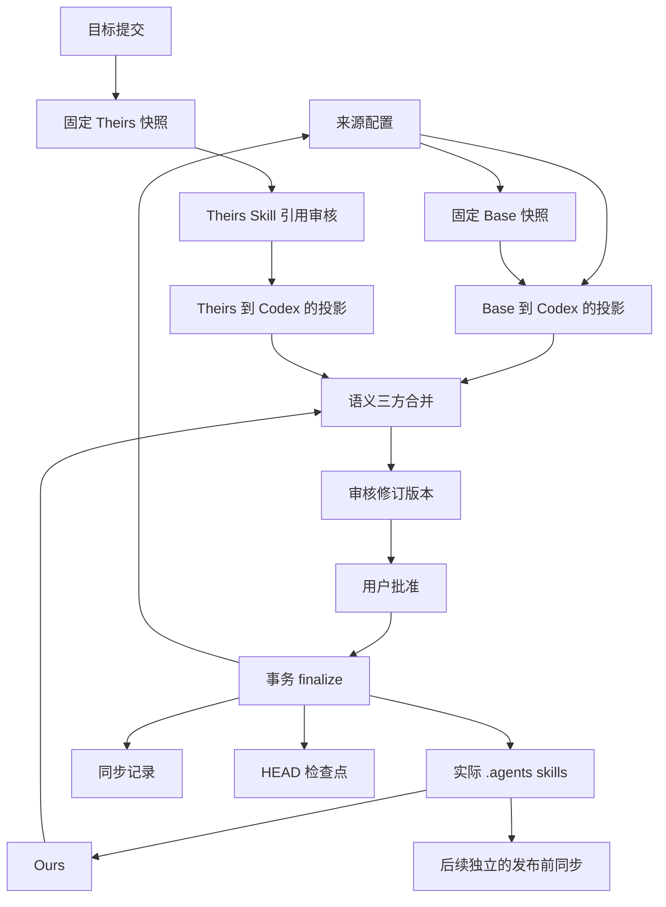

# Agent Repository Workflow Upstream Sync 长期规格

## Scope

本文定义只在 ARW 源码仓库中运行的 Upstream Sync. 它取得固定上游快照, 以 Base, Ours, Theirs 执行用户审核的语义三方合并, 更新实际 `.agents/skills/`, 来源配置和同步记录, 并通过 `HEAD` 检查点闭合一次同步.

源码仓库实际工作流文件与 Workflow Distribution 的关系由 [开发长期规格](../agent-repository-workflow-development/spec.md) 拥有. 用户在目标仓库中运行的 `workflow update` 由 [Agent Repository Workflow 长期规格](../agent-repository-workflow/spec.md) 拥有. Upstream Sync 不更新 Workflow Distribution, 不进入 ARW 安装目录, 也不成为公开 `arw` 命令.

## Entry point and source identity

Upstream Sync 生命周期维护入口是:

```text
node scripts/upstream-sync.mjs prepare --source <source> --to <full-commit-id>
node scripts/upstream-sync.mjs status
node scripts/upstream-sync.mjs review
node scripts/upstream-sync.mjs review --confirm <additional-skill-references-hash> <skill-reference-normalizations-hash>
node scripts/upstream-sync.mjs approve
node scripts/upstream-sync.mjs finalize
node scripts/upstream-sync.mjs abort
```

这些命令只覆盖 Upstream Sync 状态生命周期. `review` 在生命周期 `prepare` 取得并保存准确 Theirs 快照后, 复用开发规格中的源码仓库引用审核 Interface, 并在审核完成后继续构造 Review Revision, 不增加第二套审核协议.

参数边界是封闭的: `prepare` 只接受按上述顺序提供的来源身份和完整目标提交; `review` 只接受无参数初次调用, 或按上述顺序提供两个 hash 的 `--confirm` 调用; 其他生命周期命令不接受命令行参数.

需要用户确认的本地交互按以下方式交接:

| 操作与条件 | 先展示并等待用户确认的内容 | 确认后的交接 |
| --- | --- | --- |
| `approve` | 当前 `reviewed` 修订版本 | 把决定和当前摘要绑定为 Approval Attestation. |
| `finalize` 或 `abort` 需要执行 `status()` 返回的恢复计划 | 当前恢复计划 | 构造只对该计划有效的恢复授权. |

用户取消交互时不调用对应的写操作, 保持当前状态并退出 `0`. CLI 不接受调用方直接传入 attestation 或 recovery authorization 字段.

每次合法调用在 `stdout` 输出当前状态, 允许的操作和该操作产生的结果材料, 在 `stderr` 输出稳定排序的诊断信息. 动态值使用可逆转义. Exit `0` 表示成功, 接受的 no-op, 只读状态成功或用户取消交互. Exit `1` 表示发现项, 阻断问题, 运行或操作失败, 恢复要求或部分写入. Exit `2` 只表示命令或参数用法错误. CLI 不提供另一套 JSON 输出协议.

来源身份来自 `upstream/sources/<source>/` 的目录名. 来源配置不保存 `provenanceId`. 同步记录与工作区状态使用同一目录身份.

Upstream Sync 只处理来源配置明确登记的来源. 它不把任意仓库路径列表解释为通用同步映射, 也不通过扫描发现新来源.

## Source configuration

来源配置只保存取得固定上游快照, 选择来源平台语法和解释来源范围所需的数据:

- 上游 URL;
- 当前固定提交;
- `platform`, 只接受 `codex` 或 `claude-code`;
- 来源范围的 `include` 和 `exclude`;
- Base 的 `additionalSkillReferences`;
- Base 的 `skillReferenceNormalizations`.

来源配置是只包含上述六项的封闭 JSON 对象. 文件按 `url`, `commit`, `platform`, `scope`, `additionalSkillReferences`, `skillReferenceNormalizations` 的顺序保存字段, `scope` 按 `include`, `exclude` 的顺序保存字段. 未知字段, 缺失字段, 错误类型, 重复列表项, 未按规范顺序保存的列表或无效规范化位置都在取得上游前关闭式阻断. `additionalSkillReferences` 和 `skillReferenceNormalizations` 使用开发规格定义的完整 Base 审核结果, 不与代码默认值或其他来源配置合并.

上游 URL 只接受不含嵌入凭据的明确 `https://` URL 或明确 `ssh://` URL. 拒绝空主机, NUL, 换行, 前导 option, SCP 简写, 本地路径, `file:`, `git:`, 普通 HTTP 和 Git remote helper. 当前固定提交只接受 40 位小写十六进制完整 commit ID, 不接受 branch, tag 或缩写提交.

来源范围只包含 `include` 和 `exclude` 两个分别排序且去重的字符串数组, 空数组合法. 每个模式都是 portable Repository relative path pattern. 模式支持 `/`, segment 内的 `*`, 跨 segment 的完整 `**` 和单字符 `?`. 它不支持 ordered negation, re-inclusion, brace 或 character class. 路径匹配至少一个 `include` 且不匹配任何 `exclude` 时才被选择, `exclude` 始终优先. 来源范围选择准确上游输入, 不推断或扫描未选择的路径.

来源配置和来源范围都不保存 `version`. 它们只由同一源码仓库 Git 修订版本的代码读取, 不承担旧格式升级责任. 它们也不保存 `provenanceId`, Skill 目标路径映射, 许可证对象 ID, 许可证目标映射, `requiredLegalIds`, `upstreamPath`, Workflow Distribution 路径或 Workflow Distribution 契约版本.

来源范围的 `include` 和 `exclude` 只选择上游输入, 不是 `allowlist`. 所有采用的 Skill 都扁平写入 `.agents/skills/<skill-name>/`. 许可证是来源范围中的准确安全普通输入, 采用后写入源码仓库中的固定许可证目标. 固定布局由开发规格拥有, 来源配置不重复声明.

`platform` 表示当前上游快照采用哪套 Skill 引用语法. Upstream Sync 根据开发规格中的投影配置选择对应规则, 把 Base 和 Theirs 分别投影为统一 Codex 格式, 不在代码中写死 Claude Code 到 Codex 的专用分支.

来源配置可以包含已暂存变化, 不要求相对 `HEAD` 干净. 当引用审核实际读取它时, 该准确路径不得存在未暂存或未跟踪内容. 仓库其他路径不阻塞审核.

## Base, Ours, and Theirs

三方合并分别使用以下来源:

| 名称 | 来源 | 用途 |
| --- | --- | --- |
| Base | 来源配置当前固定的提交 | 比较本地与上游各自的变化. |
| Ours | 当前源码仓库实际 `.agents/skills/` | 提供当前本地内容, 不从 Workflow Distribution, 上次同步工作区或派生载荷取得. |
| Theirs | 调用方指定并在 `prepare` 时解析的目标固定提交 | 提供本次要合并的上游内容. |

Base 与 Theirs 分别取得到可丢弃的同步工作区. 获取必须绑定准确 URL 和提交, 拒绝可变分支状态, 不安全路径, 符号链接, 目录联接, 非普通文件和不完整范围. 获取结果不成为新的 Git 跟踪规范副本.

Base 的额外引用和规范化位置只来自当前来源配置, 并且只解释固定 Base 快照. Theirs 从准确 Theirs 快照生成自己的两个完整候选审核文件. Theirs 不读取或继承 Base 的两个列表, 即使两个提交存在祖先关系或表面上内容相同.

生命周期 `prepare` 取得并保存准确 Base, Ours 和 Theirs, 但不构建候选来源配置或 Review Revision. Theirs 的引用审核完成后, `createReviewRevision()` 消费完整结果并构建候选来源配置. Base 和 Theirs 各自投影为统一 Codex 格式后, Upstream Sync 才把它们与 Ours 送入语义三方合并. 非 Markdown 文件按准确字节参与普通软件包合并, Skill 引用分析只处理 `.md`.

许可证不参与普通软件包合并. 候选许可证必须与 Theirs 的准确字节相同. Base 与 Theirs 的许可证发生变化时, 必须作为独立批次交给用户审核, 并且不允许通过编辑许可证内容解决该发现项.

## Skill reference review

Skill 引用标记, 终止符, 额外引用, 位置规范化和来源到 Codex 的转换规则只由开发规格拥有. Upstream Sync 复用同一个 Platform Adapter 和两个审核文件 Interface.

Theirs 审核依次打开:

- `additional-skill-references.txt`;
- `skill-reference-normalizations.jsonl`.

两个文件先包含 Theirs 的完整候选, 用户只删除不应保留的行. 共用 Interface 拒绝增加, 改写或重排. 只有完成开发规格规定的审核和未变化确认后, 两个结果及其各自的 hash 才构成完整审核结果.

无参数 `review` 完成引用审核时, 如果不需要未变化确认, 同一次操作继续构造 Review Revision. 如果需要确认, 它保持 `resolving`, 返回两个审核结果 hash 并停止. 用户确认后, `review --confirm` 以同一顺序接收两个 hash, 完成引用审核并继续构造 Review Revision.

审核结果不直接修改来源配置. `createReviewRevision(confirmHashes = undefined)` 消费这个完整结果, 并把候选来源配置, 候选实际 Skill 和同步记录变化组合为一个完整审核修订版本. 从 `prepare` 保存 Theirs 到 Review Revision 构造完成之间保持快照和审核输入不变. 输入改变时重新审核, 不增加第三个 hash 或持久审核凭据.

## Sync workspace and state

单一活动同步工作区固定在被 Git 忽略的 `upstream/.workspaces/active/`. 不可变同步记录固定在 `upstream/sources/<source>/sync-records/<sync-record-id>.json`. 工作区清理不删除同步记录, 也不扫描 `.scratch`.

Main Agent 在每个用户批准的合并批次后, 把自然语言合并说明加入工作区 `agent-merge-notes.md`. 该文件使用非空 UTF-8 Markdown, 可以按相关路径分组并使用任何适合当前合并的自然语言结构. 它没有逐路径 schema, 状态值, 机械分类或固定措辞. Module 只验证文件存在, 是安全普通文件且非空, 然后把准确字节绑定审核修订版本. Module 不解析, 评分或判断说明的语义正确性. 该文件只服务本轮审核, 不复制到 Sync Record, 并随可丢弃工作区退出生命周期.

主状态封闭为:

```text
idle | resolving | reviewed | approved | recovering | awaiting-commit | checkpoint-satisfied
```

允许的操作由当前可证明状态唯一确定:

`permittedOperations` 使用 CLI 操作名. `review` 映射到 Module 的 `createReviewRevision(confirmHashes = undefined)`, `approve` 映射到 `recordApproval(attestation)`, 其他值与同名 Module 操作对应.

| 状态 | `permittedOperations` | 合法状态变化 |
| --- | --- | --- |
| `idle` | `prepare`, `status` | 有选定变化的 `prepare` 进入 `resolving`; no-op 保持 `idle` |
| `resolving` | `abort`, `review`, `status` | 完整 `review` 进入 `reviewed`; 成功 `abort` 进入 `idle` |
| `reviewed` | `abort`, `approve`, `review`, `status` | 当前修订版本的合法批准进入 `approved`; 重新审核保持或更新 `reviewed`; 漂移回到 `resolving`; 成功 `abort` 进入 `idle` |
| `approved` | `finalize`, `status` | 成功 `finalize` 进入 `awaiting-commit`; 漂移回到 `resolving`; 部分事务进入 `recovering` |
| `recovering` | `status` 和当前恢复计划准确允许的 `abort` 或 `finalize` | 授权恢复完成后进入 `idle`, `approved` 或 `awaiting-commit`; 无法证明安全时只允许 `status` 并要求人工恢复 |
| `awaiting-commit` | `status` | `status` 证明准确 `HEAD` tree 后进入 `checkpoint-satisfied` |
| `checkpoint-satisfied` | `prepare`, `status` | 下一次成功 `prepare` 清退旧工作区; 有选定变化时进入 `resolving`, no-op 时进入 `idle` |

每个操作返回自己的封闭载荷, 并共同包含 `state`, `diagnostics` 和 `permittedOperations`. 在当前状态不允许的操作返回当前可证明状态和稳定诊断信息, 保证零业务写入. 预期发现项, 阻断问题, 运行失败, 操作失败, 恢复要求和部分写入都返回结构化结果. 只有无效调用形状使用 `TypeError`; 实现缺陷或不可能状态才抛出其他异常.

候选内容, 来源配置,审核结果或其他影响摘要值的输入变化都会使当前审核修订版本与批准失效, 状态回到 `resolving`. 调用方不得通过读取工作区文件自行重建状态或允许的操作.

## Preparation and status

`prepare(source, targetCommit)` 只在 `idle`, 或可以先清退的 `checkpoint-satisfied` 开始. 它解析准确 Base 与 Theirs, 读取 Ours, 验证来源范围, 创建或更新工作区, 并返回来源关系和给 Agent 的后续说明.

Theirs 的已选快照与 Base 的已选快照具有相同路径, mode 和字节时, `prepare` 报告没有已选来源变化, 保持 `idle`, 不读取 Ours, 不创建工作区, 也不移动来源配置的固定提交. 存在活动工作区或检查点无法安全清退时, 它保持当前可证明状态并通过诊断信息关闭式停止.

`status()` 在全部状态下只读返回当前状态, 稳定诊断信息, 恢复状态和允许的操作. 恢复可证明安全时, 它额外返回绑定当前摘要值的限定范围恢复计划, 但不执行写入.

`prepare` 和状态查询不读取 Workflow Distribution 候选, 派生载荷, 摘要或生命周期状态, 也不要求先运行发布前同步. 开发规格拥有的共享投影配置不属于这些运行状态.

## Review revision and Human approval

`createReviewRevision(confirmHashes = undefined)` 只在 `resolving` 或 `reviewed` 审核当前准确 Theirs 的 Skill 引用, 并在引用审核完成后读取工作区候选树和 `agent-merge-notes.md`, 执行完整验证, 语义三方合并, Skill 引用转换和候选实际文件构建. 需要未变化确认, 引用审核未完成或过期, 合并说明缺失或为空, 无效许可证或其他阻断问题进入或保持 `resolving` 并返回诊断信息.

成功结果进入 `reviewed`, 并返回审核修订版本身份, Agent 合并说明摘要, 候选来源摘要和候选实际 Skill 摘要. 这些身份绑定准确的 Base, Ours, Theirs, 候选来源配置, 候选实际 Skill, 许可证结果和 Agent 合并说明. 它们不绑定 Workflow Distribution 或任何发布前同步输出.

相同输入重复构建产生相同审核修订版本身份. 审核修订版本不创建集中 diff 文件包, 也不把临时辅助工具或其他 Agent 推理变成持久证据.

`recordApproval(attestation)` 只记录用户已经对当前 `reviewed` 审核修订版本作出的决定. `attestation` 必须绑定审核修订版本身份, Agent 合并说明摘要, 候选来源摘要和候选实际 Skill 摘要. 合法结果进入 `approved`. 无效, 不完整, 过期或指向其他审核修订版本的 `attestation` 不写批准记录, 保持当前可证明状态并返回诊断信息.

运行时不向用户提问,也不从聊天推断批准. Agent 负责展示准确审核材料并把已经发生的用户决定交给 Module.

## Local differences and semantic review

Upstream Sync 从准确 Base 与 Ours 的路径, mode 和字节直接计算完整本地差异路径. 这些路径是本轮可重建的比较结果, 不是独立的持久状态. 来源目录不保存 `semantic-deltas.json`, 工作区不保存 `active-deltas.json` 或 `delta-lifecycle.json`, 也不要求稳定差异身份, 重复的理由或不变量说明, 或由差异记录选择的 verifier. 删除差异记录选择的 verifier 不会把原来可选且未启用的检查升级为全局要求.

三方合并按以下比较结果处理候选:

| 比较结果 | 候选处理 |
| --- | --- |
| Ours 等于 Base | 采用 Theirs. |
| Theirs 等于 Base | 保留 Ours. |
| Ours 等于 Theirs | 保留共同结果. |
| Ours 与 Theirs 都不同于 Base | Main Agent 可以保留自动三方合并结果或直接编辑候选. |

Module 不把说明压缩为固定分类, 也不自行审核合并.

Ours 到 Candidate 中全部新增, 删除和修改 Skill 都必须进入一个用户审核批次. 语义改名作为同时包含旧路径和新路径的一个批次, 不拆成删除和新增. 使用相同语义合并方式的跨 Skill 修改可以合并沟通, 包括共享 `agents/openai.yaml` 或 frontmatter 规则. 不同语义结果不能只因文件类型相同而合并.

Main Agent 对尚未确定的重要语义选择使用 `grilling` 与用户达成共识. 应用每批候选修改后, Main Agent 提供自然语言合并说明和一条只显示该批路径的 Ours 到 Candidate `git diff --no-index` 命令. 命令包含语义改名的两个路径. 用户审核说明与命令输出后单独批准该批, Main Agent 才把说明加入 `agent-merge-notes.md`. 已批准路径后来变化时, 该批批准失效并重新审核. 全部批次保持当前且已批准后, 用户使用完整 `agent-merge-notes.md` 和已经完成的批次审核批准准确 Candidate. 这个最终批准不要求重新审核一个包含全部变化的集中 diff.

Sync Record 保存已批准候选对应的本地差异路径, 双方都修改的路径, 冲突, 审核修订版本身份和批准身份. 它不保存 `agent-merge-notes.md` 的内容或独立摘要. 下一轮同步仍从新的准确 Base 与当时实际 Ours 重新计算差异, 不从旧同步记录恢复当前差异状态.

## `finalize`

普通 `finalize()` 只在 `approved`, 全部绑定摘要仍匹配, 限定范围的 Git 输入没有漂移, 目标状态通过完整写入前检查时执行. `recovering` 中只有 `status()` 返回当前 `finalize` 恢复计划时, `finalize(recoveryAuthorization)` 才接受绑定该计划的恢复授权并执行限定范围恢复. 其他状态和授权不执行写入. 普通 finalize 以一个事务提升:

- 候选 `.agents/skills/`;
- 固定许可证目标的候选字节;
- 候选来源配置, 包括 Theirs 提交和 Theirs 自己的引用配置;
- 新同步记录;
- 其他由 Upstream Sync 明确拥有的来源自身的状态.

`finalize` 不写 `distribution/`, 不运行发布前同步, 也不更新安装载荷. 成功状态是 `awaiting-commit`, 并返回同步记录身份, 候选摘要, 已完成路径证据和 `HEAD` 检查点要求.

File Transaction Module 在任何写入前重验计划输入. 写入前检查的阻断问题保证零写入. I/O 失败返回准确阶段, 已完成操作和回滚结果. Upstream Sync 继续使用自己的特定操作恢复, 不把发布前同步的 Git 暂存区恢复规则推广为统一恢复协议.

## Abort and recovery

`abort(recoveryAuthorization = undefined)` 只删除控制状态能证明由当前工作区拥有的可丢弃内容, 绝不修改已经存在的规范输出. 成功返回 `idle` 与清理证据. 部分中止返回 `recovering`, 残留路径和向前重试诊断信息. `awaiting-commit` 与 `checkpoint-satisfied` 不允许执行 `abort`.

普通 `finalize` 和 `abort` 省略 `recoveryAuthorization`. 当 `status()` 返回恢复计划时, 对应调用必须显式接收封闭授权对象. 该对象只允许 `recoveryPlanDigest`, `channel`, `humanConfirmation` 和 `externalEvidence`, 并包含准确的当前摘要, 非空 `channel`, 以及非空 `humanConfirmation` 或 `externalEvidence` 中至少一个.

额外字段, 缺失字段, 错误类型, 空值或过期摘要返回 `invalid-recovery-authorization`, 不执行恢复写入. Module 在任何恢复写入前重新验证计划摘要, Git 暂存区证据和当前目标状态. 暂存区漂移或第三种状态同样不写, 并要求人工恢复. Module 不发起提示, 也不增加独立 `recover(...)` 操作.

实时 `finalize` 因 I/O 失败后, Module 先检查每个目标的准确状态. 如果所有目标仍是前映像, 它不执行恢复写入, 清除未完成的提升状态, 返回 `status: failed`, `promotion-recovered` 和 `approved`, 并保持 Candidate, Review Revision 和 Approval Attestation 有效. 执行其他限定范围恢复时, 已经等于所选恢复方向映像的目标保持不变, 只写入仍等于相反映像的目标. 发现第三种状态或 Git index 漂移时仍按前述规则不执行恢复写入并要求人工恢复.

## `HEAD` checkpoint

`awaiting-commit` 表示规范输出已写入, 但还没有由新的 Git `HEAD` 保存. Upstream Sync 不创建 Git 提交. 外部 Agent 或用户按普通源码仓库提交工作流提交准确结果.

只有当前 `HEAD` 树与 `finalize` 返回的已完成路径证据精确匹配时, 状态才转为 `checkpoint-satisfied`. 已暂存状态, 提交 ID 文本或无关路径不决定检查点. `checkpoint-satisfied` 保留工作区证据, 下一次成功的 `prepare` 才清退它并创建新工作区.

## Module Design

### Modules

`Upstream Sync Module` 独占来源获取, 来源配置, Base/Ours/Theirs, 本地差异计算, 工作区状态, 审核修订版本, 用户批准绑定, `finalize`, `abort`, 恢复和 `HEAD` 检查点. 它不拥有 Workflow Distribution, 发布前同步, 目标仓库工作流或 Git 提交创建.

开发规格中的 `Platform Adapter` 提供来源平台到统一 Codex 格式的 Skill 引用转换. `Filesystem Module`, `JSON Module`, `File Transaction Module` 和 `Text Policy Module` 提供公共机械能力. Upstream Sync Module 保留来源特有策略和操作状态.

根 CLI 脚本只适配参数, 输入, 输出和退出码. 它先调用 `status()`, 只有恢复计划存在且用户已经确认时才构造恢复授权. CLI 不读取工作区文件推断状态, 不拥有事务策略.

### Interfaces

公开生命周期操作是 `status`, `prepare`, `createReviewRevision`, `recordApproval`, `finalize` 和 `abort`. 每个合法调用返回 `succeeded | blocked | failed` 外层结果, 当前生命周期状态, 稳定诊断信息, 允许的操作和特定操作载荷. 无效调用形状同步抛出 `TypeError`.

Source Acquisition Adapter 接受 URL, 提交和来源范围, 返回固定安全普通文件树或结构化失败. Git Adapter 提供读取 `HEAD` 树, 暂存区证据和固定提交所需的最小操作, 不暴露 shell 命令字符串.

Skill 引用审核 Interface 与开发规格完全相同. Base 使用来源配置已保存列表, Theirs 使用本轮两个临时审核结果. 审核修订版本与批准使用实际 Skill 候选摘要, 不使用 Workflow Distribution 摘要. `agent-merge-notes.md` 是工作区解析 Interface 的固定输入, 不增加公开生命周期操作或命令行参数.

File Transaction Module 只接收完整规范输出计划. 恢复计划由 Upstream Sync Module 根据它自己的操作结果和 Git 证据构造, 公共 File Transaction Module 不解释生命周期状态.

恢复计划绑定每个目标的前映像, 后映像, Git index 证据和当前映像分类. `abort` 选择前映像方向, `finalize` 选择后映像方向. 调用方不重建或解释目标状态.

### Seams and Adapters

生产环境的 Source Acquisition Adapter 与 Git Adapter 只取得固定提交的安全文件树, `HEAD` 树和暂存区证据. 确定性测试使用相同 Interface 返回隔离结果或失败. 文件系统与事务 I/O 通过开发规格中的公共 Module 完成, 不由 CLI 或工作区读取方复制.

用户批准与恢复确认都是运行时外已经发生的决定. Main Agent 只把该决定转换为公开 Interface 所需的 `attestation` 或授权. Upstream Sync 不创建用户 Adapter, 不从聊天推断决定, 也不让测试 Adapter 制造用户批准.

### Dependencies and Data Flow



本文的权威来源关系汇总如下:

| 权威来源或状态 | 责任方 | 转换和使用方 | 失败, 恢复和最终写入点 |
| --- | --- | --- | --- |
| `upstream/sources/<source>/source.json` 和其中固定的 Base 提交 | Upstream Sync Module | Source Acquisition Adapter 取得 Base, Platform Adapter 按来源平台转换为统一 Codex 格式 | 配置或固定提交无效时不创建可批准结果; 修复受 Git 管理的来源配置后重新 `prepare`; 普通 Git 提交保存配置变化 |
| 本次请求的固定目标提交 | Upstream Sync Module | Source Acquisition Adapter 取得独立 Theirs, 用户审核额外引用后由 Platform Adapter 转换 | 取得或审核失败时不改 Base 配置和实际 Skill; 重新取得并完整审核; 只有 `finalize` 采用所选 Theirs 结果 |
| 当前源码仓库 `.agents/skills/` | 普通 Skill 开发流程, Upstream Sync Module 只读取得 Ours | 语义三方合并把 Ours 与转换后的 Base 和 Theirs 比较 | 当前内容不安全或变化时阻断本轮结果; 保留实际 Skill 并重新 `prepare`; 成功 `finalize` 才事务替换所选输出 |
| Theirs 的两个等待式审核结果 | 用户审核, 引用审核 Interface 验证删除结果并计算两个独立 hash | Platform Adapter 只把保留项解释为范围外 Skill 引用或需要规范化的位置 | 编辑, 确认或输入变化时不产生持久状态; 重新执行完整审核; 审核结果只随本轮 Review Revision 和 `finalize` 生效 |
| 同步工作区, Review Revision 和批准 attestation | Upstream Sync Module | `recordApproval` 绑定用户看到的完整候选, `finalize` 只消费匹配的当前修订版本 | 漂移或部分操作失败时按当前 lifecycle 状态恢复或 `abort`; 工作区不是长期权威; `finalize` 事务是规范输出写入点 |
| `finalize` 生成的实际 Skill, 来源配置和同步记录 | Upstream Sync Module 规划, File Transaction Module 应用 | 后续开发和独立发布前同步消费实际 Skill, 下一轮同步从来源配置中的 Base 与当时实际 Ours 重新计算本地差异 | 事务失败保留特定操作恢复证据; 成功写入后状态为 `awaiting-commit`; 外部普通 Git 提交保存准确输出 |
| 当前 Git `HEAD` 树与已完成路径证据 | 外部 Agent 或用户提交, Upstream Sync Module 只读验证 | `status()` 判断 `awaiting-commit` 是否转为 `checkpoint-satisfied` | 已暂存字节或提交 ID 文本不替代树比较; 不匹配时继续等待准确提交; 精确 `HEAD` 树是检查点最终确定位置 |

### Module Design Rationale

Ours 必须是实际 `.agents/skills/`, 因为它们是当前分支真正运行和维护的内容. 让 Ours 继续读取 Workflow Distribution 会重新建立第二个编写权威来源, 并强迫普通 Skill 开发先运行发布前同步才能采用上游变化.

Base 和 Theirs 的额外引用数据完全隔离, 因为两个固定提交可能没有任何相同字节, 也可能分别引用平台内置或其他范围外 Skill. 从祖先关系或 Base 配置推断 Theirs 会把未审核标记当作已批准内容.

来源配置不保存版本或路径映射, 因为当前读取方与配置由同一 Git 修订版本绑定, 扁平 Skill 目标和许可证目标已由产品布局固定. 保留这些字段只会复制代码和目录事实.

审核修订版本继续绑定用户实际审核的完整候选内容, 但不绑定 Workflow Distribution. Upstream Sync 的职责在 `finalize` 实际文件时完成, Workflow Distribution 是后续发布前同步的独立产物. 这使两种同步可以失败和恢复而不共享中间状态.

特定操作恢复保留在 Upstream Sync, 因为活动工作区, 批准和 `HEAD` 检查点是这个生命周期独有的状态. 把它改成发布前同步的全量 Git 恢复会丢失已经建立且仍可证明的审核与批准状态.

I/O 失败后的恢复先比较准确目标状态, 因为无条件回写会再次写入未变化目标并可能重复原始失败. 全部目标仍是前映像时继续保持 `recovering` 不增加安全性, 却会丢失仍可证明的批准状态. 部分写入时只恢复后映像目标, 第三种状态要求人工恢复, 优先避免覆盖无法证明归属的字节, 并接受恢复前多一次完整状态检查的成本.

Base 配置和本次 Theirs 目标分别绑定两个准确提交, 优先让三方合并可重现且不从祖先关系推断审核结果. 使用远端最新状态或让 Theirs 继承 Base 配置会减少一次取得, 但会把未固定或未审核内容带入合并. 当前选择接受 Base 与 Theirs 分别取得, 转换和审核的成本.

规范输出由 `finalize` 一次事务写入, Git `HEAD` 检查点由外部普通提交另行完成, 因为 Upstream Sync 不拥有提交创建. 让 `finalize` 自动提交会扩大 Git 权限, 只检查暂存区又不能证明输出已经持久保存. 当前选择接受成功同步在提交前保持 `awaiting-commit`, 并由后续 `status()` 再做准确树比较的成本.

### ADR Evaluation

[ADR-0011](../../adr/0011-use-source-only-human-reviewed-upstream-sync.md) 保留仅限源码仓库, 用户审核的三方同步, 固定提交, 来源范围, 批准, 同步记录, `HEAD` 检查点和特定操作恢复. [ADR-0026](../../adr/0026-use-source-checkout-workflow-files-as-distribution-authority.md) 取代 ADR-0011 中 Ours, `finalize` 和批准摘要指向 Workflow Distribution 的部分, 并取代依赖旧清单权威来源的 `provenanceId`, 路径映射, 许可证映射和来源说明 Markdown. [ADR-0028](../../adr/0028-derive-upstream-sync-local-differences.md) 取代 ADR-0011 中持久保存语义差异及其生命周期的部分.

[ADR-0013](../../adr/0013-use-main-agent-single-writer-orchestration.md) 继续要求 Main Agent 负责用户沟通与外部 Git 写入. [ADR-0017](../../adr/0017-use-operation-specific-recovery-baselines.md) 继续拥有特定操作恢复原则. 按准确目标状态跳过不必要写入只细化该恢复基线, 不改变生命周期责任, 权威来源或持久状态, 因此不需要新增 ADR. 本文是当前来源配置与 Upstream Sync 生命周期的完整负责方.

## Requirement ownership

本文是以下要求的唯一长期负责方:

- 来源配置字段与来源身份;
- Base, Ours, Theirs 权威来源和获取;
- Base 与 Theirs 独立的 Skill 引用数据;
- 同步工作区状态和允许的操作;
- 审核修订版本, 用户批准和摘要绑定;
- Base 与 Ours 的本地差异计算, 三组完整差异和 Agent 合并说明;
- `finalize`, `abort`, 恢复授权, 同步记录和 `HEAD` 检查点;
- Upstream Sync 与发布前同步的单向边界.

现有要求标识符 `ARW-SYNC-001` 到 `ARW-SYNC-015` 由本文上述行为, Module Design 和 Validation strategy 定义.

开发规格只拥有共用 Skill 引用转换和实际文件到 Workflow Distribution 的发布前同步. 总长期规格只区分上游更新与目标仓库的 `workflow update`. 其他文档不得复制本文的状态机或恢复契约.

## Validation strategy

固定验证覆盖来源配置及其字段顺序, 固定 Base 与 Theirs 快照, 来自实际 Skill 的 Ours, Base 与 Ours 的完整差异计算, 来源平台转换, 两组独立引用审核, 语义三方合并, 三组完整差异, Agent 合并说明的准确字节绑定, `finalize`, 同步记录, `HEAD` 检查点, `abort` 和恢复. 每个公开操作都通过生产 Interface 覆盖成功, 零业务写入的阻断, 带阶段与已发生影响的失败, 无效调用和稳定诊断排序; 失败注入不依赖修改工作区内部状态.

源码仓库验证把当前 effort 的实际 Repository 相对目录传给通用命令 `node arw.mjs terms check --include <directory>`, 并至少运行 `pnpm typecheck`, `pnpm test`, 受影响 JavaScript 的 `node --check`, `node arw.mjs text check` 和 `git diff --check`. 本文不复制 Document Terms 的发现, 作用域, 结果或诊断合同.
