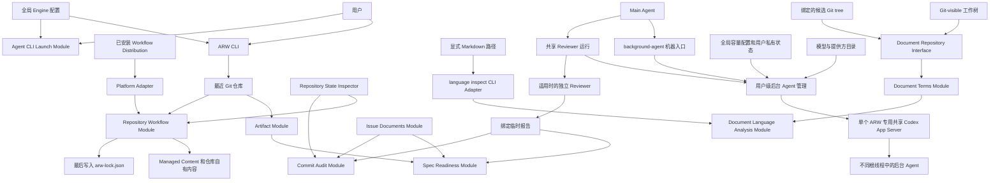

# Agent Repository Workflow 长期规格

## Terms introduced in this document

- **Canonical ID**: ARW 在命令和输出中用来唯一指向一个已登记工作记录的稳定标识符.
- **Reviewer Request**: ARW Engine 在审核开始前物化的完整请求文件. 它向 Reviewer 提供本次审核对象和绑定输出路径, 使参与者使用准确交接路径而不重建临时位置.
- **Document Repository Interface**: Document Terms 检查器用来取得一次文档路径清单和对应文档条目的内部只读边界.
- **Markdown Visible Text Module**: 把 Markdown 解析为带来源位置和标题或正文分类的可见自然语言文本流的公共能力.
- **Document Language Analysis Module**: 对已经解析的 Markdown 正文文本流进行确定性 Unicode 字符分类, 加权和舍入的公共能力.

## Scope

本文定义用户取得 ARW 后在目标 Git 仓库中使用的长期行为. 它拥有 ARW Artifact, issue 与 spec 工作流, Agent CLI 启动器, 通用后台 Agent 控制, 共享 Reviewer 运行, Spec Readiness, Commit Audit, Code Map, 文本操作和仓库工作流的 `init`, `update`, `verify`, `remove`. `.scratch` 中某项工作的本地 Spec 只服务该项工作, 不能替代本文.

其他生命周期由独立长期规格拥有:

- [开发长期规格](../agent-repository-workflow-development/spec.md) 定义源码仓库实际工作流文件, Workflow Distribution, 平台投影, Skill 引用审核, 发布前同步和开发公共 Module;
- [安装长期规格](../agent-repository-workflow-installation/spec.md) 定义引导安装脚本, 安装载荷, ARW 安装目录, 更新, 卸载, 配置升级和 PATH 或配置文件归属;
- 源码仓库专用的 [`upstream-sync` Skill](../../../.agents/skills/upstream-sync/SKILL.md) 定义固定上游来源, Base/Ours/Theirs 三方审核, 维护者批准和采用记录;
- [Application 与 JIRA 长期规格](../agent-repository-workflow-application-jira/spec.md) 定义 Application Repository 与 Module Repository 的角色, JIRA Story 接收, issue 分发, Module 状态同步, Application 验证和 JIRA 完成同步;
- [源码仓库发布长期规格](../agent-repository-workflow-release/spec.md) 定义发布候选, 归档, VM, 标签, 外部写入授权和发布恢复.

这些文档按生命周期各自保存完整规则. 本文只说明用户行为如何消费已经安装的 Workflow Distribution, 不复制其他生命周期的内部状态, 转换, 安装或发布步骤.

## Application and local lifecycle

用户先按安装长期规格取得 ARW 安装目录, 再从目标仓库或其子目录运行 ARW. ARW 安装目录更新不等于 `workflow update`: 前者替换用户安装的 ARW 运行时, 后者只更新当前目标仓库中由 ARW 管理的工作流内容. Upstream Sync 更新 ARW 源码仓库实际 Skill, 也不等于这两个操作.

ARW 是本地仓库工作流管理器. 它不自主发起 Agent 编码工作, 不充当远程 issue 服务, 不下载或启动未配置的平台运行时, 不替代用户批准, 也不在目标仓库中联网重新解释 Workflow Distribution. 用户可以通过通用后台入口交付完整 Agent 任务, 或显式调用 `arw agent start` 启动外部 Main Agent CLI. 只有配置有效 Application 的仓库才按 Application 与 JIRA 长期规格显式访问 JIRA 和协调配置的 Module Repository.

当前注册的 ARW Artifact 只有 `issue`, `map` 和 `spec`. `README.md`, `AGENTS.md`, `CONTEXT.md`, ADR, `spec-readiness.json` 和 `spec-audit.json` 都不是 ARW Artifact.

## Work records and implementation authorization

不同工作记录承担不同责任, 不能互相替代实施授权:

| 工作记录 | 责任 | Spec Readiness |
| --- | --- | --- |
| 实施 issue | 通过 issue 门禁, 当前阻断问题和必要设计确认取得实施授权, 在完成与提交前满足独立就绪检查. | 每个 issue 都运行. |
| Application Source Issue | 只镜像关联 Module 实施 issue 的状态, 不执行本地实施. | 不运行. |
| Wayfinder issue | 记录研究或设计问题, 不替代实施 issue. | 不运行. |

Spec Readiness 使用 `prepare -> independent review -> generate -> promote -> verify`. Engine 冻结完整治理输入, issue 中连续的交付结果, 要求选择与验收条件, 以及 `prepare` 固定的草稿路径, 并把 Reviewer Role 身份与哈希独立绑定到请求. 独立 Reviewer 在绑定路径写入语义问题, 完整审核没有问题时写入明确的无问题标记. Engine 从最终草稿推导完整的临时规范结果, Main Agent 只提升准确生成字节. issue 特定的 `verify` 核对当前设计的有效就绪结果. 修改实现文件前须取得当前有效就绪结果 (`verify` 退出码为 `0`), 有效结果的完成, 审计与提交检查时点由[设计就绪工作流](../../../.agents/skills/spec-readiness/SKILL.md#authorization-timing)拥有.

Spec Readiness 的结果生成与验证不判断开放语义, 原生会话控制和线程身份由共享 Reviewer 运行责任管理. 会话延续不等于准备度结果仍然有效: 任一治理输入, 审核对象, Reviewer Role 或结果绑定变化都会使旧记录失效. `architecture-evidence` 是 issue 本身会修改的实现事实, 不属于这种绑定, 实施改动它不使记录失效. 审核对象是连续的 `## What to build`, `## Spec Requirement` 和 `## Acceptance criteria`. `Status:`, `## Blocked by`, `## Validation` 和 `## Comments` 不进入审核对象. 完整 issue 格式与阻断问题图由 ARW Artifact 清单和 Issue Gate 独立验证.

Commit Audit 的准确调用条件只由通用提交工作流拥有. Commit Audit 适用时, Gate 1 和 Gate 2 由独立 `requirements-reviewer` (要求符合审核) 逐项审核冻结的完整已暂存候选内容, `code-standards-reviewer` 同时并行审核实施质量; 一次提交最多这两个并行 Reviewer. 每个提交只包含一个 effort, Main Agent 只暂存该 effort 的内容. `authorizingIssueIds` 可以包含该 effort 的多个 issue, 表示完整实施授权范围; Request 中的 Gate 1 范围只包含实际适用的终态转换子集. Gate 2 使用本次接受 issue 的有效 `## Spec Requirement` 并集. Reviewer 把发现的问题逐条写入 `prepare` 创建的 txt 报告, 没有问题时写 `No problems.`, 并返回状态; ARW 不生成或提升审核记录, 详见 [Commit Audit](#commit-audit).

Gate 3 由 `code-review` Skill Package 拥有 Standards 与 Requirements 两个独立审核轴; 提交时 Requirements 轴由 Commit Audit 承担. Main Agent 优先使用各轴完整有效的已有结果; 需要新审查时, 只解析一次比较基线与完整变更路径集合, 执行一次过滤, 再把相同的不可变比较对象, 完整代码上下文, 纳入范围的路径和适用验证事实交给 Code Standards 与适用的 `requirements-reviewer`. Requirements 轴还取得明确的完整治理要求. 各轴按自己的实际完整输入判断有效性, 不因为另一轴的输入变化就自动失效, 具体版本与复审边界见 [Review versions and result validity](#review-versions-and-result-validity).

当前有效 Spec Readiness, 必要实施验证和真实完整的最终候选齐备后, Code Standards 与适用 Commit Audit 可以对同一候选并行. 任何正式验收条件实际要求取得另一审核的完成事实时, 仍须等待该事实, 运行中结果不能作为通过. Main Agent 按[公共 Reviewer 规则](../../agents/reviewer.md#review-versions-and-concurrency)协调固定版本, 已授权源工作树写入及替代版本, 最终核对实际暂存字节与各轮受审版本, 再取得当前有效的全部适用结果和提交授权.

完全由封闭分类中不属于当前仓库实施产物的内容组成的已暂存候选内容使用轻量提交流程, 并且同样只属于一个 effort. 适用内容包括该 effort 的本地 `spec.md`, `map.md`, Application Source Issue, Wayfinder issue, 本次不进入 `completed | wontfix` 的实施 issue, `research/**` 和 `prototype/**` 下的安全普通文件, 以及按实际语义归入该 effort 的安全 gitlink. Gitlink 只记录当前仓库引用的子模块提交状态, 不属于当前仓库的实施产物. 该流程只检查准确已暂存范围, effort 归属, 安全路径, 条目模式与对象身份, ARW Artifact 基本格式, 实施 issue 终态转换, 适用文本格式, Git 差异和候选内容不变性, 这些检查由 `arw commit-audit verify --non-implementation` 一条命令完成. 它不做语义或跨文件关系检查, 不运行 Spec Readiness, Commit Audit, Gate 1, Gate 2, Gate 3 或独立 Reviewer. 候选包含当前仓库的实施产物时, 完整候选内容使用实施提交流程. 不能归入任一分类的内容先停止并明确责任, 不因为它尚未进入轻量流程的封闭分类就推定为实施产物.

## Runtime baseline

- Node.js 24 是最低运行版本.
- 产品使用原生 JavaScript, ES Modules 和 Node.js 内置模块, 没有 npm 运行时依赖.
- 产品名称是 `agent-repository-workflow`.
- `arw --version` 只向 `stdout` 输出当前运行时的准确版本. 版本来源与安装布局由 [安装长期规格](../agent-repository-workflow-installation/spec.md) 定义.

稳定发布标签使用无前缀 `MAJOR.MINOR.PATCH`. `vMAJOR.MINOR.PATCH`, 预发布和构建元数据标签不是稳定发布标签. 读者文档只能引用真实远端标签与真实获取路径, 不得提供占位符发布链接.

## Repository discovery

所有面向仓库的命令从当前目录向上寻找最近的 Git 工作树根目录, 语义等同于:

```text
git rev-parse --show-toplevel
```

命令只能读取和修改该根目录内状态. ARW Artifact 只使用 `<repository>/.scratch`. 仓库工作流只使用该根目录的 `arw-lock.json`,Managed Content 和仓库自有内容.

仓库发现只识别最近 Git 根目录, 不递归扫描普通子目录或嵌套 Git 仓库. 嵌套仓库需要自己的 ARW 生命周期时, 用户必须从它自己的根目录或子目录单独运行命令. 外层仓库不替嵌套仓库执行 `workflow init` 或扫描其 Agent 与 Skill 路径.

在 Git 仓库外运行必须明确失败. 最近仓库没有 `.scratch` 时, ARW Artifact 状态是正常空状态: `list` 成功返回空结果, `migrate artifacts` 成功且无变化, 具体 `read` 或打开操作返回可控的 `not-found`. 创建具体 ARW Artifact 时只创建目标所需父目录. 仓库工作流和 `arw agent start` 不以 `.scratch` 存在为前置条件.

如果 `.scratch` 已存在但不是安全可读写的普通目录,包括普通文件,符号链接,目录联接,不可读或越过仓库的路径,命令关闭式失败,不得回退到外层仓库.

## ARW Artifact model

注册路径如下:

| ARW Artifact 类型 | 登记路径 | 含义 |
| --- | --- | --- |
| `issue` | `.scratch/<NNNN>-<effort-slug>/issues/<NN>-<issue-slug>.md` | 实施 issue, Application Source Issue 或 Wayfinder issue |
| `map` | `.scratch/<NNNN>-<effort-slug>/map.md` | Wayfinder 工作的 Code Map |
| `spec` | `.scratch/<NNNN>-<effort-slug>/spec.md` | 本地 Spec |

ARW 只发现已登记路径, 不因为扩展名是 `.md` 就登记任意项目文档. 所有一级工作目录统一称为 effort. effort 编号必须是 `0001` 到 `9999`, issue 编号必须是 `01` 到 `99`; `0000` 和 `00` 无效. 描述性 slug 只承担路径可读性, 不承担身份责任. 旧 `.scratch/<effort-slug>/PRD.md` 只作为迁移输入. 完整迁移在无冲突时确定性改名为 `spec.md`. 登记路径中的符号链接一律拒绝.

新 effort 使用当前 `.scratch` 中现存最大 effort 编号加 1. 已提交的 issue, map 和 spec 身份不能在普通工作流中被删除, 重新编号, 改变类型或由不同工作复用. 保留编号时可以修改 effort slug 或 issue slug. 废弃 issue 只能进入适用终态. 未来单独定义的旧 effort 清理流程可以删除按 effort 编号升序排列的最旧连续段, 但删除后必须保留更新的已编号 effort 和当前最大编号, 并且不得复用已删除编号. 普通 `list`, `open` 和 `print` 不读取 Git 历史来恢复已清理内容.

Application Source Issue 使用普通 issue 登记路径与 Canonical ID, 但不是实施 issue. Application 与 JIRA 长期规格拥有使普通实施 issue 成为 Application Source Issue 的准确关联字段, 解析判定与特殊生命周期.

ARW Artifact 清单一次收集完整 `.scratch` 观察结果, 再由 `list`, `print`, `open` 和 `migrate` 复用. 格式错误记录不成为部分有效对象; 能独立读取的其他类型继续产生结果和稳定诊断.

### Implementation issue format

实施 issue 使用以下固定结构:

```markdown
# <issue title>

Status: <status>

## What to build

...

## Spec Requirement

Governing requirements:

- `docs/specs/example/spec.md#solution`

## Acceptance criteria

- [ ] ...

## Blocked by

- None - can start immediately
```

模板中的示例路径和锚点替换为实际要求. `Governing requirements:` 后保留空行, 每行一个以连字符和空格开头且由反引号包裹的路径引用; Markdown 超链接无效. `## What to build`, `## Spec Requirement` 和 `## Acceptance criteria` 必须是连续且顺序固定的二级章节. `arw print` 不解析该字段, 读取成功不证明引用语法或目标存在性有效.

`Status:` 必须位于 H1 后第一个段落. `## Spec Requirement` 路径相对最近 Git 仓库根目录, 与 Spec Readiness 输入 `filePath` 使用同一基准. 它接受仅路径或 `path#ascii-heading-anchor`. 仅路径只适用于没有 ATX 标题, 或只有一个 H1 且没有其他 ATX 标题的文档.

Issue 创建过程在发布 issue 前选择该 issue 实际实施的既有治理要求. 相关背景, 仅提供支持的输入, 交付目标, 未来输出, 解决方案设想和实施指导不能进入该章节. 长期 Spec 只有在当前工作确实为了实现它时才是要求; 作为当前 issue 交付结果修改的长期 Spec 只写入验收条件. 确实没有治理设计时, 只有用户明确确认后才能写 `Not required`.

`## What to build` 只描述完整交付结果, 验收条件只描述可验证完成条件. `## Blocked by` 无阻断问题时准确写 `- None - can start immediately`; 带标题阻断问题时写 `- <number> - <title>`. Issue 完成证据满足后可以把 `Status:` 改为终态值; 终态转换的提交门禁由提交流程独立处理.

### Implementation records

实施 issue 的 `## Validation` 整章记录当前验收项到实际证据的索引和结果, 是完成生命周期所需的证据记录. `## Comments` 整章记录讨论, 审核事件及已经取得的结论. 两章不承载实施要求, 验收条件或授权例外, 不成为 Gate 1 的要求来源或独立审核通过的权威. 有效要求及替代决定进入正式交付要求或验收章节; 授权仍来自实际用户决定和适用工作流. 记录中的链接不扩大读取权限.

两个记录章节的内容变化本身不触发 Spec Readiness, Code Standards 或要求符合审核的语义复审. 审计期间可先更新源工作树记录, 旧轮完整结束后统一暂存. Main Agent 准确核对差异仅位于这两个章节, 检查文本, 字节和最终证据定位, 并确认实施内容, 正式要求, 适用输入与授权事实没有发生其他变化. 正式生成与最终 verify 仍检查当前完整适用要求和实际证据, 不由记录中的成功声明推断通过.

新失败, 相反证据, 证据含义变化或缺少必要事实仍须处理其真实影响. 删除记录不会消除已经知道的失败或未解决问题. `Status:` 的真实终态更新及验收文字不变的任务列表勾选继续遵循既有完成责任. 记录章节身份不豁免整份 issue, 正式审核对象, 完整治理输入或其他候选变化, 也不解除真实验收依赖.

### Wayfinder issue format

Wayfinder issue 使用以下固定结构:

```markdown
# <ticket title>

Type: <type>
Status: <optional-status>
Blocked by: <none-or-ticket-numbers>

##### Question

...
```

尚未领取的 issue 可以省略 `Status:`. 领取时使用 `claimed`; 回答后追加 `## Answer`, 更新 Code Map, 再使用 `resolved`. Wayfinder `Type:` 是工作流字段, 不等同于清单中的 `implementation | application-source | wayfinder` 分类.

### Document content boundaries

迁移只规范跟踪记录元数据, H1 前置内容, 阻断问题结构和旧 `PRD.md` 路径. 它保留 issue 正文, 检查清单, Validation, Comments, Answer 和其他未被模板固定的章节. `.scratch` 下的 `map`, `spec` 和 `issue` 使用中文普通自然语言, 并直接遵循仓库默认标题合同: H1 使用中文描述性标题, H2 和更深标题使用英文. 字段名, 状态值, 路径, 命令和标识符保持准确拼写.

治理 spec 或 PRD 不修改非测试正式运行时代码时省略 `## Module Design`. 修改正式运行时代码但不改变 Module 责任, Interface, Seam, 依赖方向, 权威来源或数据流时, 保留章节并只写具体 `Not required:` 段落. 发生任一 Module 相关变化时使用完整 Module Design. Spec Readiness 在所有形式下都执行, 章节形式是唯一适用性来源.

### Canonical ID

- issue: `issue:<NNNN>:<NN>`;
- map: `map:<NNNN>`;
- spec: `spec:<NNNN>`;
- 有限定名称的跨仓库 issue: `issue:<application-or-module-name>:<NNNN>:<NN>`.

本地 Canonical ID 在当前仓库的已登记类型之间唯一. 有限定名称的 issue ID 在 Application 配置定义的拓扑内唯一, 只用于 Application 工作流引用. Canonical ID 不包含描述性 slug, `.md`, 绝对路径, 相对路径或任意文件系统路径. Canonical ID 的解析, 格式化, 比较和路径解析由负责 ARW Artifact 的 Module 统一拥有; 其他 Module 不维护重复语法.

身份派生值同样不得复制描述性 slug. effort 作用域使用 `NNNN`, issue 作用域使用 `NNNN_NN`. issue 特定临时工作区使用 `.tmp/<agent-platform>/<sessionId>/<NNNN>_<NN>/<purpose>/`. 新 Spec Readiness 伴随文件使用 `<NN>.spec-readiness.json`. 准确 `filePath` 和证据定位信息继续使用实际登记路径.

## CLI interface

ARW 命令行工具自身生成的自然语言输出必须使用英文; 为兼容旧版逻辑, 允许必要例外. 转交的用户或外部系统原文保持原样.

公开命令如下:

```text
arw list issues             arw li
arw list maps               arw lm
arw list specs              arw ls
arw list background-agents  arw lba
arw print <canonical-id>
arw open <canonical-id>
arw agent start <name> [agent-arguments...]
arw migrate artifacts
arw spec-readiness prepare --issue issue:<NNNN>:<NN> [--input <temp-json-path>]
arw spec-readiness generate --issue issue:<NNNN>:<NN> --input <draft-path>
arw spec-readiness promote --input <generated-path>
arw spec-readiness verify --issue issue:<NNNN>:<NN>
arw commit-audit prepare --input <absolute-input-path>
arw commit-audit verify [--non-implementation]
arw code-map verify
arw text check
arw text fix
arw terms check [--strict] [--include <repository-relative-directory>]... [--verbose] [--language-threshold <name>=<percentage>]...
arw language inspect <path>...
arw workflow init [--non-interactive (--reuse-profile | --platform <platform>... --domain-layout <layout> --code-map-root [<root>]... --code-map-include [<glob>]... --code-map-exclude [<glob>]...) --transform-existing-agent-docs <true|false> --orphan-code-map-readmes <delete|demote>]
arw workflow update [--non-interactive] [--dry-run] [--transform-existing-agent-docs <true|false>]
arw workflow verify
arw workflow remove [--non-interactive --arwignore <retain|delete> --code-maps <retain|delete> --mixed-agent-documents <retain|delete>]
arw --version
```

只在源码仓库中使用的维护命令不是公开的 `arw` 操作. 开发, 安装和发布规格以及 `upstream-sync` Skill 分别列出这些命令的入口与生命周期归属.

`print` 是机器可读原文读取 Interface. `open` 是用户便捷 Interface. 两者只接受一个本地 Canonical ID, 从类型前缀选择 ARW Artifact, 并拒绝有名称限定的 issue ID. 不保留类型化 `open` 或 `print`, `oi`, `om`, `os`, `tracker` 启动器, 顶层 `update` 或隐式帮助. 无参数和未知命令都是退出码 `2` 的用法错误.

全局退出约定是:

- `0`: 成功, 只读成功, 无变化或交互式取消;
- `1`: 发现项, 阻断问题, 格式错误数据, 配置, 仓库, 编辑器, I/O 或操作失败;
- `2`: 用法错误.

`arw agent start <name>` 是唯一子进程退出码传递例外. 子 CLI 正常返回非负整数时, ARW 原样返回. ARW 自己产生的用法错误, 写入前检查, 启动失败和缺失退出码仍使用上面约定.

## ARW Artifact operations

`arw list issues` 和 `arw li` 默认只显示当前可执行且没有未完成阻断问题的 issue. 实施 issue 必须是 `ready-for-agent | ready-for-human`; Wayfinder issue 必须处于打开, 未领取且未阻塞状态. Application Source Issue 不执行本地工作, 因而不进入默认结果. 结果表格列固定为 `Status`, `Type`, `Issue`, `Title`, 并按 Canonical ID 排序.

`--status | -s` 接受逗号分隔的状态值并替换默认筛选. `--all-statuses | -a` 显示全部结构与状态有效的 issue, 不应用阻断问题筛选, 并与 `--status` 互斥. `--type | -t` 只接受 `implementation | application-source | wayfinder`. Application Source Issue 的 `Type` 列准确输出 `application-source`. 空结果输出 `No matching issues.`.

`arw list maps | lm` 只列 `.scratch/<NNNN>-<effort-slug>/map.md`; `arw list specs | ls` 只列 `.scratch/<NNNN>-<effort-slug>/spec.md`. 两者读取第一个 H1 作为标题, 按 ID 排序. 空结果分别是 `No matching maps.` 和 `No matching specs.`.

`arw print <canonical-id>` 向 `stdout` 写准确原始 UTF-8 文本, 不添加路径消息, 不启动编辑器. `arw open <canonical-id>` 先输出仓库相对路径, 再通过全局 `editor` 启动安全目标并立即返回. 无效, 缺失, 有歧义或不安全目标不启动编辑器. 当前工作树中不存在的身份返回普通 `not-found`, 不回退到 Git 历史.

格式错误分类只适用于已登记记录结构. `list` 命令先输出全部正常结果, 再按路径排序向 `stderr` 输出格式错误诊断信息, 最后以退出码 `1` 结束. 如果同时存在旧 issue 或 `PRD.md`, 追加固定提示:

```text
Hint: legacy issue or PRD format detected.
Run `arw migrate artifacts` to upgrade the entire repository before retrying.
```

普通格式错误数据不追加提示. 空普通结果仍退出 `0`.

`arw migrate artifacts` 只升级最近仓库的完整 `.scratch`, 不接受任意数据根目录, 不协调 Application Module 仓库. 它先建立完整计划. 不安全路径, 无法读取的必要输入, 无效或重复编号, 目标冲突, 编号空间耗尽, 不完整 Git 历史, 未提交 effort 或有歧义的结构化引用都阻止全部写入.

准确匹配 `0001` 到 `9999` 后接 `-<effort-slug>` 的目录保留现有编号. 已编号和未编号 effort 可以混合存在. 每个当前未编号 effort 绑定到当前 `HEAD` 可达历史中首次加入其当前路径的提交. 排序先使用提交者时间戳升序; 时间相同时使用提交在 `git rev-list --reverse --topo-order HEAD` 中的出现顺序; 同一提交首次加入多个 effort 时使用 effort slug 的 UTF-8 字节序. 迁移按此顺序分配最低的未占用有效编号, 不读取其他分支或 `--all`.

迁移重命名整个 effort 目录. 它只更新解析器拥有且具有唯一映射的结构化 issue 内容, 包括 `## Spec Requirement` 中的仓库相对 `.scratch` 路径和已识别的本地阻断问题引用. 普通正文, `## Comments`, `## Answer`, spec, map, research, prototype 和其他无关文本不变. Spec Readiness 和 Commit Audit JSON 随目录移动但字节不变, 不重新绑定, 验证, 删除或授权. `Status:` 永远不变, 迁移不生成持久映射或生命周期记录. 成功时只写实际变化并执行必要重命名, 不创建备份. 执行中途发生 I/O 失败时报告已完成与剩余路径; 重试接受由此产生的合法混合状态并保留已经应用的编号. 无变化时输出 `No updates needed.`.

## Agent CLI launcher

`arw agent start <name> [agent-arguments...]` 要求 `<name>` 精确匹配全局 `config.json` 的一个 `agents` 属性. `<name>` 不做大小写折叠, 别名, 保留名称, Agent Role 或内部子 Agent 身份映射. 缺少 `<name>` 是用法错误; `<name>` 未配置时返回稳定配置诊断.

`<name>` 后没有 ARW 自有选项. 所有后续参数按原顺序传给子 CLI, 包括原样的 `--`, 不要求分隔符. Module 先使用配置的固定 `args`, 再追加本次参数.

执行顺序固定为读取并完整验证全局配置, 解析公开命令, 发现最近 Git 根目录, 选择具名配置, 再直接启动可执行文件. 任一前置失败都不启动进程. 子 CLI 使用用户调用 ARW 时的当前目录, 继承 `stdin`, `stdout` 和 `stderr`, 不通过命令解释器, 不展开变量, 不解释 `resume`, `model`, `effort` 或 Role. Windows 不创建额外可见窗口.

ARW 等待进程退出并传播正常退出码. 启动失败或没有正常数值退出码时输出稳定诊断并返回 `1`. 该启动命令不保存进程或会话登记表. 它执行外部 Main Agent CLI, 不承担共享 Reviewer 运行控制或平台投射责任.

全局配置结构, 创建和升级由安装长期规格拥有. 本文只要求 Agent 启动器使用 `agents`, 打开操作使用不等待退出的 `editor`, 源码仓库用户审核使用等待退出的 `reviewEditor`. 命令不输出完整配置内容.

## Background Agent control

### Machine entry

`arw background-agent` 是 Main Agent 与后台 Agent 共用的通用完整后台 Agent 机器入口, 只接受可选的 `--wait`, 不接受其他位置参数或命令选项. `--wait` 对每个成功受理的 `spawn_agent` 或 `followup_task` 持续 `wait_agent`, 直到 Reviewer `completion` 非空, 收到程序产生 (来源 `provider-program`) 的[提前结束阈值](#reviewer-task-continuation)暂停通知, 运行环境退出或等待失败, 然后为该请求追加一行 `{id: "<请求 id>:done", ok, result: {runId, state, completion, messages, providerError}}`, 其中 `messages` 是期间收集的全部发给 Main 的消息编号, 来源与正文, Reviewer 自己发的消息不结束等待; 标准输入结束后等这些行都输出才退出. 已安装的 ARW 启动器定位随附实现, Agent 无需发现安装目录或为每项任务编写启动脚本. 它与 `arw agent start` 的前台外部 CLI 生命周期分离; 入口本身是命令客户端, 用户级后台管理进程持有原生运行环境, 客户端不承担进程所有权.

双方通过工具调用同一机器入口, 用 UTF-8 JSONL 标准输入和输出收发消息. 每行请求是 `{id, operation, input}`, `id` 为本进程内唯一的非空字符串, `input` 为对象. 成功响应是 `{id, ok: true, result}`, 失败响应是 `{id, ok: false, error: {code, message}}`, 按 `id` 关联请求; 无法取得有效请求身份时错误响应使用 `id: null`. 每项操作返回一行完整响应; 调用方读到完整合法回执后结束这次请求, 不等待模型执行或目标处理任务. 普通请求从客户端开始处理请求, 经必要的凭据读取, 管理进程启动或连接, 排队处理到完整回执, 共用客户端配置 `backgroundAgent.messageTimeoutMs` 的总等待预算, 来源和默认值由[后台 Agent 配置规则](../agent-repository-workflow-installation/spec.md#background-agent-configuration)拥有; 超时表示结果不确定, 不停止后台 Agent, 不自动重发, 也不能推断管理进程未接受请求. 该预算不限制 Reviewer 任务执行时长或 `wait_agent` 的独立等待预算. Reviewer 的完整报告写入绑定文件, 最终完成消息只返回现行状态与适用理由; 进度和通知仍由机器入口交付. 无法解析或不支持的请求返回错误, 不启动工作或把它改写成其他操作.

| `operation` | 输入与可观察结果 |
| --- | --- |
| `spawn_agent` | 接收调用方已准备的完整首次工作指示, 原生运行设置, 工作目录, 原生权限范围与可靠身份. 管理进程在内存登记运行及首次工作消息后返回运行标识, 准确恢复记录位置, 消息编号和 `accepted` 状态; 后台异步启动原生环境并交付首次工作, 后续观察才提供已取得的原生线程与回合身份及实际状态. 首次工作只交付一次, 回执不声称线程已经创建或任务已经执行. Reviewer 调用方另外提供审核身份, 角色和报告绑定, 并由 Reviewer 专属层校验; 同一身份已有恢复记录时, 只有带可选布尔输入 `newThread: true` 才为该身份新建线程并改写恢复记录, 否则以 `reviewer-identity-exists` 拒绝. |
| `followup_task` | 所属 Main 向既有后台 Agent 分派完整后续任务. 管理进程校验归属及活动回合的准确身份, 在内存接受工作消息并返回 `messageId` 和 `accepted` 状态, 然后异步交付. Agent 空闲时启动新回合; 原根线程已卸载时先取得容量并在管理进程内部恢复准确原线程, 再交付该任务. 不自动重放先前未完成的任务, 不静默改用新线程. 普通 Reviewer 同身份新一轮审核同时更新完整当前输入, 报告绑定及本轮设置. |
| `send_message` | 双方使用准确 `runId` 和非空 `message`, 方向由调用方原生会话身份确定. 所属 Main 向该后台 Agent 排入消息, 活动回合还须核对已观察的 `turnId`; 后台 Agent 根线程向所属 Main 排入角色允许的通知. 管理进程在内存登记后返回创建的 `messageId` 与 `accepted` 状态, 再异步分发; 单独发送消息不唤醒普通空闲 Agent; 所属 Main 向因[Reviewer 提前结束阈值](#reviewer-task-continuation)暂停的原任务发送普通工作消息时, 管理程序沿原线程恢复同一任务并交付消息正文. 回合已变更时拒绝且不改投, 其他 Main 或子线程不能冒用来源. 两个方向都不以模型执行, 目标历史或 SQLite 提交作为发送回执的前提. |
| `messages` | 接收准确 `runId`, 选择该运行 Main 与后台 Agent 之间的发送方向 `direction` (`main-to-agent` 或 `agent-to-main`), 默认查询调用方自身发送的方向. `limit` 为正安全整数, 默认 `3`; 可用上一页的 `beforeMessageId` 向前查询更早记录. 返回最新在前的消息列表及后续分页位置, 每项只有 `messageId`, 正文前 100 个 Unicode 字符的 `preview`, 分发状态与保存状态, 不返回完整正文. 所属 Main 可查询该运行的双向通信; 后台 Agent 以自己的原生会话身份只能查询自身发给所属 Main 的消息, 不取得 Main 控制权或访问其他运行. 不扩大全用户列表的访问范围. |
| `wait_agent` | 接收准确运行身份, 已取得的观察 `cursor` 和可选 `timeout_ms`, 等待主动消息, 真实状态转换或待处理原生请求更新, 随即一次返回当前可取得的更新, 当前事实和后续 `cursor`; 消息通知带消息编号, 来源 (`agent` 或程序产生的 `provider-program`) 和正文; 不必等本轮结束, 也不在一个请求中持续输出后续更新. `timeout_ms` 默认 `30000`, 最小 `10000`, 最大 `3600000` 毫秒; 没有更新时返回等待超时, 不限制后台任务执行时长. 调用方可取消等待, 仅释放等待与连接, 不停止 Agent, 不完成任务或提前删除未到期消息. |
| `interrupt_agent` | 接收运行标识与准确活动回合身份, 中断当前工作并返回接受状态. 中断不表示交付完整, 不删除原生会话或替换线程. 对因提前结束阈值暂停的 Reviewer 原任务, 同样绑定其已结束的原 `turnId` 并结束整体任务, 不要求回合仍 active, 不向该已结束回合发出原生中断; 原保护保持到收尾确认. |
| `list_agents` | 返回调用方可观察的后台 Agent 运行, 当前状态与必要身份. 所属 Main 按准确运行身份可取得已发现的原生线程与回合身份, 保留期内的主动通知, 观察 `cursor`, 以及仍待处理的原生请求身份, 类型与内容; 其他 Main 只有既有全用户只读概览权限, 不因此取得控制权. 查询不启动或恢复原生环境. |
| `respond` | `input` 包含准确的 `runId`, `requestId` 和原生响应对象 `response`. 普通角色的所属 Main 取得真正的人工决定后, 才向仍待处理的准确原生请求交付合法响应; 已完成, 重复, 过期, 其他运行或 Reviewer 请求明确失败. 管理进程按已绑定的角色策略转交或拒绝原生请求, 不替 Main 自动批准. 响应格式由对应原生请求协议决定. |

对于 Reviewer, 所属 Main 的 `list_agents` 和 `wait_agent` 响应还包含当前审核任务的 `completion`. 尚未形成可核实的当前交付结论时该字段为 `null`; 有效交付使用 `{status: "ready", reportPath}`, 已确认的当前不足使用 `{status: "incomplete", reason, reportPath}`, 其中 `reportPath` 是本轮准确报告绝对路径, `reason` 说明具体不足. `incomplete` 结束本轮并交回所属 Main, 由 Main 决定重派或结束; 原报告绑定保持. 查询本身无法可靠完成时按既有错误回执处理, 不伪造完成结果. 后续新一轮审核开始时, 该字段回到 `null` 并对应新的报告绑定.

Reviewer 运行层完成报告与原生事实核对, 终端收尾和结果保存后, 整体任务转为已结束, 管理进程更新观察 `cursor` 并唤醒已经登记的 `wait_agent`; 响应携带当前核实的 `completion`, 不要求模型另发完成消息. 没有登记等待时, 不主动唤醒 Main 的模型回合, 所属 Main 后续查询或等待仍可取得当前结果. Main 控制连接断开后, 已保存的结果和报告绑定按准确 `runId` 保留在现有恢复事实中; 同一所属 Main 重连后可通过这两个操作取回, 不重新启动或重放审核. 取回已保存的 `ready` 时继续核对报告可读取且非空, 不能恢复必要事实或报告时明确返回不完整或查询错误, 不把旧 `ready` 当作当前有效结果. 结果交付不依赖主动消息的保留期限或队列, 当前任务结果由 Reviewer 运行层持有并保存.

Platform Adapter 在运行环境的 `CLAUDECODE` 为 `1` 时判定调用方平台为 Claude Code, 否则为 Codex; 调用方身份来源和 Claude Code 调用方的 Reviewer 默认设置都按这一判定选择. 机器入口通过 Platform Adapter 读取运行环境提供的调用方原生会话身份 (Codex 为 `CODEX_THREAD_ID`, Claude Code 为 `CLAUDE_CODE_SESSION_ID`, 在 Claude 后台 Agent 中即其 Claude 会话 id), 在建立命令客户端时固定并随请求交给管理进程. 机器请求不接受调用方另填或覆盖所属 Main 身份. 环境未提供可用身份时明确失败, 不猜测身份, 不启动或改变后台工作; 用户只读列表不要求 Main 身份. 后台 Agent 的 `send_message` 和 `messages` 使用其准确根线程身份核对来源, 不改变所属 Main 或授予任务控制权, 子线程不取得这些操作权.

管理进程在启动或内部恢复后台运行环境时, 通过该环境的 `ARW_BACKGROUND_AGENT_RUN_ID` 提供准确的 `runId`, 供后台 Agent 调用同一机器入口时原样使用. Main 从 `spawn_agent` 的响应取得相同标识. 运行标识只作通信元数据, 不成为 Reviewer 的审核 Input 或证据; Agent 不推导运行标识或创建消息编号.

每个后台 Agent 固定属于最初启动它的一个 Main 原生会话. 管理进程保存首次归属, 将每次控制请求携带的身份与该归属核对; 不符时拒绝请求且不改变后台工作. 只有所属 Main 可以创建该 Agent, 分派后续任务, 发送指示, 答复其原生请求或中断工作. 同一 Main 断线重连或后台环境由管理进程内部卸载和恢复, 均不改变归属; 其他 Main 只有只读查询权, 不能接管或操作. 根线程的实际卸载由管理进程在容量管理或获准维护时执行, 不作为日常公开控制操作. Main 会话身份与展示标题属于控制和观测元数据, 不放入 Reviewer 的审核提示或报告, 不使 Reviewer 读取启动方对话.

这项归属检查信任 Codex 正常提供的调用环境, 防止不同 Main 会话把指示交给不属于自己的工作. 当前用户的私密凭据负责控制连接鉴权, 不证明具体 Main 会话身份; ARW 不承担防止同一操作系统用户主动伪造环境身份或绕过正常入口直接发送控制请求的保证.

后台管理进程在首次需要后台服务时自动启动, 空闲或客户端断开后继续驻留, 正常运行至关机; 安装, 更新, 卸载维护以及明确终止或故障另按实际生命周期处理. 客户端连接管理进程, 或在启动前写入用户私有状态目录时, 若因操作系统权限拒绝 (`EPERM`, `EACCES` 或 `EROFS`) 而失败, 视为调用方所在平台沙盒的限制: 不在沙盒内启动或接入管理进程, 以既有失败响应明确失败, 消息为 `Background Agent control is blocked by the sandbox. Rerun this same command with escalated permissions outside the sandbox.`; ARW 不自行绕过沙盒, 也不要求用户预先启动管理进程. 它至多持有一个 ARW 专用共享 App Server, 在不同原生根线程中承载各后台 Agent, 不共用或关闭用户前台 Codex CLI 的 App Server. 各根线程的模型, 提供方, 推理强度, 服务档位, 工作目录, 权限和环境独立绑定; 原生请求与通知按准确线程, 回合及运行身份路由, 并发工作不能串入其他根线程. 模型目录属于共享 App Server 的进程级启动配置, 由[安装共享模型目录规则](../agent-repository-workflow-installation/spec.md#shared-model-catalog)拥有来源, 生成与清理; 根线程或单次请求不能通过 `model_catalog_json` 切换目录, 尝试覆盖时明确拒绝并说明原因. 跨仓库, Main Agent 会话以及源码与安装入口共用同一根线程容量. 各调用方仍保留准确绑定的任务恢复记录, 管理进程的用户私有共享运行状态属于[安装长期规格](../agent-repository-workflow-installation/spec.md#background-agent-management). 客户端与管理进程在所有受支持系统上只通过显式绑定 `127.0.0.1` 的本机 TCP 通信, 监听地址不可配置, 并以当前用户私密凭据鉴权; 控制连接不决定 Agent 的模型网络权限. 后台管理进程以尽量减少 CPU 与内存占用为设计目标. 空闲运行的验收以可观察行为为准: 没有待处理工作时保持事件等待, 连接, 原生通知或进程退出等事件到达后执行对应工作; 消息正文的释放遵循下方通信合同. Main Agent 每次调用 `wait_agent` 取得一次更新后可以继续工作, 随后按需再次等待; 消息已接受与任务已完成分别表示.

多个客户端同时进入时只能有一个管理进程取得该用户的所有权; 无法确认唯一所有者时不启动 App Server. 运行标识持续绑定原任务和原生线程, 使新连接不会把相同标识解释为另一任务.

控制客户端的标准输入结束时, 机器会话先等全部未返回的请求 (含 `wait_agent`) 写出响应再关闭连接, 这样调用方可以用 "写入请求后关闭标准输入" 的一次性调用取得等待结果; `SIGINT` 或 `SIGTERM` 取消未完成的等待. 连接断开或工具进程退出只结束该连接, 已接受的后台任务继续执行. 保留期内的消息, 待处理请求和状态可从新连接查询, 原运行标识和原生线程身份不因客户端断开而失效. 管理进程按后台 Agent 创建时已绑定的角色策略处理 Codex 原生用户输入和审批请求, 通用控制层不解释四个 Reviewer 角色的审核业务规则. 允许人工交互的普通角色由管理进程将准确请求转给所属 Main; Main 取得真实决定后才通过 `respond` 提供原生合法响应, 管理进程不自动批准. Reviewer 专属层提供拒绝人工交互的策略, 管理进程对用户输入, 权限或 MCP 等原生请求给出该请求类型合法的拒绝响应, 让 Reviewer 在原生输入或结果中实际看到具体原因并继续当前回合; 对命令或文件审批使用继续回合的 `decline`, 不使用中断回合的 `cancel`, 不转交 Main 或用户代答, 也不允许通过公开 `respond` 绕过. 拒绝一项请求本身不停止审核或预先决定最终状态; 只有必要检查或报告确实无法完成时才按 Reviewer 合同返回说明具体不足的 `incomplete`. 原生运行环境或管理进程实际故障时, 返回可证实的状态与明确的不完整原因, 不把未完成工具或回合伪装为已恢复. 正常机器客户端退出返回 `0`, 不可恢复的启动或输入输出故障返回 `1`, 命令用法无效返回 `2`; 单条请求失败通过对应 JSON 响应表示, 不自动关闭其他运行.

### Background Agent Communication

管理进程是 Main Agent 与后台 Agent 之间唯一的自定义消息中介, 命令客户端只转接请求与响应, Reviewer 专属运行层只处理审核责任. Main Agent 与后台 Agent 主动调用 `arw background-agent` 的 `send_message` 发送消息, 使用同一请求和回执处理方式. Reviewer 运行程序可按[公共任务接续规则](#reviewer-task-continuation)产生工作指示和暂停通知, 准确记录内部程序来源; 实际 Strata 分支中, 已绑定的提供方程序可按[适用提供方规则](strata.md#work-policy)自动产生指示, 通过同一管理进程登记与分发; 消息准确标识程序来源, 不声称由 Main Agent 或 Reviewer 主动发送, 不取得 Main 控制权或另建队列. 管理进程在内存接受消息时创建稳定的 `messageId`, 在完整合法回执中返回发送方, 再异步交付编号与完整正文给接收方, 使双方能够定位准确消息. Agent 不创建编号; 正文相同的两次发送仍是两条消息. 回执未到或控制连接失败时, 发送方不自动重发业务消息, 而是结合最近消息自行判断未知结果; 仅故障恢复时核对可取得的实际原生历史. 管理进程不增加客户端发件箱或第二层消息中介.

Main 发出的正文是工作指示, 后台 Agent 发出的正文是其角色允许的进度, 问题, 阻塞或完成通知; Reviewer 运行程序与提供方程序按其适用规则产生的指示属于准确原任务的自动工作指示; Reviewer 阈值暂停通知沿同一 `agent-to-main` 通道交给所属 Main, 明确由程序产生而非 Reviewer 请求用户代答. 程序核对原运行, 线程及当前回合后交付, 不要求 Agent 调用发送命令, 不从普通聊天文字派生程序指示. 普通后台 Agent 在完成前通过同一 `send_message` 通知最终状态, 原生最终响应仍按角色合同交付; 完成通知不替代原生回合实际结束. Reviewer 的最终交付遵循 [Reviewer 通信与会话规则](#communication-and-sessions), 其整体结果由 Reviewer 运行层核实后返回, 中途消息仍通过本节的统一通道发送. App Server 的普通进度文字和最终响应属于原生运行事实, 不自动成为另一条 ARW 消息或重复编号. 管理通知只表示未开始, 正在工作, 已结束等真实状态转换及必要的故障, 中断和待答复原生请求; 原生文字增量, token 更新或工具项目事件不会逐条变成管理状态通知, 但仍须观察其中判定实际权限, Agent 协作违规, 计量和最终结果所需的事实. `list_agents` 和 `wait_agent` 仍必须呈现原生回合结束或运行故障, 即使 Agent 未能发送结束通知, 也不能因缺少该通知而一直显示执行中或永久等待. 首次 `spawn_agent` 在内存接受完整工作交接并返回消息编号与接受状态, 不要求另发一遍任务; 原生线程与回合创建和交付结果由后续观测取得. 后续工作用 `followup_task` 登记, 原线程已卸载时由管理进程内部恢复后交付.

消息的分发状态与数据库保存状态分别表示. `accepted` 表示管理进程已在内存登记并生成 `messageId`; `delivered` 表示管理进程向目标通道成功写出消息且没有发送错误, 首次达到该状态时记录分发时间, 不表示接收方模型已读取, 处理或完成任务. 向原生 Agent 发送工作指示时, 原生指示协议的合法成功回复可以作为通道分发事实; 向 Main 输出通知时, 管理进程完成本地发送通道写入且无错误即可作为分发事实, 不增加接收确认或握手. `failed` 表示明确发送失败, `unknown` 表示发送结果无法确定; 写入失败或结果不明不能伪造成 `delivered`. `spawn_agent`, `followup_task` 和 `send_message` 的 `accepted` 回执先于异步分发结果, 不因模型执行或目标状态改变而被追认为任务完成.

管理进程使用 Node.js 内置 `node:sqlite` 在同一用户私有数据库保存 Agent, 消息和提供方当前事实. Agent 与消息变更先更新内存, 按[后台 Agent 持久状态规则](#background-agent-state)批量保存; 提供方 key 的取得与归还遵循该规则中的即时保存边界. 普通接受回执与任务启动不等待 Agent 和消息的批量提交. 首次批量写入失败或已知数据库不能写入时, 管理进程在接受新 `spawn_agent`, `followup_task` 或 `send_message` 和生成新消息编号之前暂停准入, 以 `background-agent-persistence-unavailable` 失败码与具体保存失败原因返回既有错误回执; 已接受和正在执行的工作继续, 待存变更保留并重试. 查询, 等待, 中断与故障诊断在事实可取得时继续可用; 保存恢复且待存记录全部提交后自动恢复准入. Reviewer 主动通知若在暂停期被拒, 不把通知失败冒充完整报告, 原生结束或故障仍须可观察. 未保存事实明确标示恢复不完整, 不放宽固定 Main 归属, 实际容量及安全退出核对. 同一来源到同一目标按接受顺序交付. 控制连接断开或取消等待不停止已接受的工作, 也不提前删除未到期消息.

首次成功分发的消息从记录的分发时间起保留 24 小时, 供发送方在回执丢失后查询编号与分发状态. 同一消息经 `list_agents` 或 `wait_agent` 重复输出或后来再次发送失败都不刷新或清除首次分发时间. 管理进程运行期间到期自动删除完整正文及对应消息记录; 没有可证实首次分发时间的记录不按该期限删除, 即使当前分发结果为未知也不得抹去已有的分发时间. 管理进程空闲时保持事件等待, 为下一次到期清理安排定时事件, 不因保留历史而持续执行空操作. 卸载后管理进程不继续承担到期清理; 保留数据库并重新安装后, 管理进程运行时按同一到期规则处理已过期记录. `messages` 查询只返回短预览, 防止恢复判断把大量正文重新送入 Agent 上下文; 正常消息交付仍保留完整内容.

发送方没有收到完整回执时, 用 `messages` 查询发给指定接收方的最近消息, 结合本次发送事实自行决定等待, 重发或报告不确定. 管理进程不依据正文推断重试, 不承诺恰好执行一次. 查询没有记录可能是从未接受, 已过保留期或最近批次尚未保存, 不能单独证明发送失败. 正常发送, 查询, 等待和到期清理不读取原生会话文件; 管理进程故障后的恢复才结合数据库与双方可取得的原生历史分析已发生事实, 无法核对时保持未知, 不盲目重放指示. 只在内存中登记而未保存的消息可能随管理进程崩溃丢失, 这一限制必须可观察.

### Background Agent State

当前用户固定安装目录的私有运行状态中只有一个后台 Agent SQLite 数据库, 使用 `agents`, `messages` 和 `providers` 三张表. 每条 `agents` 记录绑定一个独立根线程运行, 共享 App Server 的进程身份不充当 `run_id`. 共享进程的 PID 和操作系统创建时间由[安装私有状态规则](../agent-repository-workflow-installation/spec.md#background-agent-management)中的独立纯文本文件记录, 与各根线程的运行和任务状态分开, 不复制到每条 Agent 记录, 不增加持久事件日志. 内存中的运行与消息对象是管理进程处理当前请求, 分发和容量判断的实时事实; 数据库保存故障后可恢复的最近事实, 不为每次状态变化或消息另建文件或数据库. 表中可空的原生身份表示尚未创建或尚未核实, 不得凭空值推断根线程或共享进程已经退出.

| `agents` 字段 | 类型与含义 |
| --- | --- |
| `run_id` | 非空文本主键, 管理进程创建的固定运行标识 |
| `owner_id`, `role` | 非空文本, 首次启动时固定的 Main 原生会话身份与角色 |
| `owner_title`, `owner_session_path` | 可空文本, 仅供概览及故障恢复定位; 缺失时不得臆造标题或原生记录 |
| `thread_id`, `turn_id`, `session_path` | 可空文本, 已核实的原生根线程, 当前回合及原生会话路径; 首次接受工作时允许尚未取得 |
| `settings_json`, `cwd`, `read_paths_json`, `write_paths_json`, `instructions` | 非空文本, 准确原生设置, 工作目录, 权限范围与启动指令绑定; JSON 文本必须是相应结构的完整有效表示 |
| `recovery_path` | 可空文本, 调用方准确绑定的恢复记录位置; 空值不授权以别的记录替代 |
| `state`, `task_state`, `state_version` | 非空根线程运行状态 `starting`, `running`, `idle`, `stopping`, `exited` 或 `unknown`, 非空任务状态 `not-started`, `working`, `ended` 或 `unknown`, 以及非负整数状态版本; `idle` 表示根线程仍加载但没有正在执行的任务, 不等于实际卸载, 任务结束也不释放容量; 只在这些真实状态转换时推进版本 |
| `last_used_at_ms`, `task_started_at_ms`, `task_finished_at_ms` | 毫秒整数; 最近使用时间非空, 任务开始与结束时间可空, 尚未开始或尚未核实结束时保持空值 |
| `known_thread_ids_json` | 非空 JSON 数组文本, 已发现的原生线程身份, 用于恢复后核对协作与容量事实, 不含通知正文或累计原生事件 |
| `provider_work_json` | 可空 JSON 对象文本; 保存当前任务的公共 Reviewer 接续事实与适用提供方工作事实, 没有这些事实时为空; 不包含原始事件历史或第二份任务计时, 各自语义由公共接续规则与适用提供方规则拥有 |

Reviewer 运行程序拥有 `provider_work_json` 中原任务最近续做的已结束回合身份与消息引用, 正常提前结束累计次数, 最近已计数回合及当前阈值暂停与通知引用; 提供方程序拥有专用比较计数, 提醒, 停止及用途事实. 通用管理进程与状态存储共同保存和恢复这一个当前任务对象, 不复制消息正文或投递结果. 当前任务起点使用 `task_started_at_ms`, 累计 token 基线及[模型工作计量](#model-work-time)的停机, 休眠与等待用户暂停区间由绑定的 Reviewer 计量记录拥有, 不在工作对象中建立第二份权威. 公共部分按[Reviewer 任务接续规则](#reviewer-task-continuation)恢复, 实际 Strata 分支的专用部分按[Strata 专用规则](strata.md#recovery-state)读取. 不增加事件日志, 第二张工作状态表或独立消息队列, 未保存事实仍保持可观察的恢复限制.

| `messages` 字段 | 类型与含义 |
| --- | --- |
| `message_id` | 非空文本主键, 管理进程为每次发送独立创建 |
| `run_id` | 非空文本外键, 指向 `agents.run_id`; 一个 Agent 可有多条消息, 不存在无所属 Agent 的消息 |
| `source` | 非空文本, `main`, `agent` 或 `provider-program`, 分别表示 Main, 后台 Agent 与所属运行的自动程序消息; 自动程序包括公共 Reviewer 接续与提供方专用工作, 正文明确程序产生方, 原运行身份按已绑定设置核对, 不新增来源值或对外消息字段 |
| `sequence`, `direction`, `body` | 正安全整数接受顺序, 非空方向 `main-to-agent` 或 `agent-to-main`, 分别表示控制侧到 Agent 与 Agent 到控制侧的交付通道, 实际产生方由 `source` 区分, 非空完整正文; 同一 `run_id` 的顺序唯一 |
| `delivery_status` | 非空文本, `accepted`, `delivered`, `failed` 或 `unknown`, 不保存接收方消费状态 |
| `accepted_at_ms`, `delivered_at_ms` | 毫秒整数; 接受时间非空, 首次成功分发时间可空且此后不因重复输出更新 |
| `thread_id`, `turn_id` | 可空文本, 实际取得的原生目标线程和回合身份; 未取得时不推断已经交付 |

| `providers` 字段 | 类型与含义 |
| --- | --- |
| `provider_id` | 非空文本主键, 与 `models.custom.json.providers` 的条目名称及原生 `modelProvider` ID 对应 |
| `controller_url` | 可空文本, 已取得 key 时非空, 保存领取该 key 所用的当次控制器地址; 服务入口尚未取得地址时为空 |
| `lease_key` | 可空文本, 非空值是已领取且尚未确认归还的 Strata 独占 key; 准备失败且尚未取得 key 时为空 |
| `last_error` | 可空文本, 该提供方最近一次服务准备或归还失败的具体原因; 准备成功时清除 |

`agents.settings_json` 中的 `modelProvider` 与配置中的提供方 ID 建立逻辑关联, 加载运行按该 ID 占用提供方名额; 通用提供方只需配置名额, 不要求在 `providers` 表有记录, 因而 `agents` 不以 `providers` 为必有外键. `providers` 每个提供方 ID 只保留一条当前记录, 不保存错误历史. 服务准备在取得 key 前失败时, 该行也记录具体 `last_error`, `lease_key` 可以为空; 已有 key 与对应控制器地址不因后续失败而被清空. 两个配置条目即使指向同一 Strata 安装目录, 仍以各自的提供方 ID 独立领取 key; 第二个条目被服务拒绝时, 只更新它的当前错误并在创建该条目的原生根线程前失败, 不影响第一个条目. 服务准备成功清除对应 `last_error`. 持有非空 key 的行只表示尚未确认归还, 不证明远端此刻仍持有 key 或哪个变体正在运行. 当前变体及远端持有状态由 Strata 的控制接口核对, 不在本地再存一份状态权威.

首次领取 key 后立即保存该行, 成功保存后才继续使用; 领取回复已到而保存失败时, 进程尚存便保留已知 key 并报告具体失败原因, 不创建该提供方根线程. 领取与保存之间崩溃可能使本地没有可取得的 key, 不宣称这段未完成事实已自动恢复. 正常关闭时在确认全部相关根线程及其后代和工具卸载且没有待启动工作后, 向该行的控制器地址归还; 只有确认归还成功才即时删除该行, 全部持有 key 处理成功后才关闭共享 App Server. 归还失败或结果未知时保留非空 key, 对应地址和最近具体错误, 暂停关闭; 不重新领取来替换未核实的旧 key. 共享进程意外退出时不立即归还, 下一次需要启动时先核对旧进程实际退出再处理原 key; 归还失败时保留原身份依据和未确认归还事实, 不启动第二个共享进程. 冷恢复和归还只处理非空 key 行; 无 key 的失败记录不单独要求旧 App Server 退出证明, 不进入归还队列或占用根线程名额, 但旧进程或根线程实际退出无法核实时仍按原规则阻止准入. key 的取得和确认归还后的删除立即提交; 仅错误变化先更新内存并按配置间隔与其他待存变更合并, 保存失败继续遵循上方暂停新工作及保留待存事实的规则. 对该提供方的运行, `list_agents` 与 `wait_agent` 应能经 `modelProvider` 逻辑关联取得最近具体错误, 不把错误造为 Agent 发给 Main 的消息, 也不输出 key; 已退出 Agent 从内存释放后按需查询当前行, 不载入累计历史.

`messages(run_id, direction, sequence)` 支持按运行和方向查询最新消息及向前分页, `messages(delivered_at_ms)` 支持按首次分发时间到期清理, 即使当前状态后来成为 `failed` 或 `unknown` 仍按已有时间清理; `agents(state, last_used_at_ms)` 支持容量占用与安全空闲的候选排序. 状态转换只更新对应的 `agents` 行和状态版本, 主动发送只新增或更新对应的 `messages` 行; 不把累计 `notifications`, 文本增量, 工具事件或消息副本塞入 Agent 行. `list_agents` 和重连后的 `wait_agent` 以当前状态版本及仍保留的消息顺序形成观察游标, 返回当前状态和游标之后可见的主动消息; 游标仅定位观察位置, 不证明目标收到消息, 也不要求重放已经被当前状态替代的每次中间状态. 待答复原生请求和 Reviewer 所需的权限, 协作与计量事实继续从实际原生环境核对, 不由表字段替代.

所有 Agent, 消息和提供方错误更改先在内存生效, 同一 Agent 或提供方的多次状态变化只保留最新脏版本, 不合并不同消息, 不累计旧状态或原生流式事件. 提供方 key 的领取保存与确认归还删除仍按上方即时边界执行. `backgroundAgent.persistenceIntervalMs` 的来源, 默认值和启动时生效边界遵循[后台 Agent 配置规则](../agent-repository-workflow-installation/spec.md#background-agent-configuration). 管理进程仅在有脏行或待删除记录时按需安排下一次保存, 空闲时不反复轮询. 每批在同一个 SQLite 事务中写入 Agent, 消息和提供方错误的脏行及到期删除, 提交成功只清除该批已提交的版本; 期间新产生的变更留待下一批. 失败时事务回滚并保留该批待存记录, 暂停新任务和消息准入, 下次批量重试成功并提交全部待存记录后恢复准入; 不把最近未落盘事实说成可靠恢复记录. 正常关闭停止新工作并等待已接收操作结束后尽力提交剩余批次, 再关闭数据库; 保存失败不伪造原生进程退出, 也不阻断已经授权且满足实际退出前提的卸载. 崩溃可能丢失最近批次, 恢复先核对数据库与实际原生进程和线程事实, 无法确认的运行保持未知并占容量, 不凭数据库缺少一行推断实际进程不存在或归属可重新分配.

管理进程只在内存保留尚未退出环境的最少当前事实, 待分发或待批存记录以及正在处理的操作结果. 已退出 Agent 的行成功保存后从内存释放, 需要时按运行身份从数据库读取; 已成功分发且提交数据库的消息正文立即从内存释放, 已保存而仍待分发的正文按需从数据库读取. 最近消息查询和重连按运行身份, 方向与顺序从数据库分页取得, 并合并尚未提交的本轮内存事实, 不在启动时把整库消息读入内存. 内存释放不提前删除数据库中仍在 24 小时保留期的记录. 数据库持续不可写时拒绝新 `spawn_agent`, `followup_task` 和 `send_message`, 因而未保存消息不会随新请求无限积累; 已运行 Agent 的状态仍只合并为每个 Agent 的最新待存事实.

### Capacity and recovery

同一用户全部 ARW 入口共用管理进程启动时确定的 `backgroundAgent.maxInstances` 上限; 来源, 默认值和配置生命周期由[后台 Agent 配置规则](../agent-repository-workflow-installation/spec.md#background-agent-configuration)拥有. 仓库配置或单次任务不能覆盖. 已配置的提供方可从[共享模型目录](../agent-repository-workflow-installation/spec.md#shared-model-catalog)取得独立的 `maxInstances`; 后台运行时读取所有提供方配置, 每个已设置的值必须是正安全整数且不大于有效的全局上限, 否则明确报错且不启动共享 App Server. 安装对高于有效全局上限的提供方只警告, 保留配置值, 由[安装配置规则](../agent-repository-workflow-installation/spec.md#background-agent-configuration)拥有. 管理进程对新建或恢复根线程串行准入: 先只检查目标提供方的容量, 满额时只按最近最少使用顺序回收该提供方可安全卸载的空闲根线程, 不在此阶段使用其他提供方的空闲名额; 通过后才检查全局容量, 满额时在全部提供方中回收可安全卸载的空闲根线程. 两阶段均通过才创建或恢复根线程; 任一阶段无法释放所需名额时返回容量不足. 名额计算已加载的独立根线程运行, 包括启动中, 停止中, 空闲及状态未知的运行; 原生子 Agent 随所属根线程管理, 不另占独立名额, Reviewer 仍不得创建子 Agent. 只有确认根线程及相关后代和工具实际卸载才释放该提供方及全局名额. 管理进程为同一原生线程只保留一个运行环境, 并将新任务接收, 回收和恢复串行协调, 避免关闭刚接到工作的运行环境.

满额时, 管理进程按最近最少使用顺序选择可安全回收的空闲根线程运行. 主任务, 子 Agent, 工具调用或人工交互有任何仍未决事项时都不是空闲; 原线程身份和恢复所需事实尚未可靠保存时也不得回收. 只卸载选中的根线程及相关后代和工具, 确认实际卸载后才为新根线程释放名额, 不关闭其他根线程的工作; 全部占用者忙碌或安全空闲无法证明时立即返回容量不足, 不排队, 不终止忙碌运行. 已安全卸载的 Agent 收到所属 Main 的 `followup_task` 时自动取得名额, 沿准确原线程恢复后再交付; `send_message` 只排入消息, 查询也不启动 App Server. 单个根线程停止失败时保留未知状态与名额, 不自动终止共享 App Server 或其他根线程; 最后一个根线程确认卸载且相关工具确认退出后, 若连续 60 秒没有已加载的后台根线程或已接受且待启动的任务, 管理进程按下述 Strata 独占权规则完成归还后才关闭共享 App Server, 自身继续驻留. 等待期有新任务到达时取消本次关闭并复用共享 App Server; 后续再次满足空闲条件时重新计时. 管理进程以一次性计时事件触发空闲关闭. 已授权的安装, 更新和卸载维护可在确认安全后立即关闭共享 App Server, 无须等待这 60 秒.

调用方为准确线程与回合保持的通用占用保护尚未释放时, 管理进程继续占用该根线程名额, 不开始该线程的新任务, 不把原生 `idle` 用作安全卸载或维护依据. 调用方完成本轮交接及持久化后请求释放保护, 管理进程核对绑定身份, 保护和必要的原生退出事实, 不解释调用方的完成语义. 其他根线程和普通后台 Agent 的原有生命周期不变.

安全回收和维护卸载的原生空闲核验可能等待异步事实, 因此管理进程在把根线程转为 `stopping` 前, 必须同步重核该线程的工作身份与占用保护. 核验期间或核验完成后登记的新占用保护使本次核验不能作为该线程的停止依据, 不得按过期空闲事实卸载该根线程; 容量准入仍可选择其他符合条件的线程, 没有可回收名额时返回容量不足, 非强制维护返回 `busy`. 保护释放后, 重新核验满足安全空闲条件的线程仍可回收. 根线程一旦进入 `stopping`, 新保护请求明确失败, 不登记保护. 显式停止和已授权强制维护按各自关闭合同执行.

Strata 驱动只从[共享模型目录](../agent-repository-workflow-installation/spec.md#shared-model-catalog)取得安装目录及提供方身份, 不从配置猜测固定服务地址. 首次需要 Strata 时, 管理进程先启动共享 App Server 并确认成功, 再通过固定入口 `bash <installationDirectory>/Run-Strata-Controller.sh` 取得本次 `controller_base_url` 和 `responses_base_url`, 向当次控制器的 `POST /ownership/acquire` 领取独占 key 并立即写入 `providers` 行, 成功保存后才继续; 共享 App Server 启动失败不得领取 key, 领取或即时保存失败不得创建该提供方的原生根线程, 已启动但没有根线程的共享进程仍遵循连续空闲 60 秒的关闭规则; 不等待 Agent 与消息的定时批量保存. 后续启动, 状态核对, 停止和归还使用该控制器固定的 `/ownership/start`, `/ownership/status`, `/ownership/stop` 和 `/ownership/release` 接口. 该 key 在确认归还前固定由管理进程持有, 不随单根线程卸载转移; 原生根线程的实际提供方请求配置临时使用本次 `responses_base_url` 与 `experimental_bearer_token`, 不修改鉴权命令或环境变量, 也不把动态地址或 key 复制到 Agent 保存的运行设置, `agents.settings_json` 或绑定恢复记录. 提供方已无加载的根线程且无待启动工作时, 才可使用同一 key 停止旧模型并启动另一变体; 提供方仍被占用或有忙碌工作时不得切换. 正常关闭时, 管理进程先确认全部相关根线程, 后代和工具已卸载且没有待启动工作, 在空闲计时到期或获准维护关闭边界归还全部持有的 Strata key 并即时删除已确认归还的 `providers` 行, 然后才关闭共享 App Server. 任一归还失败或结果未知时暂停关闭, 保留共享进程与其身份文件, 原 key, 控制器地址和具体错误; 本地保留 key 不证明远端仍承认它, 不盲用或另领 key 替代未核实的持有事实. 根线程安全卸载或空闲计时开始本身不触发归还. 通用提供方只使用其配置的容量, 不执行 Strata 驱动生命周期.

实际 Strata 分支的固定模型映射与运行支持只按 [Strata 专用规则](strata.md#runtime-parameters)读取, 其他提供方不加载其参数或工作策略. 这些变体共用同一提供方身份和限额, 不另领 key 或另建容量; 控制器拒绝或状态无法核实时明确报告具体故障, 不把目标模型当作已就绪或创建原生根线程.

程序工作策略消费通用原生事实与 Reviewer 调用层绑定的用途, 不使通用管理层取得公共角色, 报告或评分语义. 实际 Strata 分支才读取 [专用工作策略](strata.md#work-policy)及 [本地测量时限](strata.md#local-measurement-time-limit), 不从提供方名称或提示文字推导审核用途. 所有 Reviewer 的用户等待沟通仅由 [Reviewer 指引](../../agents/reviewer.md)拥有.

管理进程与共享 App Server 保持标准输入输出连接. 管理进程故障可能中断全部根线程的工作; 新管理进程使用[安装私有状态规则](../agent-repository-workflow-installation/spec.md#background-agent-management)记录的 PID 定位候选系统进程, 再以操作系统报告的进程创建时间确认是否仍是原来那次启动, 不用文件时间代替. 原生进程句柄已确认退出, 操作系统确认该 PID 不存在, 或相同 PID 当前对应不同创建时间, 均能证明旧进程已结束; 创建时间不同不能对新占用者执行停止或其他操作. 未有其他确认退出事实时, 相同 PID 和创建时间的进程仍活动, 或系统查询权限, 读取或身份核对失败, 均使旧进程退出保持未知, 不启动第二个共享 App Server, 受影响根线程保留未知状态与容量名额. 默认 `stdio` 关闭可能未使旧进程及时退出, 不因此自动强杀或重新连接接管旧进程. 共享 App Server 意外退出时保留其 PID 与操作系统创建时间文件及未确认归还的提供方记录, 不在退出回调或只读查询时删除文件或归还 key. 下一次需要启动共享进程时, 先按该文件确认旧进程实际退出, 再核对并处理原 key; 旧身份或归还结果未知时保留事实并拒绝新启动, 不凭数据库缺行或本地仍有 key 猜测远端状态. 无法确认的任务返回明确不完整状态. 后续新工作由管理进程核对原线程身份并在内部恢复后交付, 不自动重放先前未完成的任务. 安装与更新对管理进程的互斥关闭和重启交接由[安装事务规则](../agent-repository-workflow-installation/spec.md#installation-transaction-and-recovery)拥有; 卸载的独立后台 Agent 关闭确认和删除前交接由[卸载规则](../agent-repository-workflow-installation/spec.md#uninstallation)拥有.

### Background Agent listing

`arw list background-agents` 与短别名 `arw lba` 是只读查询, 不接受筛选参数或其他选项. 它列出当前用户跨仓库所有尚未确认退出的后台 Agent 环境, 包括执行中, 空闲, 启动中, 停止中和状态未知的实例. 查询不启动 App Server, 不恢复已回收环境, 也不授予控制权限.

两个命令成功连接并取得列表时照常显示表格, 真实空列表仍显示普通空表; 其他配置, 鉴权和状态读取错误继续报告具体原因. 连接被拒绝, 或状态目录缺失, 或凭据与数据库同时缺失而无法取得列表时, 客户端只读观察当前用户的操作系统进程. 只有可靠确认管理进程不存在时, 才向标准输出显示 `The manager process is not running; there are no managed background Agents.`, 退出码为 `0`. 即使遗留模型或工具仍存活, 该消息也只说明当前没有被管理的后台 Agent; 安全维护仍须独立核对原生退出. 管理进程存在而列表不可取得, 或进程观察无法可靠确认其不存在时, 向标准错误显示 `The background Agent list is temporarily unavailable.`, 退出码为 `1`, 不显示普通空表. 进程观察在 Linux, Windows 和 macOS 上以准确启动入口和实参识别管理进程, 不凭命令行关键词匹配; 缺少状态目录, 凭据或数据库本身不能证明进程不存在. 查询不创建持久身份文件, 不取得启动或维护锁, 不启动管理进程或模型.

输出使用与现有 `arw list` 命令相同的表格形式, 列为 `Status`, `Role`, `Main session`, `Elapsed`, 不显示工作目录. Reviewer 的 `Elapsed` 消费 [模型工作时间](#model-work-time), 不将原始墙钟直接呈现为审核工作耗时. `Main session` 始终同时显示完整 session ID 和会话标题. 标题优先使用所属 Main 的原生标题, 没有原生标题时使用其首条用户消息的前 40 个字符, 平台注入的仓库指令消息 (以 `# AGENTS.md instructions for` 开头) 不算用户消息. Claude Code 的所属 Main 以会话记录中的自定义标题为原生标题, 没有时用自动生成的标题; 其首条用户消息不计元记录和以 `<` 开头的命令或提醒记录. 两种来源都无法提供有效标题时, 标题位置以灰色文本显示 `N/A`, 表明标题未知, 同一行仍显示完整 session ID 和其他可取得的信息; 列表继续显示其他环境, 表格排版不受颜色控制字符影响. 两个命令的查询不启动或恢复 App Server, 不停止或中断后台任务, 不改变归属和控制权. Main 身份由控制层保存与核对, 不能从本轮 Reviewer 提示或报告反推.

`Elapsed` 表示当前任务自开始以来的执行时长, 包含等待时间. Reviewer 优先消费同一工作计量的当前结果, 表格统一显示耗时值, 不添加估算前缀或表尾说明. 冷查询尚未取得绑定的工作计量时, 仅按已保存的任务起止跨度估算; 机器结果保留估算标记及停机与休眠边界不完整的依据. 非 Reviewer 保留原任务墙钟口径, 不把两者混成另一个计时权威. 同一活动回合的补充消息与列表查询不重置它; 任务结束后停止累计, 新任务从自身开始时重新计时. 它不表示 App Server 的存活时长. `Status` 使用已观测的运行事实, 未知不能显示为空闲. 确认退出的环境不在列表中, 已完成任务但环境仍空闲的实例继续显示. 该列表只提供运行概览, 不把后台 Agent 的完成状态当作 Reviewer 审核通过结论.

## Reviewer workflow

### Reviewer runtime

普通 Code Standards, 要求符合审核和 Spec Readiness 审核, Reviewer Capability 验证及基准执行共用后台 Agent 控制入口, 并由 Reviewer 专属运行责任约束. Reviewer 调用方交付完整角色, 已准备输入, 工作目录, 授权临时写入范围和报告绑定, 不引入额外管理模型. Reviewer 层从调用入口所属 Engine 的全局 `config.json` 与发起仓库的 `arw.config.json` 统一解析角色的模型, 提供方, 推理强度与服务档位, 仓库按字段覆盖全局, 不受外部 Main Agent CLI 配置或服务档位影响. 普通请求不得覆盖用户选择, 能力验证和基准的隔离实例可显式覆盖本轮设置. 配置来源, 格式及默认值由 [Reviewer 配置规格](../agent-repository-workflow-installation/spec.md#reviewer-configuration) 拥有. 所有模型使用同一完整规范角色文档和公共 Reviewer 规则, 模型差异不形成专有角色正文或输出覆盖规则. 模型设置由上述统筹流程确定并完整交付原生线程与回合, 运行程序信任这份选择与交付, 不将模型, 提供方, 推理强度或服务档位与原生运行记录重复比对. 普通审核, 能力验证和基准执行使用同一边界.

独立 Reviewer 在自己的审核运行环境中独自完成全部适用检查, 不创建, 复用或恢复子 Agent, 也不把部分审核交给其他 Agent. 它不占用与用户沟通的 Main Agent 的子 Agent 槽位, 对检查覆盖, 证据和最终报告质量负责.

Reviewer 专属层只在 Reviewer 根线程的原生配置中强制 `agents.enabled = false`, `features.multi_agent = false` 和 `features.multi_agent_v2 = false`, 配合完整 Reviewer 规则禁止 Agent 协作, 不把禁令放到共享 App Server 的全局配置或其他后台根线程. 它根据实际原生上下文核对 Reviewer 的线程身份和文件权限, 确认本轮没有子 Agent 参与; 这些限制不施加给通用后台 Agent. 新建或恢复原线程后, 必须在启动本轮模型回合前确认没有仍活动或会参与本轮的子 Agent; 已结束且不参与本轮的历史子线程不阻断可靠原线程复用, 也不进入本轮计量. 回合前发现子 Agent 会参与时不启动模型, 不隐式新建替代线程.

执行期间若有子 Agent 被新建, 恢复或参与本轮, Reviewer 专属层请求停止该 Reviewer 根线程及相关后代和工具并拒绝结果, 不停止其他后台 Agent 的根线程. 必要的线程发现, 单 Agent 执行或文件权限事实无法核对时, 明确报告原因, 不交接有效审核结果. 静态投射成功, 平台安装成功或模型启动成功均不能代替这些实际运行核对.

共享 Reviewer 运行层为准确线程与回合保持通用占用保护. 依据原生结束与绑定报告交付事实确认整体审核任务已结束后, 该层请求后台终端收尾, 核对绑定报告的完整性, 保存本轮结果并完成交接, 然后请求释放保护. 公共 Reviewer 程序及适用提供方程序继续同一任务或等待用户时保留保护, 不把单个原生回合的结束当作最终交接边界. 最终仍不完整或已经明确结束的任务请求收尾, 审核结果按既有不完整合同处理. 管理进程只负责物理终端操作, 退出事实和同一根线程的串行协调: 它根据 App Server 原生事实确认准确线程及当前 `turnId` 的审核回合已正常结束, 核对后续回合尚未开始, 终止该线程关联的全部后台终端并确认其实际退出, 再重新观察该线程没有剩余后台终端. 终端归属不从命令正文推断, 其他根线程和通用后台 Agent 不受影响; 等待终端退出不占用管理进程处理原生退出事件的全局队列. 收尾, 结果持久化及本轮交接完成前, 管理进程保留该运行的容量占用, 不启动其他审核任务的后续回合, 也不把原生 `idle` 当作可供容量回收或安全维护的空闲证明. 同一任务的程序续做在保持保护的串行交接内进行, 不绕过任务结束后的收尾要求. 完成交接并释放保护后根线程保持空闲, 可供普通审核复用或按现有安全卸载规则回收.

终止或复查失败, 或身份和退出事实无法证实时, 管理进程返回具体原因与已证实事实; 共享 Reviewer 运行层负责失败状态和结果交接限制, 不交接有效 `ready` 或安全空闲证明, 保留该根线程名额. 修复前提后由 Reviewer 运行层按同一已结束回合的原生事实重新请求核对和收尾, 不重放审核任务或改写报告. 结果持久化失败时同样不释放占用保护, 已证实的退出事实不被改写, 保存限制仍按[后台 Agent 状态规则](#background-agent-state)处理. 中断与违规停止继续遵循各自现有合同. 该收尾不增加公开机器操作, 配置或持久清理协议.

当前仓库提供完整读取权限. 每轮报告放在独立的临时目录中, 审核输入, 冻结请求, 执行规则和运行恢复记录位于该目录之外. `writePaths` 只授权这些实际存在的报告目录, `reportPath` 仍绑定准确报告文件; 目录写权限不授予 Reviewer 写入其他文件的工作权限. 目录授权把原生沙盒需要的可写范围与报告文件身份分开, 避免把报告文件作为可写根目录后在其下构造受保护子路径. 调用方省略 `readPaths`, 传入时只包含仓库内路径; `writePaths` 同样只包含仓库内路径. Codex 原生权限限制实际写入, ARW 从实际原生上下文核对完整仓库读取, 绑定报告有效写权限和仓库内的越界写权限, 不把仓库外目录加入这些数组. 请求配置值或提权后写入成功不能替代正常沙盒的可执行性证据. 仓库外访问, 网络与网页搜索等沿用 Codex 原生配置和审批机制; ARW 不固定禁用命令网络, 不额外核对网络权限或禁用网页搜索, MCP 与 Apps. 这不表示打开网络或扩大原生权限.

原生文件权限观察只支持当前 Codex 上下文的权限表示. 优先读取 `file_system_sandbox_policy` 的 `kind` 与 `entries`; 该表示不存在时读取 `permission_profile.file_system` 的 `type` 与 `entries`. 路径条目中的具体绝对路径和可以准确解析的特殊路径定义实际权限范围. 不能根据这些条目确定范围时返回 `incomplete`, 不从其他上下文字段或请求配置补造范围. 只有可解析的实际工作目录与权限满足上述读取和写入边界时, 才能交接有效结果.

### Review rounds

`arw spec-readiness prepare` 和 `arw commit-audit prepare` 每次新建一个审核轮目录, 写入本轮全部 Reviewer 交接材料, Main Agent 只运行 `cat <轮目录>/*.jsonl | arw background-agent --wait` 启动本轮全部 Reviewer 并等到各自结束; 只需重审其中一个时只传它的文件. 轮目录包含:

- 每个 Reviewer 一个报告目录, 其中只有一个空 txt 报告.
- 执行规则副本 `rules/`: 全部 `AGENTS.md` (含嵌套), `docs/agents/**`, `.agents/skills/**` 和 `.claude/skills/**`, 保持仓库相对路径, 另有 `sha256sum` 格式的 `rules/SHA256SUMS`. Spec Readiness 取工作树中已跟踪或未被忽略的文件字节, 提交审核取已暂存字节.
- 每个 Reviewer 一个 `<role>.jsonl`, 只含一行机器请求: `instructions` 是该 Role 文件加 `docs/agents/reviewer.md` 的副本正文, `cwd` 是仓库根目录, `writePaths` 只含报告目录, `stateDirectory` 是轮目录的上级, 身份是该 Role 加完整排序的 issue ID 集合. 该身份在 `stateDirectory` 中的恢复记录已有 `threadId` 且 `failure` 为 `null` (`failure` 是恢复记录已有字段, 运行层以具体错误 `{code, message}` 结束该运行, 即该运行没有交付 `ready` 而以运行层错误结束时写入; 正常结束, 正常停止和提前结束阈值暂停都保持 `null`. 审核轮准备只看它是否为 `null`, 不解释错误种类) 时, 请求是带原 `runId` 的 `followup_task` (原线程已卸载也由管理进程恢复), handoff 另给前轮报告和相邻版本变化; 没有恢复记录时是 `spawn_agent`, 有记录但不满足上述条件时是带 `newThread: true` 的 `spawn_agent`.

### Communication and sessions

跨运行环境的主动通信只使用角色列出的类型: 与用户沟通的 Main Agent 向 Reviewer 发送工作指示, Reviewer 通知已核实的问题, 必要工作进度, 阻塞或具体治理冲突. 普通审核, 能力验证和基准执行均独立完成工作, 不向用户或与用户沟通的 Main Agent 询问信息或征求同意, 缺少必要输入按既有 incomplete 合同处理. 中途消息按 [通用后台 Agent 通信](#background-agent-communication) 的单一中介交付, Main Agent 用 `wait_agent` 取得一次更新后按需再次等待, Reviewer 专属层不维护第二份消息队列.

四种 Reviewer 的最终响应保持各自的 `ready | incomplete` 格式, 完整报告仍由 Reviewer 亲自写入准确绑定文件. Reviewer 运行层按 [报告权威规则](#reports-and-result-authority) 和 [运行收尾规则](#reviewer-runtime)核实准确原线程的结束与交付, 权限, 终端收尾和结果保存, 再通过现有 `list_agents` 或 `wait_agent` 响应中的 `completion` 交付最终结果. Main Agent 根据该结果读取并消费绑定报告, 不把原生回合结束, 模型自述或中途消息单独当作审核任务完成; `ready` 仍不表示没有问题或已经取得正式结果授权. 最终交付不要求 Reviewer 另发同义的 `send_message`, 运行程序也不合成第二条完成消息. 模型在原生回合结束前发出的消息无法证明后续报告核对, 收尾和保存已成功, 因而整体完成事实由拥有这些核对责任的运行层统一交付. 这项合同共用于普通审核, Reviewer Capability 验证及基准执行.

原生 `on-request` 与 `auto_review` 负责安全审批. App Server 若仍发来必须人工决定的用户输入, 权限或 MCP 请求, Reviewer 专属层按 [通用原生请求处理规则](#machine-entry) 提供拒绝策略, 管理进程给出该请求类型合法的拒绝响应, 并让 Reviewer 在原生输入或结果中看到具体原因; 命令和文件审批使用继续回合的 `decline`, 不使用中断回合的 `cancel`. 拒绝只针对该次请求, 不因此取消本轮审核或卸载原线程. Reviewer 继续利用现有输入完成其余检查, 只有必要检查或报告确实无法完成时才说明具体不足并返回 `incomplete`; 不转交用户或 Main 代答, 不伪造批准. 这与允许人工交互的普通后台角色不同, 不把入口拒绝描述为 Codex 自动审批的决定.

活动消息绑定准确原线程和当前回合; `send_message` 只排入消息, 空闲原线程的后续任务由 `followup_task` 开启新回合. 中断, 运行环境退出与空闲状态分别处理, 恢复必须指向已确认的原线程. 身份失效, 回合改变或线程无法恢复时显式报告, 不静默建立替代线程或把指示投向新线程.

普通审核以角色和排序后的完整 issue 身份集合识别原线程, 首次启动没有父对话. 同一身份的后续审核必须复用可靠原线程, 只有 issue 身份集合改变, 原线程不可用或不可恢复, 或使用者明确要求时才新建线程; 同身份已有恢复记录时, 新建线程的 `spawn_agent` 输入带 `newThread: true`. 候选, 请求或治理输入改变需要按所属审核工作流重新准备完整输入, 不自动改变普通线程身份. 能力验证和基准实例全新启动, 不与普通审核或其他实例混用.

本轮模型设置进入恢复记录, 恢复未完成审核时使用原设置; 在原线程开始后续新审核时重新读取当前两级用户配置. 模型变化不自动替换可靠原线程, 原生拒绝新的配置组合时明确失败, 不静默改用另一设置.

### Review versions and result validity

每轮审核读取完整固定的候选, 关联上下文, 请求, 治理 Input 与适用执行规则, 不用后续源工作树字节补证. Main Agent 可以继续其他已授权工作或本候选已经获准的修复, 这些写入不替换运行中的输入. Commit Audit 的受审版本是 Request 中固定的 `base` 提交和 `tree` 已暂存树, Reviewer 不读实时索引, 所以 Main Agent 可以在审核期间继续暂存修复, 再用新一轮 `prepare` 交付新的完整版本. 这种协调使用已有临时材料和 Git 对象, 不建立另一套候选来源或原生审核调度协议.

Code Standards 与要求符合审核各自按比较基线, 纳入范围, 文件模式和实现字节, 关联上下文, 适用指令, 授权及验证事实判断完整通过结果是否仍然有效, 要求符合审核还依赖完整治理要求. 这些实际输入未变且没有新失败或相反证据时, 可以保留该轴结果. 仅治理要求输入变化, 且未进入 Standards 的候选, 规则或关联证据时, 不使 Standards 自动失效; 不得只按文件路径推断无影响. Spec Readiness 和 Commit Audit 继续执行各自机械新鲜度与当前候选检查, 原线程存在或另一轴通过不替代完整有效结果.

四种 Reviewer 的后续复审默认检查相邻受审版本的实际差异和全部关联影响. Main Agent 提供完整当前输入, 准确前轮绑定输入, 该 Reviewer 自己已完成的原始报告及变化范围. 前轮材料只证明历史覆盖并定位仍待处理的事项, 当前语义证据仍来自当前固定版本. 初次审核完成全部适用检查; 前轮未完成的检查继续完成, 旧问题逐项处理, 不因为本轮差异未再提及就消失. 前轮已完成且未受本轮变化影响的内容不再审核, 也不为其补报问题, 即使前轮漏报; 代价是漏报可能留到之后才被发现, 换来复审轮数收敛. 其他作者的结论, 作者会话历史及正式历史审计或就绪记录不能成为替代独立判断的语义权威.

需要全盘复审时由负责 Reviewer 给出本轮具体理由, 例如准确前轮输入无法恢复, 历史覆盖无法核对或影响确实遍及整个适用范围. 新请求, 哈希变化或一般性的谨慎本身不构成理由. 每轮仍由该 Reviewer 亲自写入完整的新绑定报告, 按当前全部要求和准确定位表达保留及更新的判断. Spec Readiness 与 Commit Audit 仍沿正常准备, 生成, 原样提升与 verify 边界取得当前正式结果, 不以局部读取或只有差异的报告冒充完整交付. 具体交接由[公共 Reviewer 规则](../../agents/reviewer.md#review-versions-and-concurrency)与各角色工作流拥有.

### Reports and result authority

3 个 Canonical Reviewer Role 保持各自的审查对象和最终输出协议. Code Standards 审核和非提交比较中的要求符合审核的 Reviewer 在与用户沟通的 Main Agent 提供的本轮 `reportPath` 中维护当前 txt 问题列表, 无问题时在完成审查后写入准确的 `No problems.`; 3 个 Reviewer 都返回 `ready | incomplete` 状态, 与用户沟通的 Main Agent 从准确绑定路径读取报告. 普通真实审核按现有工作流启动所需 Reviewer, 不使用能力验证专属的 3 实例集合.

Reviewer 独自完成全部检查并亲自把完整报告写入本轮绑定的文件. 最终平台消息仅包含现行状态及适用理由, 与用户沟通的 Main Agent 和运行入口不得代写, 修改原始绑定报告或从摘要合成报告. Engine 的正式结果生成, 提升与验证责任保持单一, 不因运行入口成功或 ready 状态推断通过.

与用户沟通的 Main Agent 在启动审查前固定共同受审的完整候选, 代码上下文, 请求, 治理 Input 与适用执行规则, 具体交接遵循[公共版本规则](../../agents/reviewer.md#review-versions-and-concurrency). Reviewer 发现并核实 finding 后按角色合同立即写入同一草稿或结果文件, 并继续完成同一份 Input 的全部适用检查. 修订或撤回直接更新或删除原条目, 文件只保留当前结论. 与用户沟通的 Main Agent 如需提前核对问题, 直接读取该文件, 但不能把未完成草稿作为 Engine Input, 授权或通过证据. Code Review 的精确绝对结果路径由与用户沟通的 Main Agent 指定并提供, Reviewer 亲自把完整报告写入并更新该文件, 完成后返回 `{"status":"ready"}`. 与用户沟通的 Main Agent 已知该路径, 无需再次传递, 收到完成标记后直接从文件读取完整结果. 完成标记不表示没有问题; 完整报告包含问题列表或 `No problems.`, 空文件不构成完成结果. 这避免维护消息与文件两份报告, 也避免末尾重新组织报告时丢失已核实的证据或改变原结论. 与用户沟通的 Main Agent 可以核对和讨论 finding, 并在授权内修改源工作树; 固定的本轮输入保持不变, 结论只属于该受审版本. 完整版本绑定防止一次审核混用不同字节, 按需读取则允许尽早核对问题.

Code Review 的报告路径由与用户沟通的 Main Agent 在受审仓库的会话临时工作区中按角色和本轮审查分别分配, 不复用上一轮文件作为新草稿. Reviewer 只亲自写入并更新本轮绑定的报告文件, 不维护子 Agent 名单或协作文件, 也不得修改受审内容. 文件写入失败, 必要输入不可用或审查未完成时, Reviewer 返回 `{"status":"incomplete","reason":"..."}`; 与用户沟通的 Main Agent 不依据残留文件判断通过, 按普通复审工作流修正前提后重审. 文件内的定位相对于本次 Git 比较所属的受审仓库; 行号允许逗号组合单行和连续范围, 由确定性程序处理, 无需 Reviewer 重复路径或手工转换.

### Reviewer task continuation

四个 Reviewer 角色在普通审核, Reviewer Capability 验证及基准执行中共用程序接续. Reviewer 运行层核对准确原根与回合, 合法最终 `ready` 状态及安全读取的非空绑定报告; 原生回合正常结束不单独证明整体任务完成. 缺失或空报告, 缺少合法最终状态以及可恢复的报告读取故障, 在必要输入, 原身份与副作用事实允许继续时由程序反馈具体不足并沿原线程接续同一任务. 已有完整报告时要求核对并交付合法状态, 不为取得状态重写报告. Reviewer 交付 `incomplete` 时不再接续, 本轮结束并交回所属 Main; 不从聊天措辞推断语义完成, 不由 Main 补造报告. 原生不可恢复故障, 用户取消或结束, 适用硬截止及无法可靠恢复的身份阻止接续; 未知工具副作用不自动重放. 提供方专用故障识别及预算许可仍由适用提供方程序交付, 不推广 Strata 专用策略.

每个准确原根正常 `completed` 但未完整交付的回合只计一次提前结束; 工具或报告读取故障, 原生 `failed`, 中断及未知结束事实不计正常主动提前结束. 同一任务累计达到全局 `config.json.backgroundAgent.earlyExitNotificationThreshold` 时, 程序向所属 Main 排入一次普通消息通知并暂停原任务; 配置默认值及格式由[安装后台 Agent 配置规则](../agent-repository-workflow-installation/spec.md#background-agent-configuration)拥有, 不接受仓库覆盖. 此后每再累计 `5` 次正常提前结束都通知并暂停, 不设任务自动接续总次数上限. 当前暂停与该通知引用共同保存, 重复观察或重连不重复计数或生成同一次通知; 新审核任务才重置该任务的计数与暂停事实. 程序通知不是 Reviewer 向用户征求信息, Main 负责取得用户继续或结束的决定.

等待用户期间保留原 run, thread, 输入, 报告绑定, 任务起点, 累计用量, 计数与占用保护, 不启动新模型回合. 暂停区间按[模型工作计量](#model-work-time)扣除, 不改变原始墙钟. Main 取得用户同意后通过现有 `send_message` 给该任务发送普通工作指示; 管理程序收到所属 Main 的普通工作消息即解除当前暂停, 沿准确原线程恢复同一任务并交付已接受的同一消息编号及正文, 保留真实 Main 来源, 不生成第二条用户消息或新审核输入. 不解析关键词, 不增加消息类型, 结构化批准字段或恢复操作, 不对已结束回合使用原生 steer. 用户选择结束时使用现有 `interrupt_agent`, 暂停任务也能正常结束并完成收尾; 已结束的原生回合不误调用 native interrupt, 不要求它仍为活动回合. 普通消息不解除其他任务, 用户取消, 硬截止或不可恢复故障, 也不重置下一次通知预算.

正常接续, 暂停恢复及可恢复故障不经过新任务交接, 不重新准备场景, 改写报告绑定或重建计量基线. 原线程的回合控制与保护串行交接, 防止容量回收或其他新任务插入; 不为每次早退先完整收尾或发布最终 `incomplete`. 整体任务完整交付或核实停止后才按[Reviewer 运行收尾](#reviewer-runtime)处理. 恢复新回合身份只消费已绑定的程序消息与正向原生事实, 投递未知时不盲重发; 原线程不可恢复时保留具体原因, 不以替代线程声称延续.

### Isolation and measurement

Reviewer 只取得授权输入, 在当前 Git 仓库内只写入准确绑定报告. 报告目录与审核输入的隔离及实际权限核对遵循 [Reviewer 运行规则](#reviewer-runtime). `cwd` 提供该仓库的读取权限, 调用方应省略 `readPaths`; 如果传入, 其中只能包含该仓库内的绝对路径. `writePaths` 仅包含该仓库内获授权的临时报告目录. Codex 原生权限限制实际文件写入; 仓库外访问由 Codex 的 `on-request` 命令审批和 `auto_review` 自动审核机制处理. 能力验证和基准执行消费已准备的独立临时 Git 场景, 不重复克隆或重映射, 场景生命周期仍归调用方. 发布能力验证由发起准备的 Source Checkout 调用共享机器入口, 其配置和恢复记录绑定调用方仓库; Reviewer 的受审范围由场景 `cwd` 和授权路径决定. 隐藏答案, 其他场景与源码仓库隔离继续有效, 独立工作目录不等于配置, 记忆, MCP 或其他持久状态隔离.

墙钟覆盖 Reviewer 从首次实际审核开始到最终完整交付或核实任务实际结束的一次整体审核任务, 保留原任务开始与结束, 包含工具错误, 自动续做及故障恢复间隔. 个别失败调用缺少结束时间不使整体耗时未知, 不因某个原生回合结束提前冻结整体计量. token 只计 Reviewer 原生线程的实际响应, 包括普通响应和上下文压缩响应; 续做及恢复保持原累计基线并去重, 不丢失或重复计量. ARW 运行期不计算, 定价或持久交付审核成本, 基准后的成本分析由外部 `reviewer-model-benchmark` 项目负责. 不可取得的 token 保留明确未知状态, 不记为 0, 不伪造已观测消耗.

### Model work time

Reviewer 耗时只计算同一审核任务的工作时间. 原始墙钟仍为任务结束减任务开始, 工作时间是原始墙钟扣除实际停机, 休眠, 挂起或该任务未工作的区间; 重叠区间只扣一次. 程序依据原生任务状态与模型运行生命周期事实区分主动工作和暂停或睡眠, 不能只从 GPU 没有输出, 控制客户端断开或单次查询超时推断休眠. 本任务的正常工具执行和主动等待属于工作开销, 普通工具错误或正常原生回合结束本身也不构成停机或休眠. 原任务起点保持不变, 续做及恢复保留已累计的工作与不工作事实, 不在每个正常原生回合重新计时. 当前任务尚未结束时按当前观察计算已累计工作时间, 最终结束后以完整原始墙钟和去重后的扣除值确定结果. 提供方时限与任务平均速度共用这一工作计量, 不增加公开休眠命令, 用户开关, 独立时钟数据库或第二份起点.

不能准确取得停机, 休眠或暂停边界时, 程序结合最后可核实工作, 首次不可用或暂停, 实际退出及恢复工作等已有观察, 尽量准确估算累计不工作区间和工作时间, 不能只因某次失败调用未取得结束时间就放弃整体计量. 估算结果标为估算, 保留所用状态与生命周期观察, 可核实范围及采用依据, 与直接观测时间区分, 不把连接状态或未经核实的假设冒充暂停或退出. 同一任务恢复只需保存合并后的累计不工作时间, 当前尚未闭合的停机或休眠观察与必要估算依据, 与原任务计量记录一同保存, 不累计完整区间事件历史或复制 token 基线. 重复观察和同时存在的停机, 休眠或挂起原因不重复扣除同一区间, 恢复后按原任务连续累计. 原线程身份或任务连续性完全无法恢复时按实际失败处理, 不以时间估算掩盖身份丢失, 不把替代线程计作原任务.

任务平均输入速度以实际新处理输入 token 为分子, 即原生总输入减去缓存输入; 缓存消耗独立保留展示. 任务平均输出速度以原生输出 token 为分子. 两者的共同分母是上述模型工作秒数, 即 `(任务结束 - 任务开始 - 合并后的累计不工作时间) / 1000`; 它包含正常工具执行和主动等待等工作开销, 不声称为模型推理阶段处理速度. 分母使用估算时, 派生速度同时标明估算及依据; 分子未知或分母不为正时不编造数值. 展示原始墙钟, 实际或估算的扣除值与工作时间, 使读者能够核对耗时和速度口径.

### Model phase measurement

任务平均速度按 [模型工作时间](#model-work-time)计算; 模型输入与输出阶段速度只消费正常审核已经产生的原生事件, 按准确原线程及单个实际模型响应配对计数和已有时间观察, 形成标明依据的估算. 不把整任务或整原生回合当作一次模型请求. 通用原生 Adapter 提供已取得的线程, 响应身份, 事件时间与数字, Reviewer 计量消费这些事实, 不要求 Reviewer 模型生成计量报告. 不为计量增加 App Server 初始化, 网络请求, 模型调用, token 消耗或费用, 不接收或配置模型遥测导出, 不修改用户导出设置或外部模型安装.

计数与时间必须来自同一响应的可核实观察, 重复事件按原生身份去重, 不把共享进程或全用户指标分配为单个 Reviewer. 只保留计量需要的数字, 来源, 估算依据及覆盖范围, 不保存完整事件载荷, 提示或工具输出, 不增加独立任务时钟或另一份用量基线. 事件缺失或无法可靠配对只影响对应计量及覆盖说明, 不终止合法审核; 分子未知, 阶段时间非正或身份不能匹配时保留对应未知和原因, 已知消耗不丢弃.

令 `I` 为该响应总输入, `C` 为缓存输入, `O` 为完整原生输出, 时间换算为秒. 已有事件提供实际请求发送时间 `t_request`, 首个非空模型生成内容时间 `t_first` 与最后生成内容时间 `t_last` 时, 输入近似为 `(I - C) / (t_first - t_request)`, 包含网络, 排队和首 token 生成; 输出近似为 `(O - 1) / (t_last - t_first)`. 首块已知含 `K` 个 token 时改用 `O - K`, 未知时减 1 并说明偏差, 来源已经排除首 token 时不再次扣除. 请求结束事件替代最后内容事件时说明尾部开销, 不以原生回合起点冒充请求发送. 非空实际推理文本, 正文和模型生成的工具参数可提供内容时间, 空块, 心跳, `response.created`, 工具 stdout 或推理摘要不能自动视作真实首 token. 隐藏推理使可见内容不等于首生成时须说明偏差, 输出仍使用原生完整计数, 不以文本长度或事件数量补造 token, 不把 reasoning 子计数重复加到总输出. 仅在结束时整块交付工具参数且没有可信生成区间的请求不制造阶段速度.

工具执行和等待不进入模型阶段分母, 工具参数生成进入输出计数, 工具结果后的请求是新的区间. 压缩与普通响应按各自可核实身份与已有时间配对, 已核实的压缩消耗仍进入任务总用量. 同一模型配置下, 输入和输出分别以所有有效配对样本的 `sum(tokens) / (sum(durationMs) / 1000)` 汇总, 不按来源或精度拆成不同指标, 不跨模型配置汇总, 不将不同样本的独立均值相除. 首 token 扣除逐响应执行, 估算来源和精度只影响 `estimated`, `basis` 及有效响应与 token 覆盖说明, 不改变配对样本的待遇或另设精确指标. 部分样本不能称为完整任务速度. 历史已有计量来源值继续可读, 不为当前估算方式迁移或重写历史统计. 阶段估算不改变工作时间及提供方时限.

### Platform support

Codex 与 Claude Code 都完整支持静态 Skill 与 `AGENTS.md` / `CLAUDE.md` 投射, 安装, 更新和 `arw background-agent`. 用户级管理进程按 Reviewer 设置选择后端: `modelProvider` 为 `anthropic` 时用非交互运行的 `claude -p` 的 Claude 后端, 其他提供方用共享 Codex App Server; 两种后端实现同一 `NativeSessions` 接口, 同等提供本节全部后台 Agent 控制, 包括运行中的 `send_message`, 待决的原生请求和中断. Claude 后端的回合进程与退出核对见[生产 Claude Adapter](#seams-and-adapters), 取舍见 [ADR 0033](../../adr/0033-run-each-claude-turn-as-a-stream-json-process.md). 静态投射不证明 Reviewer 可执行, 平台差异不豁免审核关卡. 公共运行合同保持一个权威来源, 不为任何平台维护第二套 Reviewer 运行流程.

## Spec Readiness

### Prepare and independent review

`prepare --issue` 从 `stdin` 或 `--input <temp-json-path>` 接受只含 `inputs` 的显式治理输入. 治理输入至少包含一个 `governing-spec` 或 `governing-prd`, 也可以包含适用的 ADR, 领域上下文或架构证据. Agent 指令与 Reviewer Role 正文不属于治理输入. 输入路径必须是安全的仓库相对普通文件, 且不能指向本地跟踪器 issue.

Engine 在当前 Main Agent 会话与 issue 的 `spec-readiness` 用途工作区下新建审核轮目录 `rounds/<requestId>/`, 草稿固定为其中的 `report/draft.txt`, 也是 Reviewer 的绑定报告. Engine 创建零字节草稿, 从 Canonical ID 定位准确 issue, 然后把以下内容绑定到 `requests/` 下的不可变 Reviewer Request, 并按 [Review rounds](#review-rounds) 写出本轮其余文件, 只输出轮目录路径:

- 审核对象: 连续的 `## What to build`, `## Spec Requirement` 和 `## Acceptance criteria`.
- 完整治理输入.
- 独立绑定的规范 Reviewer Role 身份与 SHA-256.

Reviewer Request 保存行尾规范化为 LF 的准确审核对象内容. 计算审核对象身份时, 只在 `## Acceptance criteria` 内且 Markdown 围栏代码外, 把实际列表项开头任务列表标记的 `[x]` 与 `[X]` 规范化为 `[ ]`. 单纯改变这些完成状态或行尾表示不使身份变化; 其他内容变化仍会. Markdown 围栏代码块中的二级标题属于内容, 不划分这些章节. 请求摘要值继续绑定准确审核对象内容.

Reviewer 先读取本轮固定的适用 Agent 指令完整副本, 再分两步审查:

1. 对照交付结果和验收条件检查全部要求选择. 如果存在范围问题, 收集全部独立范围问题后结束审核.
2. 要求全部通过后, 才用治理输入审查完整性, 一致性, 可实现性, 可验证性, 理由, ADR 和 Module Design 适用性.

Agent 指令规范 Reviewer 的工作方式, 但不作为治理证据, 也不扩大审核对象. 审核对象只能证明 issue 选择范围, 不能证明设计质量. Reviewer 的 txt 草稿逐条写入发现的问题, 每条以 `- ` 开头并写明检查名, 位置, 影响和修正方向; 完整审核没有问题时, 草稿精确为 `No problems.`.

Reviewer 在完成全部适用检查和绑定文件写入后单独返回完成状态. Main Agent 从准确绑定文件读取结论, 不从 `ready` 推断没有问题, 也不补写空草稿. 准备阶段创建的空文件只表示尚未交付结果; 如果 Reviewer 写错路径后返回 `ready`, 该空文件不能成为无问题证据.

### Generate, promote, and verify

审核后的结果按生成, 提升, 验证的顺序交接. 生成临时结果不等于把它写入工作记录, 写入工作记录也不等于已经取得实施授权.

`generate --issue --input <draft-path>` 要求路径与活动请求完全相同. 普通审核中, 零字节或仅含空白的草稿失败, 不生成规范结果文件; 去除首尾空白后精确为 `No problems.` 时结果为 `satisfied`, 否则为 `gap`. Engine 不解析问题条目, 问题的有效性由 Main Agent 独立核对, Main Agent 每轮自选一两处 Reviewer 应当检查的要求或代码位置抽查. 正式结果使用模式版本 7, 不含检查项. 例外草稿必须包含明确理由和用户确认时间, issue 必须准确使用 `Not required`, 且用户确认不能推断. 普通结果与例外结果都绑定当前审核对象的规范化身份. 有效结果只在 Engine 管理的临时工作区生成规范结果文件并返回路径. `generate` 不写 `.scratch` 或基线.

`promote --input <generated-path>` 在任何写入前重验 issue, 请求, 当前治理输入字节 (`architecture-evidence` 除外, `verify` 同此), 当前审核对象内容身份, 当前 Reviewer Role 字节, 结构, 路径归属和派生结果. 它是写 `.scratch/<NNNN>-<effort-slug>/issues/<NN>.spec-readiness.json` 和更新已完成基线的唯一边界. 有效的 `gap` 可以保存, 但不能满足最终就绪授权. 旧结构不能授权.

`verify --issue` 只读取该 issue 的伴随文件, 并重新检查当前治理输入, 当前 Reviewer Role 和当前 issue 的完整审核对象身份. 它通过与 `prepare`, `generate` 和 `promote` 相同的任务列表标记规范化规则派生当前身份, 并验证治理要求中仅路径引用的标题适用条件, 以及 issue 要求只引用已审核输入. 模式版本低于 7 的记录视为过期.

非成员路径, 无效的仅路径引用, 未审核要求, 绑定身份漂移或跨 issue 复用都返回非成功, 不修改 Git 跟踪记录. 旧 effort 根记录不迁移, 不删除, 也不作为回退来源. 只改变已有验收任务列表标记的完成状态, `Status:`, `## Blocked by`, `## Validation` 或 `## Comments` 的内容不使记录过期. 退出码 `0` 只证明当前 Spec Readiness 条件, 不检查 issue 状态或阻断问题.

## Commit Audit

Main Agent 在仓库 `.tmp/` 下写一个 `input.json`, 只包含同一 effort 的排序 `authorizingIssueIds`, 以及适用时的一个空要求确认. 每次运行 `arw commit-audit prepare --input <absolute-input-path>` 都在当前会话工作区下新建审核轮目录 `_commit-audit/<n>/` (`n` 从 1 递增), 从实时 Git 索引物化 `request.json` (授权范围, Gate 1 终态 issue, Gate 2 治理文档或例外, `reviewPath`, `base` 为 `HEAD` 提交, `tree` 为 `git write-tree` 固定的已暂存树), 为 `requirements-reviewer` 和 `code-standards-reviewer` 各建一个只含空 `review.txt` 的报告目录, 并按 [Review rounds](#review-rounds) 写出本轮其余文件, 然后只输出轮目录绝对路径. Code Standards 的 handoff 列出按 `.arwignore` 和 effort `prototype/**`, `research/**` 排除后的纳入路径, 并指向授权 issue 的预估净增行数. 复审的相邻版本变化是 `git diff <前轮 tree> <tree>`.

要求符合审核的 Reviewer 接收 Request 路径, 只用 `git diff <base> <tree>` 和 `git show <tree>:<path>` 读取受审版本, 把发现的要求问题逐条写入 `review.txt` (每条写明位置, 影响和修正方向), 没有问题时写 `No problems.`, 然后只返回 `ready | incomplete`. `incomplete` 结束本轮并交回 Main Agent.

提交门槛是两个 Reviewer 正常结束且报告中的问题都已处理. Main Agent 独立核对每个问题, 每轮自选一两处 Reviewer 应当检查的要求或代码位置抽查; 发现漏检时该轮结果作废并重审. ARW 不生成或提升审核记录.

`authorizingIssueIds` 使用本地数字 Canonical ID. Gate 1 覆盖本次新进入终态的 issue, 它们必须在授权范围内. Gate 2 文档只取已接受 issue 的有效 `## Spec Requirement` 并集, 每个文档必须是已暂存普通文件. 空并集需要用户明确确认具体理由和精确到秒的 UTC `confirmedAt`.

[Implementation records](#implementation-records) 定义的两个记录章节不是审核要求. Request 范围相同不能机械证明任意实现语义和字节未变, Main Agent 必须比较最终实际候选与受审版本.

旧轮运行中 HEAD 和绑定输入保持不变, 不在同一仓库进行另一提交; 索引可以继续暂存修复. 旧轮完整结束后, 可以加入经过准确核对的两个记录章节变化, 再执行当前候选检查, 最终暂存树相对受审 `tree` 只能有这些记录差异; 其他实际变化按 [Review versions and result validity](#review-versions-and-result-validity)形成替代版本并刷新受影响结果. `arw commit-audit verify` 在最终暂存候选上只读确认每个已提交 ARW Artifact 身份得到保留. 非零退出码或非空错误列表阻止提交.

## Repository Workflow

### Profile and interaction

Repository Profile 保存所选平台, 领域文档布局以及 Code Map 的根目录, 包含规则和排除规则. `workflow init` 只有在存在有效 `arw-lock.json` 时才询问是否复用 Profile. 收集替换配置时固定询问平台, 领域文档布局和 Code Map 根目录; 根目录非空时才询问包含和排除路径匹配模式.

每次实际提示先显示独立的英文 `description`, 再显示可选的 `example`, 简短的 `message` 和 `choices`. 需要转换的现有 Agent 文档分别询问. 存在孤立的 Code Map README 时才询问 `delete | demote`. 已显示且没有阻断问题的规范化计划最后请求写入确认.

根目录示例是 `src, packages/app`; 包含规则示例是 `src/**/*.ts, src/**/*.tsx`; 排除规则示例是 `**/*.test.ts, dist/**`. 路径匹配模式相对当前 Git 仓库根目录. `*` 匹配单个路径段内任意字符, `?` 匹配一个字符, `**` 只作为完整路径段匹配零个或多个路径段.

Code Map 根目录额外接受准确一个末尾 `/`. `src` 与 `src/` 在任何使用根目录的观察前都规范化为 `src`. `src//`, `./src/`, `src\`, 绝对路径, 路径穿越和根目录路径匹配模式继续拒绝. 交互式与非交互式替换使用同一规范化边界; 现有锁文件不执行隐式迁移.

### Init, update, verify, and remove

`workflow init` 按以下顺序把所选工作流写入最近的 Git 仓库:

1. 收集或复用 Profile, 从当前 ARW 安装目录读取 Workflow Distribution, 构建所选平台投影.
2. 观察该仓库中准确的根级受管范围, 规划 Managed Content 与仓库自有内容.
3. 请求授权, 在写入前重验状态.
4. 执行事务, 最后写入锁文件.

平台观察只读取最近 Git 仓库根目录下由当前平台声明的准确相对路径. 它不递归扫描普通子目录或嵌套 Git 仓库, 不扫描用户级, 系统级或平台内置的 Agent 或 Skill, 不重新证明项目本地优先级, 也不探测 Agent CLI 版本. 用户选择的平台是安装哪些平台内容的唯一运行时依据.

现有目标字节与计划写入的受管字节完全相同时, `workflow init` 可以采用该文件, 不要求旧 ARW 归属证明. 字节不同时按归属和冲突规则处理. 归属未知, 路径冲突, 状态漂移或无法完整观察时关闭式失败.

`CLAUDE.md` 是完整 Managed Content, 准确字节永远是 `@AGENTS.md\n`. 如果现有 `CLAUDE.md` 还有其他有意义内容, `workflow init` 在同一事务中把它迁入 `AGENTS.md` 的仓库自有区域, 再写入准确引用行. 不为极少见格式增加额外迁移模式.

替换受管区域时, 结束标记与保留的仓库自有文本之间至少保留一个 LF. 保留文本已经以 LF 开始时不再增加; 否则插入一个 LF, 并逐字节保留其余内容. 保留文本末尾是否有 LF 不影响该边界.

`workflow update` 使用现有 Profile 与当前已安装的 Workflow Distribution 重新计算可更新内容. Repository Workflow Module 形成包含完整操作和准确字节的内部规范计划, 供事务, 状态重验和内部验证使用. CLI 不从终端文本恢复该计划, 也不把它的完整 JSON, 文件内容, `bytes`, base64, 锁文件内容或其他内部字段写入默认终端输出.

交互式 `workflow update` 在请求最终确认前把计划显示为人类可读摘要. `workflow update --dry-run` 显示同一摘要后结束, 不写任何仓库字节或锁文件. 每项操作只显示操作类型和仓库相对路径. 存在问题时, 标准错误的每个条目只显示诊断代码和人类可读消息, 不序列化诊断对象. 没有操作且没有问题时, 两种命令向标准输出写入准确的 `No workflow updates needed.`. 交互式命令在摘要后请求确认, 并输出适用的取消结果或完成结果.

显式使用 `workflow update --non-interactive` 且不同时使用 `--dry-run` 时, 命令不显示计划也不请求确认; 没有操作时输出 `No changes.`, 否则成功后输出 `Workflow update completed.`. 命令不提供 `--json` 或其他机器可读公开输出模式. 上述更新摘要规则不用于 `workflow init`, `workflow verify` 或 `workflow remove`. `workflow verify` 只读验证锁文件, Profile, Managed Content, 仓库自有种子结构, 平台投影和已配置的 Code Map. `workflow remove` 按明确的 `retain | delete` 选择处理 `.arwignore`, Code Map 和混合 Agent 文档, 最后处理锁文件.

仓库根目录的 `arw.config.json` 由用户拥有, 格式使用 `configVersion: 2`. `workflow init` 和 `workflow update` 在同一计划与事务中验证配置并补入缺失的 `reviewers` 或角色对象, 四角色默认为空对象. 文件缺失时创建版本字段和四角色空覆盖对象; 已有用户字段与无关文本保留, 不复制全局模型设置. `workflow verify` 只读验证结构, 不持久补入默认值. Reviewer 字段格式及全局默认值由 [安装配置规格](../agent-repository-workflow-installation/spec.md#reviewer-configuration) 拥有, 仓库按字段覆盖全局, 空对象继承全局. 普通审核读取缺省只在内存中处理, 不写用户配置.

配置有效 Application 的仓库由 Application Leader 通过 Application Source Issue 协调 Module Repository 中的实施状态. 创建缺失的 Reviewer 覆盖配置不为 Application Member 推导或创建 Application 成员字段. 这些仓库配置生命周期操作不读取 `JIRA_ACCESS_TOKEN`, 不调用 JIRA, 也不检查配置远端, 当前分支或真实子模块. 通用仓库配置责任统一读取, 校验并形成运行上下文, 不支持其他版本或迁移. Application 字段行为由 [Application 与 JIRA 长期规格](../agent-repository-workflow-application-jira/spec.md#repository-application-configuration) 拥有.

选择 Codex 时, Repository Workflow 从分发载荷取得 `.codex/config.toml` 默认内容. 初始化和更新在既有观察, 计划, 授权, 状态重验和事务中补入缺失的根级 `include_collaboration_mode_instructions = false` 与说明注释. 文件不存在时创建; 设置已是合法 `true` 或 `false` 时保留整个文件字节. 设置缺失时保留全部无关原始内容, 不把子表, 注释或多行字符串中的同名文字当作根设置. 无效 TOML, 重复设置, 非布尔值或无法可靠解析均在写入前阻断整个操作. `--dry-run` 只返回计划. 验证只读要求根设置存在且合法, 移除保留整个文件; 该文件不进入 Managed Content 归属, 不维护字段历史. 仅 Claude Code 不读取或处理它, 双平台只处理一次. 默认内容独立于用户与全局配置, 不增加运行时依赖.

所有操作都只修改工作树, 不修改 Git 暂存区. 写入操作在应用前执行完整写入前检查和状态重验. `arw-lock.json` 只在完整事务成功后最后写入或更新. 失败不会把部分内容声明为完整状态.

### Lock schema

当前锁文件使用 `lockSchemaVersion: 2`. 它保存 Repository Profile 的平台选择, 受管目标, 归属, 哈希, `documentOwnership` 和仓库自有种子结构策略. 它不保存 Workflow Distribution 或投影契约版本, `sourceArwVersion`, `minimumArwVersion`, 清单摘要, 清单内容表或来源配置元数据.

Engine 只提供现有 v1 锁文件到 v2 的确定性迁移. 迁移删除失去意义的 Workflow Distribution, 投影, 版本和清单字段, 保留仍有效的 Profile, 归属, 哈希, 文档归属和种子策略. 无效或存在歧义的 v1 锁文件不做部分迁移.

### Post-init handoff

`workflow init` 成功后返回完整的 Agent 初始化后交接说明. Engine 观察到的缺口只说明机械观察结果, 不能代替 Main Agent 审核. 审核至少覆盖:

- `arw workflow verify`;
- 配置 Code Map 时的 `arw code-map verify`;
- `arw text check`;
- `arw terms check`;
- 领域文档和长期术语;
- 受管区域和语义重复;
- 与当前 Workflow Distribution 冲突的仓库自有规则;
- 仓库自有验证命令;
- 写作规则, 本地语言文件名选择和 Baseline 例外;
- `.arwignore` 和 Agent 管理范围;
- ARW Artifact 迁移准备情况.

Main Agent 删除或替换与当前 Workflow Distribution 冲突的仓库自有规则, 并保留和应用不冲突的规则. 无法判断权威来源时停止受影响工作并请求用户决定. 完整审核没有缺口时不创建 issue. 存在任一缺口时, 在普通实施前恰好创建一个汇总的仓库工作流补全 issue. 任一文件名选择仍缺少用户决定时使用 `Status: needs-info`; 全部选择和阻断问题解决后才使用 `Status: ready-for-agent`.

`workflow init` 不创建 `CONTEXT.md` 或 `CONTEXT-MAP.md`. 初始化后审核把缺少两种根文件视为补全缺口, 并把创建所选领域布局需要的结构有效文档纳入同一个仓库工作流补全 issue. `single-context` 使用根 `CONTEXT.md`; `multi-context` 使用非空根 `CONTEXT-MAP.md` 及其引用的 `CONTEXT.md`. 各 `CONTEXT.md` 可以暂时没有术语条目.

### Design rationale

`CLAUDE.md` 迁移只支持当前规定的模式, 因为它只负责把现有有意义内容保留到 `AGENTS.md` 并收敛为准确引用, 不承担通用 Markdown 合并. 当前选择接受无法安全处理的其他格式需要用户决定的成本.

初始化后审核由 Main Agent 处理语义冲突, 因为 Engine 只能报告机械观察结果, 无法判断仓库自有规则的意图. 当前选择接受初始化后仍需一次人工审核的成本, 不让 Engine 自动覆盖无法判断的规则.

## Code Map and text operations

`Code Map Module` 根据 Repository Profile 验证已配置根目录下带版本的 README, 覆盖范围, 祖先目录, 归属和生命周期. 前缀分类先只比较原始前 4 个字节与 ASCII `---\n`; 不匹配时分类为普通 README. 只有真正读取前置元数据或全文时才执行致命 UTF-8 验证.

`arw code-map verify` 是只读操作. Profile 未配置 Code Map 时成功且无要求. 配置时, 任何 Code Map 缺失, 覆盖范围无效, 路径不安全, 归属冲突或版本过期都返回发现项. 结构覆盖要求每个适用目录拥有有效 README, 但不要求 README 为每个代码文件建立独立章节; 文件说明是否完整准确仍由 Agent 进行语义审核.

`Text Policy Module` 从 Git 可见且未被 Git 忽略的候选文件开始, 再应用 `.arwignore`. `arw text check` 检查严格 UTF-8, 无 BOM 的 UTF-8 和 LF. `arw text fix` 只规范允许修改的文本, 不修改被忽略, 不安全, 不可读或策略豁免的文件.

### Document terms

`arw terms check [--strict] [--include <repository-relative-directory>]... [--verbose] [--language-threshold <name>=<percentage>]...` 是任意 Git 仓库中可用的只读命令. 不带 `--strict` 时使用 `immediate` 模式; 准确的单个 `--strict` 使用 `release` 模式. `--include` 可以出现任意多次, 每次必须紧跟一个目录, 并且可以与 `--strict` 使用任意顺序. 它不提供短别名, `fix`, 候选树参数或其他公开 `release` 操作, 不要求 Repository Profile, `arw-lock.json`, `.scratch` 或已执行 `workflow init`. CLI 从当前目录发现最近的 Git 仓库根; Git 仓库外返回退出码 `1`, 重复 `--strict`, 缺少纳入目录, 多余参数或未知参数返回完整用法说明和退出码 `2`.

Document Terms 从仓库根目录发现术语表. 根 `CONTEXT-MAP.md` 存在时只使用 map, 不回退到根 `CONTEXT.md`; map 不存在时使用根 `CONTEXT.md`; 两者都不存在时不返回上下文: `arw.config.json` 没有语言检查时没有可检查内容, 结果通过 (新初始化的仓库就是这种状态); 配置了语言检查时返回顶层 `terms-glossary-missing`, `path` 是 `.`, 退出码 `1`. `CONTEXT-MAP.md` 必须有且只有一个准确 `## Contexts` 章节. 该章节只接受以 `- [<nonempty-label>](<target>)` 开始的列表项, 链接后可以有说明文字. 目标不接受链接标题, 查询参数, 片段, 百分号转义或空白, 可以有一个会被删除的开头 `./`; 其余路径组件必须非空且不能是 `.` 或 `..`. 目标不能是绝对路径, 反斜杠路径, NUL 路径或符号链接, 必须位于仓库内, 使用准确文件名 `CONTEXT.md`, 并在规范化后唯一且存在.

上下文路径的规范形式是使用 `/` 且没有开头 `./` 的仓库相对路径. Map 声明顺序按该规范形式保留, 标准输出, 标准错误和 Module 结果通过 `JSON.stringify` 表达该值. 缺失或重复 `## Contexts`, 空清单或章节内存在非空非列表内容时产生一个无位置 `context-map-invalid`. 非法, 重复, 缺失或不受支持的列表目标在对应行产生 `column=1` 的 `context-map-invalid`. Module 收集全部 map 发现项后结束发现, 不返回部分上下文结果. Map 发现项省略 `context`, 并使用 `path="CONTEXT-MAP.md"` 定位来源.

`Document Terms Module` 要求每份已发现 `CONTEXT.md` 在第一行有且只有一个 H1, 并有且只有一个准确 `## Language` 章节. 不满足该结构时产生一项没有行列位置的 `global-terms-section-invalid`. `## Language` 可以没有术语条目; 这种结构有效的空术语表仍建立所在目录及其子目录的上下文作用域, 并执行正常文档检查. 有效条目是该上下文名称的唯一权威来源. 每个条目以独占一行的 `**Name**:` 开始, 后接一个非空 Markdown 段落作为定义. 可选 `_Avoid_:` 位于条目末尾, 使用逗号分隔且去除周围空白的非空名称; 缺少该行表示没有避免名称. `## Language` 下可以使用 H3 或更深分组标题, 条目不要求全章或跨分组 ASCII 排序. 实现与测试不维护第二份名称清单. `summary.globalTerms` 和 `summary.localTerms` 分别是实际有效的上下文名称和局部定义数量.

每份 `CONTEXT.md` 形成一次独立检查, 只使用它自己的术语表, 不合并名称或判断跨上下文冲突. 它的作用域是所在目录及全部子目录中 Git 可见的 `.md`, 先遵守 Git 忽略规则, 再应用仓库根目录 `.arwignore` 和其他通用排除. `immediate` 与 `release` 默认都排除仓库根目录的 `.scratch/**`. 嵌套上下文可以重叠, 同一 Markdown 在每个适用上下文中独立解释, 统计和报告.

纳入目录使用规范仓库相对路径. 跨平台语法只接受 `/`; `.` 表示仓库根目录, 开头的一个 `./` 和结尾的 `/` 可以省略. 绝对路径, `..`, 反斜杠, 空输入和空的中间路径组件无效. 每个纳入目录必须是仓库内存在, 安全, 可读的普通目录, 并位于至少一份已发现 `CONTEXT.md` 的目录作用域内. 根 `CONTEXT.md` 的作用域包含仓库根目录的 `.scratch/**`.

纳入目录只覆盖默认 `.scratch/**` 排除, 不覆盖 Git 忽略规则, 仓库根目录 `.arwignore` 或其他通用排除. 所选目录及其全部子目录中通过这些规则的普通 `.md` 与默认范围中的文档地位相同, 参加全部适用检查, 文档与 `uses` 统计, 名称保留判断和最终通过结果. 重复或重叠纳入目录不让同一逻辑文档在同一上下文内重复检查. 已存在的有效纳入目录没有适用 Markdown 时是成功的空操作. 纳入目录不改变术语表发现; 加入目录落入多个嵌套上下文时, 每个上下文继续独立检查.

每份被检查文档自己的 `## Terms introduced in this document` 条目是该文档局部名称的唯一来源. 文档没有局部名称时省略该章节. 章节存在时必须唯一, 位于至少一个可见 H1 之后, 并且是文档中的第一个可见 H2. H1 与该章节之间的元数据或普通文字不影响位置判断. 章节为空, 重复, 之前没有可见 H1 或不是文档中的第一个可见 H2 时, 该文档产生准确一项无位置 `local-terms-section-invalid`; 无效章节不提供局部名称, 也不产生逐条条目发现项. 有效章节除空行外只接受 `- **Name**: <nonempty-explanation>` 单行列表项; 其他非空行在准确位置产生 `local-term-entry-invalid`. 未定义的词组是普通文本, 实现与测试不维护局部允许名称清单. 同一名称可以在不同文档中独立定义.

前置元数据, 代码, 链接目标, 已识别 HTML 结构和其他受支持的隐藏内容不参加术语匹配. 未写结束围栏的围栏代码块隐藏到所在容器或文档结尾, 不产生发现项. 其他已识别隐藏结构无法确定结束位置时, 在该结构的起始定位位置产生 `malformed-markdown`; 该文档不再解释术语定义或匹配术语, 其他文档继续检查. Markdown 可见文本解析还区分标题与正文文本流, 语言组成只分析正文文本流. 语言分析不重新解析 Markdown, 也不改变 Document Terms 对结构诊断的处理.

每份 `CONTEXT.md` 定义中的准确拼写是该上下文的规范名称. 同一术语表内不区分 ASCII 大小写的重复, 或规范名称与任一避免名称之间的冲突, 都产生 `global-term-entry-invalid`; 条目顺序不影响有效性. 局部定义与适用上下文的任一规范名称或避免名称不区分 ASCII 大小写地相同时产生 `local-term-entry-invalid`. 不同长度的候选名称继续使用最长匹配, 名称继续只受既有定义语法约束, 不增加单独的字符语法或非阻断警告结果.

规范名称与避免名称使用不同的文本匹配规则. 正向规范名称检查在全部可见位置不区分 ASCII 大小写地识别候选; 实际拼写与定义不同时产生 `term-spelling-invalid`. 负向避免名称检查也不区分 ASCII 大小写地识别候选, 但只在候选的实际文本把普通名称大写为术语时产生 `term-disallowed`. 负向候选按 ASCII 空白字符分成单词, 每个单词的第一个 ASCII 字母决定该单词是否大写. 候选不在句首时, 任一单词大写就命中. 候选位于句首时, 第一个单词的大写被豁免, 后续任一单词大写仍然命中; 因此单个单词拥有句首豁免, 多个单词没有整体句首豁免. 对负向检查, 句首是可见文字文本流的开头, 或 ASCII `.`, `?`, `!` 后只经过 ASCII 空白字符, `"`, `'`, `(`, `[`, `{` 的位置. 正向检查不应用句首豁免.

`immediate` 与 `release` 请求都统计实际规范名称使用, 并检查定义语法, 规范拼写, 避免名称和局部名称保留条件. 每个有效局部名称必须在自己的定义条目之外至少使用 2 次. 只有 `release` 请求检查上下文名称保留条件. 名称保留判断从本次完整受检集合排除仓库相对路径准确为 `CONTEXT.md` 或 `CONTEXT-MAP.md`, 以及以 `/CONTEXT.md` 或 `/CONTEXT-MAP.md` 结尾的文件. 每个上下文名称必须在其余至少 2 份受检文档中合计至少有 5 次定义外使用, 且每份计入文档至少有 1 次使用. `immediate` 仍返回实际使用次数, 但不产生 `global-term-use-insufficient`.

Document Repository 对一次检查只观察一次完整 Git 可见的路径清单, `.arwignore`, `arw.config.json`, 发现来源和全部上下文所需 Markdown 字节. 仓库打开, 清单或完整批次失败产生唯一顶层 `repository-read-failed`, 不返回部分上下文; `.arwignore` 无效时也返回顶层失败. 纳入目录验证失败时, 顶层诊断信息收集完整纳入目录集合中的全部发现项. 不存在的目录产生 `include-directory-missing`; 普通文件, 符号链接, 不可读目录或其他不支持条目产生 `include-directory-unsupported`; 不属于任何上下文的目录产生 `include-directory-outside-context`. 每项使用规范仓库相对目录作为 `path`. 任一纳入目录发现项都阻止全部上下文结果并返回失败. 单个上下文来源或作用域内单份 Markdown 的 `missing | symbolic-link | unreadable | unsupported` 封闭条目只产生该上下文的来源发现项, 并继续其他上下文. 重叠作用域中的同一条目分别进入每个适用结果. 修复来源后完整重跑, 不恢复或复用部分结果.

单上下文通过时术语摘要准确为 `Document terms check passed. Documents: <N>; global terms: <N>; local terms: <N>; uses: <N>.`; 术语失败时不输出该摘要. 多上下文按 map 声明顺序串行呈现. 通过项摘要准确为 `Document terms check passed. Context: <JSON context path>; Documents: <N>; global terms: <N>; local terms: <N>; uses: <N>.`; 失败项摘要准确为 `Document terms check failed. Context: <JSON context path>; Diagnostics: <N>; Documents: <N>; global terms: <N>; local terms: <N>; uses: <N>.`. 某项失败不阻止后续项. 多上下文不输出最终术语摘要, 上下文总数或跨上下文诊断信息总数.

一次 Document Terms 请求对已经安全读取的逻辑 Markdown 文档各形成一行语言组成, 即使嵌套上下文让同一文档参加多次术语检查也不重复. 行按规范仓库相对路径去重并排序. 术语发现项不抑制仍能安全形成的语言行. 仓库或纳入目录失败使文档集合无法确定时返回空语言结果; 单份来源无法读取或不是有效 UTF-8 时不为该路径猜测比例. 语言结果不产生术语发现项, 不改变 Document Terms `status` 或 CLI 退出码.

`arw terms check` 先输出上述既有术语摘要, 然后用共享呈现函数显示语言检查. 每个检查项保留名称, 预期语言, 生效最低比例及通过, 未通过, 无法判断数量. 默认只列未通过和无法判断的文档; `--verbose` 列出全部实际比例, 包括通过与未覆盖文档. 空正文以 `-` 显示并计为无法判断. 没有规则明确显示未配置, 没有匹配文档明确显示未选中, 未命中任何规则的文档明确列为未覆盖. 重叠规则独立判断和显示, 没有优先级覆盖. 这些状态不改变术语退出码. 配置, 来源和术语错误返回 `1`, 用法错误返回 `2`.

仓库根 `arw.config.json` 的可选 `languageChecks` 是以名称为键的字典, 值准确包含必需的 `language`, `minPercentage`, `include` 和可选 `exclude`, 不重复 `name`. `language` 是 `chinese` 或 `english`, `minPercentage` 是有限的 `0` 到 `100` 数值, `include` 是非空安全仓库相对路径或通配符数组, `exclude` 是同类可选数组. 检查项遵循原生对象键顺序. 精确文件, 递归目录, 单段内的 `*` 和 `?`, 以及独立路径段 `**` 的零个或多个目录匹配都在既有 Git, `.arwignore` 和 `.scratch` 选择边界内生效. 缺失配置文件或空字典不产生默认规则.

`--language-threshold <name>=<percentage>` 可重复覆盖不同名称的本次最低比例, 保留未指定项, 不写配置. 未知名称, 重复名称, 缺失值或格式错误是用法错误, 不提供 `--threshold` 别名. `--verbose` 只影响显示, 不传入检查函数. 原始比例和全部规则判断始终保留, 使日常命令和发布验证消费相同的完整结果. `arw language inspect` 继续使用自己的原始比例表格, 不读取这些规则.

发现项保留 `document-terms-finding:` 以及 `path`, `line`, `column`, `code`, `name`, `related` 顺序. 多上下文发现项在 `path` 前增加必需 `context=<JSON context path>`. 单上下文, map 和顶层纳入目录发现项省略 `context`. 重叠检查产生的相同位置发现项不跨上下文去重.

固定全局或局部名称清单及其 `global-term-missing`, `global-term-unsupported`, `local-term-unsupported` 和 `local-term-undefined` 诊断不属于当前合同. 全局和局部条目仍使用既有 `global-term-entry-invalid` 和 `local-term-entry-invalid` 诊断表达定义内部重复或冲突, 不增加新的诊断代码.

### Document language inspection

`arw language inspect <path>...` 是任意 Git 仓库中可用的只读命令. 它接受一个或多个仓库相对 Markdown 文件或目录. 每个显式文件必须是普通 `.md` 文件. 目录递归选择所有普通 `.md` 文件, 包括未由 Git 跟踪, 被 Git 忽略, 被 `.arwignore` 忽略或位于 `.scratch` 的文件. 递归选择始终排除 `.git`, 不跟随符号链接. 重复和重叠参数产生的文件按规范仓库相对路径去重并排序.

该命令先验证并展开全部参数. 任一路径不存在, 越过仓库, 是符号链接, 显式文件不是 `.md`, 或选中文件无法安全读取为严格 UTF-8 时, 整体失败, 不输出部分表格. 全部目录展开后没有 Markdown 文件时同样失败. 这些操作失败返回退出码 `1`; 缺少路径或无效命令语法返回完整用法说明和退出码 `2`. 至少选中一份有效 Markdown 时返回退出码 `0`, 即使某份文档没有可统计字符或 Markdown 解析产生结构诊断信息. 结构诊断信息不进入该命令的失败结果, 但解析器仍只提供能够确定的可见文本流.

语言组成按 Unicode 码点遍历正文文本流. Han 字符计入 Chinese 且权重为 2, Unicode Latin 字母计入 English 且权重为 1, 其他 Unicode 字母计入 Other 且权重为 2. 空白, 数字, 标点, 符号和其他非字母字符不进入分母. 每项加权值除以三类总和并独立舍入到一位小数, 因而显示值不保证准确相加为 `100.0%`. 拉丁字母文字的其他自然语言也按 English 近似统计. 没有可统计字符时三项比例都没有有效值.

共享语言表格的字段顺序准确为 `Document`, `Chinese`, `English`, `Other`. 有效比例准确显示一位小数和 `%`, 无有效值显示 `-`. 表格不显示原始计数, 不提供 JSON 输出. 命令和公共分析只报告实际语言组成, 不决定文档预期语言, 通过阈值或用户批准.

## Shared safety and failures

所有写入操作先收集完整事实, 完成写入前检查, 再在实际写入前重验状态与归属. 状态漂移, 路径越界, 符号链接, 目录联接, 归属未知, 配置格式错误, 批准无效或摘要不匹配都关闭式失败. 预期失败返回结构化诊断和稳定状态; 只有实现缺陷或不可能状态才抛出异常.

仓库工作流使用 Git 暂存区作为外部恢复基线, 但 ARW 不修改暂存区, 不自动执行 Git 清理. 应用失败时返回已完成和剩余的影响. Agent 或用户根据 Git 证据处理恢复, 然后重新运行完整操作.

Main Agent 或用户负责语义决定. 独立 Reviewer 只返回结果. Module 拥有事务与安全策略. CLI 只拥有公开语法, 输入输出和退出码映射, 不复制 Module 策略.

## Documentation boundaries

根 `CONTEXT.md` 只维护长期领域词汇. `.scratch/<NNNN>-<effort-slug>/spec.md` 只定义一项受跟踪工作. `docs/specs/<domain>/spec.md` 维护长期产品行为. ADR 记录难以撤销, 脱离上下文会令人意外且存在真实取舍的决定. `docs/agents/` 拥有 Agent 操作指导和工作流规则. `docs/agents/reviewer.md` 拥有所有 Reviewer 的共同责任, 每个规范 Reviewer Role 拥有对应审核轴的行为, 全局与仓库配置拥有用户选定的运行设置. 根 `README.md` 是用户手册与源码仓库入口, 可以提供 Application 工程的完整操作章节, 但不复制长期规格的合同与理由.

长期规格说明稳定责任, Module 关系, 命令, 状态, 归属, 失败和安全边界, 不机械枚举每个源文件或测试数据. 同一规则只保留在拥有该责任的规格, 其他文档只链接.

## Module Design

### Modules

`Artifact Module` 拥有登记路径, Canonical ID, 实施 issue, Application Source Issue 与 Wayfinder issue 分类, 解析, 排序, 格式错误分类, 读取操作和确定性迁移. 它不解释 Spec Readiness 记录, 仓库锁文件或安装清单.

`Issue Documents Module` 唯一拥有实施 issue 正式章节, 审核对象的连续范围, `## Spec Requirement` 的语法, 相对当前 Git 仓库根目录的路径, 可选锚点和规范化结果. 它同时返回准确审核对象内容和只规范验收任务列表标记完成状态的身份内容. Spec Readiness 使用这两个结果, Spec Readiness 与 Commit Audit 使用同一要求解析结果; Validation 和 Comments 不产生正式要求. 它不计算哈希, 不读取阻断问题图, 不读取引用的 spec, 不检查锚点是否存在, 不写文件.

`Temporary Workspace Module` 验证主机 Platform Adapter 提供的平台与会话身份, 从当前 Git 仓库根目录, 可选 issue ID 和用途创建 `.tmp/` 规范目录. 它不猜测身份, 不自动清理, 不创建锁文件, 不选择或启动后台 Agent.

后台 Agent 管理 Module 是当前用户唯一持续驻留的非模型进程, 拥有单个 ARW 专用共享 App Server 的启动与各根线程的独立运行, 原线程恢复, 指示, 原生入站请求转交与准确答复, 消息转交, SQLite 保存, 最近消息查询与到期清理, 进程生命周期, 提供方和全局容量及 Strata 独占权. 它协调客户端断开后的运行, 名额预留, 空闲回收, 故障核对和同一原生线程的独占运行, 提供绑定准确线程与回合的通用占用保护, 并向 Reviewer 运行层提供后台终端操作与退出事实; 不解释四个 Reviewer Role, 报告绑定, 审核完成与持久化流程, 禁止协作或 Reviewer 的审批政策. 机器入口只转接现有 JSONL 操作并做本机鉴权, 不因客户端退出而关闭管理进程. 通用原生 Adapter 为 [模型阶段计量](#model-phase-measurement)提供正常审核已有事件的线程, 响应, 时间及数值观察, 不取得审核或评分权威.

共享 Reviewer 运行 Module 消费后台 Agent 管理 Module 的通用控制能力, 拥有四角色身份与设置合成, 单 Reviewer 运行事实核对, 整体任务结束后的后台终端收尾请求, 绑定报告完整性验证, 公共任务接续及提前结束计数与暂停协调, 本轮结果持久化与交接, 失败状态和同回合修复重查, 以及该线程的计量. 它在交接与持久化完成后释放通用占用保护. 它服务普通四角色审核及验证调用, 不重复保存进度消息, 不拥有审核语义, 场景构建, 评分, 正式结果提升或 Git 写入. 临时路径由调用方准备, 本 Module 不替代 Temporary Workspace 的身份与范围政策.

`Spec Readiness Module` 拥有准备, Reviewer Request, 草稿绑定, 生成, 提升和特定 issue 验证. 它机械验证身份, 字节, 摘要, 结构, 路径与证据, 不判断开放语义, 原生会话控制由共享 Reviewer 运行责任承担.

`Commit Audit Module` 复用 Repository State Inspector, 通过 Git Runner 读取实时已暂存候选及 HEAD, 验证单 effort 授权范围并推导 Gate 1 和 Gate 2 范围, 准备 Reviewer Request 和空报告. 它不判断语义, 不选择暂存范围, 不承担原生会话控制, 不写受 Git 跟踪文件. Main Agent 协调版本与准确记录差异, 独立 Reviewer 判断当前语义及历史覆盖.

`Agent CLI Launch Module` 接受已经验证的 Agent 配置, 本次参数, 当前目录和子进程 Adapter. 它稳定拼接固定参数与本次参数, 直接启动可执行文件, 等待结束并返回 `exited | failed`. 它不读取全局配置, 不解析公开命令, 不发现当前 Git 仓库, 不创建命令解释器或会话登记表.

`Repository State Inspector` 一次批量只读收集当前 Git 与文件系统事实, 不决定任意变化的语义影响或哪些字节已经获准. `Platform Adapter` 只根据已安装的 Workflow Distribution 与所选平台计算投影. `Repository Workflow Module` 解释事实, 拥有 Profile, 计划, 授权, 写入前重验, 事务, 最后写锁文件, 验证, 移除和初始化后交接. 三者不交换责任.

`Code Map Module` 拥有 Code Map 结构, 覆盖范围, 归属和生命周期. `Text Policy Module` 拥有目标 Git 仓库中的文本候选文件与字节策略. 两者不取得仓库工作流事务.

`Document Terms Module` 唯一拥有通用 Git 仓库中的术语表发现, map 验证, 上下文作用域, Markdown 路径政策, 上下文与文档局部定义, 可见文字匹配, 规范拼写, 避免名称, 使用次数, 逻辑文档去重, 请求模式差异, 纳入目录, 稳定诊断和最终结果. 它通过内部 Document Repository Interface 取得来源路径和准确条目, 并把已经解析的正文文本流交给公共 Document Language Analysis Module. 调用方只选择封闭的 `immediate | release` 模式, `working-tree | candidate-tree` 来源和可选纳入目录, 不提供来源 Adapter, 名称登记表, 上下文选择, 保留政策或语言阈值.

`language inspect` CLI Adapter 只拥有显式参数验证, 文件与目录展开, 仓库边界内的安全读取和共享表格渲染. 它直接组合公共 Repository, Filesystem, Markdown Visible Text Module 与 Document Language Analysis Module, 不取得 Document Terms 的 Git 清单, 上下文, `.arwignore`, 模式或诊断信息政策.

开发长期规格中的公共 Repository, Filesystem, Markdown Visible Text Module, Document Language Analysis Module, JSON, File Transaction 和 Text Policy 能力由需要的 Module 复用. 本文的业务责任不下沉到公共 Module.

### Interfaces

Issue Documents 要求操作接受完整 issue UTF-8 文本与相对当前 Git 仓库根目录的 issue 路径, 返回准确审核对象内容, 审核对象身份内容和规范化要求. 两份审核对象内容都使用 LF; 身份内容只规范 `## Acceptance criteria` 中围栏代码外实际列表项开头的任务列表标记. 位置, 路径或锚点无效时不返回部分结果.

Repository Workflow 提示 Interface 是 `prompt(question) -> Promise<answer>`. `question` 包含稳定 `id`, 非空英文 `description`, 可选 `example`, 简短 `message` 和可选的封闭 `choices`. 终端与注入的 Adapter 使用同一对象. `description` 字节不进入 Profile, 计划或摘要.

Profile 规范化返回完整规范 Profile 或验证诊断. 无效结果不包含部分 Profile, 不使用用户提供的根目录开始观察当前 Git 仓库, 不建立应用计划.

`Repository Workflow Module` 的 `init`, `update`, `verify` 和 `remove` Interface 由 [Repository Workflow](#repository-workflow) 章节完整拥有, 本节不重复各操作的生命周期. 结果区分成功, 阻断和失败, 并返回稳定诊断, 计划或影响. 无效调用同步抛出 `TypeError`. CLI 不重新读取文件系统以推断更有利的结果.

Document Repository Interface 只包含 `listPaths() -> Promise<string[]>` 和 `readEntries(paths) -> Promise<DocumentEntry[]>`. `listPaths()` 返回稳定排序且无重复的规范仓库相对路径. `readEntries(paths)` 只接受排序且无重复的路径, 返回数量相同且保持请求顺序的封闭条目. 普通文件条目包含准确 `path`, Git 模式和 `bytes`; 其他条目只把该路径分类为 `missing | symbolic-link | unreadable | unsupported`. Adapter 无法形成完整清单或完整请求结果时抛出异常, Document Terms Module 把它转换为现有关闭式结果, 不从部分条目继续分析.

产品公开的 `checkDocumentTerms(...)` 接受绝对 `repositoryRoot` 和封闭请求. 合法请求使用 `{mode: "immediate", source: {kind: "working-tree"}}`, `{mode: "release", source: {kind: "working-tree"}}` 或 `{mode: "release", source: {candidateTree, kind: "candidate-tree"}}`; 每种请求都可以增加可选 `include` 目录数组和 `languageThresholds` 数组, 后者每项是 `{name, minPercentage}`; 省略与空数组等价. `candidateTree` 是规范完整 Git 树对象 ID. `mode: "immediate"` 与候选树的组合无效. Document Terms Module 对合法请求只打开一个与 `{repositoryRoot, request}` 绑定的完整 Document Repository. 有效结果准确包含 `{contexts, diagnostics, languageComposition, languageChecks, source, status}`, 其中结果 `source` 是已验证请求的独立副本. `languageComposition` 是按 `path` 排序且无重复的行数组, 每行准确包含 `{path, chinese, english, other}`. 三个比例字段是已经舍入到一位小数的数值, 或在没有可统计字符时共同为 `null`. 顶层 `diagnostics` 只保存仓库, `arw.config.json`, `.arwignore`, 术语表发现, map 或纳入目录级发现项. `contexts` 按 map 声明顺序排列, 每项准确包含 `{context, diagnostics, status, summary}`; `context` 是规范仓库相对 `CONTEXT.md` 路径, `summary` 准确包含 `{diagnostics, documents, globalTerms, localTerms, uses}`. 顶层 `status` 只在顶层或任一上下文有发现项时为 `failed`. 根 `CONTEXT-MAP.md` 和 `CONTEXT.md` 同时缺失时返回空 `contexts` 和空 `languageComposition`: 没有语言检查时 `status: "passed"` 且没有诊断信息; 有语言检查时 `status: "failed"` 和准确的 `[{code: "terms-glossary-missing", path: "."}]` 诊断信息. 模式, 来源与纳入目录选择不成为用户配置或持久状态; CLI 只能选择工作树来源.

`languageChecks` 准确包含 `{checks, status, uncovered}`. `status` 是 `configured` 或 `unconfigured`, `uncovered` 是未覆盖文档的规范路径数组. 每个 `checks` 项完整保存 `{name, language, minPercentage, include, exclude, effectiveMinPercentage, documents, summary}`. `documents` 按路径排序, 每项是 `{path, status}`, 状态为 `passed`, `failed` 或 `indeterminate`; `summary` 是对应的 `{passed, failed, indeterminate}` 计数. 缺省 `exclude` 形成空数组. 实际比例由同一对象的 `languageComposition` 按路径提供, 与是否详细显示无关. 候选树请求从该树同时取得配置和文档, 不回退工作树配置.

Agent CLI Launch Module 返回 `{kind: "exited", exitCode}` 或 `{kind: "failed", code, message}`. 公开 CLI 保留子进程退出码或映射稳定失败.

后台 Agent 管理 Interface 承担 [Machine entry](#machine-entry) 的六项协作操作及 `messages`, `respond` 和 [Capacity and recovery](#capacity-and-recovery) 的提供方与全局容量结果. `spawn_agent` 先返回准确运行标识, 恢复位置和内存接受的首次消息编号; 原生线程与回合身份由后续 `list_agents` 或 `wait_agent` 取得. `followup_task` 分派新工作, 必要时由管理进程内部恢复准确原线程; `send_message` 双向排入消息, 对普通空闲 Agent 不唤醒; 对[阈值暂停的 Reviewer 原任务](#reviewer-task-continuation), 所属 Main 普通工作消息解除暂停并恢复同一任务, 两个方向都在完整回执中返回管理进程接受时创建的消息编号. `respond` 只对允许人工交互的角色把所属 Main 取得的合法决定送回准确待处理请求; 管理进程按角色绑定策略处理请求, Reviewer 专属层提供拒绝策略. 查询不启动 App Server, `wait_agent` 收到更新便返回; `messages` 按通信合同查询短预览, 编号与状态. 满额且没有可安全回收环境时返回容量不足, 客户端断线不改变已接受任务的运行身份. 运行事实不确定时返回明确未知或失败, 不以旧进程 ID 推断存活和释放名额.

独立的全用户运行概览只读 Interface 使用当前操作系统用户的私密凭据鉴权, 不要求 Main 会话身份. 它返回 [Background Agent listing](#background-agent-listing) 定义的当前用户全部尚未确认退出环境的已观测事实, 未知状态或明确失败; 查询不启动或恢复 App Server, 不交付指示, 不答复请求, 也不取得任务控制权. 机器控制 Interface 仍按所属 Main 身份核对操作.

共享 Reviewer 运行 Interface 接受完整角色与运行设置, 准备好的输入和工作目录, 授权临时范围, 报告绑定及适用原线程身份. 它通过通用管理 Interface 启动或恢复, 返回可用于指示和观测的准确原生身份, 活动指示另外绑定当前回合. 指示, 查询, 单次等待更新与中断只作用于所选身份, 身份失效或运行环境退出返回明确失败, 不隐式新建线程. 正常回合结束后, Reviewer 运行层请求终端收尾, 验证绑定报告, 持久化结果并交接; 完成交接提供现行平台状态, 适用理由, 已绑定报告位置和 Reviewer 原生线程的计量事实, 完整报告始终从文件消费. 未完整交付, 子 Agent 参与本轮或必要事实无法核对时不交接有效审核结果.

内部通用管理 Interface 为准确线程与回合保持占用保护, 在调用方完成交接及持久化并请求释放前, 阻止该线程的新任务开始和安全卸载. Reviewer 运行层通过该 Interface 请求后台终端清理或同回合重查; 管理 Module 与原生 Adapter 只返回身份, 终端退出及复查事实或具体失败, 不判断报告, 审核状态或持久化完成. 保护的释放只接受同一绑定调用方对准确线程与回合的请求, 不增加公开机器操作或持久清理协议.

管理进程在容量管理或获准维护时对准确运行身份确认其根线程和相关后代及工具实际卸载, 保留准确恢复事实, 不关闭其他根线程. Reviewer 专属层在违规时停止受影响的 Reviewer 根线程, 拒绝其报告. 最后一个根线程卸载且相关工具退出后, 共享 App Server 按[空闲关闭规则](#capacity-and-recovery)延迟关闭; 已授权维护可立即关闭. 中断保留运行环境供后续指示; 内部安全卸载后, 新任务经 `followup_task` 在原线程恢复并交付. 原生退出无法证实或准确绑定恢复记录不可取得时返回明确失败, 保留此前已成功保存的恢复事实. 已证实退出但单独 SQLite 批量保存失败时分别报告退出事实与未保存状态, 不把已退出说成仍在运行, 也不撤销已经授权且满足退出前提的卸载; 未完成的残留报告不因此成为完整交接.

原生会话 Interface 是管理 Module 内部的 Seam, 两种生产 Adapter 与离线 Adapter 满足同一操作与结果合同:

- 打开会话时绑定角色设置, 工作目录, 授权范围与运行标识.
- `start` 与 `resume` 返回准确线程身份, `startTurn` 返回回合身份.
- `steer` 只把指示交给仍在进行的准确回合, 成功即为分发事实, 回合已结束时明确失败.
- `respond` 与 `rejectRequest` 只作用于仍待决的准确请求, 请求已失效时明确失败.
- `snapshot` 返回成员状态, 回合身份与结果, 待决请求, 已取用的用户消息, 累计用量, [模型阶段计量](#model-phase-measurement)所需的响应事实与请求覆盖是否完整, 以及事实是否完整; 取不到的计量事实缺省, 按该节规则记为未知.
- `idleFacts` 返回能否安全卸载及原因; `interruptGroup` 中断准确回合.
- `cleanupTurnTerminals` 结束准确根线程与回合的后台终端, 确认其退出后返回, 无法确认时明确失败; `readThreadMetadata` 按给定线程身份返回该线程的原生标题与会话记录路径, 取不到的值为空, 返回的线程身份不符时明确失败.
- `stop` 与整体关闭在确认实际退出后返回.

共享进程, 模型目录和进程身份文件等后端差异只存在于 Adapter 内部, 不改变这些结果. 列表的所属 Main 标题按 [listing 规则](#background-agent-listing)取得: Claude Code 的 Main 读取其会话记录; Codex 的 Main 使用 `readThreadMetadata` 对该 Main 返回的标题, 没有时读取返回的会话记录路径中的首条用户消息. 读取失败按空值处理, 不影响其他事实.

### Seams and Adapters

Repository State Inspector 通过 Git 和文件系统观察 Seam 一次取得完整仓库事实, 同时为 Commit Audit 提供实时索引, HEAD 及其准确对象字节. 它不承担候选授权, 任意语义影响或审核编排判断. Prompt Adapter, 编辑器子进程 Adapter 和 Agent CLI 子进程 Adapter 都只实现各自公开 Interface. 正式环境的 Adapter 使用真实 Git, 文件系统和进程; 确定性测试使用具有相同操作形状的隔离或脚本化 Adapter.

Document Terms 的生产工作树 Adapter 一次取得 Git 可见的路径清单, 再以真实文件系统安全观察批量读取本次检查的全部条目. 生产候选树 Adapter 一次取得已经绑定的 Git 树清单, 并批量读取所需 blob. 两者都满足 Document Repository Interface 的顺序与分类合同, 上下文数量不增加同类 Git 清单, blob 批次或逐文件外部进程调用. 确定性测试 Adapter 可以提供脚本化条目, 但 Document Terms Module 仍负责发现, map, 上下文作用域, `.arwignore`, 文本政策, Markdown 解析, 名称匹配, 诊断和摘要. 生产 Adapter 的 Git, 路径安全和条目分类由独立聚焦测试保留, 不由内存条目替代.

原生会话控制是后台 Agent 管理 Module 的 Seam. 生产 App Server Adapter 通过原生协议与进程生命周期实现启动, 恢复, 指示, 请求答复, 观测, 中断和停止, 并提供原生身份, 会话上下文, 公开消息与累计用量. 它还提供按准确根线程核对的后台终端清单, 终止和实际退出事实, 供管理 Module 在 Reviewer 层请求后完成终端收尾; 等待退出不占用管理进程的全局串行队列, 仍可处理其他根线程及原生事件. 共享模型目录在进程启动前准备, Adapter 拒绝根线程或请求中的 `model_catalog_json` 覆盖, 不把该字段传入原生线程配置. 管理 Module 的正常消息分发不扫描原生会话文件; 原生指示协议的合法成功回复可以证明向该通道分发成功, 会话历史仅在故障恢复分析时用于核对不确定事实. 单个运行的停止结果以对应根线程及相关后代和工具实际卸载为依据, 中断接受状态不表示运行退出; 共享 App Server 的进程退出用于[空闲关闭及故障恢复规则](#capacity-and-recovery)的进程生命周期核对, 意外退出本身不触发 key 归还或身份文件删除. 确定性离线 Adapter 通过同一 Interface 提供脚本化回合, 通知, 待处理请求, 故障, 根线程卸载, 共享进程退出和用量; Reviewer 层消费相同原生事实, 另行核对其专用规则, 不复制通用进程控制.

生产 Claude Adapter 通过同一 Interface 提供上述操作与事实: 每个回合运行一个保持标准输入打开的 `claude -p` 进程, 指示写入标准输入成功即为分发事实, 权限请求经同一标准输入输出成为待决原生请求, 中断与停止结束回合进程并等待其退出. 它不使用共享 App Server 或模型目录, 以每个回合进程的身份文件提供[故障恢复](#capacity-and-recovery)所需的退出核对事实. 确定性测试用脚本化的 `claude` 可执行文件经同一 Adapter 提供回合, 回显, 权限请求与故障.

Strata 控制服务是后台 Agent 管理 Module 的独立 Seam. 其 Interface 提供连接并取得当次控制器与 Responses 地址, 领取独占 key, 核对模型与持有状态, 按固定模型映射启动, 停止及归还的操作. 管理 Module 负责先确认共享进程启动再领取 key, 在正常关闭前归还, 并处理即时保存, 故障恢复与提供方错误; Adapter 不取得 SQLite 或根线程容量的权威. 生产 Adapter 使用安装目录中的固定脚本及当次控制器 HTTP 接口, 离线 Adapter 通过同一 Interface 提供领取拒绝, 状态, 变体切换, 归还和传输失败事实.

用户授权和 Reviewer 语义判断仍由对应参与者提供, 不是会话 Adapter 的业务决定. 离线 Adapter 的运行观察不能证明真实模型质量或原生禁用 Agent 协作的行为, 少量真实运行核对与正式能力验证各有责任. 开发规格中的公共 Repository, Filesystem, JSON, File Transaction 和 Text Policy Module 提供普通机械能力, 本文 Module 不复制对应 I/O 策略.

### Dependencies and Data Flow



规范数据的权威来源如下:

| 权威来源 | 事实 | 使用者 | 最终更新者 |
| --- | --- | --- | --- |
| [入口自然所属 Engine 目录中的 `config.json`](../agent-repository-workflow-installation/spec.md#global-engine-configuration) | 用户自有的 Agent, 编辑器, Reviewer 和后台 Agent 设置, 各字段的消费方与生效范围由安装配置规格拥有 | CLI, Agent CLI Launch Module, 后台 Agent 客户端与管理 Module, 共享 Reviewer 运行 Module | 用户; 安装只执行安装目录配置受治理的结构生命周期 |
| [共享模型目录](../agent-repository-workflow-installation/spec.md#shared-model-catalog) | 原生与自定义模型描述, ARW 专用提供方上限及 Strata 可变安装目录 | 后台 Agent 管理 Module 与共享 App Server | 给原生进程的生成目录只含模型数组; 提供方配置由管理进程读取, 不把独占 key 写回来源或生成目录 |
| [用户私有后台状态](../agent-repository-workflow-installation/spec.md#background-agent-management) | 单一管理进程的本机控制凭据, Agent, 消息与提供方当前事实共用的 SQLite 数据库及恢复所需事实 | 后台 Agent 管理 Module 与机器入口 | Agent, 消息与提供方当前错误先在内存更新并按需批存, 消息首次成功分发后保留 24 小时; Strata key 领取后立即保存, 确认归还后删除; 重启核对可证实的原生进程, 归属与未确认归还事实, 不放宽容量和回收保证 |
| 已安装的 Workflow Distribution | 共享基线, Skill 和平台投影输入 | Platform Adapter, Repository Workflow | 安装过程复制 |
| 目标 Git 仓库的当前字节 | 当前 Managed Content 和仓库自有状态 | Repository State Inspector, Repository Workflow | Repository Workflow 事务; 外部 Git 工作流提交 |
| 当前 Git 可见的工作树路径与字节, 请求绑定的不可变候选树条目, 或用户显式选择的 Markdown 路径 | 工作树由当前 Git 仓库与文件系统共同拥有; 候选树由准确 Git 对象 ID 拥有; 显式路径由当前命令参数拥有 | 对应生产 Document Repository Adapter 形成一次稳定路径清单和封闭批量条目, Document Terms Module 从该结果发现并分别检查全部上下文; `language inspect` CLI Adapter 对完整验证后的显式集合执行安全读取 | 仓库级观察无法完整取得时不返回部分上下文; 单份封闭条目失败只进入适用上下文; 显式集合任一输入失败时不输出部分表格; 修复来源或重新绑定候选后完整重跑 |
| `arw-lock.json` | Repository Profile, 受管目标身份, 归属和哈希 | Repository Workflow 的验证, 更新和移除操作 | Repository Workflow 最后写入 |
| 仓库根目录 `CONTEXT-MAP.md` 或 `CONTEXT.md`, 以及每份文档自己的 `## Terms introduced in this document` | Map 声明的有序上下文, 各上下文的名称定义, 以及该文档局部名称 | Document Terms Module | 对应文档的维护流程 |
| `.scratch` 登记记录 | issue, map, spec, 正式要求与独立的记录章节 | ARW Artifact, Issue Documents, Spec Readiness, Commit Audit 按各自章节责任读取 | issue 或 spec 工作流; 完成记录不自行产生要求或通过授权 |
| issue 旁的 `<NN>.spec-readiness.json` | 该 issue 的独立准备度结果和绑定的输入哈希 | 完成与提交工作流, Spec Readiness 验证 | Spec Readiness 提升操作 |
| Git 暂存区及 HEAD | 当前准确提交候选和比较来源 | Commit Audit, 提交流程 | 用户和 Main Agent 的 Git 流程; 审计旧轮完整结束前保持不变 |
| 不可变 Git 对象与本轮完整输入副本 | Code Review 启动时固定的完整候选, 代码上下文, 治理来源和执行规则 | Gate 3 的独立双轴审核 | Main Agent 在启动前固定, 源工作树后续修改不替换本轮内容 |
| 当前完整角色规则, 模型与提供方设置, 授权输入和报告绑定 | 角色与共同责任拥有审核行为, 调用工作流拥有本轮输入和授权范围 | 共享 Reviewer 运行 Module, 独立运行环境中的 Reviewer | 调用方先准备并冻结, Reviewer 亲自写入绑定报告, 运行入口不代写或提升 |
| 原生线程身份, 实际上下文和累计用量 | Codex App Server 与原生会话事实 | 后台 Agent 管理 Module 控制原线程, 共享 Reviewer 运行 Module 核对本轮没有子 Agent 参与并计量该线程 | 恢复沿原身份继续观测和去重; 无法核对必要事实或违规时拒绝 Reviewer 结果; 未知计量保留未知 |

Reviewer 原生会话控制与正式结果生成分开: 调用方先准备完整冻结输入与报告绑定, 通用管理入口控制独立会话和消息交付, Reviewer 专属层核对审核限制, Reviewer 亲自将完整报告写入本轮绑定文件, 所属审核工作流再沿原有生成, 提升和验证边界消费. 进度, 完成状态和计量不成为第二份报告或授权来源, 原线程恢复也不恢复已经因输入漂移失效的结果.

对同一候选并行审核时, Main Agent 先取得当前有效就绪与必要验证, 再把完整固定版本交给适用的三个审核. 源工作树后续写入不流入旧轮. 旧轮完整结束后, Main Agent 比较新旧版本, 单纯记录变更执行机械核对及当前结果验证, 真正实现或要求变化执行受影响验证和差异复审. 新轮由负责 Reviewer 使用完整当前输入及自己的前轮材料写入完整新报告, Engine 保持正常生成, 提升和验证边界. 最终主仓库授权检查在短时协调相关写入后读取准确当前内容, 只有实际候选符合已批准版本且全部适用结果有效时才能提交.

### Module Design Rationale

Repository Workflow 保持为一个隐藏复杂性且接口精简的 Module, 因为 Profile, 当前状态, 投影组合, 归属, 授权, 应用, 最后写锁文件, 验证, 移除和初始化后交接共用一次完整观察与事务. 把锁文件或投影策略拆入公共机械能力会复制仓库权威来源.

Repository State Inspector 保持独立, 因为正式环境和测试需要同一个完整观察边界. 它只收集事实, 不解释策略. Platform Adapter 保持操作中立, 每次只计算一个平台, 不执行 Git 写入, 也不取得用户授权.

Spec Readiness 分离准备, 外部审核, 生成, 提升和验证, 使开放语义审核保持独立, Engine 检查保持确定性. Issue Documents 单独拥有审核对象边界和要求语法, 防止 Spec Readiness 与 Commit Audit 接受不同的路径契约.

用户级后台 Agent 管理 Module 统一拥有单个 ARW 专用共享 App Server, 以独立根线程承载跨仓库和多个 Main Agent 会话的后台工作, 使调用方不会同时恢复同一原线程或竞争最后一个根线程名额. 单一非模型进程集中串行处理新任务, 回收和恢复, 但其实际故障会影响正在运行的任务; 因而恢复记录必须独立保存, 重启后先核对存活事实, 无法核对时关闭式拒绝新启动. 显式 `127.0.0.1` 和当前用户私密凭据让控制入口限于本机当前用户, 不把控制网络路径扩大到 Agent 模型网络权限.

管理 Module 按 `modelProvider` 在共享 Codex App Server 与 Claude 回合进程两种 Adapter 间选择, 使 Claude Code 能运行 Claude 模型的后台 Agent, 而不维护第二套控制, 通信或恢复合同. Claude Adapter 每回合运行一个进程, 不为每个 Agent 常驻进程: 空闲 Agent 不占进程, 容量, 回收和恢复只需核对一个回合进程; 代价是每个回合重新载入会话的启动开销. 取舍见 [ADR 0032](../../adr/0032-run-claude-reviewers-through-headless-claude.md) 与 [ADR 0033](../../adr/0033-run-each-claude-turn-as-a-stream-json-process.md).

Strata 的独占 key 覆盖同一共享 App Server 中多个根线程的存活期, 因而由用户级管理 Module 持有并保存未确认归还事实, 而非交给某个根线程或原生 Adapter. 这接受 bearer key 保存在当前用户私有状态中的暴露面, 以及领取回复和本地即时保存之间崩溃时无法凭缺失记录自动找回 key 的限制.

独立 Codex 会话让 Reviewer 自己完成全部检查而不占用与用户沟通的 Main Agent 的子 Agent 容量. 禁止 Reviewer 创建子 Agent, 可以避免重复分析改变审核与质量判断对象. 通用管理 Module 集中会话, 通信, 恢复, 物理终端事实与通用占用保护, Reviewer 专属 Module 集中角色, 报告核对, 本轮结果交接与持久化, 单 Agent 事实核对和线程计量; 这样既不要求管理进程解释审核完成条件, 也不把审核约束施加给其他后台 Agent. 额外管理模型会改变审核与计量对象, 把控制放入各结果生成 Module 又会混合语义输入与协议状态; 当前选择接受显式交接和原生协议依赖的成本.

Reviewer 亲自将完整审核结果写入本轮绑定文件, 保留原有报告和 Engine 派生权威. 用消息摘要合成报告会丢失原始证据, 单 Agent 与文件授权限制需要准确原生事实, 不能只凭启动请求判断. 原生目录写授权接受在该临时目录创建文件的沙盒能力, 因而调用方把输入和执行规则放在目录外, Reviewer 的工作权限仍只覆盖绑定报告. 这种隔离复用现有目录授权和报告身份, 避免维护相邻输入的额外权限清单. 当前选择接受文件校验, 授权上下文与线程身份核对, 原生线程用量观测的成本, 并保留无法取得事实时的明确失败或未知状态.

Agent CLI Launch Module 隐藏子进程复杂性, 但不成为 Agent 编排器. 不透明参数透传防止 ARW 跟踪 Codex, Claude Code 或未来 CLI 的选项.

`Artifact Module` 统一登记路径, Canonical ID, 解析, 排序, 诊断和迁移, 优先让 issue, map 和 spec 使用同一仓库内文档合同. 为每种登记类型分别实现扫描与错误分类会复制路径和格式政策, 把具体工作流语义也放入该 Module 则会形成浅层总入口. 当前选择接受所有登记类型必须满足同一最小库存形状, 类型特有语义仍由各自 Module 解释的成本.

Temporary Workspace Module 独立验证主机身份并构造 `.tmp/` 路径, 优先让所有临时审核和事务材料使用同一仓库与会话范围. 允许调用方任意选择系统临时目录会失去 issue 和会话隔离, 增加锁和自动清理又会建立当前没有的生命周期. 当前选择接受临时内容不自动清理, 调用方必须显式提供已经验证的 Platform Adapter 身份的成本.

Commit Audit Module 独立于实施 Module 和 Reviewer, 优先从实时 Git 暂存区读取准确候选并机械物化完整 Request, 再由 Reviewer 把发现的问题用自然语言逐条写进 txt 报告, 没有问题时只写 `No problems.`; ARW 不生成或提升审核记录, 提交门禁是 Reviewer 正常结束且问题都已处理. 在已知缺陷场景的对比中, 默认 Reviewer 模型在这种最轻格式下的检出率不低于程序生成的逐项清单, 而输出和核对成本更低; 代价是报告不再证明每项要求都被检查, 漏检只能由 Main Agent 每轮抽查一两处发现; 当前接受这一覆盖证据的损失, 场景较易, 后续实际审核中继续观察. Main Agent 手工拼接每个 Gate 会复制派生规则, Reviewer 生成正式文件会混合语义审核与机械写入, 提交后再审核又失去提交前阻断能力. 固定本轮完整输入而允许源工作树继续已授权写入, 可以利用审核等待而不增加候选来源. 当前选择接受 Main Agent 准确交接, 新版本影响核对及必要替代审核的成本.

差异复审保留原 Reviewer 自己已经完成且未受影响的覆盖, 可以减少重复判断, 同时每轮完整输入和完整报告保持当前结果的可核对性. 把历史覆盖判断留给 Reviewer, 把候选及记录差异比较留给 Main Agent, 可以避免 Engine 伪装成任意代码语义检查器. 明确记录章节的非要求身份使正常收尾不反复触发审核, 但新的真实失败仍削弱相应结论, 不成为降低证据责任的例外. 这些边界复用已有请求, 临时材料及 Git 对象, 不需要调度器, 覆盖登记或新增持久格式.

Code Map Module 保留独立结构, 覆盖与生命周期, 因为这些规则同时被只读验证和 Repository Workflow 使用. 把它嵌入 Repository Workflow 会让独立验证依赖完整写入事务, 把它当作 `Artifact Module` 管理的普通记录又无法表达目录覆盖和归属. 当前选择接受仓库工作流调用另一个 Module, 并分别报告 Code Map 诊断的成本.

目标仓库 Text Policy Module 独立选择文本候选并验证准确字节, 优先让仓库工作流之外的 `arw text` 操作复用同一政策. 让每个写入方自行检查会复制 UTF-8 和换行规则, 把所有文件都交给 Text Policy 又会错误处理二进制内容. 当前选择接受调用方必须先取得适用文件范围, 文本检查与业务事务分别返回诊断的成本.

Document Terms Module 直接消费 map, 每个上下文的名称定义和每份文档的局部定义, 优先让文档自己成为名称合同的唯一权威来源. 在实现或测试中保存另一份允许名称清单会形成只能证明自身副本的检查, 合并不同上下文又会破坏各术语表的独立语义. 当前选择共享一次来源观察, 但按目录子树独立检查每个上下文. 该选择接受嵌套上下文会重复检查同一文档的成本, 避免引入范围路径匹配模式, 优先级, 遮蔽或第二份术语权威.

Document Language Analysis Module 保持为公共确定性能力, 因为 Document Terms 的发现范围与显式路径命令不同, 但两者必须使用同一种 Markdown 正文边界, 字符分类, 权重和舍入. 把语言计算放入 Document Terms 会迫使显式检查复制算法或继承不适用的上下文与 Git 清单; 把预期语言和阈值放入公共 Module 又会把可演进的 Agent 流程政策变成运行时配置. 当前选择只公开实际比例, 并接受拉丁字母文字语言按 English 近似统计以及独立舍入总和可能不等于 `100.0%` 的成本.

局部术语章节使用文档中的第一个 H2, 优先兼容 H1 后由其他文档合同要求的元数据, 同时用固定且容易发现的位置防止定义任意推迟. 任意 H2 位置会让正文先使用尚未解释的名称, 因而不采用. 该选择接受普通文字也可以出现在 H1 与第一个 H2 之间的成本.

未写结束围栏的围栏代码块遵循 Markdown 已经定义的容器或文档结束边界, 保持术语范围与文档的代码范围一致. ARW 不为这种合法 EOF 形式增加更严格的结束围栏要求. 该选择接受遗漏的结束围栏可能把原本希望作为正文的后续内容隐藏到容器或文档结尾, 因而 Document Terms 不会发现该排版错误的成本. 行内代码, 链接和已识别 HTML 不使用围栏代码块的结束规则; 它们无法确定结束位置时关闭式失败, 避免猜测隐藏内容与可见文字的边界.

`immediate` 与 `release` 是独立于文件来源的两种 Document Terms 模式. 默认公开命令对工作树使用 `immediate`; `--strict` 对同一工作树使用 `release`; 发布检查也用 `--strict`. 分离模式与来源让命令行严格检查和正式发布检查共享准确政策, 又不把工作树当作发布证据. 两种模式默认排除历史 `.scratch` 记录, 避免已经结束的一次性工作持续成为普通仓库健康检查的负担. 可选纳入目录让当前 effort 重新成为完整检查对象, 使 issue 完成验证仍覆盖正在编写的工作记录, 又不建立当前 effort 的持久配置. 发布检查不传纳入目录, 因而正式发布候选不让一次性工作材料满足长期使用门槛. 生成内容和第三方内容继续由既有 Git 忽略规则或 `.arwignore` 责任排除. 该边界不提供候选树 CLI 参数或另一份配置.

Issue 完成时固定运行文本与术语检查, 因为编码, 换行和已登记术语是所有仓库共同拥有的文档健康条件. 有效术语表入口建立术语权威来源和文档作用域; 结构有效但没有术语条目的 `CONTEXT.md` 准确表达仓库当前没有已登记术语, 并与术语责任尚未建立的缺失状态区分, 因而不需要按仓库增加术语检查启用状态. 该选择接受首次采用的补全 issue 必须创建所选领域布局, 且 `multi-context` 需要用户确定上下文名称和目录的成本. 当前 effort 通过纳入目录进入检查, 让本次工作记录与长期文档一起满足同一规则. Code Map 只在 Repository Profile 配置后形成结构责任, 因而对应验证保持条件适用, 并继续由 Agent 补充无法机械判断的 README 语义审核.

Document Repository Interface 把来源观察与 Document Terms 解释分开, 因为工作树和候选树需要不同的 Git 与文件系统操作, 而名称政策与诊断必须保持一个权威实现. 把来源 I/O 留在 Document Terms Module 中会让语义测试重复执行完整仓库观察, 把路径政策或诊断下放到 Adapter 又会产生两套检查行为. 当前选择接受生产 Adapter 需要独立合同和真实集成覆盖, 以换取多数语义测试只提供准确来源条目且仍经过完整 Document Terms Module 责任.

入口自然所属 Engine 目录中的 `config.json` 保存该入口的用户选择, 使源码与已安装命令各自使用所属配置, 来源可直接由运行入口确定. 环境变量, `package.json` 或每次命令参数不能稳定保存用户配置, 把设置写入 Workflow Distribution 又会混合用户数据与共享载荷. 当前选择接受配置需要独立升级结构, 安装时必须提示未知字段和已改写项的成本.

已安装 Workflow Distribution 作为共享基线和平台投影输入, 优先让发布验证过的同一载荷驱动所有目标仓库. 从当前 Source Checkout 读取会让已安装命令依赖不可用来源, 运行时重新构建会建立第二个投影权威. 当前选择接受新的工作流内容只有在安装或更新后才进入已安装运行时的成本.

最近 Git 仓库中的 `.scratch` 登记记录作为 issue, map, spec 和要求文本来源, 优先让工作证据与所属仓库一同保存并隔离嵌套仓库. 全局数据库或聊天记录无法随仓库版本化, 把这些状态分散到普通文档又会复制身份和解析规则. 当前选择接受登记格式需要确定性迁移, 记录由普通 Git 工作流保存的成本.

issue 旁的 `<NN>.spec-readiness.json` 作为该 issue 的准备度结果和输入哈希绑定来源, 优先保存独立 Reviewer 的准确结论而不是从 issue 状态或对话推断授权. 每个 issue 使用自己的数字 Canonical ID 和记录, 防止一项工作的结论被另一项工作复用. 只保留临时草稿无法供后续门禁验证, 保存未绑定结论又允许输入变化后继续使用. 当前选择接受任一绑定输入变化都会使记录过期, 必须以完整当前输入准备新的正式结果, 并由原 Reviewer 核对差异及其关联影响的成本.

Git 暂存区作为提交前 Gate 3 和 Commit Audit 的冻结候选来源, 优先让审核对象与将要提交的准确字节一致, 同时保留其他未暂存工作. 使用可变工作树会混入未经本轮审核的变化, 使用既有提交只能事后审核, 另建持久候选副本会增加同步状态. 当前选择接受提交前必须隔离已暂存范围, 替代版本须在旧轮完整结束后交接, 并按实际输入刷新受影响结果的成本.

### ADR Evaluation

[ADR-0002](../../adr/0002-use-repository-local-managed-distribution.md) 拥有 Managed Content, 仓库自有内容和初始化时相同字节采用边界. [ADR-0005](../../adr/0005-use-arw-version-and-distribution-digest.md) 拥有 ARW 产品身份. [ADR-0006](../../adr/0006-enforce-spec-readiness-with-independent-review.md) 拥有独立 Spec Readiness. [ADR-0008](../../adr/0008-use-explicit-repository-owned-code-maps.md) 拥有 Code Map. [ADR-0009](../../adr/0009-use-canonical-distribution-lock-contract.md) 拥有锁文件 v2. [ADR-0010](../../adr/0010-use-role-fenced-managed-region-markers.md) 拥有受管理区域. [ADR-0013](../../adr/0013-use-main-agent-single-writer-orchestration.md) 拥有 Main Agent 协调分工写入和可恢复基线的边界. [ADR-0014](../../adr/0014-use-operation-neutral-platform-adapters.md) 拥有操作中立平台 Adapter. [ADR-0017](../../adr/0017-use-operation-specific-recovery-baselines.md) 适用于 Repository Workflow 的操作特定恢复: Git 暂存区是外部恢复基线, ARW 不自动恢复, Agent 或用户恢复后完整重跑. [ADR-0023](../../adr/0023-separate-commit-audit-review-from-implementation.md) 拥有独立 Commit Audit 位置. [ADR-0025](../../adr/0025-use-root-only-repository-platform-discovery.md) 拥有只观察最近 Git 仓库根级平台目标的规则.

[ADR-0026](../../adr/0026-use-source-checkout-workflow-files-as-distribution-authority.md) 与开发规格定义本文消费的已安装 Workflow Distribution. 安装, Upstream Sync 和发布的 ADR 结论留在各自负责的规格中.

[ADR-0030](../../adr/0030-use-user-wide-background-agent-management.md) 拥有用户级单一非模型管理进程与本机控制通道的选择. 独立报告目录只安排临时输出及其原生授权范围, 准确报告身份, 输入保护, 原线程恢复和计量责任继续由现有 Reviewer 边界承担; 它不增加公开字段, 持久权威或恢复协议, 因而不需要新 ADR. [ADR-0016](../../adr/0016-use-repository-owned-agent-projection-configs.md) 继续拥有规范角色与统一用户配置, 独立 Reviewer 运行和平台执行范围, 不作为通用后台容量的第二权威. [ADR-0013](../../adr/0013-use-main-agent-single-writer-orchestration.md) 区分 Reviewer 在独立运行环境中独自审核的责任, 与面向用户的 Main Agent 的 Git 和沟通责任; [ADR-0006](../../adr/0006-enforce-spec-readiness-with-independent-review.md) 继续保留独立语义审核和机械结果生成的分离.

Document Repository Interface 不改变 ADR-0013 的 Agent 写入分工, 因为工作树与候选树 Adapter 都只读, Document Terms Module 不写仓库或 Git. 它把 ADR-0018 的有界机械信任应用到 Document Terms 来源观察: 工作树 Adapter 拒绝符号链接与不支持条目, 候选 Adapter 只读取已经绑定对象 ID 的树与 blob, 但都不声称证明恶意信任根或并发替换. 确定性测试 Adapter 不进入产品调用, 配置或持久状态. 该边界只分离现有来源观察与术语解释, 不改变授权主体, 信任根, 持久格式或恢复责任, 因而不需要新 ADR.

局部术语章节位置和围栏代码块结束行为是本文直接拥有的文档语法与可见文字政策. 两项选择都不建立新的所有者, 权威关系, 持久状态, 信任边界或恢复协议, 可以在本文中独立演进, 因而不需要 ADR.

必要术语表入口和 `terms-glossary-missing` 是本文直接拥有的文档验证政策. 它们不建立新的所有者, 权威关系, 持久状态, 信任边界或恢复协议, 可以与其他 Document Terms 发现和诊断合同在本文中独立演进, 因而不需要 ADR.

`CLAUDE.md` 的准确引用和混合内容迁移只是 ADR-0002 内容归属边界在 Repository Workflow 中的固定应用. 它不建立新的内容所有者, 权威关系或恢复协议, 因此不需要新的 ADR.

## Requirement ownership

以下既有要求标识符继续由本文拥有:

- `ARW-PRODUCT-001` 至 `ARW-PRODUCT-005`;
- `ARW-BASE-001` 至 `ARW-BASE-018`;
- `ARW-WORKFLOW-001` 至 `ARW-WORKFLOW-012`;
- `ARW-COLLISION-001` 至 `ARW-COLLISION-013`, 并受当前仅根目录平台观察结果和仓库工作流冲突行为约束;
- `ARW-READY-001` 至 `ARW-READY-011`;
- `ARW-OPS-001` 至 `ARW-OPS-016`;
- `ARW-DOC-001` 至 `ARW-DOC-005`, 以及 `ARW-DOC-007` 至 `ARW-DOC-009`;
- `ARW-DIAG-001` 至 `ARW-DIAG-003`;
- `ARW-TEST-001` 至 `ARW-TEST-007`, 以及 `ARW-TEST-009` 至 `ARW-TEST-012` 中属于用户行为的部分.

开发规格拥有 `ARW-DIST-*` 和 `ARW-PROJECTION-*`. 安装规格拥有 `ARW-ENGINE-*`. 每个生命周期规格分别拥有自己的验证细节, 因而 `ARW-TEST-*` 不建立重复规则来源.

## Validation strategy

不依赖彼此结果且没有共享写入冲突的必要验证可以并行. 输入, 配置, 依赖, 必要环境及验证合同准确相同且没有新失败或相反证据时, 可以复用完整有效结果; 实际变化只重跑受影响范围. 已证明来源与执行环境等价的耗时检查可以在普通候选快照中运行, 不建立 Git 工作树登记. 最终依赖主仓库实时索引, 当前设计或 Git 可见文档的授权检查仍在主仓库执行, Main Agent 只在这些短检查时协调相关写入. 定向检查, 不等价快照或相似输出不能替代必要完整验证, 具体操作由[验证规则](../../../.agents/skills/validation/SKILL.md)拥有.

普通及真实端到端测试都在已授权交付范围内自主选择必要案例, 不要求逐例提前申请或用户批准. 仍须先判断现有覆盖能否证明独立风险, 使用最少充分覆盖, 避免配置值, 文档句子或实现逻辑的重复断言. 日常工作已经覆盖的真实端到端流程通常不新增, 必须有具体可观察结果与实际回归风险支持必要性. 新建或语义修改后按目标仓库在根 `AGENTS.md` Repository-owned 区域声明的单回调阈值测量 ([测试性能流程](../../../.agents/skills/test-performance-optimization/SKILL.md#threshold)); 超限仍需用户对准确案例及实测耗时批准例外. 该阈值属于目标仓库, 普通运行不因墙钟超限自动失败, 不通过拆分案例或外移实际等待掩盖耗时.

低价值测试清理由用户主动发起, 在匹配活动 issue 中确定本次范围和目标, 不自动建立周期任务. 清理保留权限, 身份, 数据安全, 事务恢复, 正式报告格式及绑定等核心保证和正式运行时行为. 低风险独立观察的裁减需要本次用户明确接受准确范围和实际损失, 不继承历史单次接受决定, 不以清理目标授权削弱核心保证.

本次清理的默认范围, 目标, 计数口径, 价值判断, 删除与优化衔接, 具体授权及审核反馈由[独立清理流程](../../../.agents/skills/test-value-cleanup/SKILL.md)统一定义. 单回调阈值, 测量和性能优化仍由[测试性能流程](../../../.agents/skills/test-performance-optimization/SKILL.md#threshold)拥有. 清理细则保留单一权威来源, 避免默认值或统计口径调整时多处内容分歧.

通用后台 Agent 的公开控制测试让两个仓库与多个 Main Agent 客户端同时请求最后名额, 观察只有一个用户级管理进程取得所有权, 最多持有一个 ARW 专用共享 App Server, 且其中已加载的独立根线程不超过配置名额. 非本机连接或没有当前用户私密凭据的控制请求不得进入任务控制; 该控制通道不改变 Agent 原生模型网络权限. 根线程启动中, 内部卸载中和存活未知都占名额; 满额时只回收最近最少使用且已保存恢复事实, 没有待处理任务, 子 Agent, 工具或人工交互的空闲根线程, 确认该根线程及相关后代和工具实际卸载后才加载新根线程, 不影响其他根线程; 全部忙碌时立即返回容量不足. 新工作与空闲回收同时到达时, 原运行不能在接受工作后被关闭; 同一原生线程也不能同时恢复到两个环境. 安全卸载后 `followup_task` 恢复准确原线程再交付新工作, `send_message` 或仅查询不启动 App Server. 最后一个根线程卸载且相关工具退出后, 观察连续 60 秒无后台根线程或已接受待启动任务才关闭共享 App Server; 期间新任务取消关闭并复用, 下次空闲重新计时, 由一次性计时事件触发关闭. 安装, 更新和卸载维护在取得授权且安全核对完成后可立即关闭共享 App Server. 多个根线程并发时分别使用本轮模型, 提供方, 推理强度, 服务档位, 工作目录, 权限和环境, 原生请求与通知按线程, 回合及运行身份准确归属; Reviewer 根线程的协作禁令不改变普通后台根线程.

使用目标提供方上限小于全局上限的配置观察两阶段准入: 目标提供方满额时只回收该提供方可安全卸载的空闲根线程, 即使全局有空位也不能借用其他提供方名额; 目标提供方通过后, 全局满额可从任一提供方回收安全空闲根线程. 两阶段并发申请不超额, 未确认卸载的根线程同时占对应提供方和全局名额. 用离线 Strata 控制 Adapter 观察首次需要时先确认共享 App Server 启动成功, 再经固定入口取得当次地址, 领取 key 后立即保存 `providers` 行才继续创建对应原生根线程, 并按三个模型 ID 的固定映射使用控制器 API. 注入共享进程启动失败时观察没有领取 key; 领取或即时保存失败时没有创建对应根线程, 已启动的无根进程仍按连续空闲 60 秒规则关闭. 加载根线程时拒绝切换变体; 无根线程和待启动工作时用同一 key 切换. 原生实际请求配置取得动态 Responses 地址和 key, 恢复设置和生成模型目录不含它们. 正常空闲到期或获准维护关闭时先确认全部根线程和关联工作已卸载且没有待启动工作, 再归还全部持有 key 并即时删除已确认归还的行, 最后确认共享进程退出; 归还失败或结果不明暂停关闭, 保留共享进程, 身份文件, 原行及诊断. 意外退出不在退出回调或仅查询时归还或清理身份文件; 下一次需要启动时先确认旧进程实际退出, 再处理原 key, 未确认时不启动第二个进程. 控制器拒绝或状态无法核对, 以及 key 领取后立即保存失败, 都不能被报告为目标模型已就绪. 服务准备或归还失败按[提供方当前状态规则](#background-agent-state)保存具体原因, 已有 key 不因失败而清空. 分别注入尚无控制器地址的准备失败, 已持有 key 后的准备失败与归还结果未知, 观察每个提供方只保留当前具体错误, 已有 key 和地址不丢失; 错误按批次保存而 key 的取得和确认归还删除立即保存. 运行的 `list_agents` 与 `wait_agent` 通过 `modelProvider` 显示对应错误且不泄露 key, 已退出运行从内存释放后仍可按需取得该错误. 无 key 的错误行本身不作为旧进程退出证明或根线程容量占用的阻断因素, 旧进程或根线程退出未知仍按原规则阻断.

断开机器客户端连接后, 后台工作继续, 新连接能查到状态, 保留期内的消息和待处理请求. 分别在内存接受, 完整回执, 异步分发和 SQLite 批量保存之间制造故障, 观察 `spawn_agent`, `followup_task` 和 `send_message` 的回执先返回 `messageId` 与接受状态, 不等待原生线程创建, 模型执行或数据库提交; 随后的 `list_agents` 或 `wait_agent` 才报告实际身份和结果. 普通请求的 `5000` 毫秒默认预算覆盖排队到完整回执, 超时不停止任务或自动重发, `wait_agent` 自身按 `timeout_ms` 返回更新或等待超时, 不限制任务执行总时长. 同一正文的新发送取得不同编号, `delivered` 只在向目标通道写出成功且没有错误时成立, 写入失败或结果不明不能冒充成功或目标模型已处理. 查询默认只取最近 3 条, 每条最多 100 个 Unicode 字符预览, 增大数量及向前分页可取得更早记录但不返回完整正文; 其他 Main 不能读取该通信. 以可控时间观察管理进程运行期间从首次成功分发起保留 24 小时, 到期自动清理完整正文和消息记录, 重复 `list_agents` 或 `wait_agent` 输出不延后期限, 未证实成功分发或时间未知的记录继续保留; 卸载保留数据库并重新安装运行后按同一到期规则处理. 验证 `wait_agent` 在任务执行期间收到一次更新即返回当前可取得的消息与状态, 后续更新由再次调用取得; 调用方取消等待只释放等待和连接. 普通发送, 查询, 等待与清理均不扫描原生会话文件, 故障恢复时才结合双方可取得的历史分析未知事实. 允许人工交互的角色由管理进程把准确原生请求交给所属 Main, Main 取得真实决定后通过 `respond` 仅答复本运行仍待处理的准确请求; 重复, 过期, 跨运行和 Reviewer 的人工答复均失败. 对 Reviewer 的用户输入, 权限及 MCP 请求按已绑定策略给出原生合法拒绝, 具体原因进入 Reviewer 可见的原生输入或结果; 命令和文件审批以 `decline` 继续当前回合, 不以 `cancel` 中断, 不因此取消审核或卸载线程. 仅在必要检查或报告实际无法完成时交付说明不足的 `incomplete`. 单个根线程内部卸载失败时保留未知状态和名额, 不自动终止其他根线程或共享 App Server; 共享进程故障可能影响全部根线程. 首次后台服务启动管理进程, 最后一个根线程卸载且相关工具退出后按 60 秒连续空闲规则关闭共享 App Server, 新任务取消关闭并复用, 管理进程在空闲和客户端断开后继续驻留; 用户前台 Codex CLI 的 App Server 不被接管或关闭. 管理进程故障后按 PID 与操作系统进程创建时间核对旧共享进程, 只有原生句柄确认退出, 原 PID 已不存在或该 PID 对应的创建时间已改变, 才能认定旧进程退出并启动新进程; 相同身份仍活动或读取和身份核对失败时保持未知并阻断. 创建时间改变时不得操作复用该 PID 的新进程. 原线程只随所属 Main 的后续工作由管理进程内部恢复, 不自动重放先前任务. 通用层的这些测试不以 Reviewer 的报告或禁止协作规则替代完整后台 Agent 行为.

让两个 Main 查询同一后台 Agent, 观察二者都能取得全用户概览, 但只有最初所属 Main 能分派后续任务, 发送消息, 答复请求或中断工作; 其他 Main 的控制操作失败且不影响运行. 所属 Main 断线重连和后台环境内部恢复后保持归属, 安全卸载只由管理进程负责; 最后一个根线程确认卸载且相关工具确认退出后按[空闲关闭规则](#capacity-and-recovery)关闭共享 App Server. 列表测试跨仓库观察全部尚未退出的环境, 核对 Role, 状态, 始终同时显示的 Main 标题与完整 ID, 原生标题缺失时的首条用户消息前 40 字符, 以及包含等待的当前任务耗时. 同一活动回合收到补充消息和多次列表查询不重置耗时, 任务结束后停止累计, 后续新任务重新计时; 列表查询不能唤醒环境或取得控制权. 在同一概览中混合有效标题和两种来源都无法提供有效标题的环境, 观察 `arw list background-agents` 与 `arw lba` 均正常返回完整表格, 缺失标题位置显示灰色 `N/A`, 对应行的状态, Role, 完整 session ID 与耗时仍可见, 颜色控制字符不改变表格排版, 后台任务继续且查询不启动或恢复 App Server, 归属和控制权不变.

首次创建普通 Reviewer 时核对原生父线程关系和已有对话记录, 确认没有继承所属 Main 或其他会话的对话内容, 而不是仅凭线程 ID 为新值认定隔离成功. 后续同一普通身份的审核继续复用原线程; Main 归属与标题仅由控制层使用, 不进入审核提示或报告.

通过共享 Reviewer 运行入口让正常结束的 `ready` 和 `incomplete` 回合各留下多项关联后台终端, 观察仅准确根线程的终端被终止并确认退出, 复查为空后才交付本轮结果和安全空闲事实; 同一运行的后续工作与容量回收等待收尾, 其他根线程继续工作. 注入终止失败或退出未知, 观察具体失败, 无有效 `ready` 或安全空闲证明, 名额仍占用; 前提修复后根据同一回合事实完成收尾, 不重复模型任务或改写报告. 这些观察防止把原生回合结束或 `idle` 误当作后台终端退出证明, 也防止终端退出等待阻塞管理进程的原生事件处理.

Reviewer 的定向测试分别观察中断保留运行环境, 违规时仅使该 Reviewer 根线程及其中任何意外出现的附加 Agent 和工具退出, 不停止其他根线程, 并保留准确原线程记录与累计计量. 恢复不替换线程或重复计量, 未完成的残留报告不得交接. 分别注入原生退出无法证实, 准确绑定恢复记录不可取得及已证实退出后的单独 SQLite 批量保存失败; 前两者明确失败, 后者分别报告退出事实与未保存状态, 不将其误报为原生退出失败或撤销已授权卸载.

共享 Reviewer 运行通过公开 Module Interface 与同 Interface 的离线 Adapter 观察输入和报告绑定, 活动指示与空闲后续回合, 通知, 原线程恢复, 本轮有子 Agent 参与时拒绝结果, 以及 Reviewer 原生线程实际响应的累计去重, 包括上下文压缩响应. 新建或恢复回合前若仍有活动或会参与本轮的子 Agent, 模型回合不得启动; 已结束且不参与本轮的历史线程不阻断复用. 真实原生运行另核对 Reviewer 根线程的 `agents.enabled = false`, `features.multi_agent = false`, `features.multi_agent_v2 = false` 禁用协作行为, 不将禁令施加给共享进程中的普通后台根线程. 模型运行前确认范围与预计耗时, 少量原生试验不代替正式能力发布验证. 最终分发与平台投射继续证明普通 Reviewer 规则可用及 Claude 静态支持保留, 不以文档句子或静态配置证明可执行能力.

正式行为使用 Node.js 内置测试覆盖公开 Module Interface, CLI Seam, 错误路径, 状态转换, 归属, 恢复和有界解析器矩阵. Document Terms 语义测试通过确定性 Document Repository Adapter 提供自己的上下文与局部定义, 验证动态名称, 冲突, 3 种合法模式与来源组合, 其他组合的同步拒绝, `immediate` 与 `release` 政策差异, 默认 `.scratch` 排除, 纳入目录与通用排除的优先级, 目录验证, 上下文归属, 去重, 统计, 语言行和失败结果, 不复制仓库当前名称登记表. Terms CLI 测试覆盖默认模式, 准确单个 `--strict`, 可重复 `--include`, 参数顺序, 路径语法, 术语结果之后的语言表格, 术语失败时仍可用的语言行, 并拒绝不完整, 多余, 重复或未知参数. Language Inspection CLI 测试覆盖多个文件, 目录递归, 重叠目标去重, 未跟踪或被忽略的显式目标, `.git` 与符号链接排除, 空目录, 空文档, 严格 UTF-8, 全量输入验证和零部分输出. 独立生产 Adapter 测试继续覆盖 Git 可见的清单, 候选树批量 blob, 路径安全, 顺序, 条目分类和关闭式失败. 常规测试不访问网络. Git, 文件系统和进程集成使用隔离的真实目录或脚本化 Adapter.

每个实施或文档 issue 在完成前必须通过 `arw text check`, 以及把该 issue 所属当前 effort 的实际仓库相对目录传给 `--include` 的 `arw terms check`. Repository Profile 配置 Code Map 时还必须通过 `arw code-map verify`. Repository-owned 测试套件继续补充测试, 构建和其他本地验证.

Commit Audit 的确定性验证通过公开准备与 verify 生命周期观察授权范围, Gate 1 和 Gate 2 推导及 ARW Artifact 身份保留; 观察审计使用准确索引, 不混入新工作树字节. Agent 工作流的独立核对使用正常交付实际取得的请求, 原始报告及结果, 证明共同候选, 自身前轮覆盖, 差异与关联影响, 未完成检查及最终授权. 确定性解析器不声称判断任意代码语义, 文档规则不使用仅断言包含某句话的测试证明, 普通规则验证不新增全自动真实模型端到端场景.

源码仓库的确定性测试矩阵与完整验证命令由[源码仓库验证规则](../../agents/source-checkout-validation.md)拥有, 测试与类型检查继续独立, 实际依赖和输入有效性决定执行顺序及结果复用. 安装与发布受验系统矩阵留在各自的责任规格中.
